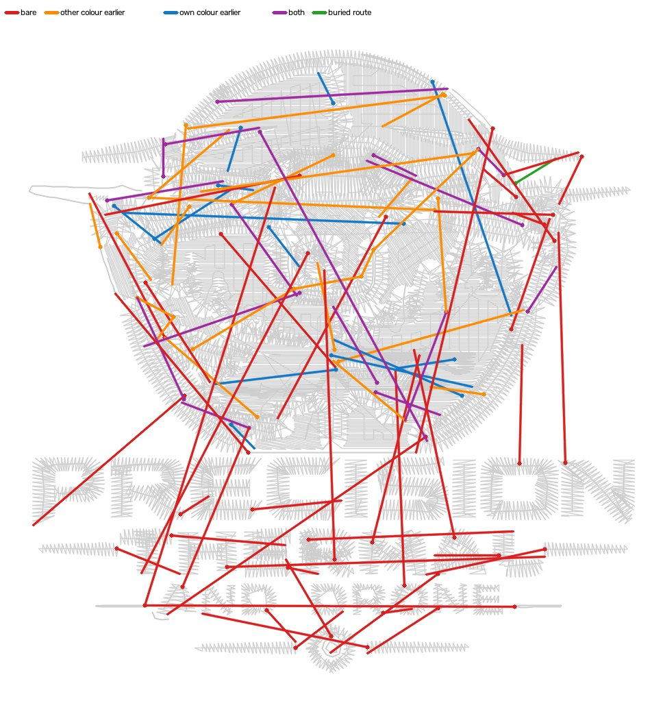

# Buried walk between pieces: the walk rule is there, our layout gives it nothing to walk under (2026-10-26)

Queue item W4-03, the third trim item #1072 ranked
(`docs/sequence-like-pro-2026-10-25.md`): on Precision Drone the pro walks
about a metre needle-down between pieces and cuts 38 times for 84 pieces; we
walked 135 mm and cut 82 times for 90. The brief's likely build was "let a
between-piece hop walk needle-down when later thread covers every millimetre
of it, up to a length the pro's walks justify". Measured first. **The premise
is false, and nothing was built.** We already have that rule, and it already
uses his length. `trim_bury_under_later` has been ON since 2026-10-23, and its
detour budget is 2.5 times the hop against his p90 of 2.57. Across the five
jobs, not one of our between-piece cuts has a route under later thread, at any
length. The pro walks because of how his layout is built. He lays the badge
back to front in 23 colour blocks of 8 cones, so the gaps in an early block
have later colours over them. Ours is a knock-out in 11 blocks of 6 cones, and
the thread over our gaps is sewn earlier, or there is none.

## Instrument

`digitizer/tools/between_walks.py`, new, pinned by `tests/test_between_walks.py`
on hand-built DSTs and plans. Two readings.

**Both DSTs, one reader** (`read_steps`, each file in its own frame, DST
never PES). Pieces and visits are `tools/sequence_pro.py`'s, so a step here is
that tool's piece-to-piece move. Every step is `cut` (a TRIM on the way),
`flown` (needle-up, no trim) or `walked` (needle-down the whole way). Every
walked stitch is sampled every 0.1 mm at its centre and both thread edges,
stage 7's `_UnderThread` samples, against the file's other thread:

- `buried`: all three under a centreline sewn LATER (or within a thread width
  of the step's ends, stage 7's end allowance). Split by the covering block,
  `same` colour or a `later` one, and by covering stitch (`zigzag` or
  `straight`).
- `on_work`: not buried, but all three under some thread sewn before or after.
  `on_own` is the part on this block's own thread. `edge` is the part whose
  centre is buried while a thread edge is not.
- `bare`: the rest.

**Our plan** (`diagnose_plan`). For every cut left inside a colour block, it
asks whether a route exists under thread sewn after the cut. The cover is
stage 7's own (`_later_thread_burier` on the finished blocks) and so is the
raster (`_bury_route`'s mask, eroded the same way). The search has NO length
budget, over the hop's box grown by up to 15 mm. The classes:

- `takes_now`: stage 7's `bury(k)` takes the hop on the finished layout.
- `gap_cap`: a route exists, but the hop is longer than `LINK_MAX_GAP_MM`
  (40 mm).
- `budget`: a route exists, longer than `_link_budget_mm(gap)`.
- `in_budget`: a raster route exists inside the budget, but the exact test
  refuses it.
- `no_route`: nothing under later thread joins the two ends. The cheapest
  route that leaves the later thread least (`off_mm`) is then split by what
  that part lies on. `off_on_own_mm` is this colour's own earlier stitches,
  which only the shape order inside the colour could fix.
  `off_on_earlier_mm` is another colour sewn earlier, which needs a colour
  order change. `off_bare_mm` is fabric, which no order fixes.

## The pro's walks, over his 28 DSTs

12 of the 28 files walk between pieces. Walks fully under later thread
(bare + on-work under 0.5 mm): 331. Becker (5 files), Gaulke roofing (4),
Machine (3), Tires and the beanies walk nothing; MFab 2.9 mm.

| clean buried walks | n | walk mm p50 / p90 / max | straight hop mm p50 / p90 / max | walk / hop p50 / p90 / p95 / max | mm per stitch p50 / p90 |
|---|---|---|---|---|---|
| all | 331 | 1.3 / 14.7 / 97.9 | 1.3 / 11.9 / 26.7 | 1.00 / 1.14 / 1.62 / 7.60 | 1.20 / 1.72 |
| hop over 3 mm | 75 | 14.0 / 40.9 / 97.9 | 10.8 / 19.6 / 26.7 | 1.07 / 2.57 / 3.83 / 7.60 | 1.45 / 2.81 |

Against stage 7's own limits, `_link_budget_mm` = max(14, 2.5 x hop), capped
at 72 mm (36 stitches at 2 mm). His p90 detour is 2.57, so the budget sits on
it. His longest straight hop (26.7 mm) is inside `LINK_MAX_GAP_MM`. 11 of
his 331 walks (3%) are past our budget. Fremont hat and patch each have 40.9
/ 43.4 / 47.9 mm for hops of 16.0 / 16.9 / 16.3 mm (2.6-2.9x). Drone has
37.1 for 4.9, 40.5 for 12.9 and 97.9 for 15.8. Gaulke plowing's hat and
beanie each have 37.0 for 6.8. That is the most a looser budget could copy.
It cannot copy them here, because our layout has no buried route in the
first place (below).

What he walks UNDER: the later colours, 357 of Drone's 541 buried mm and 191
of Fremont's 211. On Fremont that is later satin (204 mm under zigzag).

Half his walking is not buried. On Drone, 480 of 1,022 mm lies on work. Of
that, 132 mm has its centre buried with an edge out, and 101 mm lies on his
own colour's earlier thread (the two can overlap). The picture shows what
most of it is. The orange stretches in his x-ray trace the drone body's
run-stitch OUTLINE, which is design thread: block 17, black, 572 stitches, an
11 mm² footprint and 466 mm of "walk". The piece rule opens a lone run line
away by construction, so an outline reads as a walk. Only the green
stretches are travel. They are the long walks inside the round badge, under
the blocks he lays on top. Bare: 0.7 mm in a metre, which is sampling slack.
He never walks on fabric.

## The five jobs

Tree `main` 46949f78. Hat preset, the Studio's request (`tools.pro_pair`),
stages 0-4 once per job, `plan_stitches` per arm. `off` = main's defaults,
which include `trim_bury_under_later`, ON since 2026-10-23. `cut` = plus
`cut_every_jump`, #1072's arm. Trims are TRIM records read from the DST by
`sequence_pro` (a block's opening lift after a colour change is not counted,
same as #1072). The plan column counts cuts between two different shapes:
`n: route / other colour only / own colour only / both / some bare`.

| job | side | trims | pieces | between pieces: cut / flown / walked | walked mm: buried / on work / bare | our between-piece cuts (plan): route under later thread / blocked by: other colour sewn earlier only / own colour only / both / some bare | exposed travel mm | bare thread mm | stitches |
|---|---|---|---|---|---|---|---|---|---|
| Fremont hat 92.5 | pro | 20 | 47 | 19 / 0 / 22 | 217.8: 211.1 / 6.6 / 0.0 | n/a |  |  | 17067 |
|  | off | 28 | 46 | 18 / 25 / 18 | 15.9: 13.1 / 2.8 / 0.0 | 26: 0 / 8 / 6 / 12 / 0 | 28.9 | 0.0 | 17381 |
|  | cut | 28 | 43 | 18 / 0 / 28 | 38.2: 20.9 / 17.3 / 0.0 | 26: 0 / 8 / 6 / 12 / 0 | 28.9 | 0.0 | 17396 |
| Becker hat 101.9 | pro | 9 | 13 | 8 / 0 / 0 | 0: 0 / 0 / 0 | n/a |  |  | 12356 |
|  | off | 19 | 10 | 11 / 0 / 0 | 11.5: 0.0 / 0.0 / 11.5 | 10: 0 / 0 / 0 / 0 / 10 | 13.3 | 0.0 | 7859 |
|  | cut | 22 | 10 | 11 / 0 / 0 | 11.5: 0.0 / 0.0 / 11.5 | 10: 0 / 0 / 0 / 0 / 10 | 13.3 | 0.0 | 7871 |
| MFab hat 104.9 | pro | 18 | 21 | 15 / 0 / 2 | 2.9: 2.1 / 0.9 / 0.0 | n/a |  |  | 17568 |
|  | off | 51 | 45 | 35 / 11 / 26 | 197.4: 50.1 / 102.8 / 44.6 | 39: 0 / 3 / 2 / 3 / 31 | 18.8 | 2.57 | 10902 |
|  | cut | 66 | 45 | 45 / 0 / 27 | 204.0: 51.0 / 105.6 / 47.4 | 51: 0 / 5 / 5 / 3 / 38 | 18.8 | 0.62 | 10963 |
| Drone 62.6 | pro | 58 | 84 | 37 / 0 / 70 | 1021.7: 540.8 / 480.2 / 0.7 | n/a |  |  | 14552 |
|  | off | 95 | 91 | 73 / 14 / 11 | 55.8: 26.1 / 25.2 / 4.5 | 73: 0 / 23 / 1 / 12 / 37 | 49.6 | 5.45 | 13438 |
|  | cut | 109 | 91 | 83 / 0 / 15 | 66.2: 29.8 / 32.0 / 4.5 | 84: 0 / 25 / 3 / 12 / 44 | 49.6 | 0.93 | 13510 |
| Gaulke hat 114.2 | pro | 41 | 41 | 41 / 0 / 0 | 0: 0 / 0 / 0 | n/a |  |  | 6138 |
|  | off | 31 | 40 | 27 / 13 / 0 | 0.8: 0.3 / 0.3 / 0.2 | 28: 0 / 1 / 1 / 0 / 26 | 16.7 | 5.99 | 7474 |
|  | cut | 45 | 40 | 40 / 0 / 0 | 0.8: 0.3 / 0.3 / 0.2 | 41: 0 / 2 / 2 / 0 / 37 | 16.7 | 0.0 | 7530 |

Over the five jobs (`off`): **0 of 176 between-shape cuts have a route under
later thread, at any length** (`cut` arm: 0 of 212). Inside one shape, 2 of
48 do: Drone's one is a 20.6 mm route for a 4.9 mm hop, over its 14 mm
budget, and Fremont's one stage 7 takes on the finished layout. Our walking
between pieces: 281 mm over the five jobs, against his 1,242. On Drone today
the `cut` arm reads 83 cut steps, 66 mm walked, 91 pieces (#1072 read 82,
135 mm, 90 on `a7a7259f`). The DST column counts steps between PIECES
(footprints); the plan column counts cuts between two SHAPES, so the two can
differ.

## Drone, where the gap is

Split at 62% of the design's height, between the badge and the lettering
(the counts are the same at 60% and 66%):

| | pro: cut / walked steps, walked mm | ours `off`: between-shape cuts | ours: blocked by |
|---|---|---|---|
| lettering | 27 / 0, 0 mm | 28 | all 28 on bare fabric |
| badge | 10 / 70, 1,022 mm (541 buried) | 45 | 23 other colour sewn earlier only, 2 own colour, 11 both, 9 some bare |

In the lettering we are at parity: he cuts letter to letter on bare fabric,
and so do we. The whole Drone gap is in the badge: 45 cuts against his 10.

His badge is built back to front. Block 4 (dark grey #293133, 1,633
stitches, 540 mm², the badge ground) sews 3 pieces with 0 trims, joined by 316
mm of walking, every millimetre under later thread. Then 18 more blocks lay
the drone on top. Over the whole file he loads dark grey six times, black
four, mid grey three and orange four: 23 blocks of 8 cones. We sew 11 blocks
of 6 cones in a knock-out layout. Three cones come back once more for
satin-heavy blocks, and two run-only blocks (the edge cap among them) go
last. Over all 73 of Drone's
between-shape cuts, the best routes spend 670 mm off later thread. 407 mm of
that lies on colours sewn BEFORE, 80 on the cut's own colour, and 184 on
nothing.



Red: some bare fabric. Orange: only another colour sewn earlier. Blue: only
this colour's own earlier stitches. Purple: both. Green: a buried route
exists. The pro's x-ray (his walks green where buried, orange on work) is in
the session scratch, not committed: his file, public repo.

## What it means

1. **The rule the brief asked for exists and is already ON.**
   `trim_bury_under_later` buries a cut hop under later thread with a detour
   budget at his p90, and `cut_every_jump` walks sub-trim jumps on work. A
   longer budget would reach none of our cuts: 0 have a route at any length.
2. **What stops us is the layout, not stage 7.** Over the five jobs, a
   between-shape cut's best route leaves the later thread over the own
   colour's earlier work (Fremont 91 mm, Becker 96, MFab 93, Drone 80,
   Gaulke 82), over another colour sewn earlier (Fremont 128, MFab 223,
   Drone 407), or over bare fabric (Becker 101, MFab 133, Drone 184, Gaulke
   87).
3. **The pro's lever is layering plus colour revisits**: 23 blocks against
   our 11 on Drone, a colour's pieces sewn early and covered by what comes
   later. That is construction upstream of stage 7. Stage 5 plans every
   underlap against the layer order, and `depth_sort_layers` / borders-last
   set that order, so a reorder in stage 7 would put seams on the wrong side
   of every boundary (`stage7_sequence`'s module docstring). It is also
   LAYOUT, which Kent judges from renders (2026-10-22). Not built here.
   The existing layering flag does not reach it either. On Drone with
   `silhouette_underfill` ON, plan trims go 106 to 100. Between-shape cuts
   stay at 73, still 0 with a buried route (DST between-piece cut steps 73
   to 72), and exposed travel goes 49.6 to 44.5 mm. That flag lays ONE
   under-fill, and the colours on it still sew in knock-out.
4. **The one cheap thing would break gate 3.** That is walking the off-cover
   stretch on our own colour's finished thread, which the pro does too (101
   mm on Drone). `tools/travel_cover` counts thread that nothing sews after
   as exposed, and the brief's rule is that exposed travel must not rise. So
   it is the ROADMAP gate 3 instrument's call, not a build.

## Gates

Nothing in the engine changed, so there is no OFF/ON, no exposure delta and
no pin. The tool reads files and plans. Gate 4: no agreement figure is
quoted. The pro's census thresholds come from his 28 DSTs, with the counts
above.

## Reproduce

```
cd digitizer
python -m tools.between_walks "<pro>.DST" ours.dst [--steps] [--json OUT]
python -c "import pickle; from tools import between_walks as bw; print(bw.diagnose_plan(pickle.load(open('plan.pkl','rb'))))"
```

Ours: `tools.pro_pair.request(width, "hat_front", {})` through the service
parser, `build_generation` + `finish_generation`, then `plan_stitches(result,
cfg)` per arm and `digitizer_core.export.write_dst(plan, "ours.dst")`.
