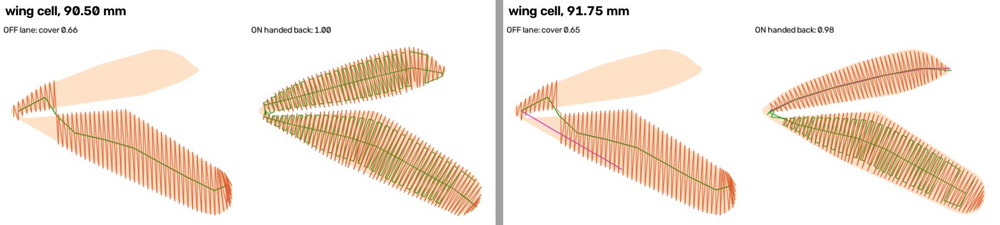
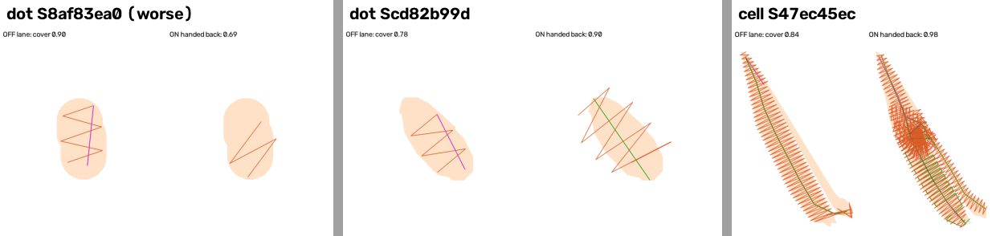
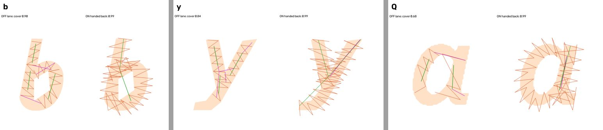
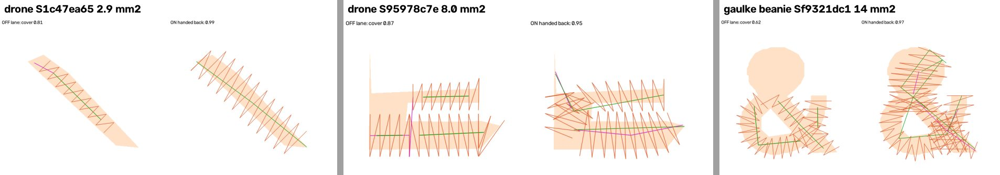

# Column-lane cover hand-back: census before any flip (2026-11-13)

`lettering_columns_cover_handback` (#1445) shipped **built OFF**, per Kent's ruling of 2026-11-13 ("Hand-back, built
OFF"). With the flag ON, a text-tagged shape that the Column lane covers under 0.90 (`columns.satin_cover`) is handed
back to the ordinary satin/fill ladder. This census measures what ON would do on real lettering. Flipping it is Kent's
call.

**Answer: ON, as built, is not recommended.**
- It does what it was built for: the monarch's misread wing cell, and the Gaulke beanie's '&' bowl that the lane leaves
  bare.
- But on every shape under about 8 mm² it hands back, the ladder's satin overshoots the shape. It sews about one more
  shape's area of thread **outside** it.
- The chance-corrected word cc does not move. The board's reach (built from cc) **falls** on the one pair it measures,
  precision_drone.

## Method

- **Jobs, with the target width beside each:**
  - every lettering-board pair: Becker × 5, Hotel Fremont × 2, MFab × 2, ProSeal × 2, Precision Drone, Tires, Gaulke
    × 3, each at the pro's width;
  - the 9 `testdata/art/commons_lettering` logos at 80 mm;
  - typed lettering at 80 mm: 4 outline fonts (montserrat, montserrat-bold, open-sans, open-sans-bold) × "Hotel
    Fremont", "PRECISION DRONE", "Marine 1895";
  - the starter monarch at 90.50 / 91.75 mm and the owl at 79.2 / 79.6 / 80.8 / 81.6 mm.
- **Flag ON first, everywhere.** A hook on `stage7_sequence.satin_cover` logs every hand-back: the lane's runs, the
  ladder's runs, and the shape's tags. A job with no hand-back is byte-identical to OFF by construction, so OFF was run
  only where something was handed back.
- **Two figures per hand-back,** each with every satin/fill stitch widened 0.2 mm a side:
  - **cover**: the share of the shape inside the thread;
  - **spill**: thread **outside** the shape, as a share of the shape's area. `satin_cover` cannot see spill.
- **Board:** `tools/lettering_board`, ON across all 16 pairs. Main's defaults were then run on the two pairs that hand
  back, and compared with `--compare`. The code was main `8ca63a25` (#1445's branch). Rendered and measured, not sewn:
  gate 1 applies.

## Where it hands back

| Job (target mm) | Lane shapes | Handed back |
|---|---|---|
| 14 of 16 board pairs (Becker × 5, Fremont × 2, MFab × 2, ProSeal × 2, Tires, Gaulke hat / LC) | many | **0** |
| precision_drone (pro width) | — | 2 |
| gaulke_roofing_beanie (pro width) | — | 1 |
| commons: 8 of 9 logos (80) | 0-35 | **0** |
| commons: bukit_asam (80) | 18 | 3 |
| typed: 12 jobs (80) | 11-14 each | **0** |
| monarch 90.50 / 91.75 | 26 / 28 | 5 / 2 |
| owl 79.2 / 79.6 / 80.8 / 81.6 | 3 each | **0** |

**The owl is not helped.** The lane already covers its three tagged black shapes at 0.90 or more. So the −4.5% black
at those widths ([`monarch-size-cliff-2026-11-13.md`](monarch-size-cliff-2026-11-13.md)) has another cause, and it is
still untraced.

## Each hand-back

| Job | Shape | mm² | What it is | Cover, lane → ladder | Spill, lane → ladder |
|---|---|---|---|---|---|
| monarch 90.50 | Sfe1be372 | 118.2 | the V wing cell | 0.66 → **1.00** | 0.12 → 0.23 |
| monarch 91.75 | Sfe1be372 | 121.5 | the same | 0.65 → **0.98** | 0.11 → 0.06 |
| monarch 90.50 | S47ec45ec | 48.6 | wing cell | 0.84 → 0.98 | 0.24 → 0.33 |
| gaulke_roofing_beanie | Sf9321dc1 | 14.0 | '&': the lane leaves its top bowl bare | 0.62 → **0.97** | 0.33 → 0.47 |
| precision_drone | S95978c7e | 8.0 | a lettering-group shape | 0.87 → 0.95 | 0.84 → 0.90 |
| bukit_asam | S6a7ee6a1 | 4.4 | letter 'b' | 0.90 → 0.99 | 0.35 → **0.98** |
| bukit_asam | S1dd25151 | 3.7 | letter 'y' | 0.84 → 0.99 | 0.35 → **1.20** |
| bukit_asam | Sa7e6e35c | 3.4 | letter 'a' (OCR 'Q') | 0.68 → 0.99 | 0.28 → **1.24** |
| precision_drone | S1c47ea65 | 2.9 | a thin bar | 0.81 → 0.99 | 0.33 → **1.82** |
| monarch 90.50 / 91.75 | four white dots | 1.0-1.2 | wing dots | 0.78-0.90 → 0.69-0.93 | 0.24-0.30 → **0.23-1.10** |

One dot gets **worse** on both figures: S8af83ea0, cover 0.90 → 0.69.

Read by eye:
- **Large shapes improve.** The wing cell sews both arms, and the '&' gets its bowl.
- **Small letters get worse.** The ladder's zigzag runs past the letter's edges and across its counter: 'b', 'y', 'a',
  the drone bar.
- The ladder is the satin a shape gets **untagged**. On a 3-4 mm letter that is exactly what the lettering lane exists
  to replace.

There is a clean gap in the data:
- Every hand-back that helps is **14 mm² or more**.
- Every one that hurts is **8 mm² or less**.

That is n = 10, so it is a lead, not a rule.

## Board, OFF → ON (the two pairs that hand back)

| Pair | Band | Figure | OFF → ON | Pro |
|---|---|---|---|---|
| all | 4-6 mm | word cc (chance-corrected) | +0.82 → +0.82 | +0.97 |
| all | < 4 mm | word cc (chance-corrected) | +0.00 → +0.00 | +1.00 |
| precision_drone | 4-6 mm | reach (octaves) | 2.06 → **1.64** | 3.38 |
| gaulke_roofing_beanie | 4-6 mm | columns / stitches | 68 → 69 / 3,025 → 3,062 | 68 / 3,348 |

The other 14 pairs hand back nothing, so their board figures are identical by construction.

## Options for Kent

1. **Keep OFF, record (no build).**
   - Cost: none.
   - Catch: the monarch still loses its wing cell at 90.50 / 91.75 mm, and the Gaulke beanie's '&' bowl stays unsewn.
2. **Flip ON as built.**
   - Delivers: both of those.
   - Catch: every small letter or dot it hands back is sewn with spill of about one shape-area outside (bukit 'b' / 'y'
     / 'a', the drone bar, monarch dots). Drone reach falls 0.43 octaves, and cc does not move.
   - Not recommended.
3. **Narrow the hand-back to large shapes, built OFF, then re-census (my pick).**
   - What: hand back only shapes above an area floor, for example 10 mm², placed in the gap between 8 and 14 mm². Or
     only when the ladder does not spill more than the lane, which reads the harm directly but needs the ladder sewn
     first.
   - Cost: one small PR plus this census again, about 2 hours of laptop time.
   - Catch: a new constant, chosen from n = 10. The '&' (14 mm²) sits near the edge.
4. **Fix the lane where it drops a branch.**
   - What: the '&' bowl and the V cell are both branches the Column lane's cut does not sew.
   - Delivers: the most principled fix. Real letters keep the lane's construction.
   - Cost: an R&D build in `columns.py`; days, not hours.
