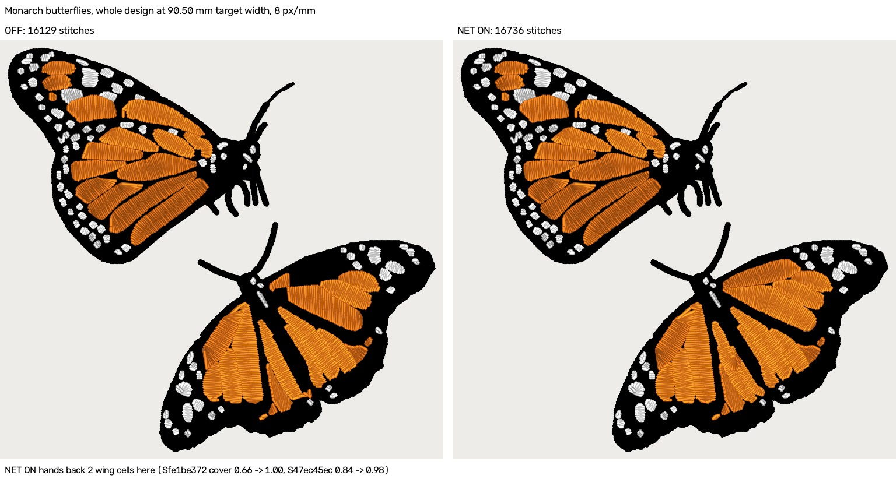
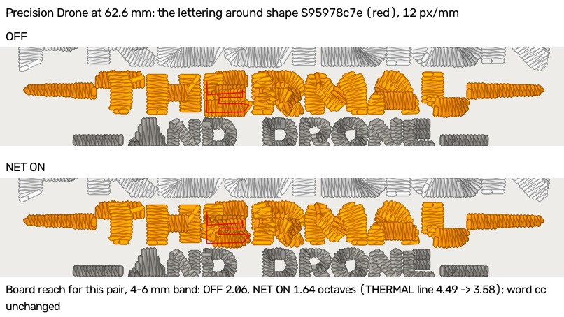
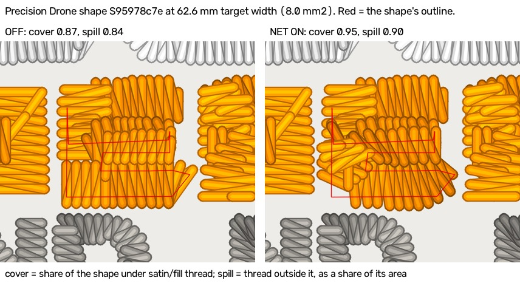
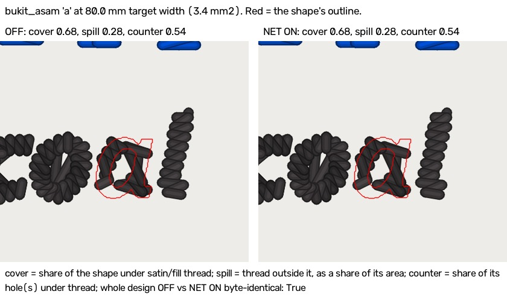

# Column-lane cover hand-back, narrowed: description and confirmation (2026-11-13)

Kent's ruling on the first census ([`column-cover-handback-census-2026-11-13.md`](column-cover-handback-census-2026-11-13.md)),
2026-11-13: **"Narrow it, re-census"**. The flag `lettering_columns_cover_handback` stays **OFF**, and flipping it is
Kent's call.

The rule below is a **foreman's decision, not a Kent ruling**. Among three candidates (STRICT, NET, a 10 mm² floor),
the foreman picked NET.

## Ruling, 2026-11-14: "Keep OFF, record"

Kent ruled on 2026-11-14 after seeing the OFF vs NET ON sheets below: **"Keep OFF, record"**.

- `lettering_columns_cover_handback` stays **OFF**.
- No flip, no further narrowing, and no 10 mm² floor build.
- The code (#1445, #1484) stays in the tree, built OFF.

The reason, as measured:
- **NET fails its own pass line on the 13 shapes it was chosen on.** Drone reach falls 2.06 → 1.64 octaves (4-6 mm
  band), all from one 8 mm² shape: the 'E' of THERMAL.
- **The fresh run left it untested:** 158 jobs, 51 candidates, **1 hand-back**. That one is the monarch wing cell at
  91.8 mm, a re-sighting of a shape the rule was chosen on.

**Open items, recorded and NOT tasked:**
- The monarch loses its V wing cell at 90.50 / 91.75 mm targets
  ([`monarch-size-cliff-2026-11-13.md`](monarch-size-cliff-2026-11-13.md)).
- The Gaulke beanie's '&' bowl stays bare (93.8 mm, the pro's width).
- The owl's −4.5% black at 79.2 / 79.6 / 80.8 / 81.6 mm is untraced (section at the end).
- **The principled route nobody has built:** the first census's option 4, which is to fix the Column lane where it
  drops a branch. The '&' bowl and the V cell are both branches the lane's cut does not sew. A hand-back swaps whole
  shapes onto the ladder instead of sewing the missing branch.
  - Kent's eye on the Gaulke '&', 2026-11-14, verbatim: **"the & was better on"**. Asked whether that changes the
    ruling, he chose **"Record my eye, stay OFF"**.
  - *Interpretation, not his words:* this is evidence that sewing the dropped branch is worth doing. It also suggests
    the counter (holes) figure overstates the harm on this shape.

### The sheets Kent ruled on

These are OFF vs NET ON, each pair digitized fresh. The Gaulke '&' sheet is a board pair's art, so it stays in
gitignored `pro_renders/` and is not committed.

Read by eye:
- **Monarch:** the lower butterfly's V cell is bare under OFF and filled under NET ON.
- **Drone:** the THERMAL 'E' turns from stacked bars into a criss-cross ladder.
- **Bukit 'a':** identical, and the whole design is byte-identical OFF vs ON.
- **Gaulke '&'** (93.8 mm, not committed): the bowl is sewn, but thread covers half the counter. Cover 0.62 → 0.97,
  counter 0.23 → 0.50.
  - **Kent judged the ON render better by eye** despite the smaller counter, verbatim: "the & was better on".
  - The ruling stays OFF ("Record my eye, stay OFF").

## In short

- **The 13 shapes NET was chosen on (a description, not a test):**
  - NET hands back 5: the monarch wing cells at 90.50 and 91.75 mm, a second monarch wing cell, the Gaulke '&', and
    the drone's 8 mm² shape.
  - It keeps every small letter and dot the first census flagged.
  - **It still fails the board half of the pass line:** drone reach falls 2.06 → 1.64 octaves (4-6 mm band), all of
    it from the 8 mm² shape.
  - The '&' hand-back lays thread over its counter (holes 0.23 → 0.50).
  - STRICT hands back only the 91.75 mm cell; the 10 mm² floor hands back 4. Neither moves a board figure.
  - Chance-corrected word cc does not move under any of the three.
- **Fresh material (158 jobs, none seen before):**
  - 51 candidates, and NET hands back **1**: the same monarch wing cell at 91.8 mm, 0.05 mm from a width it was chosen
    on.
  - **Too few fresh hand-backs to say anything, so the confirmation stops here.**
  - NET kept all 50 other candidates, every one 7.96 mm² or smaller.
- **Cost:** the trial took at most 1.03 s and 3.3% of a job.
- **Renders:** none new. The only fresh hand-back is the wing cell already rendered in the first census.

## The rule (`columns.handback_wins`, `HANDBACK_RULE = "net"`)

1. The Column lane sews a text-tagged shape and covers under 0.90 of it (`satin_cover`).
2. The ordinary ladder is then sewn ONCE as a trial, as the shape would sew untagged.
3. The ladder's runs replace the lane's only when the ladder puts **at least as much new thread inside the shape as it
   adds outside it**:
   - cover gain ≥ spill gain, measured as satin and fill thread widened 0.2 mm a side;
   - and its cover is higher than the lane's.
4. Otherwise the lane's runs stand, and the trial leaves nothing behind.

There is no fitted constant.

## Pass line, committed BEFORE the confirmation run

For every shape the narrowed rule hands back on fresh material:

> **per shape cover gain ≥ spill gain; no board figure worse; OFF byte-identical**

**The per-shape half is true by construction.** It is the rule itself, so it cannot fail. The confirmation therefore
also reports a check that **no rule reads**: thread laid over the shape's own holes, which means a counter sewn shut.
Every fresh hand-back is also rendered for the eye.

**Fresh material** means shapes the rule was not chosen on:
- every starter design across its ±2% width sweep (9 widths each, its pack config);
- the 9 commons lettering logos at 65 and 100 mm;
- the Becker, Fremont, Drone and MFab art at 70 and 110 mm;
- typed lettering (4 outline fonts × 3 texts) at 50 and 120 mm.

None of these widths was used in the first census. If the fresh hand-backs are too few to say anything, the count is
reported and the confirmation stops there.

## Part 1: the 13 candidates (a DESCRIPTION, not a test)

The rule was chosen after looking at these same 13 shapes, so how it scores on them describes the choice. It does not
test it.

Engine `55292112` (flag ON, NET), re-run on the first census's jobs at their widths: monarch 90.50 / 91.75 mm,
bukit_asam 80 mm, and the two board pairs (precision_drone at 62.6 mm, gaulke_roofing_beanie at 93.8 mm, pro width).
Cover and spill are satin and fill thread widened 0.2 mm a side, as a share of the shape's area. The engine handed
back exactly the 5 shapes NET picks offline.

| Job (target mm) | Shape | mm² | What it is | Cover, lane → ladder | Spill, lane → ladder | NET | STRICT | ≥ 10 mm² |
|---|---|---|---|---|---|---|---|---|
| monarch 90.50 | Sfe1be372 | 118.2 | V wing cell | 0.66 → 1.00 | 0.12 → 0.23 | **back** | kept | **back** |
| monarch 91.75 | Sfe1be372 | 121.5 | the same | 0.65 → 0.98 | 0.11 → 0.06 | **back** | **back** | **back** |
| monarch 90.50 | S47ec45ec | 48.6 | wing cell | 0.84 → 0.98 | 0.24 → 0.33 | **back** | kept | **back** |
| gaulke_roofing_beanie (93.8) | Sf9321dc1 | 14.0 | '&' | 0.62 → 0.97 | 0.33 → 0.47 | **back** | kept | **back** |
| precision_drone (62.6) | S95978c7e | 8.0 | lettering-group shape | 0.87 → 0.95 | 0.84 → 0.90 | **back** | kept | kept |
| precision_drone (62.6) | S1c47ea65 | 2.9 | thin bar | 0.81 → 0.99 | 0.33 → 1.82 | kept | kept | kept |
| bukit_asam (80) | S6a7ee6a1 | 4.4 | 'b' | 0.90 → 0.99 | 0.35 → 0.98 | kept | kept | kept |
| bukit_asam (80) | S1dd25151 | 3.7 | 'y' | 0.84 → 0.99 | 0.35 → 1.20 | kept | kept | kept |
| bukit_asam (80) | Sa7e6e35c | 3.4 | 'a' (OCR 'Q') | 0.68 → 0.99 | 0.28 → 1.24 | kept | kept | kept |
| monarch 90.50 | S8af83ea0 | 1.0 | wing dot | 0.90 → 0.69 | 0.24 → 0.23 | kept | kept | kept |
| monarch 90.50 | Scd82b99d | 1.2 | wing dot | 0.78 → 0.90 | 0.24 → 1.10 | kept | kept | kept |
| monarch 90.50 | S4fe91286 | 1.2 | wing dot | 0.83 → 0.93 | 0.30 → 0.99 | kept | kept | kept |
| monarch 91.75 | S36892fda | 1.2 | wing dot | 0.77 → 0.90 | 0.24 → 1.07 | kept | kept | kept |
| **hands back** | | | | | | **5** | **1** | **4** |

**Thread over the shape's own holes, a check no rule reads:** of NET's 5, only the '&' has holes, and its holes go
**0.23 → 0.50** covered. The ladder lays thread across the '&''s counter. The first census's render shows the bowl
sewn, and this figure says part of that thread lands in the counter. The area floor hands it back too; STRICT does not.

**Board, chance-corrected (the two board pairs with candidates; the other 14 pairs have none, so they are identical by
construction):**

| Pair | Band | Figure | OFF | NET | STRICT | ≥ 10 mm² | Pro |
|---|---|---|---|---|---|---|---|
| all | 4-6 mm | word cc | +0.82 | +0.82 | +0.82 | +0.82 | +0.97 |
| all | < 4 mm | word cc | +0.00 | +0.00 | +0.00 | +0.00 | +1.00 |
| precision_drone | 4-6 mm | reach (octaves) | 2.06 | **1.64** | 2.06 | 2.06 | 3.38 |
| precision_drone THERMAL | 4-6 mm | reach (octaves) | 4.49 | **3.58** | 4.49 | 4.49 | 3.31 |
| gaulke_roofing_beanie | 4-6 mm | reach (octaves) | 3.81 | 3.81 | 3.81 | 3.81 | 3.89 |
| gaulke_roofing_beanie | 4-6 mm | columns / stitches | 68 / 3,025 | 69 / 3,062 | 68 / 3,025 | 69 / 3,062 | 68 / 3,348 |

The NET column was digitized with NET on (`2026-11-13-net`). STRICT and the floor were not digitized separately on
the board:
- STRICT hands back nothing on either pair, so its column is OFF.
- The floor hands back the '&' and not the drone shape, so its column is NET's Gaulke and OFF's drone.

**Against the pass line, NET fails its board half on these 13:** drone reach falls 0.43 octaves, all of it from the
one 8 mm² shape S95978c7e. That shape goes 0.87 → 0.95 cover and 0.84 → 0.90 spill, so NET's rule admits it. The
area floor and STRICT keep it, and no board figure moves for them.

## Part 2: fresh confirmation

Engine `e09eb093` (the pass-line commit; same code as `55292112`), flag ON, NET. There were 158 jobs with **0 errors**:

| Material | Jobs | Target widths (mm) |
|---|---|---|
| 12 starter designs × 9 widths | 108 | each design's pack target −2% to +2% in 0.5% steps, with its pack config |
| commons lettering logos × 2 widths | 18 | 65 and 100 |
| Becker / Fremont / Drone / MFab art | 8 | 70 and 110 |
| typed lettering (4 outline fonts × 3 texts) | 24 | 50 and 120 |

- **Candidates** (the lane covers a tagged shape under 0.90, so the ladder is sewn as a trial): **51**. They came from
  baseball, monarch, jakarta, k_line, Fremont 110, Drone 70 and typed montserrat / open-sans at 50 mm.
- **Hand-backs: 1.** It is the monarch at 91.8 mm, shape Sfe1be372, cover 0.65 → 0.98 and spill 0.11 → 0.07, with no
  holes. **This is the same V wing cell the rule was chosen on (91.75 mm), 0.05 mm away**, so it is not a fresh
  shape.
- **Fresh hand-backs: effectively 0. Too few to say anything, so the confirmation stops here, as stated in advance.**
  The pass line is neither met nor failed on fresh material, and NET stays untested outside the shapes it was chosen
  on. No board pair is in the fresh set, so the board half was not exercised either.

**The other 50 candidates were kept on the lane.** Every one is 7.96 mm² or smaller:
- **5** monarch wing dots would have LOST cover on the ladder;
- **45** gain less cover than spill: the ladder's spill on them is **0.77-2.13** of the shape's area. They are
  baseball letters, monarch dots, jakarta / k_line letters, Fremont 'E' and '8' at 110, a Drone 70 bar, and typed
  letters at 50 mm;
- two of them would also have sewn their counters shut: k_line 'A' at 100 mm (holes 0.34 → **1.00**), and two
  typed open-sans "Hotel Fremont" shapes at 50 mm (0.22 → 0.50).

So NET does what the first census asked on fresh small shapes: it kept every one of them. The single hand-back is a
re-sighting of a shape it was chosen on.

## Runtime cost of the trial

The trial runs only when the lane covers a tagged shape under 0.90. It sews that shape a second time, as the ordinary
ladder, before `handback_wins` decides. With the flag OFF the cover check short-circuits, so OFF costs nothing.

Timing (the ladder trial only, not the decision's buffer measure), on a laptop shared with other workers:
- Over the 158 fresh jobs plus the 13-shape jobs: **29 jobs ran at least one trial**.
- Per job: median **0.07 s**, max **1.03 s** (typed open-sans "Hotel Fremont" at 50 mm: 6 trials in a 31.4 s job).
- Per trial: median 0.04 s, max 0.39 s.
- **At most 3.3% of a job's time.**
- Whole jobs took 13.6-1,929 s. The slow tail (bumblebee 81.3 at 1,929 s against 280-360 s for its neighbours) is
  laptop contention, not the trial: bumblebee ran no trial.

## Open item (not a task)

**The owl's −4.5% black** at targets 79.2 / 79.6 / 80.8 / 81.6 mm is still untraced. Three black shapes are tagged as
lettering at those widths, but the lane already covers them at 0.90 or more. So neither version of the hand-back
touches them, and the loss has another cause ([`monarch-size-cliff-2026-11-13.md`](monarch-size-cliff-2026-11-13.md)).
