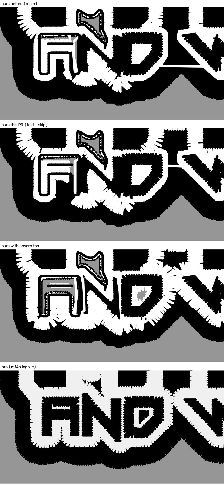

# The MFab extras ride the gate (2026-10-26)

Kent's ruling on the wave-3 flip sheet, 2026-10-26, verbatim: **"MFab extras
into the gate"**. The option he picked read:

> Adds the sliver fold, fragment absorb, covered-shape skip and the black
> outer edge to the MFab-only gate, so only MFab-type art changes. MFab trims
> go hat 37->25 and LC 46->24 (pro 19/20), and MFab gets the pro's closed
> black edge. Catch: on the hat, thread travel over finished fill rises
> 23->43 mm (none on bare garment).

## The change

`white_keyline_art.RECIPE` gains `keyline_fold_slivers` and
`skip_covered_shapes` (#1102). The black outer edge,
`silhouette_underfill_rim` (#1096), was in the recipe already.

**Fragment absorb (`cfg.extra["absorb_fragments"]`, #1100) is held out.** In
the recipe it bares the garment inside the letter counters under AND /
WELDING / LLC (below). This PR proposes shipping the other three without it.
Adding it later is one entry in the recipe, once its defect is fixed.

- **What fires the gate is unchanged.** `detect` is untouched, so the verdict
  on every job is what it was. The non-MFab verdicts were not re-run for this
  PR, since adding a switch to the recipe cannot move a verdict. On today's
  base 12 of the 20 still read False; #1108 measured all 20.
- **Any other art is unchanged.** `apply(cfg, False)` returns the same
  config object, so a job the gate does not fire on sews exactly as before.
- **Where they act.** Both switches act inside `plan_stitches`, where the
  verdict is folded into the config.

## Measured together

**Base:** `tools/arm3`-style arms, scratch. MFab is digitized once per job,
then each arm plans with its own recipe. The base is main `65fd6ce2`, before
#1112 and #1121 flipped `sew_enclosed_white`, `outline_loop_mitre`,
`fine_bars_satin` and `small_text_bay_mouth`. The first two were already in
the gate.

- **"Before" is main's default byte for byte:** hat DST `a4841a68`, LC
  `f41029f4`, the #1108 proof's own.
- **One reader on all three files:** stitches, trims and colour changes come
  from `tools/sequence_pro.read_file` on ours and on the pro's DST.
- **Cut locations:** by the run each cut follows (#1102's `measure.py`).

**Two exposure reads:**

- **Exposed travel:** `tools/travel_cover` on our plans.
- **Exposed walk:** one DST rule on both files. A walk is >= 3 non-reversing
  1.0-3.5 mm steps that are not a fill row. It counts as exposed where no
  later thread lies within 0.2 mm of its centre and both edges.

**New bare garment** is garment no thread of the arm covers that "before"
covered: 0.4 mm threads on a 0.1 mm grid, patches >= 0.15 mm2.

| | DST trims | stitches | colour changes | white loop cuts | panel/fill | slivers | under-fill | riders | exposed travel mm | exposed walk mm white / all | new bare mm2 |
|---|---|---|---|---|---|---|---|---|---|---|---|
| hat before (main) | 40 | 21,765 | 2 | 9 | 4 | 16 | 3 | 6 | 22.1 | 8.3 / 8.9 | -- |
| **hat, this PR** | **27** | **20,665** | 2 | 11 | 4 | 2 | 4 | 6 | 34.4 | 8.4 / 17.1 | **0.0** |
| hat, absorb too | 27 | 20,254 | 2 | 14 | 2 | 1 | 4 | 6 | 13.5 | 1.9 / 9.2 | 3.3 |
| hat pro | 18 | 17,568 | 4 | 5 | 1 | 0 | 0 | 13 | n/a | 0.0 / 4.1 | |
| LC before (main) | 52 | 20,849 | 2 | 5 | 3 | 31 | 4 | 8 | 18.6 | 0.3 / 8.6 | -- |
| **LC, this PR** | **27** | **18,471** | 2 | 9 | 2 | 5 | 2 | 8 | 23.3 | 6.0 / 15.5 | **0.9** |
| LC, absorb too | 31 | 18,226 | 2 | 17 | 1 | 3 | 2 | 8 | 15.1 | 4.6 / 14.2 | 8.8 |
| LC pro | 19 | 15,786 | 4 | 6 | 0 | 0 | 0 | 14 | n/a | 0.1 / 0.8 | |

- **Trims:** hat 40 -> 27 and LC 52 -> 27, against the pro's 18 / 19.
  Stitches fall 1.1k / 2.4k.
- **Colour changes are unchanged** at 2 (the pro's 4).
- **The catch the option named is real: travel over finished thread rises.**
  `travel_cover` reads hat 22.1 -> 34.4 mm and LC 18.6 -> 23.3. The DST walk
  read rises on both too. Thread on bare garment (`hairline_travel`) stays 0.0.
- **The LC's 0.9 mm2** is the fold's own: two specks by the A of AND.

The hollow A and the missing N in every one of our panels are main's, not
this PR's (outlined small lettering, a separate open lane). Whole designs:
`lc_whole_before_pr_absorb_pro.jpg`, `hat_whole_before_pr_absorb_pro.jpg`.

## Why absorb is held out: one extra at a time, MFab LC

Each arm adds ONE extra to main's recipe (all five planned from one digitize,
no rembg).

| arm | DST trims | new bare mm2 (>= 0.15 / all) | where |
|---|---|---|---|
| fold | 31 | 0.9 / 1.2 | two specks by the A |
| skip | 46 | 0.0 / 0.0 | |
| **absorb** | 34 | **12.0 / 12.5** | inside the A (9.1), AND's D counter (1.5), WELDING (0.6) |
| all four | 31 | 8.8 / 10.0 | the same places |
| fold + skip (this PR) | 27 | 0.9 / 1.2 | the fold's two specks |

- **Absorb alone opens the counters.** With it in the recipe, the white
  field's own fill all but vanishes: on the LC 17 fill runs become 1, on the
  hat 29 become 0. Before, that fill filled the panel under the riders.
- **The hat confirms it.** Without absorb, no new bare patch reaches
  0.15 mm2. With it, 3.3 mm2 lie in 7 patches, the largest 1.7 mm2 between
  the D and the W.
- **One explanation is refuted.** Keeping the field's own hole rings byte for
  byte through absorb's union (a scratch prototype) did not change it:
  12.9 mm2. The cause is still open.
- **Most likely cause (unproven):** fragments joined at the panel hole's
  edge reshape the hole, so stage 7 no longer recognises it as a rider hole.

## Not done here

- **The merged base.** These arms ran before #1112 and #1121 landed. The
  re-take on today's main waits on the CPU lock and will be added to the PR.
- **Absorb's own fix.** Proposed as follow-up work.
