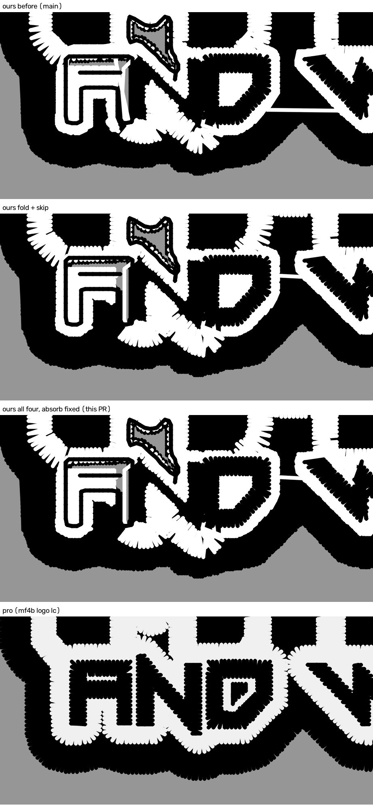

# The MFab extras ride the gate (2026-10-26)

**Kent's rulings, 2026-10-26, verbatim:**

- On the wave-3 flip sheet: **"MFab extras into the gate"**. The option read:

  > Adds the sliver fold, fragment absorb, covered-shape skip and the black
  > outer edge to the MFab-only gate, so only MFab-type art changes. MFab
  > trims go hat 37->25 and LC 46->24 (pro 19/20), and MFab gets the pro's
  > closed black edge. Catch: on the hat, thread travel over finished fill
  > rises 23->43 mm (none on bare garment).

- Then, once absorb was found to bare the counters: **"Hold all four"**.
  The option read: "Nothing ships until absorb is fixed. Catch: MFab keeps
  40 / 52 trims meanwhile."

## The change

1. **The recipe.** `white_keyline_art.RECIPE` gains `keyline_fold_slivers` and
   `skip_covered_shapes` (#1102). `RECIPE_EXTRA` carries
   `cfg.extra["absorb_fragments"]` (#1100). The black outer edge,
   `silhouette_underfill_rim` (#1096), was in the recipe already.
2. **Absorb's panel fix** (`fragment_absorb`, its ON path only). This is what
   bared the counters, and it is fixed here (below).

What does not change:

- **What fires the gate.** `detect` is untouched, so every job's verdict is
  what it was: MFab hat and LC only. #1108 measured all 20 others False; 12
  re-read False on today's base. The rest were not re-run, because adding
  switches to the recipe cannot move a verdict.
- **Any other art.** `apply(cfg, False)` returns the same config object.
- **Absorb OFF.** It never reaches the new code (`test_off_never_reaches_the_new_code`).

## Measured together, on today's main (5cf8da43)

MFab is digitized once per job; each arm then plans with its own recipe
(`arm3.py`, scratch).

- **"Before" is main's default byte for byte:** hat DST `a4841a68`, LC
  `f41029f4`. That is the #1108 proof's own, so #1112 / #1121's flips do not
  move MFab.
- **One reader on every file:** stitches, trims and colour changes come from
  `tools/sequence_pro.read_file` on ours and on the pro's DST.
- **Cut locations:** by the run each cut follows (#1102's `measure.py`).
- **Exposed travel:** `tools/travel_cover` on our plans.
- **Exposed walk:** one DST rule on both files. A walk is >= 3 non-reversing
  1.0-3.5 mm steps that are not a fill row. It counts as exposed where no
  later thread lies within 0.2 mm of its centre and both edges.
- **New bare garment:** garment no thread of the arm covers that "before"
  covered (0.4 mm threads on a 0.1 mm grid, patches >= 0.15 mm2).

| | DST trims | stitches | colour changes | white loop cuts | panel/fill | slivers | under-fill | riders | exposed travel mm | exposed walk mm white / all | new bare mm2 |
|---|---|---|---|---|---|---|---|---|---|---|---|
| hat before (main) | 40 | 21,765 | 2 | 9 | 4 | 16 | 3 | 6 | 22.1 | 8.3 / 8.9 | -- |
| hat, fold + skip | 27 | 20,665 | 2 | 11 | 4 | 2 | 4 | 6 | 34.4 | 8.4 / 17.1 | 0.0 |
| **hat, all four (this PR)** | **30** | **20,561** | 2 | 11 | 7 | 1 | 5 | 6 | **21.0** | 2.0 / 10.8 | **0.0** |
| hat pro | 18 | 17,568 | 4 | 5 | 1 | 0 | 0 | 13 | n/a | 0.0 / 4.1 | |
| LC before (main) | 52 | 20,849 | 2 | 5 | 3 | 31 | 4 | 8 | 18.6 | 0.3 / 8.6 | -- |
| LC, fold + skip | 27 | 18,471 | 2 | 9 | 2 | 5 | 2 | 8 | 23.3 | 6.0 / 15.5 | 0.9 |
| **LC, all four (this PR)** | **25** | **17,777** | 2 | 11 | 1 | 2 | 2 | 8 | **35.4** | 6.0 / 15.5 | **0.9** |
| LC pro | 19 | 15,786 | 4 | 6 | 0 | 0 | 0 | 14 | n/a | 0.1 / 0.8 | |

- **Trims:** hat 40 -> 30 and LC 52 -> 25, against the pro's 18 / 19.
  Stitches fall 1.2k / 3.1k.
- **Absorb, fixed, still costs the hat 3 trims.** It goes 27 -> 30 against
  fold + skip: its white panel/fill cuts go 4 -> 7. On the LC it saves 2
  (27 -> 25).
- **Its exposure cuts both ways.** Travel over finished thread falls on the
  hat (34.4 -> 21.0 mm) and rises on the LC (23.3 -> 35.4 mm). The LC's rise
  is one leg of the white field's own fill across the panel: 6.7 -> 18.8 mm
  exposed, because the absorbed fragment that used to sew on top of it no
  longer does. It is white on white, and thread on bare garment
  (`hairline_travel`) stays 0.0.
- **Colour changes are unchanged** at 2 (the pro's 4).
- **No new bare garment from absorb.** The LC's 0.9 mm2 sits in the fold +
  skip arm too, and lies inside the black A of AND (`Sbd0d3e9f`). Main sews
  that A hollow (outlined small lettering, an open lane of its own).

Whole designs: `lc_whole_before_three_four_pro.jpg` and
`hat_whole_before_three_four_pro.jpg`. Absorb before its fix:
`lc_AND_absorb_unfixed.jpg`.

## What absorb did wrong, and the fix

**Pinned one extra at a time, MFab LC, on main `65fd6ce2`** (new bare
garment, patches >= 0.15 mm2 / all):

| arm | new bare mm2 |
|---|---|
| fold | 0.9 / 1.2 |
| skip | 0.0 / 0.0 |
| **absorb** | **12.0 / 12.5** (inside the A 9.1, AND's D counter 1.5, WELDING 0.6) |
| all four | 8.8 / 10.0 |

The hat agreed: 3.3 mm2 in 7 patches with absorb, none without.

**The mechanism, read on the LC (`absorb_diag.py`, scratch).** With the
recipe, the white field carries `RIDER_HOLES_KEY`: the holes the black
riders (AND / WELDING / LLC) sit in. Stage 7 closes those holes and fills
them as the panel, matching them to the artwork's hole rings byte for byte.
Absorb broke that match in two ways:

1. **Two fragments inside a rider hole joined the field** (`Sea8b86df`
   8.8 mm2, `S6e47ed6b` 2.0 mm2), and the join split the panel into pieces
   no longer listed.
2. **The union rebuilt every other hole ring.** Only 1 of the 7 rider holes
   still matched by WKB, though 6 still matched by geometry.

So the panel was looped instead of filled:

- rest polygon holes 11 -> 21, and loops 7 -> 17;
- panel fill 442.9 -> 6.5 mm2, and the field's fill runs 17 -> 1;
- the counters under the riders sewed bare.

**Keeping the rings alone was not enough.** That scratch prototype still bared
12.9 mm2, because the split panel pieces were still unlisted.

**The fix has two parts** (`fragment_absorb._join`, `_panel_holes`):

- The join keeps the body's own hole rings, vertex for vertex. `_join`'s
  docstring already claimed "nothing else of the body's outline moves".
- The body's rider holes are re-read on the joined polygon: every hole lying
  inside one of them is still the panel's.

After the fix, the bare garment is gone on both jobs (table above). Tests:
`tests/test_fragment_absorb.py`, the panel group.

**One stale pin re-taken.** `test_fragment_absorb.py`'s OFF md5 is asserted
on Windows only. It moved with #1112 / #1121's flips: with those four flags
off, the fixture still reads the old `e16ecce0`.
