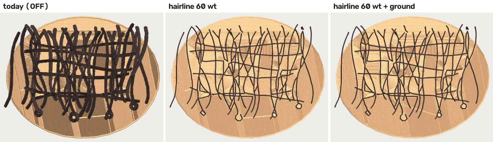
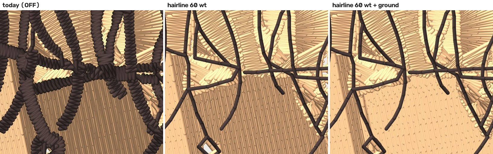

# Hairline step 2: the ground under the strands — 2026-10-12

Follows `docs/hairline-prototype-2026-10-12.md` (PR #848). Everything here is
**default OFF**: `cfg.hairline` (already OFF) and a new
`cfg.hairline_over_ground`, read only when `hairline` is on. **Every number
below is a property of the FILE, not of cloth.** ROADMAP gate 1 applies, and
nothing here has been sewn.

## Kent's one-minute read





- **Left, today:** each strand is sewn as a satin rope about three threads
  wide.
- **Middle, the hairline tier at 60 wt:** one thread per strand. The skin
  stops at the strands, so wherever the strand's traced slot is wider than
  one thread, cloth shows. Look at the white inside the small loop at the
  bottom of the zoom.
- **Right, with the ground:** the skin fill runs on under every strand, and
  the loop is filled.

## What was built

### 1. The ground under the strands (`cfg.hairline_over_ground`)

The code is `stage5_overlap._hairline_ground`. It reuses the bean-letter
`ground_under` path that is already in stage 5.

**What the stage does.**
- For every hairline strand, it takes each ground that sews **before** the
  strand and touches it.
- It unions those grounds and computes their morphological closing. The
  closing radius is the blob-check factor times the block's hairline limit
  (1.2 mm at 40 wt). A closing only fills gaps narrower than twice that
  radius, so the ground's outline does not move anywhere else.
- It fills the strand's part of the closing under the ground. A strand that
  stage 4 traced as a **hole** in the ground is no longer held open as a
  counter. That held-open hole is the knockout described in finding 3.

**Who fills which part.** The part of the closing under the strand is split
by distance: the nearest ground takes each point (a Voronoi split, grown in
8 rings).
- **Fill grounds** keep their share.
- **Satin grounds** keep only the share that their existing underlap tongue
  already covers. The rest goes to the nearest fill ground within the reach.
  Measured on this fixture: when the extra area was added to the satin
  cells' polygons, those cells lost half their satin stitches and opened bare
  patches inside their own artwork.
- **Crumbs** are ground cells too small to cover themselves: the slivers that
  rule 3 hands back, and run or satin cells no larger than a reach disk. They
  are closed over in the same way as the strands.

**Sequencing.**
- Only an earlier-layer ground reaches under a strand, so the ground sews
  first. Stage 7's colour order is unchanged.
- A ground that sews after the strand is left exactly as it is today. A test
  asserts this.
- The strands still sew as runs, and the tier adds no trims of its own.

### 2. The width is read off the source (finding 1)

The code is `stage6_hairline.InkSource` and `source_width_mm`. The new field
`PipelineResult.ink_source` carries references to stage 1's arrays. These
are native-resolution when stage 1 upscaled, through the same
`native_rgb` / `native_alpha` / `upscale` mapping that `_coverage_parts` and
stage 4's native read use.

**How a width is read.**
- It reads at up to 240 points along the strand bodies. Crossings are
  already excluded by `measure`.
- At each point a profile runs along the skeleton's normal.
- Each sample on the profile is unmixed between the surround colour and the
  ink. The space is CIELAB with alpha × 100 as a fourth axis, which is
  `_native_profile_image`'s space.
- The coverage is integrated **outward from the skeleton**, stopping at the
  first gap. A neighbouring strand is therefore not counted.

**What the gate uses.**
- The gate reads the median of those widths.
- If the source has no contrast edge there, the gate falls back to the
  traced width.
- The skeleton walk still uses the traced width, because the walk is a
  property of the raster it walks.

### 3. Who counts as a hairline (`hairline_candidates`, finding 4)

The candidates are read **once** per plan, and stage 5 and stage 7 share the
result. The rule:

- A thin shape is a **ground fragment** when both of these hold:
  - its thread also sews some shape that the width gate rejects, which makes
    that thread a ground colour (the skin's big cells), and
  - it is not darker than the colours its edge touches. Darker means more
    than 2 L* below the boundary-length-weighted L* of the touching shapes of
    other threads.
- A ground fragment is not a hairline candidate. It sews with the ground on
  the ladder, as it does today.
- A thin shape that touches no other colour lies on the garment and still
  qualifies. So does a thin shape of a colour that fills no area.

**Known limit:** a light strand of a colour that also fills an area
somewhere else is read as ground. One example is blonde highlights over
brown hair when the blonde also fills a patch.

## A correction to finding 1, measured

Finding 1 said "the tracer makes a hairline about 0.11 mm wider (0.455 against
0.349)". **That is a units error, not a tracer bias.**
- `hairline_renders` digitized `hair_strands.png` at 80 mm, which is the
  **canvas** width.
- The fixture's art box is 69.15 mm (1383 px at 20 px/mm). Every strand
  therefore sewed **1.157×** the width it was drawn at.
- The "556 mm² of hair pixels" are fixture mm², and in design mm² they are
  **744**. Against the 754 mm² traced, that is 1.3%, not 36%.
- At 80 mm the strands really are 0.29–0.69 mm wide, with a length-weighted
  median of 0.50. The 60 wt line (0.48) *should* have refused that network,
  and with the source read it does.

The tracer's error has **no fixed sign**:
- A lone 0.33 mm stroke traces **thin**: the median is 0.24 mm, and the
  polygon's own area over its length is 0.28 mm.
- The hair network traces near the truth (0.398 at drawn scale, against a
  drawn median of 0.43), because cells absorbed at the crossings offset the
  thinning.

That is the case for reading the source rather than correcting the trace by
a constant. The source read measured:

| | drawn | traced | source |
|---|---|---|---|
| lone stroke (test, 1:1) | 0.332 | 0.243 | 0.343 |
| hair network, drawn scale | 0.43 (length-weighted median) | 0.398 | 0.452 |
| script loop, drawn scale | 0.35 | 0.281 | 0.270 |

**The renders now run at the fixtures' drawn scale.** `tools.hairline_renders`
sets the design width from the art box, so the 0.25–0.6 mm the fixture
script states is what the gate sees.

## The table

The numbers come from `docs/renders/hairline-ground-2026-10-12/table.json`,
written by `python -m tools.hairline_renders` in `digitizer/`. Both fixtures
are forced to the flat class, as before.
- The hair fixture is 69.15 mm wide, with a strand median of 0.43 mm.
- The script fixture is 55.2 mm wide, with a stroke median of 0.35 mm.

"Bare" is preflight's uncovered-artwork instrument. It uses
`_coverage_map`'s thread ribbons at 0.25 mm cells, covered at 0.25 units,
and the wanted area is the artwork on the source's ink. It is summed over
**every** bare cell, because a strip of cloth beside a strand is exactly the
thin patch that `ARTWORK_UNCOVERED` filters out.
- "New" means a cell that the OFF arm covered.
- "On ground" counts only the cells inside the skin's closed outline.
  Outside it, a strand lies on the garment. There, one 0.40 mm run along a
  stroke drawn up to 0.6 mm leaves the edges of the ink uncovered whatever
  stage 5 does. That is the tier, not cloth showing between strands.

| hair | OFF 40 | ON 40 | ON 40 + ground | ON 60 | ON 60 + ground |
|---|---|---|---|---|---|
| stitches | 26,922 | 19,841 | 21,362 | 21,806 | 22,724 |
| dark-thread stitches | 8,243 | 1,150 | 1,150 | 1,133 | 1,133 |
| dark thread laid (m) | 8.57 | 1.37 | 1.37 | 1.36 | 1.36 |
| hairline shapes / strands sewn / dropped | — | 2 / 59 / 2 | 2 / 59 / 2 | 2 / 59 / 2 | 2 / 59 / 2 |
| network width: traced → source (gate) | — | 0.398 → 0.452 (0.60) | same | 0.398 → 0.452 (0.48) | same |
| **bare fabric, new vs OFF, on the ground (mm²)** | 0 | **2.88** | **0.44** | **3.25** | **0.69** |
| bare fabric, new vs OFF, anywhere (mm²) | 0 | 5.06 | 2.62 | 5.62 | 3.06 |
| bare fabric, total (mm²) | 4.38 | 8.38 | 3.06 | 9.00 | 3.56 |
| **skin fill + underlay stitches** | 8,031 | **8,031 (md5-identical)** | 9,468 (+17.9%) | 8,026 (−0.06%) | 8,926 (+11.1%) |
| trims / jumps | 90 / 80 | 105 / 107 | 115 / 113 | 102 / 112 | 113 / 112 |
| longest jump (mm) | 41.9 | 42.8 | 51.7 | 57.7 | 57.7 |
| dark stitches < 1.0 mm (excl. lock legs) | 3,886 | 0 | 0 | 20 | 20 |

The script has no ground, so the ground arm is identical to ON there by
construction. At drawn scale **all four strokes are sewn at 60 wt**; in the
#848 table at 60 mm, the 0.4 mm underline went over the limit. At 60 wt the
script sews 170 stitches, against 1,233 today, with 0 stitches under 1.0 mm.
The script's bare cells are its strokes' own edges on the garment
(5.4 mm² in every ON arm).

## Against the done-test, plainly

- **Bare fabric between the strands:** on the ground it falls from 2.88 to
  0.44 mm² at 40 wt, and from 3.25 to 0.69 mm² at 60 wt. That is about
  85% of it, but **not zero**.
  - In a run one revision earlier, the last cells sat almost all in two
    ground crumbs (1.6 and 1.9 mm²). I did not chase why the closing misses
    them there.
  - Off the ground, 2.2 mm² is still the edges of strands drawn wider than a
    thread, lying on the garment. No ground can cover that.
- **Skin fill within 1% of OFF:** **met by the sliver rule**. With the tier
  ON and no ground, the skin's fill and underlay are md5-identical to OFF at
  40 wt, and −0.06% at 60 wt. The #848 prototype moved them 4.4%.
  - **With the ground, skin fill grows +11% at 60 wt and +18% at 40 wt.**
    This is not new area: the union of the skin's planned polygons grows by
    0.4% (2,904 → 2,915 mm²).
  - It is **stacking**. Each fill ground's share under a strand overlaps the
    neighbour's existing underlap tongue, and the cells' outlines become more
    complex.
  - This is the price of the ground arm, so I am stating it rather than
    hiding it. A sew-out decides whether the double layer under a strand
    matters (card block E).
  - The ground also adds 9–11 trims, all in the skin, and the longest jump
    goes from 42.8 to 51.7 mm at 40 wt.
- **"60 wt admits the fixture with real margin":** **not achievable as the
  fixture is drawn.** Its length-weighted median strand is 0.43 mm and the
  60 wt line is 0.48 mm. An honest read can leave at most 0.05 mm of margin,
  and the source read leaves 0.028.
  - At 40 wt the margin is 0.148.
  - The per-shape gate admits the network as a whole even though some of
    its strands are drawn over 0.48 (the fixture draws 0.25–0.6; finding 4's
    all-or-nothing).
  - Real margin at 60 wt needs either a fixture drawn finer or a per-strand
    gate. Both are separate changes.
- **Pictures:** `compare_full.jpg` and `compare_zoom.jpg` above.

## The 2026-09-09 seam ruling

The ruling says *"the colour sewn ON TOP owns the seam — its column covers
both fills' edges, which is what a border is for — and the shape underneath
skips that stretch"*. It decides **which colour borders a shared seam**.
This change does not conflict with it, for three reasons:
- **A hairline has no border.** The tier sews one run on the skeleton,
  with no outline and no column.
- **There is no seam.** With the ground under it, the strand lies inside
  the ground's fill. No edge is shared, so no edge has to be owned, and
  stage 7's `_owned_by_later` / `border_runs(omit=…)` has nothing to omit.
- **The ruling's own direction holds.** The strand is the colour sewn on
  top. It is the stage 5 underlap principle taken to its end: the earlier
  colour extends under the later one. Here that is all the way under,
  because one thread of the later colour cannot hide a seam.

Nothing in the ruling as written forbids it, so this is not built as an
exception. The flag is still named `hairline_over_ground`, so the arm can be
compared on its own. One open edge case: with `border` on, a skin cell's
predicted border now runs along a polygon that reaches under the strands.
This was not exercised here.

## What gate 1 (the sew-out) still owns

Everything in #848's list is unchanged, plus:
- **card block E** (`card_E_ground.dst`): whether a strand reads over a ground
  that runs under it, and whether the double layer of fill under a strand
  (the +11–18% above) puckers or reads heavy;
- the 1.2 mm closing radius (twice the strand limit) and the 2 L* darker
  margin of the fragment rule. Both are geometry, and both are unsewn;
- the 60 wt laid width, which now decides a real admission on this fixture
  (0.452 against 0.48).

## Reproduce

```
cd digitizer
python -m tools.hairline_renders      # renders, table.json, compare_*.jpg
python -m pytest -q tests/test_hairline_ground.py tests/test_hairline_tier.py tests/test_thread_profile.py
```

`test_hairline_ground.py` pins OFF against #848's md5s with
`hairline_over_ground=True` and `hairline=False`, so the ground flag on its
own is inert.
