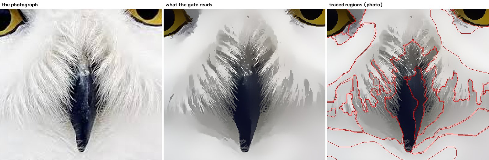
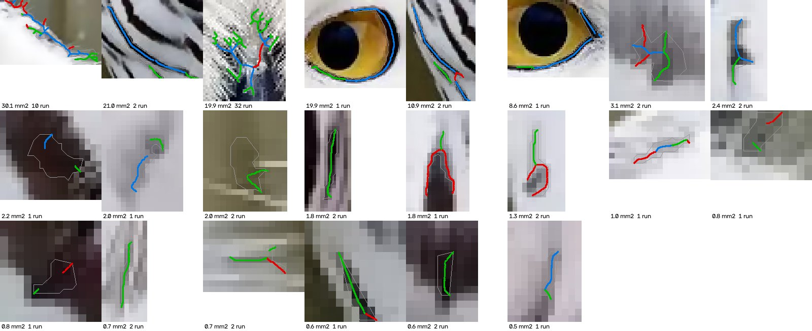
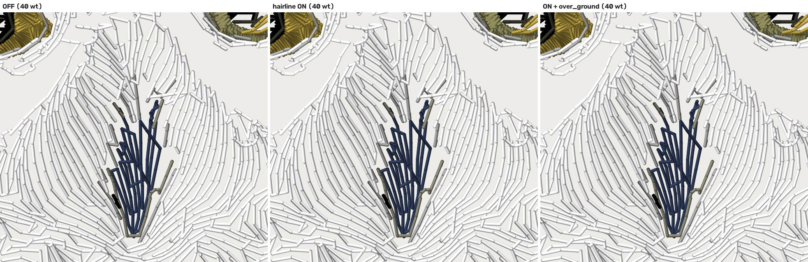
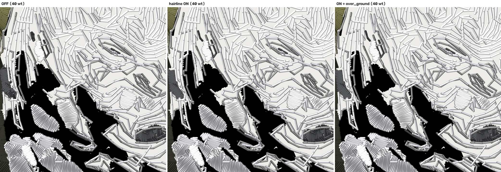
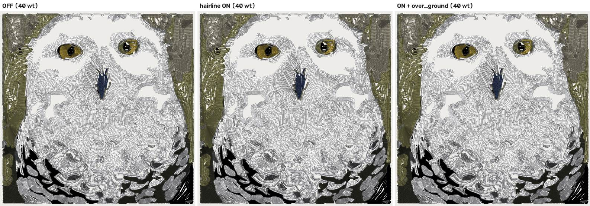
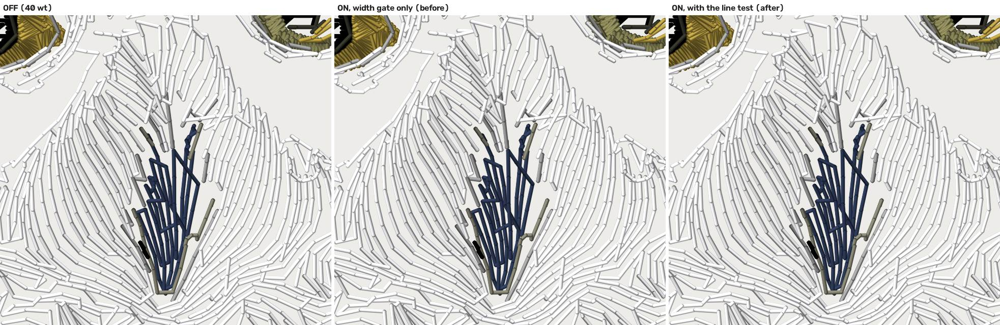
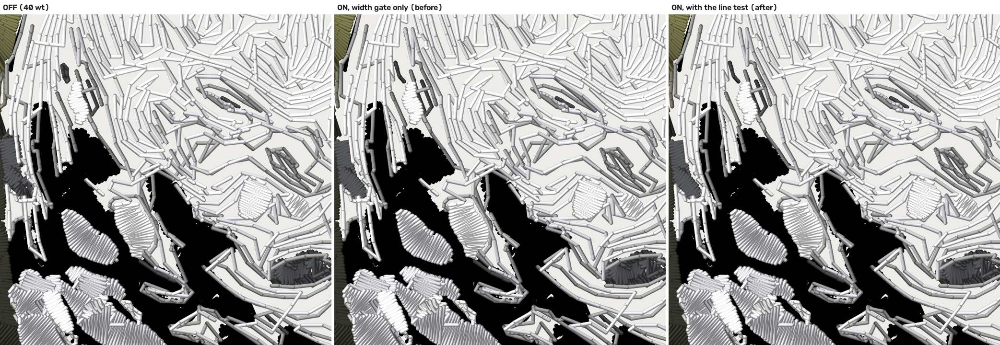

# The hairline tier meets a real photograph — 2026-10-12

Follows `docs/hairline-strand-gate-2026-10-12.md` (#851) and the rest-pieces
PR (#861). Until this, `cfg.hairline` had been measured only on drawn hair
(`hair_strands`, `hair_fine`, `thin_script`). This is the first real photo.
**Every number below is a property of the FILE, not of cloth** (ROADMAP
gate 1). Nothing was flipped: `cfg.hairline` and `cfg.hairline_over_ground`
stay OFF, and the flip waits on Kent's sew-out card.

## Verdict

**The hairline tier is not ready to meet real photos, and the gate is not
where it falls short.** On the one real photograph in the corpus, the
strands never reach the tier as shapes. The photo lane's segmenter merges
the owl's facial bristles into a few ragged grey regions. What the tier
does see is mostly not hair: the blur rim between a dark feather bar and
white down, slivers of smooth down, and the subject's edge against the
fence. Each of these is thin enough to pass the width gate.

- The trial found one defect with a clear fix, and this PR builds it,
  behind the OFF flag. The width gate admitted a thin band of colour even
  when the photo shows no line there. A **line test** now asks whether the
  branch's middle stands out from both of its sides. On the Studio route at
  60 wt, the tier's shapes fall from 47 to 22 and the branches it sews as
  runs from 172 to 72. The drawn fixtures are untouched: zero refusals, and
  every gate verdict is the same.
- Even after the fix, the tier is a rounding error on this photo.
  - Its run branches total 0.02 m (`classical`) to 0.16 m (`studio`) at
    40 wt, against designs of 53 and 227 m of thread.
  - In the full `classical` plan it sews 3 strands and drops 10.
  - About 70% of the paths it would walk are under the 2.2 mm loop floor,
    and the walk drops them. **The next step is upstream:** hair has to reach stage 6 as
  lines. See "What next" below for three options; that choice is Kent's.

## Since this was measured: the drop guard (#879)

After these runs, `main` merged the drop guard
(`stage6_hairline.DROP_GUARD`). A shape whose walk would drop more than 2%
of its strand length is handed back whole to its OFF ladder. It sits after
the line test and composes with it.

**Every table below predates the guard.** The guard answers this doc's "it
drops 10 strands" from the other side. On the `classical` route at 40 wt,
the census on the merged tree reads:

| | candidates | run branches | handed back by the guard |
|---|---|---|---|
| line test and guard | 2 | 3 | 7 |
| guard only (line test off) | 6 | 11 | 13 |

At 60 wt the census reads 2 / 3 / 4 with both, and 5 / 9 / 11 with the guard
only. `tests/test_hairline_photo_trial.py` pins these figures.

On this photo the tier now touches two shapes and three short strands. That
makes the verdict stronger, not weaker: the gate is clean, and there is
nothing for it to sew.

## The photo, and which pipeline ran

`digitizer/testdata/photo/owl_kent.jpg` is Kent's own snowy owl, cleared as
a corpus fixture on 2026-08-12. It is the only real photograph in
`digitizer/testdata`; every other `photo_*` file is generated by a script
(`docs/asset-provenance.json`). There is no portrait and no pet in the
corpus. The owl is the closest fine-strand texture available:

- the facial bristles round the beak (fine, mostly **light** strands over
  a darker underlay);
- wispy feather edges against the fence;
- the dark barring on the breast.

No new photo or client art was added. The design is 127 mm wide, the width
`tools/cap_fold_ab.py` uses for this fixture. At that width the source is
554 px across, so 4.36 px/mm: **one source pixel is 0.23 mm, and a 0.3 mm
strand is about 1.3 px wide.** The photo itself barely resolves a strand at
this size. That limit holds whatever the engine does.

The trial runs three routes (`python -m tools.hairline_photo_trial`):

| route | settings | what actually ran |
|---|---|---|
| `photo` | `forced_class="photo_subject"`, rembg venv passed in | photo lane, prep and **rembg cutout** (`PHOTO_BACKGROUND_REMOVED` fired) |
| `classical` | the same with `photo_prep=False` | photo lane, no prep, no cutout. This is byte-identical to a machine without the rembg venv (the cutout-failed rule in `pipeline.py`), so it reproduces anywhere and the done-test pins it |
| `studio` | the Studio's flags (`detect_photographic`, `faces_route_flat`) | neither signal fires on this file (no EXIF, no face), so stage 0 sends it to the **`gradient`** lane. This is what the app does with this photo today |

A worktree has no rembg venv. The `photo` route used the primary
checkout's (`--rembg-python`), and the row records that the cutout fired.

## Finding 1: the strands never become shapes



Left: the photograph. Middle: what the gate reads on the photo lane, which
is the prepped (texture-killed) raster `InkSource` carries. Right: the
traced regions. The bristle field comes through prep as a field of fine
strokes, and stage 2/4 trace it as **four or five ragged regions**, each
several millimetres across. Not one bristle is a shape of its own. The
hairline tier works per shape (it reads the skeleton of a region the tracer
delivered), so it never sees them. The Studio route
(`source_studio_beak.jpg`) reads the unprepped photo at 8 px/mm and does
better: one region (19.9 mm², 32 run branches at 60 wt) is the bristle
field. It is still a blob with strands in it, not strands.

**So: does the per-strand gate fire on real hair? Barely, and only where
the tracer happened to leave a strand-shaped region.** The tier is
downstream of segmentation, and segmentation is built to merge texture.

## Finding 2: what the gate caught instead — and the fix



Every shape the gate admits at 60 wt on the Studio route, drawn on the
source it read. **Green** is a branch sewn as a run. **Red** is a branch
the line test refused. **Blue** is a branch left to the ladder for width.
Before the fix, every red branch was green. By eye, the admitted shapes
fall into four groups (my reading of the sheets, not an instrument):

- **Blur rims.** A grey band between a black feather bar and white down
  (the rims along the bars in tiles 2 and 5). Its colour lies *on the
  path* from one side to the other, so it is a ramp, not a line. Each one
  is thin and long, so the width gate passes it.
- **Slivers of a smooth field.** The segmenter cut a thin region out of a
  gentle gradient, and there is no edge in the photo at all. The source
  width read found no contrast and fell back to the **traced** width, which
  admitted it. That fallback was written for an opaque flat source and is
  wrong for a photo.
- **The subject's edge against the fence**, and on the `photo` route the
  rembg cutout's edge (`candidates_photo_60wt.jpg`).
- **Real fine lines.** The lower eye rims, a few dark bristles above the
  beak, the tips of dark feather bars, and one crack in the fence.

**The fix: `stage6_hairline._line_contrasts`, read per branch in
`_decide_edges`.** The fix only applies under `cfg.hairline`, which is OFF.

- Profiles run across the branch, using the same geometry as the width
  read (now shared as `_profiles`).
- For each side of a profile, the surround is the sample that differs
  **most** from the middle. It is not the profile's far end, because a
  strand lying next to another strand has ink at its far end.
- The line contrast is how far the core (the traced half-width) leaves the
  straight segment between the two surrounds, in the gate's own CIELAB +
  alpha units:
  - a ramp band reads about 0;
  - a flat sliver reads about 0;
  - a strand reads its own contrast.
- A branch is refused when the median contrast is under 12 (the gate's
  existing `_SRC_MIN_CONTRAST`). Refused branches go to the ladder, as they
  would OFF.
- The test runs **whether or not the width read found an ink colour**,
  which closes the traced-width fallback above.
- A branch with no neighbour to follow reads its own pixels.

Two exclusions keep the test from refusing real strands. Both came from
running the test on the drawn fixtures, where real strands were being
refused:

- **A profile with an end inside the shape's own raster** is not read. The
  normal ran along the strand, so the ink would be one of its sides.
- **A profile where exactly one side looks like the middle** is not read,
  because it cannot be decided. The strand may be fused with a touching
  neighbour on that side, or it may be a sliver of one field along its
  edge. The width gate decides those, as before. This keeps the test
  conservative: it only refuses what it can see is no line.

| census at 60 wt (shapes / run branches / refused) | before | after |
|---|---|---|
| `classical` | 16 / 63 / 0 | **6 / 14 / 11** |
| `photo` (rembg) | 14 / 32 / 0 | **10 / 22 / 2** |
| `studio` | 47 / 172 / 0 | **22 / 72 / 24** |
| `hair_strands` (drawn) | 2 / 184 / 0 | 2 / 184 / **0** |
| `hair_fine` (drawn) | 2 / 321 / 0 | 2 / 321 / **0** |
| `thin_script` (drawn) | 4 / 26 / 0 | 4 / 26 / **0** |

| census at 40 wt | before | after |
|---|---|---|
| `classical` | 19 / 71 / 0 | 9 / 19 / 16 |
| `photo` | 16 / 41 / 0 | 12 / 29 / 4 |
| `studio` | 66 / 302 / 0 | 30 / 106 / 31 |

The run-branch count falls by more than the refusals for two reasons:

- A branch too short to read follows its neighbours, so a refused branch
  carries those neighbours with it.
- A shape that is no longer admitted makes its colour a ground colour, so
  the ground-fragment rule then hands back more slivers of that colour.

Drawn fixtures, after: `hair_strands` 263 / 184 run branches at
40 / 60 wt, `hair_fine` 332 / 321, `thin_script` 26 (both candidate shapes
summed, so these are not the doc tables' largest-shape figures). The test
can only refuse, and it refuses nothing on them, so every verdict is the one
it was before. That is why `test_hairline_strand_gate.py`, `test_hairline_ground.py`,
`test_hairline_tier.py`, `test_hairline_rest_pieces.py`,
`test_thread_profile.py` and `test_hairline_card.py` pass unchanged.

**What the fix does not catch:**

- An edge sliver: a thin piece of one colour along its own edge, with that
  colour on one side. The one-sided rule leaves it to the width gate,
  because it cannot be told from a strand fused to a neighbour.
- Real fine lines that are not hair. An eye rim is a line, and the test
  says so.

`candidates_photo_60wt.jpg` shows what is left on the rembg route: mostly
edge slivers along the subject's cut-out edge.

## Finding 3: what it sews, stitched (OFF vs ON vs ON + ground)

The full plans: route `classical`, 40 wt, 127 mm, on `main` as of this
branch's merge. The `noline` arm is the same plan with the line test
switched off, which is the gate as it stood before this PR.

| `classical`, 40 wt | OFF | ON | ON + ground | ON, before the line test |
|---|---|---|---|---|
| stitches | 31,484 | 31,162 | 31,161 | 30,938 |
| trims | 332 | 332 | 332 | 332 |
| colour changes | 30 | 30 | 30 | 29 |
| thread laid (m) | 52.86 | 52.64 | 52.64 | 52.52 |
| stitches < 1.0 mm (not lock legs) | 5,659 | 5,346 | 5,346 | 5,115 |
| hairline shapes / strands sewn / dropped | — | 9 / 3 / 10 | 9 / 3 / 10 | 14 / 14 / 18 |
| rest slivers dropped | — | 0 | 0 | 0 |
| admitted shapes*: stitches | 654 | 328 | 328 | 252 |
| admitted shapes*: thread (m) | 0.547 | 0.326 | 0.326 | 0.267 |
| admitted shapes*: stitches < 1.0 mm | 456 | 140 | 140 | 82 |
| **bare fabric, new vs OFF (mm²)** | 0 | **14.3** | 14.5 | **31.1** |

\* The 9 shapes the gate admits **after** the line test, measured in every
arm. The before arm admits 14 shapes, so its row is not its whole tier.

The gate census for the same route is in Finding 2. Per-route JSON:
`docs/renders/claude-hairline-photo-trial/table_classical.json`.

**The line test halves the damage.** Before it, the tier sewed 14 strands
and dropped 18, and it left **31.1 mm²** of fabric bare that OFF covered.
It also sewed one colour change fewer (30 → 29). I did not chase why;
the line test puts the change back. After it, the tier sews 3 strands, drops 10, and
leaves **14.3 mm²**.

**Read "bare fabric" as new vs OFF only.** The absolute total (about
6,700 mm²) is the photo lane's own open fills read by an instrument built
for solid flat fills. The part that moved against OFF is the tier's.







The line test's own before/after, on the same plans:





What the arms say:

- **ON changes almost nothing on this photo.** The design loses 322 of
  31,484 stitches (1.0%), 0.22 m of 52.86 m of thread, and 313 of its
  5,659 sub-1 mm stitches. Trims and colour changes do not move.
- **The tier sews 3 strands and drops 10.** The 9 shapes it admits at
  40 wt carry 13 walkable paths, and 10 of them are under the 2.2 mm loop
  floor. Within those 9 shapes, stitches halve (654 → 328), thread falls
  from 0.55 to 0.33 m, and sub-1 mm stitches fall from 456 to 140. The
  effect is real but small.
- **It leaves about 14 mm² of new bare fabric.** That area was covered OFF.
  It is the tier's own edges (one 0.40 mm run down a region traced wider)
  plus the dropped short strands (about 2 mm², see "What it loses").
- **The Studio route**, from an earlier run of the same arms (off40 and
  on40 only; on40g was not run):
  - 89,404 against 90,555 stitches;
  - 24 shapes sewn as 17 strands, with **38 dropped**;
  - trims 183 → 189;
  - 3.9 mm² new bare fabric.
  The same story at a larger scale. The Studio sews this photo in the
  `gradient` lane, which is why its totals differ from `classical`.

## Does over_ground do anything here?

**No.** `on40g` differs from `on40` by one stitch and 0.2 mm² of bare
fabric. The ground only reaches under a strand from a ground colour that
sews **before** it and touches it (`stage5_overlap._hairline_ground`). The
three strands that survive on this photo are mostly the subject's edge, and
no earlier ground meets them. That fits the verdict: there are no strands
lying over a ground here for the ground to go under.

## Not run, and how to run it

The arm runs took about 25 minutes per plan on a laptop shared with seven
other lanes, so the trial ran the four arms above and stopped. The rest is
one command each:

- **The `photo` route's arms (the rembg cutout).**
  - Its census is in Finding 2 and is real: the cutout fired there.
  - Its arm run **timed out in the rembg worker under load**, and the route
    silently became `classical` (`pipeline.py`'s cutout-failed rule). Its
    numbers came out identical to `classical`, which is how this was caught.
  - The tool now gives that route a 900 s worker timeout.
  - `python -m tools.hairline_photo_trial --routes photo --rembg-python <venv python>`
- **60 wt** (`--arms off60 on60 on60g`). Compare it with `off60`, never
  with `off40`: a 60 wt plan re-spaces every satin, and an earlier pass
  measured +3,130 stitches from that alone.
- **The Studio route's ground arm** (`--routes studio --arms off40 on40 on40g`).

## What it loses

- **Short strands.** About 70% of the paths the tier would walk on this
  photo are under `RUN_MIN_LOOP_MM` (2.2 mm), and the walk drops them:

  | route | paths | under 2.2 mm |
  |---|---|---|
  | `classical`, 40 wt | 13 | 10 |
  | `classical`, 60 wt | 9 | 6 |
  | `photo`, 40 wt | 20 | 14 |
  | `photo`, 60 wt | 15 | 11 |
  | `studio`, 40 wt | 61 | 44 |
  | `studio`, 60 wt | 43 | 30 |

  - Where **every** path of a shape is short and the shape has no thick
    part, stage 7 sends the whole shape down the ladder, as it would OFF,
    so nothing is lost.
  - Where the shape also has a thick part, the short branches' ribbons are
    cut out of the rest **and** dropped by the walk, so their ink is sewn
    by nobody. Measured as the ribbon area of those components inside the
    artwork: 2.2 / 1.1 mm² (`classical`, 40 / 60 wt), 3.1 / 1.5 (`photo`),
    5.7 / 4.2 (`studio`).
  - That is a real hole, but a small one: it explains under a sixth of the
    new bare fabric in the table above.
  - It is not built here, because the cure is a design question.
    - The simple version cannot recover a strand: hand the short
      components back to the rest. The rest is opened by half a laid width,
      which erases a 0.3 mm strip.
    - The real version is a rule for sewing a 1–2 mm stub, and that is the
      sew-out card's block A question.
- **The tier's own edges**, as on the drawn fixtures. A 0.32–0.40 mm run
  down a region the tracer drew wider leaves the region's rim uncovered,
  and the bare-fabric instrument counts it.
- **Light strands.** The owl's bristles are mostly white strands over a
  darker underlay. Even if they were traced, the ground-fragment rule
  (`hairline_candidates`, its known limit) reads a light strand of a colour
  that also fills an area as ground, and hands it back.

## What next — three options (Kent's call)

The tier is fine once it has a strand. The photo lane does not hand it any
strands. Three ways to get them there:

1. **Feed the tier from a line detector, not from regions.**
   - `detail_layer` (OFF) already extracts FDoG coherent lines from the
     photo and sews them as **bean** runs over every fill, sewn last. Swap
     its emitter for the hairline walk: one pass at 1.5 mm, the curl rule,
     and the 1.0 mm floor.
   - The fill stays the ground, which is the pros' "strands over a ground".
   - **Cost:** moderate; both halves exist.
   - **Catch:** FDoG finds every coherent edge, not only hair, so it needs
     the line test from this PR, and it puts more thread on top of fills.
     It also sees light strands only if it is asked for both polarities.
2. **Fur as texture, not strands.**
   - The research doc's §2: pros sew fur as directional fill (randomised
     tatami 4–6 mm, or layered narrow satins), with strands only as
     accents.
   - `fill_technique="streamline"` (built, not default) is that recipe:
     runs along the ETF direction field. Route a detected hair or fur
     region to it.
   - **Cost:** the router (what is a fur region?) and a measured A/B on
     this photo.
   - **Catch:** it changes the region's fill, not its strands, and it needs
     a reliable fur detector.
3. **Trace finer in hair zones.**
   - Raise `work_px_per_mm` and lower `min_detail_mm` inside a detected
     strand field, so stage 4 returns strands as shapes and the tier as
     built sews them.
   - **Cost:** cheapest to try.
   - **Catch:** it fights the segmenter's whole job, which is to merge
     texture. It fragments the design (trims, small shapes), and at
     4.36 px/mm the source does not resolve a 0.3 mm strand anyway. It
     needs a bigger photo before it can work.

My pick would be option 1. Option 3 is listed because it is genuinely live
on higher-resolution photos. None of this moves the 60 wt or stitch-length
candidates, which stay with the sew-out card (gate 1).

## Reproduce

```
cd digitizer
python -m tools.hairline_photo_trial --routes classical     # arms off40 on40 on40g on40_noline
python -m tools.hairline_photo_trial --sheets-only --routes classical studio photo \
    --rembg-python <primary>/digitizer/rembg_isolated/venv/Scripts/python.exe
python -m pytest -q tests/test_hairline_photo_trial.py
```

Per-route results: `docs/renders/claude-hairline-photo-trial/table_<route>.json`
and `table.md`. The lossless per-arm renders go to the gitignored
`digitizer/debug_out/hairline_photo_trial/`.
`tests/test_hairline_photo_trial.py` pins the line test on drawn rasters (a
dark line on white is a strand; a black|grey|white blur band and a flat
sliver are not; no source means no test) and pins the `classical` census
at 40 and 60 wt. That census rests on medial-axis pixels, so the pins are
bounds rather than exact values.
