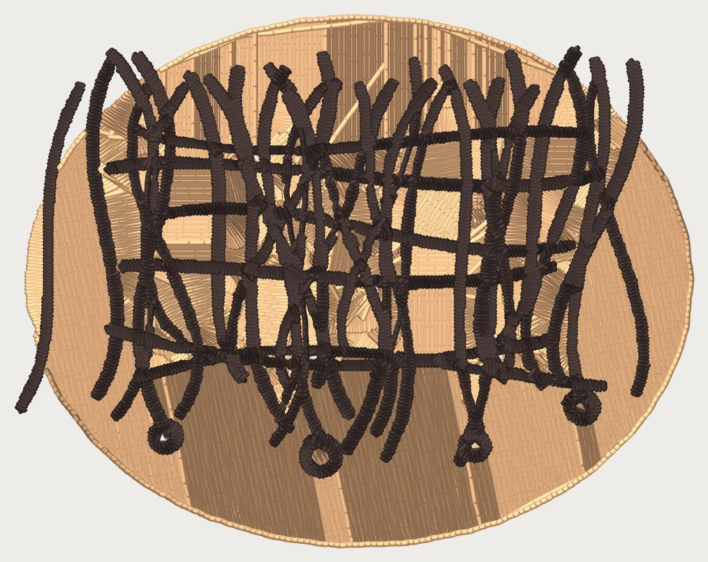
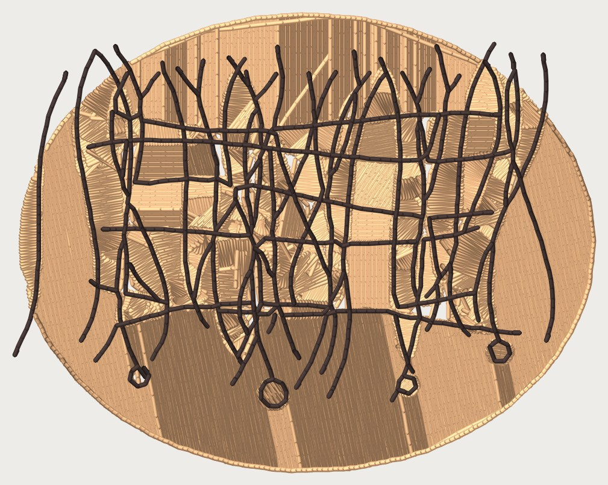
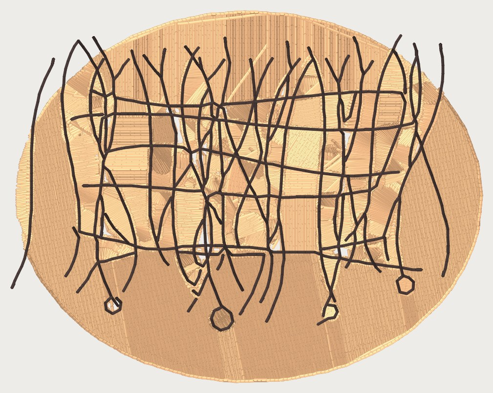
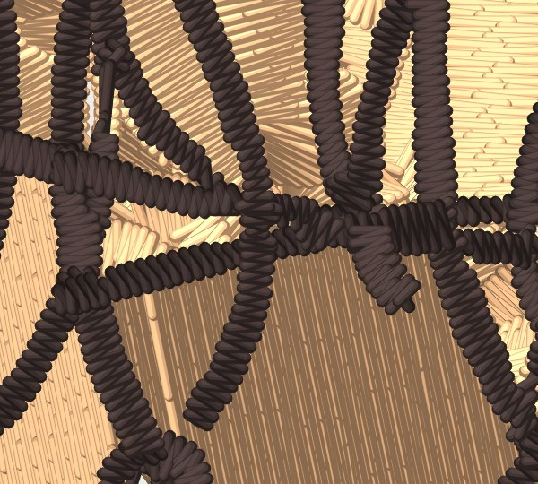
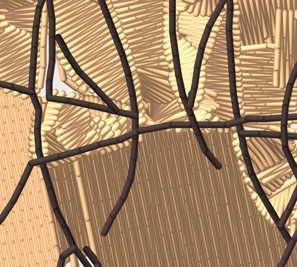
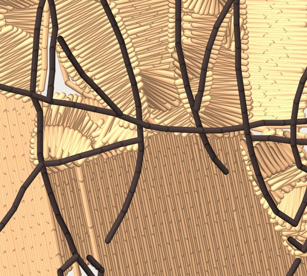
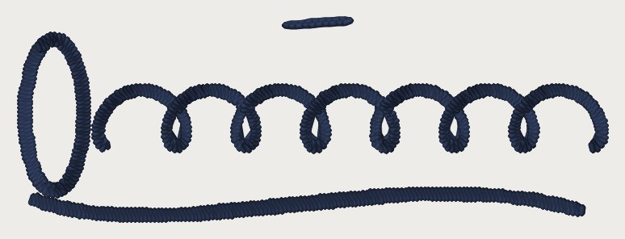
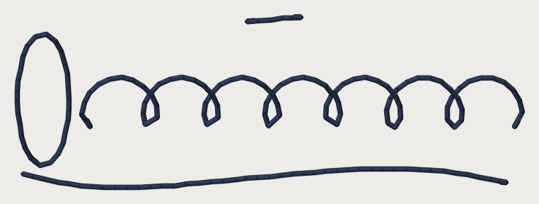
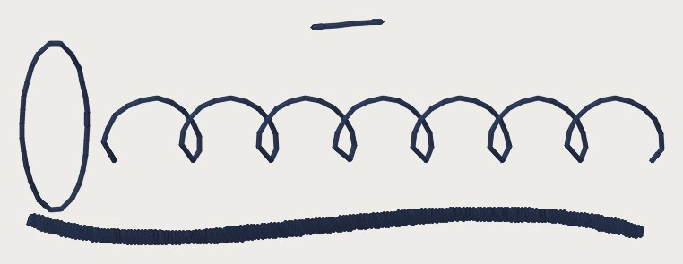

# Hairline prototype: thread weight and a one-run tier — 2026-10-12

**Kent:** "Thread is extremely thin, we should be able to embroider hair!"

This builds what `docs/fine-detail-hair-research-2026-10-12.md` (PR #843)
§4 proposed, **all default OFF / 40 wt**. **Every 60 and 75 wt number, and
the hairline stitch length, is a CANDIDATE from a source, not a setting.**
ROADMAP gate 1 applies: none of it has been sewn. The sew-out card that
would settle it is at the end, written as a list of DST files. Nothing
here generates them.

## What was built

1. **`machine.thread_profile(wt)`** for 40, 60 and 75 wt. Read-only. A bad
   weight raises an error.

   | Field | 40 (today) | 60 | 75 | Source |
   |---|---|---|---|---|
   | `width_mm` (laid width) | 0.40 = `COVERAGE_THREAD_W_MM` | 0.32 | 0.26 | Law 16; 60 and 75 scale 0.40 by √dtex (#843 §1) |
   | `satin_spacing_mm` | 0.40 = `SATIN_SPACING_MM` | 0.32 | 0.25 | Amann: 0.30–0.35 for 60, 0.20–0.25 for 75 [V][20] |
   | `hairline_run_width_mm` | 0.40 | 0.32 | 0.26 | = laid width |
   | `hairline_max_width_mm` | 0.60 | 0.48 | 0.39 | 1.5 × laid width (`HAIRLINE_MAX_WIDTHS`) |
   | `min_stitch_mm` | 1.0 | **1.0** | **1.0** | Melco: set by the needle, not the thread [V][25] |
   | `min_cap_height_mm` (a note) | 6 | 4 | 3 | 60 wt sources disagree: 3 / 4–5 / 4 mm (#843 §5) |
   | `needle_advice` | 75/11 | Madeira 60/8–65/9 **and** Wilcom 70/10–75/11 | 60/8 | both carried, #843 §1 |

   `tests/test_thread_profile.py` asserts that the minimum stitch is the
   same at every weight, so nobody lowers it for 60 wt later. The
   cap-height figure is a note only. Preflight still reads Law 48's 4 mm, so
   the 40 wt output does not change.

2. **`cfg.thread_wt`** (default 40) sets the weight for the whole design.
   A single colour block can override it with
   **`shape_overrides[sid].thread_wt`**, through the per-shape override path
   the Studio already uses. Each colour has one needle, so a block takes the
   finest weight that any of its shapes asks for. Bad values are refused in
   three places: `regions.apply_shape_edits` raises an error, the service
   returns a 400, and `_OVERRIDE_KEYS` lists the new key.

   **What it changes today:** satin spacing, in both the classic satin tier
   and the Column lane (stage 7's two `spacing_mm=` call sites), and the
   hairline tier's width limit and run width.

   **What it deliberately leaves alone:**
   - `MIN_STITCH_MM`: the needle sets it.
   - `FILL_ROW_MM`: it came from professional files whose thread weight is
     unknown.
   - `RUN_MIN_AREA_MM2`: stage 4 uses it, and changing it would change which
     shapes exist at all, not just how they sew.
   - Preflight's coverage unit.
   - `STREAMLINE_D_SEP_DARK_MM`.
   - The JS preview's `THREAD_WIDTH_MM`.

   Each one is a separate change with its own measurement.

3. **`cfg.hairline`** (default OFF) and **`cfg.hairline_stitch_mm`**
   (default 1.5, Melco's minimum for a walk stitch). The tier is in
   `digitizer_core/stage6_hairline.py`. Stage 7 tries it before the
   run-tier rung, for shapes on the `auto` tier only. It works like this:
   - **Measure.** It reads the stroke width off the medial axis of the
     artwork polygon. Crossing cores are excluded, because they read 1.41×
     wider or more. The shape gets this tier when the median width is no
     more than 1.5 laid widths, and the 95th percentile is no more than
     twice that.
   - **Decompose.** It uses `stage6_satin._skeleton_edges`, the same code
     the satin tier uses, not a copy. It prunes end-cap spurs. A short edge
     between two nodes is treated as the inside of one crossing: it is
     merged and not sewn.
   - **Walk.** Each edge is sewn once. A path starts at an odd node
     (Euler's rule) nearest the needle. At every node it carries on along
     the edge that turns least, so at a crossing the needle follows the
     strand straight through.
   - **Stitch.** Stitches are 1.5 mm, shortened in 10% steps where the
     chord would wander more than half a thread from the drawn line (on a
     curl), but **never below `MIN_STITCH_MM`**. There is no underlay and no
     travel. Trims follow `trim_at_mm`. Any lock stitches come from the
     existing tie rule.
   - **Drop.** Paths shorter than `RUN_MIN_LOOP_MM` (2.2 mm) are dropped
     and counted in the plan warning **`HAIRLINE_TIER_SEWN`**
     (`shapes`/`strands`/`dropped`). The Studio lists that code in
     `SILENT_WARNINGS`, so it is never shown to the customer (Kent's
     2026-10-02 no-warnings ruling).

   **Reused rather than rebuilt:**
   - stage 7's per-shape emission slot, so sequencing, colour blocks and
     every exporter work unchanged;
   - `_skeleton_edges`;
   - `stage6_detail`'s nearest-neighbour ordering and its jump-or-trim
     rule between lines;
   - `run_outline`'s kind (`stitches.RUN`).

   **Not reused:** `detail_layer`'s single block sewn last. The hairline
   tier sews each shape in its own colour block, in its normal place in
   the sequence. A strand drawn in hair brown is that region's thread,
   whereas `detail_layer` picks one cone for every photo line.
4. **`stitchviz.render_design(..., thread_mm=)`.** The renderer can now draw
   60 wt at its own laid width. The default is unchanged, so every existing
   render and every `coverage` figure stays the same.
5. **Fixtures**, all drawn by the repo's own code
   (`tools/draw_hair_fixtures.py`, seeded, so no photographs and no client
   art):
   - `testdata/synthetic/hair_strands.png`: 80 mm wide, 40 strands 0.25–0.6
     mm wide over a skin-toned oval. Some strands cross, and 4 of them are
     curls with a radius under 2 mm.
   - `testdata/synthetic/thin_script.png`: 60 mm wide, a looping signature
     line drawn with 0.3–0.5 mm strokes.

## The pictures

All renders come from `python -m tools.hairline_renders` in `digitizer/`.
Each one draws thread at the laid width of its arm. It is not a picture of
cloth.

| | today (OFF, 40 wt) | hairline ON, 40 wt | hairline ON, 60 wt |
|---|---|---|---|
| hair |  |  |  |
| hair, zoom |  |  |  |
| script |  |  |  |

**What the pictures show:**
- **Today:** a hair strand drawn at 0.25–0.6 mm sews as a satin rope about
  1 mm wide, and the script sews as a three-pass bean. Both come out about
  three threads heavy.
- **Hairline ON:** each strand is one thread down its middle. The script
  reads as a pen line.
- **60 wt:** the strands look the same as at 40 wt, drawn thinner. The
  script's underline (drawn 0.4 mm, but the tracer reads it wider than
  0.48 mm) goes over the 60 wt limit and is sewn by the existing ladder.

## The table

Both fixtures were forced to the flat class (see finding 2). The numbers
are file properties and come from `docs/renders/hairline-2026-10-12/table.json`.

| | hair OFF 40 | hair ON 40 | hair ON 60 | script OFF 40 | script ON 40 | script ON 60 |
|---|---|---|---|---|---|---|
| strands drawn | 40 | 40 | 40 | 4 | 4 | 4 |
| hairline shapes / strands sewn / dropped | — | 40 / 97 / 28 | 32 / 88 / 22 | — | 4 / 4 / 0 | 3 / 3 / 0 |
| stitches, whole design | 32,857 | 22,602 | 25,635 | 1,352 | 185 | 525 |
| dark-thread stitches | 9,574 | 1,349 | 1,315 | 1,352 | 185 | 525 |
| dark thread laid (m), drawn length 1.39 / 0.205 | 10.65 | 1.62 | 1.61 | 1.42 | 0.24 | 0.63 |
| trims / jumps | 109 / 60 | 123 / 88 | 108 / 94 | 4 / 0 | 3 / 1 | 3 / 1 |
| dark-thread stitches < 1.0 mm (excluding 0.8 mm lock legs) | 3,729 | **0** | **0** | 631 | **0** | 73 ¹ |
| 0.8 mm lock legs (existing tie rule) | 161 | 312 | 296 | 12 | 24 | 20 |
| longest jump (mm) | 55.5 | 56.9 | 41.7 | 30.7 | 22.2 | 28.3 |
| skin fill stitches / row pitch | 10,647 / 0.15 | 10,180 / 0.15 | 10,318 / 0.15 | — | — | — |
| `stitchviz.coverage` | 0.785 | 0.773 | 0.775 | 0.225 | 0.085 | 0.129 |

¹ These short stitches come from the underline, which goes over the 60 wt
limit and falls back to today's tier. They do not come from the hairline
tier.

**One strand on its own** (a 32.8 mm S-curve, 0.3 mm wide):
- The hairline tier sews it in **24 stitches and 32.8 mm of thread**.
- Today's run tier (a bean round the outline: 3 passes over a ring twice
  the strand's length, at 0.73 mm) sews it in **274 stitches and 197.7 mm
  of thread**.
- The ratio is 0.088 by stitch count and 0.166 by thread length. That is
  less than the "about a third" in the brief, because today's bean goes
  round **both sides** of the stroke.
- `tests/test_hairline_tier.py` asserts only that the ratio is below a
  third.

**Skin fill:** the row pitch stays at 0.15 mm in every arm, but the fill is
**not byte-identical**, and the stitch count moves by up to 4.4%. Thin skin
slivers between near-parallel strands now pass the width test and sew as
single runs. Also, the hairline shapes end in different places, so the
fills start from different points. This is the tier working as specified
(any thin shape qualifies, whatever its colour), and Kent may not want it
for the ground colour; see finding 4.

## Findings the next lane needs

1. **The tracer makes a hairline about 0.11 mm wider.** On the strand bodies
   the median traced width is 0.455 mm, against 0.349 mm measured the same
   way on exact buffers of the drawn strands. The traced area is 754 mm²
   against 556 mm² of hair pixels, because small skin cells between
   crossings get absorbed into the hair. Every gate in this lane sees the
   traced width. As a result, the 60 wt gate (0.48 mm) admits the main hair
   network with only 0.025 mm to spare, and the script's 0.4 mm underline
   fails it. A width-honest tracer would move the results more than any
   constant here.
2. **Stage 0 classifies the hair fixture as `gradient`**, probably because
   of how dense the edges are. The hair network comes out as the same
   region in both lanes: the same id and 753.83 mm². The renders force
   `flat` so that the skin is traced as flat art too.
3. **The cloth shows through where the hair satin used to cover it.** The
   ground does not run under the strands: stage 5 knocks the skin out
   around the hair, and a single 0.40 mm thread does not cover a 0.6–0.7 mm
   traced gap, worst at crossings. The white flecks in the ON renders are
   that cloth. #843 §2's recipe ("single strands are single runs laid over
   that ground") needs the ground to **underlap** hairline shapes fully. That
   is a stage 5 change and is not built here.
4. **The width test is per shape.** The tracer gives a hair network as one
   region, so the network passes or fails as a whole. A thin skin sliver
   counts as a hairline too. If the tier should apply only to strands, it
   needs a rule, for example darker than its neighbours, or the colour named
   in the override.
5. **The medial axis kinks into crossings.** At a crossing the skeleton
   bends toward the junction, and the run follows that bend: visible in the
   zoom as a small jog. A spline fit, or straightening across the bridge,
   would remove it.
6. **Curls below a 1.5 mm radius look polygonal.** At the 1.0 mm floor a
   1.2 mm-radius loop is about an octagon (see the script's small loops).
   Only cloth can say whether that reads as a curl. Card block A is there
   to test this.

## What gate 1 still owns

These are all candidates until Kent sews the card:
- the 60 and 75 wt laid widths and satin spacings;
- the 1.5 mm hairline stitch, and whether a curl can go down to 1.0 mm;
- one pass against a bean, for a single strand;
- the 1.5-width limit;
- how close two strands can sit and still read as separate;
- whether 60 wt moves Melco's 1.0 mm column floor;
- the cap-height note;
- which needle 60 wt wants, since Madeira and Wilcom disagree.

## The sew-out card as DST files (for the next lane to generate)

From #843 §4 ("First sew-out card"). Each item is one DST.

**Setup:**
- **Two hoopings** of every file: pique + cutaway + water-soluble topping,
  and twill + tearaway.
- **Needles:** 40 wt on a 75/11, and 60 wt twice, once on a 65/9
  (Madeira) and once on a 70/10 (Wilcom), because the sources disagree.

A DST carries no thread weight, so geometry that does not depend on the
weight is one file sewn in each thread. Where the geometry does depend on
the weight (satin spacing), there is one file per weight.

| File | Content | Engine settings | Settles |
|---|---|---|---|
| `card_A_strands.dst` | 25 mm straight and a 3 mm-radius S-curve, each at 0.73 / 1.0 / 1.5 / 2.0 mm stitches, as one pass and as a 3-pass bean: 16 lines, labelled by a tick count | `hairline_stitch_mm` per line; bean = today's `BEAN_*` | hairline stitch length; one pass vs bean |
| `card_A_curls.dst` | spirals of radius 2.0 / 1.5 / 1.2 / 1.0 mm at 1.5 mm stitches, floor 1.0 | `cfg.hairline` | curl floor (finding 6) |
| `card_B_combs.dst` | five parallel 20 mm runs at 0.4 / 0.6 / 0.8 / 1.2 mm spacing (4 combs) | single runs, 1.5 mm | when strands stop reading as separate |
| `card_C_satin_40.dst` / `card_C_satin_60.dst` | 20 mm columns 0.6 / 0.8 / 1.0 / 1.2 mm wide at 0.40 / 0.32 spacing | `thread_wt` 40 / 60 | does 60 wt move the 1.0 mm column floor; 60 wt spacing |
| `card_D_caps_40.dst` / `card_D_caps_60.dst` | one word at 2.5 / 3 / 4 mm cap height | `thread_wt` 40 / 60 | the cap-height note |
| `card_E_ground.dst` | 15 × 15 mm mid-tone tatami, then card A's 1.5 mm single runs over it in a dark and a light thread (two colour stops); the ground runs **under** the strands (finding 3) | `cfg.hairline`, a ground not knocked out | strands over a ground |
| `hair_strands_on40.dst` / `_on60.dst` | this lane's fixture, as rendered above | `cfg.hairline`, `thread_wt` 40 / 60, `forced_class` flat | does the picture match cloth |

**Score each line on:**
- thread breaks, from the machine counter;
- gaps along the line;
- whether it reads at arm's length;
- a macro photo.

## Reproduce

```
cd digitizer
python -m tools.draw_hair_fixtures        # rewrites the two fixtures (seeded)
python -m tools.hairline_renders          # renders + table.json
python -m pytest -q tests/test_thread_profile.py tests/test_hairline_tier.py
```

`test_thread_profile.py` also pins **byte-identity for the OFF path**. It
digitizes `logo_whitebg`, `logo_alpha` and `ribbon_curve`, with
`thread_wt=40, hairline=False` set explicitly, and checks the md5 of each
stitch stream against the md5 of the flat-lane golden file. That md5 is
written into the test, so nobody can re-capture the golden to make this
change pass.
