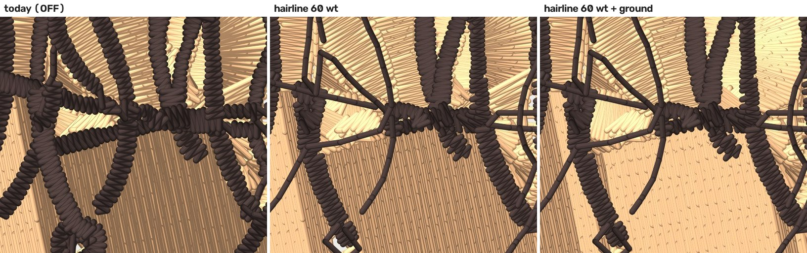
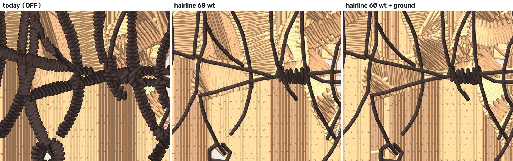

# Hairline step 3: the gate per strand, a finer fixture, the sew-out card — 2026-10-12

Follows `docs/hairline-prototype-2026-10-12.md` (#848) and
`docs/hairline-ground-2026-10-12.md` (#850). Everything here is **default
OFF** (`cfg.hairline`, already OFF). **Every number is a property of the FILE,
not of cloth.** ROADMAP gate 1 applies: nothing here has been sewn, and the
card in section 3 is how it gets sewn.

## What this changes

### 1. The width gate decides per skeleton branch

Before, a hair network was one shape and the gate gave one verdict: the
network's median width against the line, so a 0.8 mm strand inside a network
of 0.3 mm strands sewed as a run (or a 0.3 mm one sewed as a bean, if the
median went the other way).

Now `stage6_hairline.measure` walks the skeleton graph the tier already
builds (`_graph`, the same `stage6_satin._skeleton_edges` decomposition, spurs
pruned and crossing bridges merged) and decides each **branch** on its own
width.

- **Width of a branch.** The source read (`InkSource`, up to 12 profiles
  along the branch's own body pixels, unmixed against the ink colour the
  whole shape read), else the traced median of its body pixels. A branch is a
  hairline when that width is at or under the thread-weight limit
  (1.5 x the laid width: 0.60 mm at 40 wt, 0.48 at 60 wt) and its 95th
  percentile is at or under twice the limit.
- **A branch too short to read** (all of it inside a crossing's disk) follows
  its neighbours: a hairline when every branch it touches is, otherwise not.
- **Thin branches** sew as hairline runs, exactly as before: the walk, its
  path-minimising start rule (Euler's rule, nearest odd node), the
  straightest continuation at a node, the 1.5 mm stitch, the curl rule and
  the 1.0 mm floor are unchanged. Only the admitted branches are walked.
- **Thick branches** keep today's tier for the **rest of the shape's
  polygon**: the polygon minus the thin branches' ribbons (the branch's width
  read, plus 0.02 mm), the ribbon cut back by a disk round each node where a
  thin branch meets a thick one, so the thick strand keeps its own polygon
  whole through the junction; then opened by half a laid width (a rim
  narrower than a thread is not a strand) and pieces under
  `RUN_MIN_AREA_MM2` dropped. Each connected piece goes down the ladder as a
  shape of its own (`stage6_hairline.rest_planned`; stage 7 offers it to
  every tier except the hairline one), **before** the runs, so a hairline
  lies over the thick strand it crosses, like a strand over any ground.
- **The ground (#850)** goes under the hairline **parts only**
  (`measure`'s `hair_geom`, the shape minus its rest), not under the thick
  branches. A shape that is thin throughout has no rest, `hair_geom` is None
  and stage 5 uses its whole polygon, as in #850.

**It replaces the per-shape gate; there is no second flag.** With
`cfg.hairline` off none of this runs, and the OFF md5 pins hold (below). A
shape that is thin throughout takes the same path as before
(`test_a_shape_thin_throughout_is_untouched`; the crossing and curl tests of
`test_hairline_tier.py` and every #850 test pass unchanged). A shape that was
thin on average but held a wide strand used to sew whole as runs; that
behaviour is gone on purpose, because it is the defect this fixes.

OFF is byte-identical: `test_thread_profile.py` and `test_hairline_ground.py`
digitize `logo_whitebg`, `logo_alpha` and `ribbon_curve` with the flags set
explicitly and compare the md5 of each stitch stream against the md5 of the
golden FILE, written into the tests.

### 2. A finer fixture, and a fixture quirk

`tools/draw_hair_fixtures.py` now also draws
`digitizer/testdata/synthetic/hair_fine.png`: the same canvas, oval, curves,
crossings and curls as `hair_strands.png`, with the 40 strands drawn
0.25 to 0.35 mm wide (spread evenly, shuffled with a seed: the median is
exactly 0.30 mm). Provenance row in `docs/asset-provenance.json`. No
photographs, no client art.

**A quirk in the existing fixture.** `_stroke` draws with `cv2.polylines`,
which paints an *odd* thickness as the next even one: asked for 0.30 mm it
draws 0.35. So `hair_strands.png`'s "0.25 to 0.6 mm" strands are really drawn
at 0.25, 0.35, 0.45 and 0.55 (the source reads cluster there), and a 0.30 mm
median could not be drawn with it. `hair_fine` uses an exact buffer fill
(`_stroke_exact`; ink area over length reads 0.248 / 0.298 / 0.351 for 0.25 /
0.30 / 0.35). `hair_strands.png` is left byte-identical, because #848 and #850
numbers are about it.

### 3. The sew-out card

`docs/sewout/hairline-card-2026-10-12/`, written by `python -m
tools.hairline_card`. Two hoops (40 wt and 60 wt), blocks A to E, each
94 x 82 mm, every file through `digitizer_service.formats.write` (pystitch)
and read back. Its README has the hooping, needles, thread, the six sew-outs
(40 wt on a 75/11; 60 wt on a 65/9 and again on a 70/10; each on pique and on
twill), and `scoring-sheet.md` has one row per block per sew-out. The
read-back table is in the README and below.

## The fixtures, all three, at their drawn scale

`python -m tools.hairline_renders` in `digitizer/`; renders and the table in
`docs/renders/hairline-strand-gate-2026-10-12/` (`table.json`, `table.md`,
`compare_*.jpg`). Fixtures are forced to the flat class, as in #850.
"Bare fabric" is preflight's uncovered-artwork instrument, summed over every
cell, as in #850. The arms: **off40** (today), **on40**, **on60**,
**on60g** (60 wt with `hairline_over_ground`).





#### hair_strands (drawn median 0.43 mm, design 69.15 mm wide)

| | off40 | on40 | on60 | on60g |
|---|---|---|---|---|
| stitches | 26,922 | 21,285 | 25,949 | 26,480 |
| thread laid, whole design (m) | 40.08 | 34.62 | 40.32 | 40.75 |
| dark (hair / ink) thread laid (m) | 8.57 | 3.1 | 5.74 | 5.79 |
| dark-thread stitches | 8,243 | 2,594 | 5,276 | 5,310 |
| hairline shapes / strands sewn / dropped | - | 2 / 51 / 2 | 2 / 42 / 4 | 2 / 42 / 4 |
| branches: run / ladder | - | 262 / 51 | 183 / 130 | 183 / 130 |
| area left to the ladder (mm2) | - | 171.1 | 344.0 | 344.0 |
| bare fabric, total (mm2) | 4.38 | 6.88 | 4.88 | 1.81 |
| bare fabric, new vs OFF, on the ground (mm2) | 0.0 | 1.69 | 1.56 | 0.75 |
| skin fill + underlay stitches (md5 = OFF at 40 wt?) | 8,031 (same) | 8,031 (same) | 8,026 (differs) | 8,579 (differs) |
| trims / jumps | 90 / 80 | 123 / 105 | 117 / 101 | 122 / 102 |
| longest jump (mm) | 41.9 | 59.0 | 57.7 | 57.7 |
| dark stitches < 1.0 mm (excl. lock legs) | 3886 | 378 | 1848 | 1855 |
| gate: network median read (limit) -> margin (mm) | - | 0.452 (0.6) -> 0.148 | 0.452 (0.48) -> 0.028 | 0.452 (0.48) -> 0.028 |

#### hair_fine (drawn median 0.301 mm, design 69.15 mm wide)

| | off40 | on40 | on60 | on60g |
|---|---|---|---|---|
| stitches | 26,852 | 20,512 | 22,643 | 23,293 |
| thread laid, whole design (m) | 38.92 | 33.31 | 36.22 | 36.88 |
| dark (hair / ink) thread laid (m) | 7.24 | 1.62 | 1.94 | 1.94 |
| dark-thread stitches | 7,794 | 1,442 | 1,825 | 1,825 |
| hairline shapes / strands sewn / dropped | - | 2 / 59 / 3 | 2 / 57 / 5 | 2 / 57 / 5 |
| branches: run / ladder | - | 330 / 8 | 319 / 19 | 319 / 19 |
| area left to the ladder (mm2) | - | 20.0 | 41.4 | 41.4 |
| bare fabric, total (mm2) | 4.75 | 5.94 | 6.12 | 2.0 |
| bare fabric, new vs OFF, on the ground (mm2) | 0.0 | 1.5 | 1.81 | 0.69 |
| skin fill + underlay stitches (md5 = OFF at 40 wt?) | 8,410 (same) | 8,410 (same) | 8,417 (differs) | 8,904 (differs) |
| trims / jumps | 105 / 89 | 128 / 123 | 128 / 120 | 134 / 118 |
| longest jump (mm) | 53.2 | 57.8 | 53.2 | 58.3 |
| dark stitches < 1.0 mm (excl. lock legs) | 5640 | 160 | 450 | 450 |
| gate: network median read (limit) -> margin (mm) | - | 0.301 (0.6) -> 0.299 | 0.301 (0.48) -> 0.179 | 0.301 (0.48) -> 0.179 |

#### thin_script (drawn median 0.35 mm, design 55.2 mm wide)

| | off40 | on40 | on60 | on60g |
|---|---|---|---|---|
| stitches | 1,233 | 170 | 170 | 170 |
| thread laid, whole design (m) | 1.26 | 0.22 | 0.22 | 0.22 |
| dark (hair / ink) thread laid (m) | 1.26 | 0.22 | 0.22 | 0.22 |
| dark-thread stitches | 1,233 | 170 | 170 | 170 |
| hairline shapes / strands sewn / dropped | - | 4 / 4 / 0 | 4 / 4 / 0 | 4 / 4 / 0 |
| branches: run / ladder | - | 21 / 0 | 21 / 0 | 21 / 0 |
| area left to the ladder (mm2) | - | 0.0 | 0.0 | 0.0 |
| bare fabric, total (mm2) | 0.06 | 5.38 | 5.44 | 5.44 |
| bare fabric, new vs OFF, on the ground (mm2) | 0.0 | 3.75 | 3.88 | 3.88 |
| skin fill + underlay stitches (md5 = OFF at 40 wt?) | 95 (same) | 0 (differs) | 0 (differs) | 0 (differs) |
| trims / jumps | 4 / 0 | 3 / 1 | 3 / 1 | 3 / 1 |
| longest jump (mm) | 28.2 | 20.6 | 20.6 | 20.6 |
| dark stitches < 1.0 mm (excl. lock legs) | 717 | 0 | 0 | 0 |
| gate: network median read (limit) -> margin (mm) | - | 0.27 (0.6) -> 0.33 | 0.27 (0.48) -> 0.21 | 0.27 (0.48) -> 0.21 |

### The card's file checks (pystitch reading each DST back)

| | 40wt | 60wt |
|---|---|---|
| file | `hairline_card_40wt.dst` (13,553 bytes) | `hairline_card_60wt.dst` (14,375 bytes) |
| stitches in the file / in the plan | 3,883 / 3,883 | 4,158 / 4,158 |
| colour changes in the file / planned | 2 / 2 | 2 / 2 |
| extent (mm), x by y | 94.0 x 82.0 | 94.0 x 82.0 |
| x range / y range (mm) | [-47.0, 47.0] / [-41.0, 41.0] | [-47.0, 47.0] / [-41.0, 41.0] |
| inside 100 x 100 mm | yes | yes |
| longest move (mm; the writer splits above 12.1) | 13.6 | 13.6 |
| stitches under 1.0 mm that are not 0.8 mm lock legs | 611 | 696 |
|   of those, outside the expected places | 0 | 0 |
| 0.8 mm lock-leg stitches | 753 | 838 |

Stitches under 1.0 mm, by where they are:

| where | 40wt | 60wt | why |
|---|---|---|---|
| A:0.73 lines | 208 | 208 | block A's 0.73 mm lines (today's bean stride, under Melco's 1.0 floor: the test) |
| C:0.6 col | 109 | 133 | block C's 0.6 mm column (its cross is under 1.0: the test) |
| C:0.8 col | 50 | 62 | block C's 0.8 mm column (its cross is under 1.0: the test) |
| D:2.5 cap | 52 | 76 | block D lettering, as the digitizer sews it today |
| D:3.0 cap | 23 | 50 | block D lettering, as the digitizer sews it today |
| D:4.0 cap | 33 | 76 | block D lettering, as the digitizer sews it today |
| E:ground | 150 | 150 | block E's tatami: row turns at the engine's 0.15 mm pitch |

Stitches per colour stop:

| stop | thread | 40wt stitches (thread m) | 60wt stitches (thread m) |
|---|---|---|---|
| 1 | ground (mid-tone) | 776 (1.53) | 776 (1.53) |
| 2 | dark | 3,018 (3.31) | 3,293 (3.54) |
| 3 | light | 89 (0.11) | 89 (0.11) |

Block boxes in the hoop (mm, x0 y0 x1 y1, centre of the card at 0, 0):

| block | 40wt | 60wt |
|---|---|---|
| A | [-47.0, -41.0, -3.0, 14.5] | [-47.0, -41.0, -3.0, 14.5] |
| B | [3.0, -41.0, 47.0, -19.2] | [3.0, -41.0, 47.0, -19.2] |
| C | [3.0, -15.0, 47.0, 5.8] | [3.0, -15.0, 47.0, 5.8] |
| D | [3.0, 8.0, 47.0, 32.7] | [3.0, 8.0, 47.0, 32.7] |
| E | [-47.0, 18.0, -3.0, 41.0] | [-47.0, 18.0, -3.0, 41.0] |


## Against the done-tests

- **`hair_fine` admits at 60 wt with at least 0.10 mm margin: met.** The
  network's median read is 0.301 mm against the 0.48 line, a margin of
  **0.179 mm** (`test_hair_fine_admits_at_60_weight_with_margin`). 319 of its
  338 branches sew as runs; 19 (41 mm2) go to the ladder, and the render
  shows where: a knot where the tracer fused two or three neighbouring
  strands into one wider cell (the satin knot at the right of the zoom).
- **`hair_strands`: thick branches go to the normal tier, thin ones to
  runs: met** (`test_hair_strands_thick_branches_go_to_the_ladder_and_thin_ones_to_runs`).
  At 40 wt, 262 branches run and 51 (171 mm2) go to the ladder. At 60 wt,
  183 run and 130 (344 mm2, about 46% of the network's area) go to the
  ladder. The fixture's median strand is 0.43 mm, so the 0.48 line splits it
  down the middle. The picture shows what that is: the thick strands stay
  satin ropes, and the thin ones are single threads laid over them.
- **A drawn network of one 0.3 mm and one 0.8 mm branch sews the thin one as
  a single run and the thick one as today's tier: met**
  (`test_a_thin_branch_is_one_run_and_the_thick_one_keeps_todays_tier`: one
  20 mm run, one satin column over the bar, the same kind OFF sews for the
  bar alone).
- **Skin fill:** the ON arms at 40 wt without the ground are md5-identical to
  OFF for both hair fixtures (the sliver rule from #850 still holds). At 60 wt
  the skin's own satin cells sew at the 60 wt spacing, so its count moves by
  a handful (8,031 to 8,026; 8,410 to 8,417).

## What is not good, and what I did not do

- **Bare fabric is not zero.** On `hair_fine` at 60 wt it is 1.81 mm2 new on
  the ground without the ground fix and 0.69 with it. The `thin_script`
  figure (3.9 mm2 new) is its strokes' own edges on the garment: a 0.40 mm
  run down a 0.45 to 0.6 mm stroke, as in #850.
- **60 wt on `hair_strands` is mostly the ladder** (130 of 313 branches).
  That is the fixture's width against the line, not a defect of the gate, but
  it means the 60 wt story for that fixture is "thin strands as runs, thick
  strands as before".
- **Ladder pieces of a mixed shape sew a lot of short stitches.** The ON
  arms of `hair_strands` have 378 (40 wt) and 1,848 (60 wt) dark-thread
  stitches under 1.0 mm that are not lock legs, against 3,886 OFF. They are
  the ladder's own (a bean or a satin cross on a narrow rope), the same
  tiers as today.
- **The ribbon's width, the junction cut and the opening radius** (read plus
  0.02 mm; 1 local radius; half a laid width) are geometry I chose and did
  not sew. Card block E is where it shows.
- The skeleton's own kink into crossings (#848 finding 5) and the polygonal
  curls (finding 6) are unchanged; card block A tests the second.

## Reproduce

```
cd digitizer
python -m tools.draw_hair_fixtures        # three fixtures, seeded (the first two are unchanged)
python -m tools.hairline_renders          # renders, table.json, table.md
python -m tools.hairline_card             # the two hoops, README, scoring sheet
python -m pytest -q tests/test_hairline_strand_gate.py tests/test_hairline_card.py \
    tests/test_hairline_ground.py tests/test_hairline_tier.py tests/test_thread_profile.py
```
