# Lane census, 2026-10-25: auto vs "Sew as flat art" vs Kent's 6b, judged against the pro's files

**Measurement only.** ROADMAP gate 2: this changes no routing and edits no engine file; building 6b,
even OFF, waits on Kent's ruling from this table. Gate 4: every agreement figure below is
chance-corrected (kappa, or cc), none is a raw agreement. No new client art: the sheets draw only artwork this repo already ships under `testdata/`, beside the pro files it already ships; ProSeal's rows and sheet are not committed
(see "Rows not shown"). Tool: `digitizer/tools/lane_census.py`; pins: `digitizer/tests/test_lane_census.py`.

**Engine measured:** `origin/main` `d36ff80e` (digitizer_core + src tree `638d3e70398e+ae7dabf21be7`), OpenCV IPP pinned to
`avx2` as the test environment does, one process at a time. **Request:** the Studio's
(`tools.pro_pair.request`: `detect_photographic`, `faces_route_flat`, `max_colors` 6), at each job's pro width
(the registered DST's extents) and garment. Word legibility read with tesseract v5.4.0.20240606 (Windows; not the 5.3.4 CI pins, so do
not set a cc figure here against a CI-pinned one).
`origin/main` then took #1101 and #1102 (both OFF flags); MFab LC and Becker beanie, auto and forced flat, were re-run on `46949f78` and their DSTs are byte-identical to the rows quoted here.

## The answer in six lines

1. **The question does not shrink.** Of 14 pro jobs, **4 reach the flat lane today**, and
   all four are ONE logo (Becker's main artwork at four sizes). **8 reach gradient** and
   **2 reach `photo_scene`** (Tires, and MFab's hat). By distinct artwork it is 1 flat, 7 gradient, 2
   `photo_scene` of 10. (DOCTRINE 2026-09-09's "every real logo at 80 mm is gradient" and MASTER_SCOPE's "6 of 7" are older
   readings at one width; Becker is flat at all four of its pro widths, 76.5 to 101.9 mm.)
2. **6b's gate fires on 8 of 14** (gradient class, ramp gate refuses, nothing photographic): every gradient job. It is shut
   on the two `photo_scene` jobs, which 6b's text ("a gradient-class design") never touches: for those the button stays the only fix.
3. **6b as written sews the same file the button does.** On 7 of the 8 jobs where it fires the DST is byte-identical to forced flat's; on Drone it
   differs by 42 stitches and 0 trims. Keeping the gradient class "for reporting" changes nothing
   that is sewn, so Kent's 6b and the planner's variant are one decision (to a few stitches on Drone): *when the ramp gate refuses a non-photographic gradient design, sew flat.*
4. **Against the pro's file the route is close to a wash on the two kappas** (largest move 0.08; mixed sign), **and flat sews more trims than auto on
   8 of the 10 jobs where they differ** (median +7; fewer on Fremont hat and MFab LC).
5. **The cone budget no longer separates the routes**: no route on any job sews over 6 cones, and flat changes the cone count on none of the 10.
   (DOCTRINE 2026-09-10's Golden Tee, 24 cones under a budget of 12, is gone: 6 in both arms.)
6. **These instruments cannot see what Kent ranked forced flat on** (edges, which colour lands where: his 2026-09-30 Instagram-icon call). The
   sheets below put the arms side by side for the eye; the numbers do not decide it.

## 6b, quoted from the plan

From `docs/superpowers/plans/2026-09-08-real-logo-lane-and-thin-strokes.md` §5a, verbatim (a test pins that this is a substring of the plan):

> PR 6b routes by consequence instead of by statistic: when `design_ramp.fit_design_ramp` REFUSES a gradient-class design and `is_photographic` is false (declared, or detected per review item 13), segment with `stage2_quantize.quantize` while keeping the gradient class for reporting.

**Measured as written, not paraphrased.** `sixb_shim` wraps `classify`, `fit_design_ramp`, `photo_segment` and `quantize` in `digitizer_core.pipeline`
for the length of one run and puts them back; no engine file changes. `fit_design_ramp` is only called for a gradient-class design, so a recorded
refusal is "REFUSES a gradient-class design"; `cfg.is_photographic is not True` on the pipeline's local config is "declared, or detected"; then
`photo_segment` hands the work to `quantize` and **the classification is left "gradient"**, so every later stage still sees the gradient class: the
plan's "keeping the gradient class for reporting" read literally. Because 6b *could* be measured as written, nothing is substituted for it; the
**planner's variant** is shown as its own arm, labelled as the planner's and not Kent's: the whole flat route (`forced_class="flat"`) wherever the same gate
fires, auto elsewhere. Its row is therefore a pick between two arms that ran.

Arms: **auto**; **forced flat** = the Studio's button, `tools.flip_sheet.PROXIES["flat_off"]` imported, not retyped; **6b as written**; **planner's variant**.

## What the columns are

- **lane**: stage 0's class, and which region former ran (`photo_segment` is SLIC+RAG; `quantize` is the flat k-means), observed by the shim, not inferred.
- **stitches / trims**: read from the written DST by one pystitch reader, the pro's file and ours alike (`pro_pair.pro_counts`); the pro's trims are the DST's.
- **cones (budget 6)**: distinct thread numbers that sew (`color_cap`'s count). The pro's are the PES's distinct colours, or `n/a (N stops)` for a DST-only job (a DST has no palette).
- **thread kappa**: `blockcensus.grouping_join`. Each of our *sewn* regions is assigned to the pro colour block it sits on most, and kappa is taken of that against the pro's visible
  block map over the area both cover, after the scorecard's translation registration. It asks "does our region partition reproduce the pro's colour allocation". It is not
  1.0 even for a professional: independent same-logo pro pairs join at 0.83 to 0.89, and one pro's own two saves of one job at 0.65 (`blockcensus` docstring, 2026-08-24).
  `d` marks a **degenerate** cell (the joint area is one label: nothing to discriminate); degenerate cells are left out of every mean and delta.
  (The brief asked for "thread kappa against the art"; this is the thread/colour-allocation kappa the repo has, taken against the pro's file as the whole census is.)
- **sttype kappa (raw / chance)**: the scorecard's stitch-type (satin / fill / run) agreement over the shared solid area, the figure `pro_parity/kappacheck.py` compares, with the raw
  agreement and the chance floor beside it. The scorecard clamps below-chance to 0.00.
- **cc**: `tools/word_legibility.py`'s chance-corrected per-word legibility at the native size, over the words scored in BOTH files, on the jobs with words pinned
  (`testdata/word_legibility_words.json`); `-` elsewhere.

## 1. Which lane each pro job reaches today

| job | garment | pro width | lane today (class / former) | ramp gate | photographic | 6b gate |
|---|---|---:|---|---|---|---|
| becker_hat_large | hat_front | 101.9 mm | flat / quantize | n/a (not gradient) | no | shut: stage 0 says flat |
| becker_lc_large | left_chest | 95.7 mm | flat / quantize | n/a (not gradient) | no | shut: stage 0 says flat |
| becker_hat_small | hat_front | 76.5 mm | flat / quantize | n/a (not gradient) | no | shut: stage 0 says flat |
| becker_chest_small | left_chest | 76.5 mm | flat / quantize | n/a (not gradient) | no | shut: stage 0 says flat |
| becker_beanie | beanie | 79.8 mm | gradient / photo_segment | refuses | no | **fires** |
| hotel_fremont_hat | hat_front | 92.6 mm | gradient / photo_segment | refuses | no | **fires** |
| hotel_fremont_patch | patch | 92.5 mm | gradient / photo_segment | refuses | no | **fires** |
| gaulke_roofing_hat | hat_front | 114.2 mm | gradient / photo_segment | refuses | no | **fires** |
| gaulke_roofing_lc | left_chest | 95.2 mm | gradient / photo_segment | refuses | no | **fires** |
| golf_hat | hat_front | 74.9 mm | gradient / photo_segment | refuses | no | **fires** |
| precision_drone | hat_front | 62.6 mm | gradient / photo_segment | refuses | no | **fires** |
| tires_hat_3d | hat_front | 114.3 mm | photo_scene / photo_segment | n/a (not gradient) | no | shut: stage 0 says photo_scene |
| mfab_hat | hat_front | 104.9 mm | photo_scene / photo_segment | n/a (not gradient) | no | shut: stage 0 says photo_scene |
| mfab_lc | left_chest | 96.7 mm | gradient / photo_segment | refuses | no | **fires** |

The cheap probe (stages 0 and 1 and the ramp fit, stopped at the region-former dispatch) names the same class and the same gate as the full run on 14 of 14 jobs.
The job list is Becker's four files and `becker_beanie`, Fremont hat and patch, Bridge, Gaulke hat and LC, Golden Tee, Drone, Tires, and MFab hat and LC.
Bridge is not measured (below). `becker_beanie`'s art is a different raster from Becker's main logo (`testdata/art/logo_toat_beanie.png`) and is gradient.

## 2. 6b as written against the button

| job | auto class | forced flat == auto | 6b == forced flat | 6b minus flat (stitches / trims) |
|---|---|---|---|---|
| becker_hat_large | flat | byte-identical | n/a (gate shut) |  |
| becker_lc_large | flat | byte-identical | n/a (gate shut) |  |
| becker_hat_small | flat | byte-identical | n/a (gate shut) |  |
| becker_chest_small | flat | byte-identical | n/a (gate shut) |  |
| becker_beanie | gradient | differs | byte-identical |  |
| hotel_fremont_hat | gradient | differs | byte-identical |  |
| hotel_fremont_patch | gradient | differs | byte-identical |  |
| gaulke_roofing_hat | gradient | differs | byte-identical |  |
| gaulke_roofing_lc | gradient | differs | byte-identical |  |
| golf_hat | gradient | differs | byte-identical |  |
| precision_drone | gradient | differs | differs | -42 / +0 |
| tires_hat_3d | photo_scene | differs | n/a (gate shut) |  |
| mfab_hat | photo_scene | differs | n/a (gate shut) |  |
| mfab_lc | gradient | differs | byte-identical |  |

Forced flat on a job stage 0 already calls flat is a no-op (byte-identical on all four Becker files). On a gradient job 6b and the button sew the same file but for Drone,
where the 6b arm differs by 42 stitches. (Why Drone differs was not chased: it is one job and a few stitches.)

## 3. What each route costs against the pro

Every job counts once here, but four of the 14 rows are Becker, which is flat on every arm and byte-identical across them; read the paired tables, which list only the jobs where the arm moved.

| route | jobs | lanes reached | median stitches / pro | median trims / pro | jobs over 6 cones | mean thread kappa | mean sttype kappa |
|---|---:|---|---:|---:|---:|---:|---:|
| auto | 14 | flat / quantize x4, gradient / photo_segment x8, photo_scene / photo_segment x2 | 0.82 | 1.87 | 0 | +0.51 (n=11) | 0.15 (n=14) |
| forced flat (Sew as flat art) | 14 | flat / quantize x14 | 0.89 | 1.88 | 0 | +0.52 (n=11) | 0.15 (n=14) |
| 6b, as written (Kent's text) | 14 | flat / quantize x4, gradient / quantize x8, photo_scene / photo_segment x2 | 0.89 | 1.88 | 0 | +0.52 (n=11) | 0.15 (n=14) |
| planner's variant (NOT Kent's) | 14 | flat / quantize x12, photo_scene / photo_segment x2 | 0.89 | 1.88 | 0 | +0.52 (n=11) | 0.15 (n=14) |

**Forced flat minus auto**, on the 10 jobs where it differs (`closer` = nearer the pro's count than auto was):

| job | stitches auto -> flat (pro) | trims auto -> flat (pro) | thread kappa delta | sttype kappa delta |
|---|---|---|---:|---:|
| becker_beanie | 8133 -> 8641 (11411) | 29 -> 64 (11) | -0.02 | 0.00 |
| hotel_fremont_hat | 17449 -> 17472 (17067) | 43 -> 39 (21) | 0.00 | +0.02 |
| hotel_fremont_patch | 24243 -> 25104 (15458) | 58 -> 69 (21) | +0.02 | +0.01 |
| gaulke_roofing_hat | 7735 -> 7756 (6138) | 29 -> 32 (42) | - | 0.00 |
| gaulke_roofing_lc | 6495 -> 6546 (5151) | 30 -> 33 (42) | - | -0.01 |
| golf_hat | 8220 -> 10655 (5973) | 24 -> 40 (10) | +0.02 | -0.08 |
| precision_drone | 13438 -> 15739 (14552) | 95 -> 124 (59) | +0.07 | +0.01 |
| tires_hat_3d | 8283 -> 7924 (5555) | 7 -> 9 (10) | - | 0.00 |
| mfab_hat | 11625 -> 13051 (17568) | 51 -> 62 (19) | 0.00 | 0.00 |
| mfab_lc | 11401 -> 10807 (15786) | 68 -> 56 (20) | 0.00 | -0.05 |
| **10 jobs** | closer to the pro's count on 3 | closer on 5 | up 3 / same 3 / down 1 | up 3 / same 4 / down 3 |

**6b as written minus auto** (the 8 gate-firing jobs; the planner's variant is the same 8 but for Drone's 42 stitches):

| job | stitches auto -> sixb (pro) | trims auto -> sixb (pro) | thread kappa delta | sttype kappa delta |
|---|---|---|---:|---:|
| becker_beanie | 8133 -> 8641 (11411) | 29 -> 64 (11) | -0.02 | 0.00 |
| hotel_fremont_hat | 17449 -> 17472 (17067) | 43 -> 39 (21) | 0.00 | +0.02 |
| hotel_fremont_patch | 24243 -> 25104 (15458) | 58 -> 69 (21) | +0.02 | +0.01 |
| gaulke_roofing_hat | 7735 -> 7756 (6138) | 29 -> 32 (42) | - | 0.00 |
| gaulke_roofing_lc | 6495 -> 6546 (5151) | 30 -> 33 (42) | - | -0.01 |
| golf_hat | 8220 -> 10655 (5973) | 24 -> 40 (10) | +0.02 | -0.08 |
| precision_drone | 13438 -> 15697 (14552) | 95 -> 124 (59) | +0.07 | +0.01 |
| mfab_lc | 11401 -> 10807 (15786) | 68 -> 56 (20) | 0.00 | -0.05 |
| **8 jobs** | closer to the pro's count on 1 | closer on 4 | up 3 / same 2 / down 1 | up 3 / same 2 / down 3 |

**Word legibility (cc), native size**, words scored in both files, read with tesseract v5.4.0.20240606:

| job | words (n) | auto | forced flat | 6b as written | the pro |
|---|---|---:|---:|---:|---:|
| hotel_fremont_hat | 8 (EST, 1895, THE, HOTEL, FREMONT, EAT, STAY, PLAY) | +0.60 | +0.63 | +0.63 | +1.00 |
| becker_hat_large | 2 (BECKER, MARINE) | +1.00 | +1.00 | = auto | +1.00 |
| mfab_hat (`photo_scene`: 6b does not touch it) | 4 (MFAB, AND, WELDING, LLC) | +0.32 | +0.29 | = auto | +0.60 |

Eight words on Fremont means one word moving is 0.03 to 0.1; read the cc as "no visible difference", not as a gain. Becker reads at 1.00 on every arm (two words; the artwork itself is the ceiling).
Tesseract's per-word cc is the only legibility figure here; it is not a sew-out (ROADMAP gate 1).

## 4. Per job, with the sheet

Each sheet is `art | auto | forced flat | 6b (where its gate fires) | pro`, each drawn in its own frame at the same scale (`tools.pro_pair`'s tile helpers, imported).
`python -m tools.lane_census sheet` redraws them from the cache.

### becker_hat_large - hat_front, 101.9 mm

6b gate: **does not fire** (stage 0 says flat).

| route | lane (class / former) | stitches | trims | cones (budget 6) | thread kappa | sttype kappa (raw / chance) | cc |
|---|---|---:|---:|---:|---:|---:|---:|
| the pro | - | 12356 | 10 | 2 | - | - | +1.00 |
| auto | flat / quantize | 7859 | 19 | 1 | +0.68 | 0.00 (0.46 / 0.52) | +1.00 |
| forced flat (Sew as flat art) | flat / quantize | 7859 | 19 | 1 | +0.68 | 0.00 (0.46 / 0.52) | +1.00 |
| 6b, as written (Kent's text) - = auto | flat / quantize | 7859 | 19 | 1 | +0.68 | 0.00 (0.46 / 0.52) | +1.00 |
| planner's variant (NOT Kent's) - = auto | flat / quantize | 7859 | 19 | 1 | +0.68 | 0.00 (0.46 / 0.52) | +1.00 |

### becker_lc_large - left_chest, 95.7 mm

6b gate: **does not fire** (stage 0 says flat).

| route | lane (class / former) | stitches | trims | cones (budget 6) | thread kappa | sttype kappa (raw / chance) | cc |
|---|---|---:|---:|---:|---:|---:|---:|
| the pro | - | 11274 | 12 | 2 | - | - | - |
| auto | flat / quantize | 7355 | 22 | 1 | +0.18 | 0.00 (0.49 / 0.54) | - |
| forced flat (Sew as flat art) | flat / quantize | 7355 | 22 | 1 | +0.18 | 0.00 (0.49 / 0.54) | - |
| 6b, as written (Kent's text) - = auto | flat / quantize | 7355 | 22 | 1 | +0.18 | 0.00 (0.49 / 0.54) | - |
| planner's variant (NOT Kent's) - = auto | flat / quantize | 7355 | 22 | 1 | +0.18 | 0.00 (0.49 / 0.54) | - |

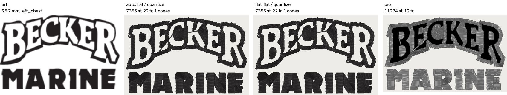

### becker_hat_small - hat_front, 76.5 mm

6b gate: **does not fire** (stage 0 says flat).

| route | lane (class / former) | stitches | trims | cones (budget 6) | thread kappa | sttype kappa (raw / chance) | cc |
|---|---|---:|---:|---:|---:|---:|---:|
| the pro | - | 8694 | 11 | 2 | - | - | - |
| auto | flat / quantize | 5162 | 17 | 1 | +0.70 | 0.05 (0.71 / 0.69) | - |
| forced flat (Sew as flat art) | flat / quantize | 5162 | 17 | 1 | +0.70 | 0.05 (0.71 / 0.69) | - |
| 6b, as written (Kent's text) - = auto | flat / quantize | 5162 | 17 | 1 | +0.70 | 0.05 (0.71 / 0.69) | - |
| planner's variant (NOT Kent's) - = auto | flat / quantize | 5162 | 17 | 1 | +0.70 | 0.05 (0.71 / 0.69) | - |

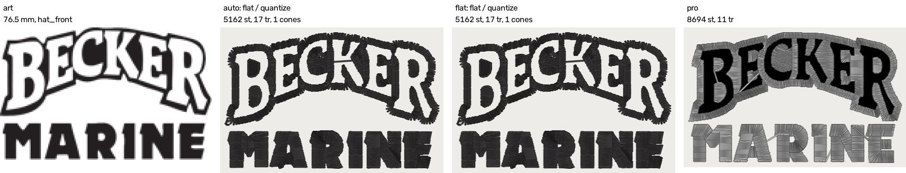

### becker_chest_small - left_chest, 76.5 mm

6b gate: **does not fire** (stage 0 says flat).

| route | lane (class / former) | stitches | trims | cones (budget 6) | thread kappa | sttype kappa (raw / chance) | cc |
|---|---|---:|---:|---:|---:|---:|---:|
| the pro | - | 8694 | 12 | 2 | - | - | - |
| auto | flat / quantize | 4955 | 17 | 1 | +0.20 | 0.12 (0.75 / 0.72) | - |
| forced flat (Sew as flat art) | flat / quantize | 4955 | 17 | 1 | +0.20 | 0.12 (0.75 / 0.72) | - |
| 6b, as written (Kent's text) - = auto | flat / quantize | 4955 | 17 | 1 | +0.20 | 0.12 (0.75 / 0.72) | - |
| planner's variant (NOT Kent's) - = auto | flat / quantize | 4955 | 17 | 1 | +0.20 | 0.12 (0.75 / 0.72) | - |

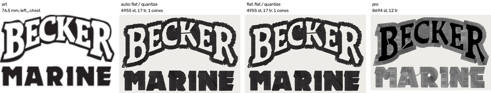

### becker_beanie - beanie, 79.8 mm

6b gate: **fires** (gradient class, ramp refused, not photographic).

| route | lane (class / former) | stitches | trims | cones (budget 6) | thread kappa | sttype kappa (raw / chance) | cc |
|---|---|---:|---:|---:|---:|---:|---:|
| the pro | - | 11411 | 11 | 3 | - | - | - |
| auto | gradient / photo_segment | 8133 | 29 | 3 | +0.49 | 0.00 (0.48 / 0.48) | - |
| forced flat (Sew as flat art) | flat / quantize | 8641 | 64 | 3 | +0.48 | 0.00 (0.44 / 0.46) | - |
| 6b, as written (Kent's text) | gradient / quantize | 8641 | 64 | 3 | +0.48 | 0.00 (0.44 / 0.46) | - |
| planner's variant (NOT Kent's) - = flat | flat / quantize | 8641 | 64 | 3 | +0.48 | 0.00 (0.44 / 0.46) | - |

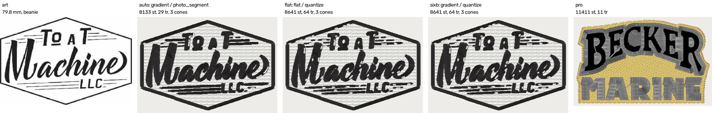

### hotel_fremont_hat - hat_front, 92.6 mm

6b gate: **fires** (gradient class, ramp refused, not photographic).

| route | lane (class / former) | stitches | trims | cones (budget 6) | thread kappa | sttype kappa (raw / chance) | cc |
|---|---|---:|---:|---:|---:|---:|---:|
| the pro | - | 17067 | 21 | 3 | - | - | +1.00 |
| auto | gradient / photo_segment | 17449 | 43 | 3 | +0.45 | 0.37 (0.64 / 0.43) | +0.60 |
| forced flat (Sew as flat art) | flat / quantize | 17472 | 39 | 3 | +0.45 | 0.39 (0.65 / 0.43) | +0.63 |
| 6b, as written (Kent's text) | gradient / quantize | 17472 | 39 | 3 | +0.45 | 0.39 (0.65 / 0.43) | +0.63 |
| planner's variant (NOT Kent's) - = flat | flat / quantize | 17472 | 39 | 3 | +0.45 | 0.39 (0.65 / 0.43) | +0.63 |

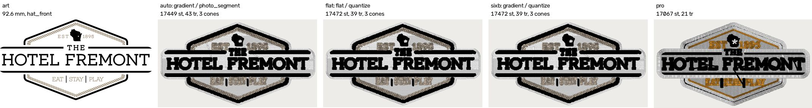

### hotel_fremont_patch - patch, 92.5 mm

6b gate: **fires** (gradient class, ramp refused, not photographic).

| route | lane (class / former) | stitches | trims | cones (budget 6) | thread kappa | sttype kappa (raw / chance) | cc |
|---|---|---:|---:|---:|---:|---:|---:|
| the pro | - | 15458 | 21 | 4 | - | - | - |
| auto | gradient / photo_segment | 24243 | 58 | 3 | +0.43 | 0.53 (0.75 / 0.47) | - |
| forced flat (Sew as flat art) | flat / quantize | 25104 | 69 | 3 | +0.45 | 0.53 (0.75 / 0.46) | - |
| 6b, as written (Kent's text) | gradient / quantize | 25104 | 69 | 3 | +0.45 | 0.53 (0.75 / 0.46) | - |
| planner's variant (NOT Kent's) - = flat | flat / quantize | 25104 | 69 | 3 | +0.45 | 0.53 (0.75 / 0.46) | - |

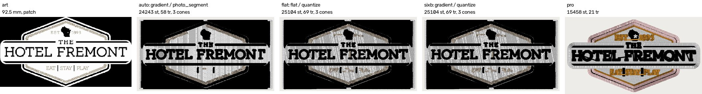

### gaulke_roofing_hat - hat_front, 114.2 mm

6b gate: **fires** (gradient class, ramp refused, not photographic).

| route | lane (class / former) | stitches | trims | cones (budget 6) | thread kappa | sttype kappa (raw / chance) | cc |
|---|---|---:|---:|---:|---:|---:|---:|
| the pro | - | 6138 | 42 | n/a (1 stops) | - | - | - |
| auto | gradient / photo_segment | 7735 | 29 | 2 | +1.00d | 0.19 (0.86 / 0.83) | - |
| forced flat (Sew as flat art) | flat / quantize | 7756 | 32 | 2 | +1.00d | 0.18 (0.86 / 0.83) | - |
| 6b, as written (Kent's text) | gradient / quantize | 7756 | 32 | 2 | +1.00d | 0.18 (0.86 / 0.83) | - |
| planner's variant (NOT Kent's) - = flat | flat / quantize | 7756 | 32 | 2 | +1.00d | 0.18 (0.86 / 0.83) | - |

### gaulke_roofing_lc - left_chest, 95.2 mm

6b gate: **fires** (gradient class, ramp refused, not photographic).

| route | lane (class / former) | stitches | trims | cones (budget 6) | thread kappa | sttype kappa (raw / chance) | cc |
|---|---|---:|---:|---:|---:|---:|---:|
| the pro | - | 5151 | 42 | n/a (1 stops) | - | - | - |
| auto | gradient / photo_segment | 6495 | 30 | 2 | +1.00d | 0.28 (0.91 / 0.87) | - |
| forced flat (Sew as flat art) | flat / quantize | 6546 | 33 | 2 | +1.00d | 0.27 (0.90 / 0.86) | - |
| 6b, as written (Kent's text) | gradient / quantize | 6546 | 33 | 2 | +1.00d | 0.27 (0.90 / 0.86) | - |
| planner's variant (NOT Kent's) - = flat | flat / quantize | 6546 | 33 | 2 | +1.00d | 0.27 (0.90 / 0.86) | - |

### golf_hat - hat_front, 74.9 mm

6b gate: **fires** (gradient class, ramp refused, not photographic).

| route | lane (class / former) | stitches | trims | cones (budget 6) | thread kappa | sttype kappa (raw / chance) | cc |
|---|---|---:|---:|---:|---:|---:|---:|
| the pro | - | 5973 | 10 | 3 | - | - | - |
| auto | gradient / photo_segment | 8220 | 24 | 6 | +0.86 | 0.08 (0.92 / 0.92) | - |
| forced flat (Sew as flat art) | flat / quantize | 10655 | 40 | 6 | +0.89 | 0.00 (0.83 / 0.84) | - |
| 6b, as written (Kent's text) | gradient / quantize | 10655 | 40 | 6 | +0.89 | 0.00 (0.83 / 0.84) | - |
| planner's variant (NOT Kent's) - = flat | flat / quantize | 10655 | 40 | 6 | +0.89 | 0.00 (0.83 / 0.84) | - |

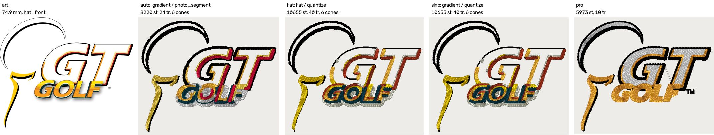

### precision_drone - hat_front, 62.6 mm

6b gate: **fires** (gradient class, ramp refused, not photographic).

| route | lane (class / former) | stitches | trims | cones (budget 6) | thread kappa | sttype kappa (raw / chance) | cc |
|---|---|---:|---:|---:|---:|---:|---:|
| the pro | - | 14552 | 59 | 8 (+2) | - | - | - |
| auto | gradient / photo_segment | 13438 | 95 | 6 | +0.51 | 0.25 (0.66 / 0.55) | - |
| forced flat (Sew as flat art) | flat / quantize | 15739 | 124 | 6 | +0.58 | 0.27 (0.66 / 0.54) | - |
| 6b, as written (Kent's text) | gradient / quantize | 15697 | 124 | 6 | +0.58 | 0.27 (0.66 / 0.54) | - |
| planner's variant (NOT Kent's) - = flat | flat / quantize | 15739 | 124 | 6 | +0.58 | 0.27 (0.66 / 0.54) | - |

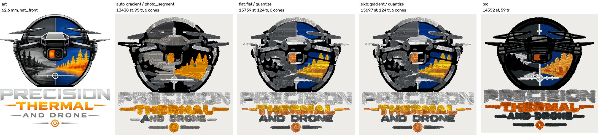

### tires_hat_3d - hat_front, 114.3 mm

6b gate: **does not fire** (stage 0 says photo_scene).

| route | lane (class / former) | stitches | trims | cones (budget 6) | thread kappa | sttype kappa (raw / chance) | cc |
|---|---|---:|---:|---:|---:|---:|---:|
| the pro | - | 5555 | 10 | 2 | - | - | - |
| auto | photo_scene / photo_segment | 8283 | 7 | 1 | +1.00d | 0.00 (0.43 / 0.43) | - |
| forced flat (Sew as flat art) | flat / quantize | 7924 | 9 | 1 | +1.00d | 0.00 (0.40 / 0.40) | - |
| 6b, as written (Kent's text) - = auto | photo_scene / photo_segment | 8283 | 7 | 1 | +1.00d | 0.00 (0.43 / 0.43) | - |
| planner's variant (NOT Kent's) - = auto | photo_scene / photo_segment | 8283 | 7 | 1 | +1.00d | 0.00 (0.43 / 0.43) | - |

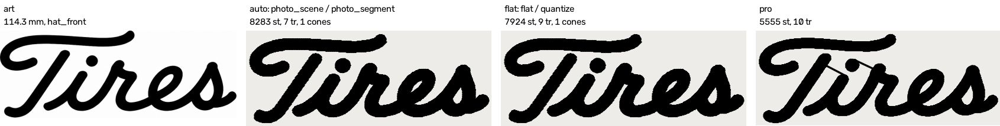

### mfab_hat - hat_front, 104.9 mm

6b gate: **does not fire** (stage 0 says photo_scene).

| route | lane (class / former) | stitches | trims | cones (budget 6) | thread kappa | sttype kappa (raw / chance) | cc |
|---|---|---:|---:|---:|---:|---:|---:|
| the pro | - | 17568 | 19 | 2 | - | - | +0.60 |
| auto | photo_scene / photo_segment | 11625 | 51 | 2 | +0.57 | 0.16 (0.54 / 0.46) | +0.32 |
| forced flat (Sew as flat art) | flat / quantize | 13051 | 62 | 2 | +0.57 | 0.15 (0.53 / 0.45) | +0.29 |
| 6b, as written (Kent's text) - = auto | photo_scene / photo_segment | 11625 | 51 | 2 | +0.57 | 0.16 (0.54 / 0.46) | +0.32 |
| planner's variant (NOT Kent's) - = auto | photo_scene / photo_segment | 11625 | 51 | 2 | +0.57 | 0.16 (0.54 / 0.46) | +0.32 |

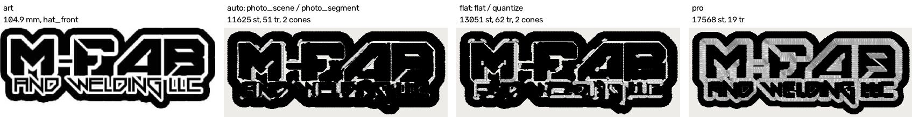

### mfab_lc - left_chest, 96.7 mm

6b gate: **fires** (gradient class, ramp refused, not photographic).

| route | lane (class / former) | stitches | trims | cones (budget 6) | thread kappa | sttype kappa (raw / chance) | cc |
|---|---|---:|---:|---:|---:|---:|---:|
| the pro | - | 15786 | 20 | 2 | - | - | - |
| auto | gradient / photo_segment | 11401 | 68 | 2 | +0.56 | 0.14 (0.47 / 0.38) | - |
| forced flat (Sew as flat art) | flat / quantize | 10807 | 56 | 2 | +0.56 | 0.09 (0.47 / 0.41) | - |
| 6b, as written (Kent's text) | gradient / quantize | 10807 | 56 | 2 | +0.56 | 0.09 (0.47 / 0.41) | - |
| planner's variant (NOT Kent's) - = flat | flat / quantize | 10807 | 56 | 2 | +0.56 | 0.09 (0.47 / 0.41) | - |

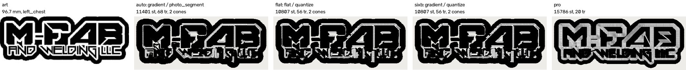

## 5. What moved since the first pass (W3-13, and the three flags #1057 flipped ON)

The first pass was on `97bdfa4f`. `origin/main` then took #1098 (W3-13: stage 0's `gradient_smoothness` no longer follows the allocator; no threshold moved), #1057 (three layout flags ON),
#1094, #1097 and #1099, so every row was re-measured on `d36ff80e`. **No lane moved**: all 15 jobs (14 here, ProSeal local) reach the same class and the same gate on both engines, so W3-13 flipped no
gradient/flat call on a pro job. **Every sewn file moved** (0 of 36 rows byte-identical; the engine's defaults changed under #1057): stitch counts moved by -6.5 % to +2.6 % and trim counts by
-46 % to +0 %, and every kappa and cc in this doc is the new engine's. The headline numbers do not change between the two passes (the lanes; 7 of 8 byte-identical; flat sewing more trims on 8 of 10 jobs, though Fremont hat's sign flipped), so this doc quotes the new engine. The rows that moved:

| job | arm | lane old -> new | stitches | trims | cones |
|---|---|---|---|---|---|
| becker_hat_large | auto | flat / quantize | 8056 -> 7859 | 19 -> 19 | 1 -> 1 |
| becker_hat_large | flat | flat / quantize | 8056 -> 7859 | 19 -> 19 | 1 -> 1 |
| becker_lc_large | auto | flat / quantize | 7435 -> 7355 | 22 -> 22 | 1 -> 1 |
| becker_lc_large | flat | flat / quantize | 7435 -> 7355 | 22 -> 22 | 1 -> 1 |
| becker_hat_small | auto | flat / quantize | 5243 -> 5162 | 17 -> 17 | 1 -> 1 |
| becker_hat_small | flat | flat / quantize | 5243 -> 5162 | 17 -> 17 | 1 -> 1 |
| becker_chest_small | auto | flat / quantize | 5026 -> 4955 | 17 -> 17 | 1 -> 1 |
| becker_chest_small | flat | flat / quantize | 5026 -> 4955 | 17 -> 17 | 1 -> 1 |
| becker_beanie | auto | gradient / photo_segment | 8237 -> 8133 | 31 -> 29 | 3 -> 3 |
| becker_beanie | flat | flat / quantize | 8890 -> 8641 | 65 -> 64 | 3 -> 3 |
| becker_beanie | sixb | gradient / quantize | 8890 -> 8641 | 65 -> 64 | 3 -> 3 |
| hotel_fremont_hat | auto | gradient / photo_segment | 18573 -> 17449 | 54 -> 43 | 3 -> 3 |
| hotel_fremont_hat | flat | flat / quantize | 18513 -> 17472 | 57 -> 39 | 3 -> 3 |
| hotel_fremont_hat | sixb | gradient / quantize | 18513 -> 17472 | 57 -> 39 | 3 -> 3 |
| hotel_fremont_patch | auto | gradient / photo_segment | 23703 -> 24243 | 78 -> 58 | 3 -> 3 |
| hotel_fremont_patch | flat | flat / quantize | 24599 -> 25104 | 89 -> 69 | 3 -> 3 |
| hotel_fremont_patch | sixb | gradient / quantize | 24599 -> 25104 | 89 -> 69 | 3 -> 3 |
| gaulke_roofing_hat | auto | gradient / photo_segment | 8090 -> 7735 | 33 -> 29 | 2 -> 2 |
| gaulke_roofing_hat | flat | flat / quantize | 8143 -> 7756 | 35 -> 32 | 2 -> 2 |
| gaulke_roofing_hat | sixb | gradient / quantize | 8143 -> 7756 | 35 -> 32 | 2 -> 2 |
| gaulke_roofing_lc | auto | gradient / photo_segment | 6724 -> 6495 | 36 -> 30 | 2 -> 2 |
| gaulke_roofing_lc | flat | flat / quantize | 6736 -> 6546 | 36 -> 33 | 2 -> 2 |
| gaulke_roofing_lc | sixb | gradient / quantize | 6736 -> 6546 | 36 -> 33 | 2 -> 2 |
| golf_hat | auto | gradient / photo_segment | 8288 -> 8220 | 31 -> 24 | 6 -> 6 |
| golf_hat | flat | flat / quantize | 10779 -> 10655 | 74 -> 40 | 6 -> 6 |
| golf_hat | sixb | gradient / quantize | 10779 -> 10655 | 74 -> 40 | 6 -> 6 |
| precision_drone | auto | gradient / photo_segment | 14077 -> 13438 | 106 -> 95 | 6 -> 6 |
| precision_drone | flat | flat / quantize | 16790 -> 15739 | 130 -> 124 | 6 -> 6 |
| precision_drone | sixb | gradient / quantize | 16789 -> 15697 | 131 -> 124 | 6 -> 6 |
| tires_hat_3d | auto | photo_scene / photo_segment | 8075 -> 8283 | 9 -> 7 | 1 -> 1 |
| tires_hat_3d | flat | flat / quantize | 8198 -> 7924 | 11 -> 9 | 1 -> 1 |
| mfab_hat | auto | photo_scene / photo_segment | 11855 -> 11625 | 64 -> 51 | 2 -> 2 |
| mfab_hat | flat | flat / quantize | 13327 -> 13051 | 71 -> 62 | 2 -> 2 |
| mfab_lc | auto | gradient / photo_segment | 11691 -> 11401 | 69 -> 68 | 2 -> 2 |
| mfab_lc | flat | flat / quantize | 11061 -> 10807 | 58 -> 56 | 2 -> 2 |
| mfab_lc | sixb | gradient / quantize | 11061 -> 10807 | 58 -> 56 | 2 -> 2 |
| **0 of 36 rows byte-identical** | | | | | |

## 6. What this does not show

- **Edges and colour placement.** The instruments compare our stitches to the pro's stitches, or our words to the artwork's. They cannot see what Kent saw on the Instagram icon on 2026-09-30
  (the gradient lane's region edges are superpixel edges, which `snap_region_edges` then cut but did not cure). That file is not in this corpus. Look at the sheets: the Golden Tee and Drone sheets show the two lanes
  putting different colours in different places, which neither kappa registers.
- **n.** 14 jobs, 10 distinct artworks, one of which (Becker) is four of the rows and sits flat on every arm. The paired tables have 7 usable thread-kappa pairs and 10 stitch-type pairs; the
  largest moves are 0.08 (stitch type) and 0.07 (thread). Independent pro pairs themselves agree at 0.83 to 0.89 on the thread kappa, and one pro's two saves of one job at 0.65, so
  no move here is distinguishable from the instrument's own spread.
- **One digitizer's choices.** The pro's file is one professional's decisions, and the two kappas score conformance to them (ROADMAP: read every number with the ceiling).
- **Sewing.** Nothing here is fabric (ROADMAP gate 1).

## Rows not shown

- **ProSeal** (`proseal_hat`): the art is not committed. It is measured locally (`--local`) and its rows are not in this doc or the PR; they are in the session's shared notes.
- **Bridge Bar** (`bridge_hat`): no pro file for it on this machine (not under `scratch_kent/Embroidery Files`, not in `Embroidery Files.zip`), so it has no row. Its art is committed
  (`testdata/photo/logo_bridge_bar.jpg`); the lane it reaches could be read with `lane_census premise` once a pro width exists.
- The job list is `tools/pro_intake.pair_record` (W3-08 merged as `pro_intake`, there is no `tools/pro_registry.py`), which carries `border_census.PAIRS`' rows and Golden Tee.

## Reproduce

From `digitizer/`, with the venv's python, one command at a time (the premise is minutes, a full run an hour or two on a loaded laptop):

    python -m tools.lane_census premise          # which lane each job reaches
    python -m tools.lane_census run              # auto / flat / 6b, both kappas (resumable; --force re-runs)
    python -m tools.lane_census cc               # word legibility on the pinned jobs
    python -m tools.lane_census table            # every table above
    python -m tools.lane_census sheet            # the sheets
    python -m tools.lane_census diff --old CACHE # which rows moved against an earlier engine's cache
    python -m pytest -q tests/test_lane_census.py
