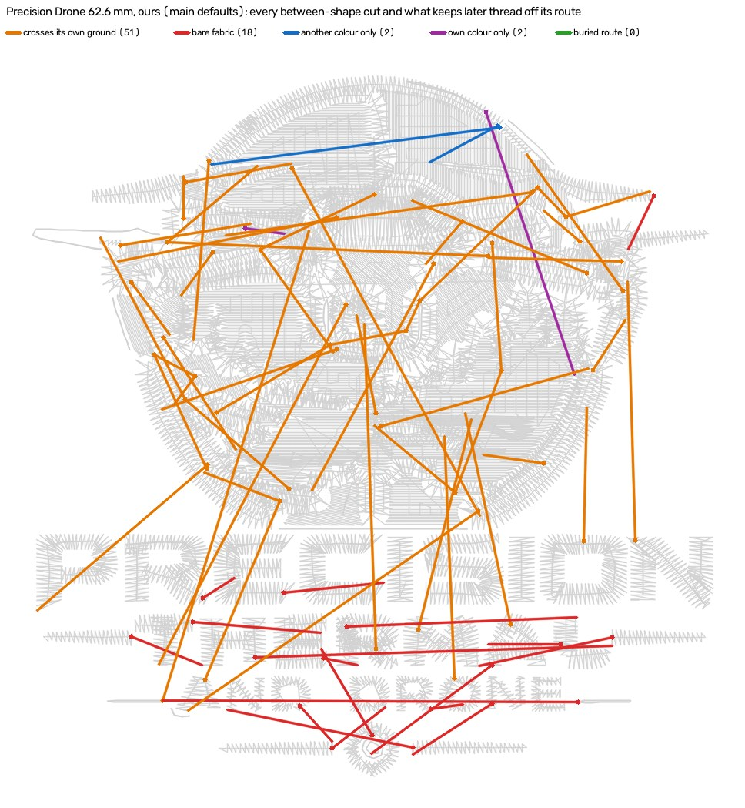

# Layering census: the pro sews every contained piece ON its ground, we already can, and it buys no buried walk (2026-10-26)

Queue item W4-06. #1104 (`docs/buried-walk-2026-10-26.md`) found that none of
our 176 between-shape cuts on five hats has a route under later thread, and
that the pro builds Precision Drone's badge back to front: 23 blocks of 8
cones, with his dark ground walking 316 mm under 18 later blocks. It named
LAYERING plus colour revisits as the lever. The brief: count where he layers,
and if it is his rule for a class of region, build it behind one OFF flag so
stage 7's `trim_bury_under_later` finds routes. Measured first.

**The premise is false, and no engine change ships.**

1. His rule is exact. Every piece that sits inside an earlier colour's
   outline is sewn ON that colour: 162 of 162, over 20 of his 28 DSTs. That
   rule is already built. `silhouette_underfill` (OFF) sews Drone's 28
   contained pieces on their ground, where main knocks out or half-covers
   14 of 27. On Fremont it takes 5 cuts off; on MFab alone it adds 29.
2. Layering does not reach our cuts. Of the 176 between-shape cuts, 80 cross
   the ground their own pieces sit on. In any back-to-front build that ground
   sews FIRST, so it can never be the later thread a buried walk needs. 78
   more cross bare fabric. 13 lie on their own colour only. **5** are kept
   off later thread by another colour beside them, and only those 5 could a
   colour order reach.
3. A back-to-front prototype was measured on all five jobs and not kept. It
   gave a layer order by containment depth, a colour split into one block per
   depth (the pro's revisits), and every hole closed under the later shapes
   it holds. Plan trims went 106 → 105, 32 → 33, 20, 54 and 34 unchanged.
   Buried routes stayed 0 → 0. Per-region agreement with the pro on Drone
   went from kappa 0.42 to 0.39.

## Instrument

`digitizer/tools/layer_census.py` is new, pinned by
`tests/test_layer_census.py` on hand-built DSTs. It is one reader for both
sides, reading the DST and never the PES. The PES only names the threads.
Each file is read in its own frame. Per colour block, every needle-down
segment is drawn a thread wide, closed 0.6 mm into a body, and opened 0.6 mm
so a lone run line drops out (`sequence_pro`'s rule). The module docstring
has the full definitions. In short:

- **layered mm²**: cells 0.5 mm deep inside two blocks of different colours.
  The erosion keeps a seam's underlap out of the count.
- **pieces**: the parts of a block's body that come within 1 mm of an earlier
  block of another colour. A piece is `on` when half or more of its interior
  lies on earlier other-colour thread, `off` (knocked out) at a fifth or
  less, and `partial` between. `inside` is how much of the piece one earlier
  block's outline (holes closed) holds. At 0.9 or more the piece is a
  ground's content.
- **kappa, inside rule**: Cohen's kappa of "inside ⇒ on" against his labels,
  with partials left out.
- **revisits**: a block whose colour already sewed. The number in brackets
  counts the revisits where an intervening block covered 5 mm² or more of
  that colour's earlier body, so the revisit sews ON something.
- **`compare(ours, pro)`**: for each of OUR pieces, our label and his label at
  the same place. The two designs are aligned box to box, as in
  `tools/pro_layers`. The comparison gives a kappa per region (gate 4).

`tools/between_walks.diagnose_plan(plan, regions=...)` gains one optional
split, pinned by a new test in `tests/test_between_walks.py`. A no-route
cut's `off_on_earlier_mm` divides into `off_on_ground_mm` and
`off_on_sibling_mm`. The first is an earlier shape whose outline holds 0.9
of either end's shape, meaning the ground the cut's colour sits on. The
second is the rest. Without `regions`, the rows are exactly what they were.

## The pro, 28 DSTs

Registered pairs (`tools/pro_intake`), `Test Files` left out because it is
not his. `?` marks cones counted without a PES, where each block counts as
its own cone. `+kd` marks a beanie whose knockdown block is excluded. The
last column covers the blocks that host his inside-on pieces: their trims,
and their needle-down walks under later colours (`between_walks.read_steps`).

| job | blocks / cones | revisits (sewn ON) | layered mm² (share) | colour underneath | inside an earlier outline: on / off / partial | not inside: on / off / partial | kappa, inside rule | trims | ground blocks: trims, walk under later mm |
|---|---|---|---|---|---|---|---|---|---|
| c_gaulke_plowing_beanie | 7 / 7? +kd | 0 (0) | 320 (0.08) | (no PES) | 11 / 0 / 0 | 2 / 1 / 4 | 0.44 | 50 | 6, 0 |
| gaulke_plowing_hat | 7 / 7? | 0 (0) | 318 (0.12) | (no PES) | 11 / 0 / 0 | 2 / 1 / 4 | 0.44 | 50 | 6, 0 |
| gaulke_plowing_lc | 7 / 7? | 0 (0) | 224 (0.11) | (no PES) | 11 / 0 / 0 | 2 / 5 / 3 | 0.75 | 49 | 8, 27 |
| c_gaulke_plowing_lc | 1 / 1? | 0 (0) | 0 (0.00) | - | 0 / 0 / 0 | 0 / 0 / 0 | n/a | 41 | - |
| gaulke_jb | 21 / 21? | 0 (0) | 1229 (0.18) | (no PES) | 15 / 0 / 0 | 6 / 3 / 8 | 0.39 | 88 | 10, 92 |
| golf_hat | 7 / 3 | 4 (2) | 216 (0.15) | #f0f0f0 largest | 4 / 0 / 0 | 9 / 1 / 1 | 0.06 | 9 | 1, 0 |
| becker_hat_large | 5 / 2 | 3 (1) | 728 (0.17) | #000000 darkest | 3 / 0 / 0 | 2 / 0 / 0 | 0.00 | 9 | 0, 0 |
| becker_lc_large | 4 / 2 | 2 (1) | 638 (0.17) | #000000 darkest | 3 / 0 / 0 | 2 / 0 / 0 | 0.00 | 11 | 0, 0 |
| becker_chest_small | 4 / 2 | 2 (1) | 404 (0.17) | #000000 darkest | 3 / 0 / 0 | 2 / 0 / 0 | 0.00 | 11 | 0, 0 |
| becker_hat_small | 5 / 2 | 3 (1) | 404 (0.17) | #000000 darkest | 3 / 0 / 0 | 2 / 0 / 0 | 0.00 | 10 | 0, 0 |
| becker_marine_hat | 5 / 5? | 0 (0) | 745 (0.18) | (no PES) | 3 / 0 / 0 | 2 / 1 / 0 | 0.33 | 10 | 0, 0 |
| gaulke_roofing_beanie | 1 / 1? +kd | 0 (0) | 0 (0.00) | - | 0 / 0 / 0 | 0 / 0 / 0 | n/a | 41 | - |
| gaulke_roofing_hat | 1 / 1? | 0 (0) | 0 (0.00) | - | 0 / 0 / 0 | 0 / 0 / 0 | n/a | 41 | - |
| gaulke_roofing_lc | 1 / 1? | 0 (0) | 0 (0.00) | - | 0 / 0 / 0 | 0 / 0 / 0 | n/a | 41 | - |
| gaulke_roofing_c_golke_logo_hat_1 | 3 / 3? | 0 (0) | 0 (0.00) | - | 0 / 0 / 0 | 0 / 2 / 0 | n/a | 39 | - |
| hotel_fremont_hat | 11 / 3 | 8 (6) | 1038 (0.34) | #f0f0f0 largest | 17 / 0 / 0 | 3 / 0 / 2 | 0.00 | 20 | 0, 0 |
| hotel_fremont_patch | 9 / 4 | 5 (5) | 983 (0.33) | #f0f0f0 largest | 16 / 0 / 0 | 3 / 0 / 2 | 0.00 | 20 | 0, 0 |
| mfab_hat | 5 / 2 | 3 (3) | 1145 (0.31) | #000000 largest, darkest | 9 / 0 / 0 | 0 / 0 / 0 | n/a | 18 | 6, 0 |
| mfab_lc | 5 / 2 | 3 (3) | 1000 (0.32) | #000000 largest, darkest | 8 / 0 / 0 | 0 / 0 / 0 | n/a | 19 | 6, 0 |
| precision_drone | 23 / 8 | 15 (9) | 643 (0.28) | #293133 largest | 13 / 0 / 0 | 14 / 9 / 3 | 0.32 | 58 | 14, 269 |
| proseal_beanie | 5 / 5? +kd | 0 (0) | 35 (0.01) | (no PES) | 0 / 0 / 0 | 0 / 4 / 1 | n/a | 47 | - |
| proseal_hat | 5 / 5? | 0 (0) | 40 (0.02) | (no PES) | 0 / 0 / 0 | 0 / 3 / 1 | n/a | 53 | - |
| tires_hat_3d | 2 / 2 | 0 (0) | 0 (0.00) | #d15400 neither largest nor darkest | 0 / 0 / 0 | 0 / 1 / 0 | n/a | 9 | - |
| machine_beanie | 2 / 2 +kd | 0 (0) | 922 (0.27) | #fbfcff largest | 5 / 0 / 0 | 1 / 0 / 0 | 0.00 | 30 | 0, 0 |
| machine_hat | 2 / 2? | 0 (0) | 1043 (0.25) | (no PES) | 9 / 0 / 0 | 1 / 0 / 0 | 0.00 | 30 | 0, 0 |
| machine_lc | 2 / 2? | 0 (0) | 1044 (0.25) | (no PES) | 9 / 0 / 0 | 1 / 0 / 0 | 0.00 | 30 | 0, 0 |
| becker_beanie | 5 / 2 +kd | 3 (1) | 408 (0.11) | #000000 darkest | 3 / 0 / 0 | 2 / 0 / 0 | 0.00 | 10 | 0, 0 |
| toat_beanie | 2 / 2 +kd | 0 (0) | 879 (0.24) | #f0f0f0 largest | 6 / 0 / 0 | 1 / 0 / 0 | 0.00 | 30 | 0, 0 |

Read across:

- **Inside ⇒ on is exact.** 162 inside pieces, 0 off, 0 partial. That holds
  on every job that has one: Becker (6 files), Fremont, MFab, Machine, the
  beanies, Golf, Gaulke plowing, and Drone.
- **It is sufficient, not necessary.** He also lays 57 pieces on an earlier
  colour without any one outline holding them. 31 pieces he knocks out: his
  lettering beside the badge (Drone), ProSeal, Tires, and Gaulke's
  three-colour hat. Over the 250 judged pieces the inside rule scores kappa
  **0.41**. That is moderate. On Becker, Fremont and Machine everything
  touching an earlier colour sits on it, so the kappa there is 0.00: the rule
  varies and his label does not.
- **The colour underneath** is the design's largest colour (Fremont white,
  Golf, Drone's dark grey, Machine, the TOAT beanie) or its darkest (Becker
  black), or both (MFab black).
- **Revisits** come with it: Fremont 11 blocks of 3 cones (6 revisits sew on
  something), Drone 23 of 8 (9), MFab 5 of 2 (3), Golf 7 of 3 (2), Becker 5
  of 2 (1).
- **What it buys him is a ground in ONE piece, not walks.** On 15 of the 20
  layering files the ground blocks have 0 trims and no piece-to-piece step at
  all. Walks under later colours inside a ground happen on Drone (269 mm,
  22 walks), Gaulke JB (92) and Gaulke plowing LC (27), and nowhere else.
  His other buried walking is in non-ground blocks: Fremont 191 mm, Gaulke
  plowing 212, Drone 88, Golf 57.

## Ours, five hats: OFF | silhouette_underfill | back-to-front prototype | pro

The OFF rows are #1104's runs (`main` 46949f78). Drone's was re-run on
787fa4bc, after #1105 and #1106 changed only ON paths, and its DST is
byte-identical (md5 `5ad4a63e`). The `silhouette_underfill` rows ran on
787fa4bc; the prototype ran on 46949f78 plus its diff. The hat preset and the Studio's
request (`tools.pro_pair`). Stages 0-4 run once per job; `plan_stitches` runs
once per arm. Trims are read from the DST by this reader on both sides, with
the plan's own count in brackets. "Between-shape cuts" are #1104's plan
column, split by `diagnose_plan(plan, regions=result.regions)`. Each cut is
given ONE class, in this order: a buried route, then crosses its own ground,
then bare fabric, then another colour only, then own colour only.
"Per-region kappa" is `compare` on our pieces, with partials out. It means
something on Drone alone (n 25-33). Elsewhere n is 12 or fewer and one side
is nearly constant, so read those as n/a.

| job | side | blocks / cones | trims (plan's) | between-shape cuts: buried route / crosses own ground / bare / another colour / own colour only | inside pieces on / off / partial | layered mm² | per-region kappa vs pro (n) | exposed travel mm | bare thread mm | stitches |
|---|---|---|---|---|---|---|---|---|---|---|
| Drone 62.6 | pro | 23 / 8 | 58 | n/a | 13 / 0 / 0 | 643 | | | | |
| | OFF (main) | 11 / 6 | 95 (106) | 73: 0 / 51 / 18 / 2 / 2 | 13 / 7 / 7 | 87 | 0.42 (25) | 49.6 | 5.45 | 13438 |
| | silhouette_underfill | 11 / 6 | 89 (100) | 73: 0 / 51 / 18 / 2 / 2 | 28 / 0 / 0 | 612 | 0.39 (33) | 44.5 | 4.63 | 13648 |
| | back-to-front prototype | 14 / 6 | 91 (105) | 73: 0 / 42 / 28 / 2 / 1 | 17 / 8 / 6 | 80 | 0.39 (26) | 43.5 | 4.02 | 13403 |
| MFab hat 104.9 | pro | 5 / 2 | 18 | n/a | 9 / 0 / 0 | 1145 | | | | |
| | OFF (main) | 3 / 2 | 51 (54) | 39: 0 / 10 / 24 / 3 / 2 | 0 / 1 / 0 | 0 | n/a (1) | 18.8 | 2.57 | 10902 |
| | silhouette_underfill | 4 / 2 | 80 (83) | 30: 0 / 10 / 15 / 3 / 2 | 0 / 0 / 0 | 0 | 0.00 (4) | 46.6 | 0.0 | 22213 |
| | back-to-front prototype | 3 / 2 | 51 (54) | 39: 0 / 10 / 24 / 3 / 2 | 0 / 1 / 0 | 0 | n/a (1) | 18.8 | 2.57 | 10902 |
| Fremont hat 92.5 | pro | 11 / 3 | 20 | n/a | 17 / 0 / 0 | 1038 | | | | |
| | OFF (main) | 4 / 3 | 28 (32) | 26: 0 / 19 / 0 / 0 / 7 | 12 / 0 / 1 | 697 | 0.00 (9) | 28.9 | 0.0 | 17381 |
| | silhouette_underfill | 4 / 3 | 23 (27) | 23: 0 / 19 / 0 / 0 / 4 | 13 / 0 / 0 | 772 | n/a (9) | 24.6 | 0.0 | 16066 |
| | back-to-front prototype | 4 / 3 | 29 (33) | 27: 0 / 24 / 0 / 0 / 3 | 13 / 2 / 1 | 730 | 1.00 (12) | 26.7 | 0.0 | 17346 |
| Becker hat 101.9 | pro | 5 / 2 | 9 | n/a | 3 / 0 / 0 | 728 | | | | |
| | OFF (main) | 1 / 1 | 19 (20) | 10: 0 / 0 / 10 / 0 / 0 | 0 / 0 / 0 | 0 | n/a (0) | 13.3 | 0.0 | 7859 |
| | silhouette_underfill | 1 / 1 | 19 (20) | 10: 0 / 0 / 10 / 0 / 0 | 0 / 0 / 0 | 0 | n/a (0) | 13.3 | 0.0 | 7859 |
| | back-to-front prototype | 1 / 1 | 19 (20) | 10: 0 / 0 / 10 / 0 / 0 | 0 / 0 / 0 | 0 | n/a (0) | 13.3 | 0.0 | 7859 |
| Gaulke hat 114.2 | pro | 1 / 1 | 41 | n/a | 0 / 0 / 0 | 0 | | | | |
| | OFF (main) | 3 / 2 | 31 (34) | 28: 0 / 0 / 26 / 0 / 2 | 1 / 0 / 0 | 62 | 0.00 (1) | 16.7 | 5.99 | 7474 |
| | silhouette_underfill | 3 / 2 | 31 (34) | 28: 0 / 0 / 26 / 0 / 2 | 1 / 0 / 0 | 62 | 0.00 (1) | 16.7 | 5.99 | 7474 |
| | back-to-front prototype | 3 / 2 | 31 (34) | 28: 0 / 0 / 26 / 0 / 2 | 1 / 0 / 0 | 62 | 0.00 (1) | 16.7 | 5.99 | 7474 |

The back-to-front prototype is not in this branch. Its diff is in the session
notes: `back_to_front.py`, one call after the under-fill in `plan_stitches`,
and stage 5's `ground_under` reading a new meta key. It relayered each sewn
region by containment depth (outlines holding 0.9 of it, other threads
only). Key order is (depth, old layer), so a thread at two depths became two
blocks. It closed every region's holes under the later shapes inside them.
On Drone that is 11 → 21 layers, 14 blocks, max depth 2, and 585 mm² of the
badge ground sewn under the scene.



Orange: the best route crosses the ground the pieces sit on. Red: bare
fabric. Blue: only another colour beside it. Purple: only this colour's own
earlier stitches. Green: a buried route (none). His side stays in the session
scratch because the file is his. His Drone walks inside the badge lie under
the blocks he lays on top. Half his "walking" is the drone's run outline
(#1104).

## What it means

1. **Layering is already built, and it is the pro's rule.**
   `silhouette_underfill` puts every contained piece on its ground (Drone
   28/28). What it buys is the pro's one-piece ground: same-colour inner
   shapes merge into the under-fill. Plan trims: Drone 106 → 100, Fremont
   32 → 27 with 1,315 fewer stitches and exposed travel 28.9 → 24.6 mm.
   Becker and Gaulke do not move: main sews one colour there. MFab alone
   goes 54 → 83 with stitches doubled (10,902 → 22,213) and exposed travel
   18.8 → 46.6 mm. That fails gate 3, and the flag was built for MFab's
   white-sewn recipe (`mfab-underfill-panels-2026-10-25`), not for this.
   Its known over-reach is still there too: on Drone the per-region
   kappa against him FALLS (0.42 → 0.39), because he does not fill the whole
   badge under the scene (`underfill-outer-rim-2026-10-25`: "Drone (he does
   not under-fill)"). That flip stays Kent's, from renders.
2. **No order or layering reaches the between-shape cuts.** A buried walk
   needs thread sewn AFTER the cut over the whole route. The thread between
   two pieces of one colour is the ground they sit on (80 of 176), and his
   own rule (inside ⇒ on) puts that ground underneath, so it sews first. The
   pro crosses it by walking ON his finished ground. That is Drone's 480 mm
   on work, and gate 3 forbids it here: `tools/travel_cover` counts thread
   nothing sews over as exposed, and exposure must not rise. Or he cuts.
   Only the 5 cuts held off by a colour beside them could move with a
   colour order. That is the whole reach of a revisit scheme on these
   five jobs.
3. **The residual trim gap on these hats is not layout.** It splits three
   ways. Bare-fabric hops (78) are lettering, where #1104 found parity on
   Drone, plus the garment left between pieces where main does not sew the
   white (Becker, MFab, Gaulke). Cuts inside one piece belong to
   `fill_section_travel` (#1091). Isolated pieces belong to
   `absorb_fragments` (#1100).

## Gates

- Gate 3: no engine change, so nothing new on fabric. The prototype's arms
  read exposed travel 49.6 → 43.5 mm and bare thread 5.45 → 4.02 mm on
  Drone, with the others unchanged or lower (table). It was dropped on
  trims, not on gate 3. `silhouette_underfill` alone RAISES MFab's exposed
  travel 18.8 → 46.6 mm, so flipping it on its own fails gate 3 on MFab.
  Its Fremont and Drone rows lower exposure.
- Gate 4: every agreement figure is a kappa. The inside rule scores 0.41 over
  250 of his pieces. Per region against him on our pieces, Drone reads OFF
  0.42, under-fill 0.39, prototype 0.39. Raw agreement is not quoted as a
  result.
- Layout flips stay Kent's from renders (2026-10-22). Nothing here flips.

## Reproduce

```
cd digitizer
python -m tools.layer_census [--json OUT]                  # his registered DSTs
python -m tools.layer_census ours.dst --colours plan.pkl   # ours, colours from the plan
python -c "import pickle; from tools import between_walks as bw; \
  print(bw.diagnose_plan(pickle.load(open('plan.pkl','rb')), regions=pickle.load(open('result.pkl','rb')).regions))"
```

Ours: `tools.pro_pair.request(width, "hat_front", {})` through the service
parser, then `build_generation` + `finish_generation` (pickled), then
`plan_stitches(result, cfg)` per arm and `export.write_dst`. The arms:
`{}`, `{"silhouette_underfill": true}`, and the prototype's
`{"extra": {"back_to_front": true}}` on its diff.
