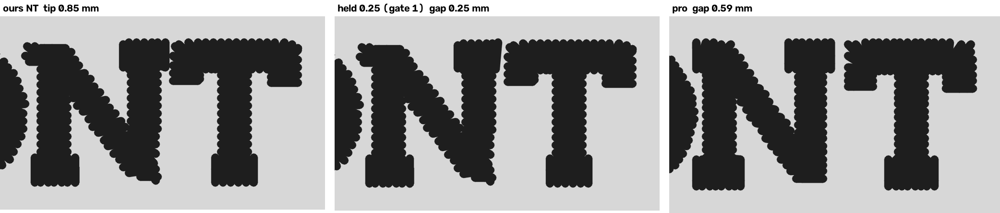
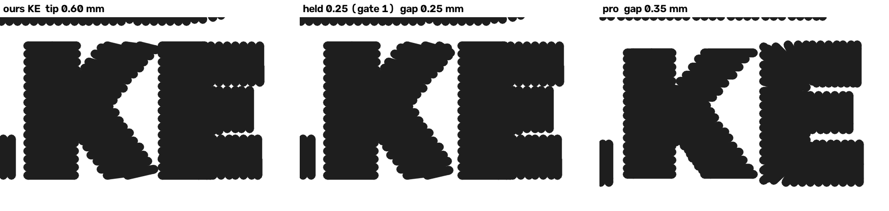
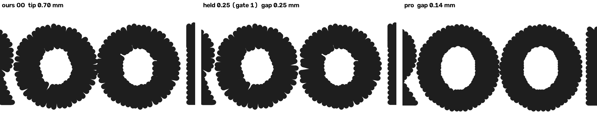
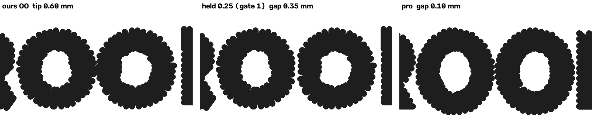

# Letter separation at 5-10 mm: where ours touch and the pro's do not (2026-10-25)

W3-07. The 2026-10-23 band reader had to cut our letters into the pro's
letter boxes, because at its 1.0 mm opening our Fremont O-T-E and N-T came
out as one piece where the pro's stood apart
([`lettering-5-10mm-2026-10-23.md`](lettering-5-10mm-2026-10-23.md)). This
counts the touching pairs on every paired job with a word in or near the
band, ours beside the pro's, and says for each of ours what closed the gap.
Measurement only: no engine change. Engine: `origin/main` 4e8cc40a (#1078;
`text_lean`, `inside_stagger`, `wide_letters`, `border_from_outline` ON,
`square_ends` ON, `corner_fold` and `enclosed_alpha_hole_parts` OFF).

## The answer

- **Premise TRUE: the fuse is in our stitches, not in the art polygons.**
  Every pair of ours that touches has traced (stage-4) polygons 0.60-0.87 mm
  apart, and stage 5 hands satin the same polygons (`d5` within 0.04 of `d4`).
- **But the cause is PULL COMP on all six, not construction.** Both facing
  letters' rails sit 0.17-0.29 mm outside their traced edge: the hat's
  0.40 mm pull less the Column lane's 0.11 mm rail inset (0.29 a side), the
  left chest's 0.17. A traced gap under 0.4 + 2 x comp (0.98 mm on the hat,
  0.74 on the LC) leaves no fabric between two 0.4 mm threads. No needle
  facing the other letter runs past its own rail offset by more than
  0.03 mm, except Gaulke's K arm end (+0.09). No fan crosses past the
  outline and no absorbed serif at this size. The T's bar END at Fremont O-T
  and N-T carries the same 0.26-0.29 reach as the rails, because
  `square_ends` keeps the side pull on a square cap's corner. **ROADMAP
  gate 1: the pull is reported here, never changed.**
- **The pro's rule:** at 5-8 mm caps he leaves at least 0.10 mm of visible
  fabric between neighbours (p10 0.15-0.22 mm, median 0.36-0.49), touching
  in 2 of 82 pairs and only at a tip (contact 0.20 and 0.45 mm, never fused
  at a 1.0 mm opening). At 6.5-8 mm his gap ignores the art's spacing
  (r = -0.06, ours +0.76). At 9-13 mm he keeps the art's gap (at least
  0.75 mm, r 0.94-0.99).
- **How he does it:** not with narrower letters overall. His sewn letter
  widths and pitches are ours (median per pair -0.05 and -0.01 mm, at the
  word's own scale). The difference is all at the TIGHT pairs (traced gap
  under 0.9 mm, n 27), where he keeps +0.10 mm more (median), pair by pair:
  N-T, O-N and K-E sit 0.16-0.46 mm further apart, and the Gaulke O-O pairs
  are sewn 0.1-0.2 mm narrower.
- **Prototype, harness only, A GATE-1 CANDIDATE for the I5 sew-out:**
  holding the facing needles apart to the re-set's 0.25 mm
  (`small_text_cap_letter_gap_mm`) opens all six pairs to 0.25-0.35 mm. It
  moves 2-22 needles per pair, none by more than 0.29 mm. Whether 0.25 mm
  stays open on cloth depends on pull and thread spread.
- **It does NOT move 4 mm legibility, and FREMONT's 0.00 is the OCR, not
  the thread.** With O-T and N-T held apart, Fremont still reads `HOTEL`
  1.00 and `FREMONT` 0.00 at a 4 mm shrink, against the pro's 1.00 / 1.00.
  Our 4 mm FREMONT crop reads plainly to the eye (below), yet tesseract
  returns "CSA". Ours has one tip touch there (N-T) and a wider median gap
  than the pro's (0.54 against 0.39).

## The census

Each word read the same way in both DSTs, each in its own frame (method
below). Gaps are VISIBLE fabric between the two letters' 0.4 mm thread, in
mm; "touching" is gap 0; "fused" is still joined at a 1.0 mm opening (a
broad bridge, not a tip). One-letter words (Gaulke's C and &) are not shown.

| job (width, garment) | word | side | cap mm | span mm | min gap | touching | fused | gap med (apart) |
|---|---|---|---|---|---|---|---|---|
| Hotel Fremont hat 92.6 | HOTEL | ours | 7.25 | 33.6 | 0.0 | 1 OT | 1 OT | 0.45 |
| | | pro | 7.45 | 34.2 | 0.0 | 1 OT | 0 | 0.35 |
| | FREMONT | ours | 7.25 | 49.5 | 0.0 | 1 NT | 0 | 0.54 |
| | | pro | 7.45 | 50.0 | 0.3 | 0 | 0 | 0.39 |
| Hotel Fremont patch 92.5 | HOTEL | ours | 6.75 | 32.45 | 0.18 | 0 | 0 | 0.65 |
| | | pro | 7.45 | 34.2 | 0.0 | 1 OT | 0 | 0.35 |
| | FREMONT | ours | 6.75 | 48.0 | 0.4 | 0 | 0 | 0.82 |
| | | pro | 7.45 | 50.0 | 0.3 | 0 | 0 | 0.39 |
| Precision Drone hat 62.6 | PRECISION | ours | 6.45 | 62.95 | 0.0 | 1 ON | 1 ON | 0.2 |
| | | pro | 6.25 | 62.8 | 0.1 | 0 | 0 | 0.47 |
| Proseal hat 85.9 | PROSEAL | ours | 9.5 | 80.7 | 1.38 | 0 | 0 | 1.66 |
| | | pro | 9.4 | 81.2 | 1.19 | 0 | 0 | 1.58 |
| MFab hat 104.9 | AND | ours | n/a: letters knocked out of a backdrop of their own thread | | | | | |
| | | pro | 7.1 | 21.75 | 0.5 | 0 | 0 | 0.5 |
| | WELDING | ours | n/a: as AND | | | | | |
| | | pro | 7.1 | 45.65 | 0.0 | 1 IN | 0 | 0.6 |
| Gaulke Roofing hat 114.2 | GOLKE | ours | 6.45 | 32.05 | 0.0 | 1 KE | 0 | 0.35 |
| | | pro | 6.75 | 32.05 | 0.15 | 0 | 0 | 0.35 |
| | INDUSTRIES | ours | 6.68 | 57.0 | 0.25 | 0 | 0 | 0.35 |
| | | pro | 6.45 | 57.15 | 0.35 | 0 | 0 | 0.45 |
| | STEEL | ours | 6.2 | 26.75 | 0.3 | 0 | 0 | 0.6 |
| | | pro | 6.45 | 26.95 | 0.45 | 0 | 0 | 0.62 |
| | ROOFING | ours | 6.4 | 39.9 | 0.0 | 1 OO | 0 | 0.55 |
| | | pro | 6.1 | 40.35 | 0.14 | 0 | 0 | 0.43 |
| | SUPPLY | ours | 6.23 | 33.45 | 0.3 | 0 | 0 | 0.5 |
| | | pro | 6.15 | 33.8 | 0.3 | 0 | 0 | 0.45 |
| Gaulke Roofing LC 95.2 | GOLKE | ours | 5.5 | 26.7 | 0.2 | 0 | 0 | 0.32 |
| | | pro | 5.75 | 26.95 | 0.25 | 0 | 0 | 0.38 |
| | INDUSTRIES | ours | 5.45 | 47.55 | 0.2 | 0 | 0 | 0.35 |
| | | pro | 5.52 | 48.25 | 0.25 | 0 | 0 | 0.5 |
| | STEEL | ours | 5.2 | 22.25 | 0.2 | 0 | 0 | 0.4 |
| | | pro | 5.55 | 22.85 | 0.55 | 0 | 0 | 0.6 |
| | ROOFING | ours | 5.25 | 33.3 | 0.0 | 1 OO | 0 | 0.45 |
| | | pro | 5.3 | 33.75 | 0.1 | 0 | 0 | 0.28 |
| | SUPPLY | ours | 5.2 | 27.8 | 0.25 | 0 | 0 | 0.45 |
| | | pro | 5.3 | 28.25 | 0.2 | 0 | 0 | 0.5 |
| Becker hat small 76.5 | MARINE | ours | 12.85 | 73.55 | 0.85 | 0 | 0 | 1.1 |
| | | pro | 13.2 | 73.45 | 0.75 | 0 | 0 | 1.2 |

Totals: ours 95 pairs read, 6 touching, 2 fused. The pro's 103 pairs hold
3 touching (two of them the same O-T, because the patch's pro file carries
the hat's lettering) and 0 fused.

### The pro's rule, by cap

The pro's pairs on every job, the patch left out (its lettering is the
hat's), MFab's eight included:

| cap | pairs | min | p10 | median | p90 | touching |
|---|---|---|---|---|---|---|
| 5-6.5 mm (Drone, Gaulke) | 60 | 0.10 | 0.22 | 0.49 | 0.75 | 0 |
| 6.5-8 mm (Fremont, MFab, Gaulke hat GOLKE) | 22 | 0.00 | 0.15 | 0.36 | 0.60 | 2, tips (0.20, 0.45 mm) |
| 8-10 mm (Proseal) | 6 | 1.19 | 1.19 | 1.58 | 1.75 | 0 |
| 10-15 mm (Becker MARINE) | 5 | 0.75 | 0.78 | 1.20 | 1.98 | 0 |

**Rows that contradict it:** the pro's own Fremont O-T, where his T's bar
tip meets the O's shoulder (contact 0.20 mm; crop below, right panel), and
MFab's I-N (contact 0.45 mm). Both are tips that part at a 1.0 mm opening.
Ours at Fremont O-T is FUSED (contact 1.65 mm). Near the floor without
touching: Drone C-I 0.10, Gaulke LC O-O 0.10 and R-O 0.20, Gaulke hat O-O
0.14.

Against the art's spacing (`d4`, ours vs pro, all 85 pairs read on both
sides): ours = 0.87 d4 - 0.47, pro = 0.75 d4 - 0.29. At a traced gap of
0.6 mm that is 0.05 against 0.16; at 0.8 mm, 0.23 against 0.31. In the
6.5-8 mm band ours follows the art (r +0.76) and the pro's does not (r -0.06).

### Every pair: traced gap / ours / pro

| job | traced gap d4 / ours visible / pro visible, mm |
|---|---|
| Fremont hat | HO 1.33/0.5/0.2; **OT 0.62/0.0/0.0**; TE 0.8/0.35/0.35; EL 1.01/0.45/0.57; FR 1.0/0.6/0.47; RE 0.68/0.3/0.4; EM 1.01/0.54/0.38; MO 1.33/0.45/0.3; ON 1.33/0.55/0.3; **NT 0.6/0.0/0.59** |
| Fremont patch | HO 1.2/0.75/0.2; OT 0.53/0.18/0.0; TE 0.71/0.55/0.35; EL 1.12/0.8/0.57; FR 1.0/0.8/0.47; RE 0.78/0.4/0.4; EM 0.99/0.55/0.38; MO 1.27/0.95/0.3; ON 1.24/0.85/0.3; NT 1.85/1.45/0.59 |
| Drone | PR 0.96/0.4/0.5; RE 0.68/0.2/0.25; EC 0.98/0.56/0.5; CI 0.8/0.15/0.1; IS 1.32/0.8/0.5; SI 1.04/0.15/0.45; IO 1.09/0.2/0.4; **ON 0.87/0.0/0.5** |
| Proseal | PR 2.54/2.0/1.62; RO 2.6/1.7/1.84; OS 2.36/1.61/1.55; SE 2.56/1.78/1.67; EA 1.86/1.38/1.19; AL 2.13/1.45/1.2 |
| Gaulke hat | GO 0.88/0.22/0.15; OL 1.1/0.35/0.35; LK 1.01/0.45/0.55; **KE 0.81/0.0/0.35**; IN 1.48/0.6/0.6; ND 1.48/0.6/0.8; DU 1.0/0.25/0.35; US 1.22/0.5/0.45; ST 0.69/0.25/0.35; TR 0.99/0.35/0.55; RI 1.03/0.27/0.41; IE 1.4/0.6/0.8; ES 0.77/0.35/0.45 · ST 1.1/0.75/0.45; TE 0.84/0.3/0.5; EE 1.2/0.65/0.75; EL 1.17/0.55/0.75; RO 1.01/0.25/0.22; **OO 0.78/0.0/0.14**; OF 1.15/0.6/0.4; FI 1.07/0.55/0.55; IN 1.55/0.7/0.8; NG 1.1/0.25/0.45; SU 1.13/0.5/0.35; UP 1.5/0.7/0.6; PP 1.1/0.3/0.3; PL 1.1/0.35/0.45; LY 1.65/1.05/1.25 |
| Gaulke LC | GO 0.73/0.3/0.25; OL 0.93/0.35/0.3; LK 0.88/0.35/0.45; KE 0.73/0.2/0.5; IN 1.19/0.5/0.5; ND 1.22/0.6/0.6; DU 0.82/0.2/0.25; US 1.1/0.55/0.45; ST 0.57/0.35/0.55; TR 0.89/0.35/0.65; RI 0.79/0.35/0.48; IE 1.18/0.5/0.5; ES 0.75/0.35/0.55 · ST 0.77/0.45/0.55; TE 0.7/0.2/0.6; EE 0.98/0.45/0.6; EL 0.87/0.35/0.65; RO 0.78/0.2/0.2; **OO 0.64/0.0/0.1**; OF 0.92/0.5/0.2; FI 0.91/0.45/0.65; IN 1.27/0.6/0.4; NG 0.93/0.35/0.35; SU 0.98/0.45/0.55; UP 1.21/0.5/0.5; PP 0.89/0.3/0.3; PL 0.91/0.25/0.2; LY 1.35/0.85/0.85 |
| Becker hat small | MA 1.46/0.86/0.83; AR 2.76/2.06/2.2; RI 2.24/1.6/1.65; IN 1.85/1.1/1.2; NE 1.61/0.85/0.75 |

## The attribution

For each pair of ours that touches. `over`: how far the letter's furthest
needle FACING the other letter lies outside its own traced polygon. `comp`:
the letter's own rail offset, the median distance of its needles that lie
outside the polygon. `where`: whether that furthest needle is a column END
(its run's first or last three crosses) or a RAIL. Letters are `a` then `b`
in reading order.

| job | pair | ours | pro gap | d4 | d5 | over a / b | comp a / b | where a / b | cause |
|---|---|---|---|---|---|---|---|---|---|
| Fremont hat | OT | FUSED, 1.65 mm contact | 0.0 (tip) | 0.62 | 0.65 | 0.28 / 0.29 | 0.27 / 0.29 | rail / end | pull comp |
| Fremont hat | NT | tip, 0.85 | 0.59 | 0.60 | 0.64 | 0.29 / 0.26 | 0.26 / 0.29 | rail / end | pull comp |
| Drone | ON | FUSED, 4.20 | 0.50 | 0.87 | 0.87 | 0.29 / 0.29 | 0.29 / 0.28 | rail / rail | pull comp |
| Gaulke hat | KE | tip, 0.60 | 0.35 | 0.81 | 0.81 | 0.37 / 0.29 | 0.28 / 0.29 | end / end | pull comp |
| Gaulke hat | OO | tip, 0.70 | 0.14 | 0.78 | 0.78 | 0.28 / 0.30 | 0.27 / 0.27 | rail / rail | pull comp |
| Gaulke LC | OO | tip, 0.60 | 0.10 | 0.64 | 0.64 | 0.19 / 0.20 | 0.18 / 0.17 | rail / rail | pull comp |

Trace (d4 under 0.4 mm, or one traced shape holding both letters): none.
Construction (needles past outline + comp): none. The K arm's end runs
0.09 mm past the K's own rail offset, and 0.81 - 0.4 - 0.28 - 0.29 is still
-0.16 without it.

Where the pro gets his room back on these six (per pair, at the word's own
scale; `pitch` = centre to centre, `half-width` = the two letters' half
widths summed): N-T +0.46 pitch, -0.30 half-width; O-N +0.27, -0.03;
K-E +0.16, -0.15; Gaulke hat O-O -0.01, -0.20; Gaulke LC O-O -0.05, -0.10;
O-T -0.05, +0.20 (his touch). Over all 85 pairs: pitch -0.01 and
half-width -0.05 (median). Over the 27 tight pairs (d4 under 0.9): gap
+0.10, pitch +0.03, half-width -0.07. A per-pair judgement rather than a
global spacing or weight change.

### Crops: ours | ours held at 0.25 (gate 1) | pro

Needle-down thread drawn 0.4 mm wide at 40 px/mm, each file in its own
frame; the pair's colour blocks dark, every other block pale.
`docs/renders/letter-separation-2026-10-25/`:

| pair | crop |
|---|---|
| Fremont hat O-T |  |
| Fremont hat N-T |  |
| Drone O-N (the O is also sewn SHUT: the split alpha counter, `enclosed_alpha_hole_parts`, OFF on this engine; #1057 flips it) |  |
| Gaulke hat K-E |  |
| Gaulke hat O-O |  |
| Gaulke LC O-O |  |

## The prototype (harness only)

`--hold-back`: every needle of letter `a` closer than 0.25 + 0.4 mm to
`b`'s needle path, and every needle of `b` closer to `a`'s, is pushed
straight away from the other's ORIGINAL path. The two letters share the
shortfall in proportion to what each overruns past its own outline + comp,
and evenly when the two excesses sum under 0.02 mm. Here the excesses are
0.00-0.09 mm, so the split follows hundredths of a millimetre; a build
would do better to split evenly. Needles are picked by plan shape on the
file's exact 0.1 mm grid, never by mask, because an overrunning needle lies
in the NEIGHBOUR's mask.

| pair | share a takes | needles moved a + b | largest move mm | visible gap after |
|---|---|---|---|---|
| Fremont hat OT | 0.5 | 4 + 4 | 0.25 | 0.35 |
| Fremont hat NT | 1.0 | 2 + 0 | 0.24 | 0.25 |
| Drone ON | 0.5 | 11 + 11 | 0.17 | 0.30 |
| Gaulke hat KE | 1.0 | 3 + 0 | 0.29 | 0.25 |
| Gaulke hat OO | 0.33 | 5 + 5 | 0.28 | 0.25 |
| Gaulke LC OO | 0.33 | 6 + 5 | 0.22 | 0.35 |

**0.25 mm is the re-set's sewn-gap CANDIDATE (`cfg.small_text_cap_letter_gap_mm`),
gate 1.** Whether a 0.25 mm gap in the file stays open on cloth depends on
the pull this would partly undo and on thread spread. It joins the I5
sew-out list, beside pull by stroke, which is also gate 1.

**Where a build would go** (named, not built: `columns.py` and
`stage7_sequence.py` are in #1057, and `outline_cut.py` is W3-03's). The
push that closes these gaps is the Column lane's rail pull:
`digitizer_core/stage7_sequence.py:3212` passes `fabric.pull_comp_mm` to
`lettering_columns_shape` (`columns.py:2123`). That reaches `column_runs`,
which calls `sewn_rails(col, poly, col_pull, ...)` at `columns.py:1740`.
`sewn_rails` (`columns.py:640`) pushes both rails with
`stage6_satin._push_rails` (`stage6_satin.py:3469`) and then holds the end
faces (`_hold_end_faces`, `columns.py:660`). A hold-back would hand
`lettering_columns_shape` the outlines of the word's OTHER letters (stage 7
knows the word: `text_cluster_id`) and clamp, in `sewn_rails`, any
penetration that lands within gap + 0.4 mm of a neighbour's own
outline + pull. A flag OFF by default, with this census as its instrument.

## Legibility at a 4 mm shrink (`tools.word_legibility`, imported)

| job | word | ours read / cc | pro read / cc |
|---|---|---|---|
| Fremont hat | HOTEL | HOTEL / 1.00 | HOTEL / 1.00 |
| | FREMONT | CSA / 0.00 | FREMONT / 1.00 |
| | job (n 2) | +0.42 | +1.00 |
| | FREMONT, O-T and N-T held at 0.25 | CSA / 0.00 | |
| Proseal hat | PROSEAL | PROSEAL / 1.00 | PRGSEAL / 0.76 |
| Becker hat small | MARINE | (nothing) / 0.00 | RLANIK / -0.08 |
| MFab hat | AND, WELDING | not located (cost 2.43, 2.67 > 2.0) | no word-sized thread near the word |
| Fremont patch, Drone, Gaulke hat and LC | | not pinned in `testdata/word_legibility_words.json`: named, not scored | |

Separation does not move FREMONT. The held-back design (all 10 moved
needles written into our `design.json` on its own grid) reads the same
"CSA". HOTEL reads 1.00 with its O-T fused. The 4 mm crops
`word_legibility` reads (its own `--dump` render, located by its own
`find_word`, loc cost 0.46 ours and 0.51 pro) show why the census cannot
help it: ours reads plainly to the eye.

| ours, 4 mm: tesseract "CSA" | pro, 4 mm: tesseract "FREMONT" |
|---|---|
|  |  |

FREMONT's 0.00 is a tesseract miss on that crop. A wave planned on it
(+0.42 against +1.00 for the job) was planning against the instrument.
Becker's MARINE reads for neither file, which is the reader's ceiling at
that size, not the thread.

## How it was read

- **Ours**: `tools.pro_pair.digitize` at the pro's width and garment (the
  Studio's request through the service's parser), via
  `small_text_columns.digitize_dst`, written as DST through
  `digitizer_service.formats.write`. The plan's geometry is kept beside it:
  stage-4 regions, the stage-5 sewing polygons (a spy on
  `resolve_overlaps`), and every run with its shape and colour block.
- **Both files**: `small_text_columns.read_blocks`, then `pieces` (unchanged)
  with needle-down stitches of 6 mm or less drawn 0.4 mm wide at 20 px/mm,
  opened 0.55 mm, as connected pieces. `text_lines` groups pieces at least
  4 mm tall into lines. The census's line is the one nearest a share of the
  file's OWN height (`WORDS`; MFab also takes an x share, to leave LLC out).
  `word_letters` merges pieces that overlap in x by half the narrower, then
  shares joined pieces out between the known text's letters (least squares
  on per-glyph width shares: I 0.35, M 1.25, W 1.45, ...). It parts a
  joined piece at a 1.0 mm opening when its letters part there (TIP; every
  pixel goes to the nearest part; contact = the boundary they share),
  otherwise at the thread's narrowest column near the share's edge (FUSED;
  contact = the thread crossing the cut).
- **Knock-outs**: a line whose own thread also makes a piece holding the
  whole line in its box is letters cut out of a backdrop. That is MFab's
  white AND WELDING inside its black keyline, unsewn under Kent's
  `sew_enclosed_white` hold. Its pieces are backdrop slivers, so the row is
  named, never scored 0.
- **Plan to file**: plan colour block i is DST colour block i, one to one
  (checked on all eight: stitch counts differ only by the writer's
  dedupe). A letter's shapes are those with at least five needles inside
  its thread IN ITS OWN BLOCK. Without that rule, a backdrop fill sewn
  under the letters (Fremont's badge) maps to every letter. A shape with
  30%+ of its needles in each of two letters means the trace joined them.

Reproduce (the pro files and ProSeal's art are on Kent's box only, through
`tools.pro_intake`'s registry):

```
cd digitizer
python -m tools.letter_gap_census --digitize all --cache OUT          # 4-33 min a job on a loaded laptop
python -m tools.letter_gap_census --read all --cache OUT --hold-back --legibility --crops OUT/crops --json OUT/all.json
```

`tests/test_letter_gap_census.py` (16 tests) covers the reader on
synthetic satin glyphs: apart (0.6 mm visible), fused along their height,
an arm tip into the neighbour (tip, not fused), a word space, too many
pieces, the share, lines, knock-outs, the attribution's three causes, the
hold-back reaching the candidate gap, and Becker's committed MARINE DST
read end to end.

## Follow-ups (not built here)

1. **Hold the facing rail at a neighbour** (gate 1, I5 sew-out): the build
   above, OFF, its card the six pairs here. Read the pro's pitch-or-width
   choice per pair before choosing one rule.
2. **`word_legibility` reads a legible 4 mm FREMONT as "CSA".** Before
   another wave quotes Fremont's +0.42, the instrument needs a look at that
   crop: margins, the line above cut into the crop, or the psm-7 variants.
   That is `tools/word_legibility.py`'s work, not the thread's.
3. **Pin words for Drone, Gaulke and the Fremont patch** in
   `testdata/word_legibility_words.json`, so their 4 mm figure exists.
4. **Drone's O** sews shut on this engine; #1057's `enclosed_alpha_hole_parts`
   flip cures it (`lettering-5-10mm-2026-10-23.md`).
5. **MFab**: our AND WELDING has no letter thread to read until white letter
   faces sew (`sew_enclosed_white`, Kent's hold).
