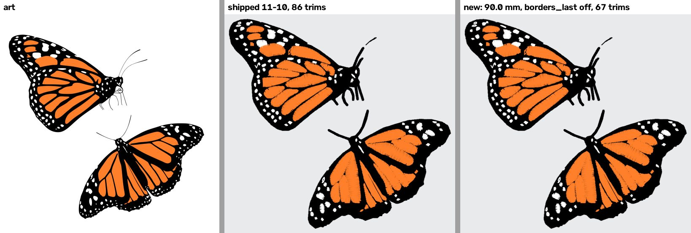
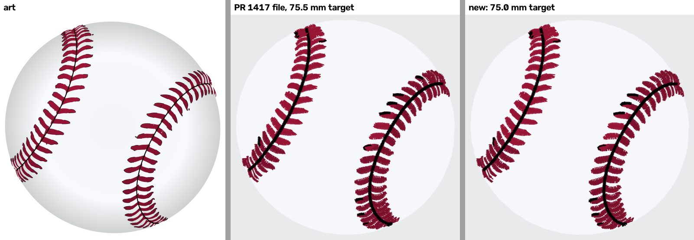

# Monarch orange stripe: not drift, a width mistake (2026-11-12)

## The correction

- **What was claimed** (in [`starter-pack-weak-spots-2026-11-12.md`](starter-pack-weak-spots-2026-11-12.md) and PR
  #1417): re-digitizing the monarch on main loses the lower butterfly's first orange stripe. The claim said this was
  drift on main since the pack's `ac3d77fa`, because the loss appeared with `borders_last` on or off.
- **What is true:** main never changed the monarch. The re-digitize ran at the wrong target width.
  - The pack (PR #1382) used `target_width_mm` **90.0**. A stitched DST comes out about 0.6% wider than its target,
    and the manifest records that file width (90.5).
  - The 11-12 re-digitize took the manifest's 90.5 as its target.
  - At 90.5 the stripe is lost, on `ac3d77fa` as much as on main.
- **The proof:** at 90.0, `ac3d77fa` and main `8bd56ff7` write the same DST bytes. Past the 512-byte DST header, those
  bytes are identical to the shipped file. The header differs in one field, the label: the pack's is `monarch`, and
  this run's is `EMBBOT`.

So there is no commit to name, and no flag or default behind the loss. No other design or tripwire pair can share it,
because nothing changed.

## Ruling trail (Kent, all 2026-11-12)

1. **"Baseball + monarch"**: re-digitize the baseball with `forced_class: "flat"` and the monarch with
   `borders_last: false`. The turtle stays as shipped.
2. **"Baseball only now"**: ship the baseball (#1417) and keep the shipped monarch. The reason given to Kent was the
   false drift claim above.
3. **"Ship monarch now"**, after the correction: ship the monarch at the pack's 90.0 mm target with
   `borders_last: false`. That is this PR.

The baseball fix below follows ruling 1 and needs no new ruling.

## Evidence

All runs use the 1920 px Commons render whose sha256 the manifest records.

"Orange" counts pixels drawn from the DST at 10 px/mm, each block in its own thread colour
(`r > 200, 90 < g < 170, b < 90`). The `borders_last: false` runs change the block order, so their orange is drawn in
their own order: from the run's design, or from the regenerated `starterThreads.js`. The two methods agree to within
15 px.

| Code | Target mm | Setting | Stitches | Trims | Size mm | Orange px |
|---|---|---|---|---|---|---|
| shipped file (11-10) | — | — | 16,819 | 86 | 90.5 × 85.7 | 111,617 |
| `ac3d77fa` | 90.0 | defaults | 16,819 | 86 | 90.5 × 85.7 | 111,617 |
| `ac3d77fa` | 90.5 | defaults | 16,129 | 85 | 91.0 × 86.1 | 104,058 |
| main `8bd56ff7` | 90.0 | defaults | 16,819 | 86 | 90.5 × 85.7 | 111,617 |
| main `8bd56ff7` / `3cb7a128` | 90.0 | `borders_last: false` | 16,743 | 67 | 90.5 × 85.7 | 111,269 |
| main `7ad81351` (the 11-12 run) | 90.5 | `borders_last: false` | 16,035 | 63 | 91.0 × 86.1 | 103,952 |

Trims are the `tools/trim_classes` count, which is the count the manifest holds. The 86 → 63 reported on 11-12 came
from the wrong width.

## The baseball shipped in #1417 had the same mistake

The #1417 baseball was digitized at a 75.5 mm target. The pack's baseball was made at **75.0**. The flat fix itself
was sound and checked from its own file. But the file came out 0.6 mm wider (76.1 against 75.5) and 0.6 mm taller
(74.7 against 74.1) than the pack's.

This PR re-digitizes it at 75.0 with the same `forced_class: "flat"`.

The baseball and turtle "before" runs in the weak-spots doc had the same slip (75.5 for 75.0, 92.5 for 92.0). That
doc put their small differences down to drift. At the pack's targets, `ac3d77fa` reproduces both shipped 11-10 files
byte for byte past the header:
- baseball: 20,812 stitches, 75.5 × 74.1 mm;
- turtle: 17,398 stitches, 92.5 × 61.8 mm.

None of the three diagnoses changes:
- the baseball's radial ramp bands;
- the turtle's RAG merge;
- the monarch's `borders_last` hops.

## Shipped in this PR

Both files were made on main `3cb7a128`.

**Widths.** The target used, the DST as read back, and the manifest row:

| Design | File | Target mm | DST read back mm | Manifest mm |
|---|---|---|---|---|
| baseball | pack, 11-10 | 75.0 | 75.5 × 74.1 | (was) 75.5 × 74.1 |
| baseball | #1417 | **75.5** (the slip) | 76.1 × 74.7 | (was) 76.1 × 74.7 |
| baseball | this PR | 75.0 | 75.5 × 74.2 | 75.5 × 74.2 |
| monarch | pack, 11-10 | 90.0 | 90.5 × 85.7 | (was) 90.5 × 85.7 |
| monarch | this PR | 90.0 | 90.5 × 85.7 | 90.5 × 85.7 |

**Counts:**

| Design | Stitches | Colours | Trims | Preflight | sha256 |
|---|---|---|---|---|---|
| baseball (#1417 → this PR) | 24,378 → 23,637 | 5 | 56 → 54 | B 76 | `8e86bec1…` |
| monarch (11-10 → this PR) | 16,819 → 16,743 | 3 | 86 → 67 | B 76 → B 88 | `55fd43c3…` |

**Checks:**
- **Service read-back** (`readback.verify`): every check is `ok` on both files:
  - stitch count, trim count, colour count;
  - trim order and colour order;
  - longest stitch (4.8 mm on the monarch).
  Rewriting each design gives the same bytes.
- **Thread colours:** `app/scripts/derive-starter-threads.mjs` regenerated `starterThreads.js`.
  - The monarch line swaps the white and orange blocks to the new sew order: `[[0,0,0],[255,127,42],[255,255,255]]`.
  - The baseball's fifth block (two grey specks in the seam, shown red) moves one channel: `[141,18,50]`.
  - The other ten lines are unchanged.
- **Manifest:** each re-digitized row's `digitize_config` is now its whole `/digitize` config, target width included,
  so the next regeneration cannot repeat this slip.
- **Re-read and rendered** from each file, in that file's own thread list:

The monarch's stripes are whole, and orange is 111,269 px against the 11-10 file's 111,617 (−0.3%). The white dots now
sew before the orange cells. Hops that land on finished work drop from 68 to 51.

The baseball is still one white field with no grey rings, at the pack's size.

Rendered and read back, not sewn: gate 1 applies.

## Size fragility (untraced)

The monarch's stripe is sewn at a 90.0 mm target (111,617 orange px) and lost at 90.5 (104,058, −6.8%, about
75 mm²). This holds on `ac3d77fa`, so it is not new. A 0.5 mm change in requested width turning a whole orange cell
black is a fragility in its own right, and a customer who resizes the monarch can hit it. The stage that drops the
cell was not traced.

## Rule for the next re-digitize

Take the target width from the run that made the file, not from the manifest's `width_mm`. Re-digitized rows now carry
it in `digitize_config`. For any other row, recover it by matching the shipped DST's bytes past the header before
claiming that anything changed.
