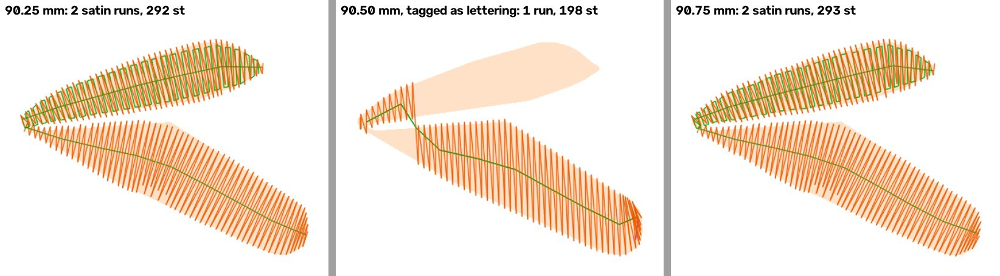

# Monarch size cliff: wing cells read as lettering at some widths (2026-11-13)

Kent picked "Size fragility trace" on 2026-11-13. The monarch keeps a whole orange wing cell at a 90.0 mm target and
loses it at 90.5 mm, at `ac3d77fa` and on main alike
([`monarch-orange-drift-2026-11-12.md`](monarch-orange-drift-2026-11-12.md)). This doc finds where and why.

This is a diagnosis only: nothing is fixed, flipped or changed in the pack. Every number names the **target width**
(`target_width_mm` sent to `/digitize`), not the stitched file's width, which runs about 0.6% wider.

## Answer

**Not a cliff, and not segmentation. It is a lettering misread at isolated widths.**

At target 90.50 and 91.75 mm, `textcluster._letter_candidates` admits one more orange wing cell as a candidate letter.
That cell sits at (+14, +24) mm in a 90 mm frame and is 17 mm tall. Its skeleton stroke-width CV (coefficient of
variation) jitters with size: 0.582, **0.537**, 0.581, 0.553, **0.538** at 90.25 / 90.50 / 90.75 / 91.50 / 91.75 mm.
Only twice does it fall under **`LETTER_STROKE_CV_MAX = 0.55`**.

Once admitted, it links the orange cells into one 11-member "word":
- `_linked` passes: height ratio within `LETTER_HEIGHT_RATIO` 0.8, stroke within `SIMILARITY_RATIO` 0.5, one ink, and
  inside `PROXIMITY_HEIGHT_MULT` 3x height;
- the group clears `MIN_CLUSTER_MEMBERS` 3, so `detect_text_clusters` tags all 11 `text_candidate`.

`columns.is_lettering` then sends every member down the Column lane, which sews each as lettering columns. The cell
that loses the stripe is `Sfe1be372` at (+21, +9) mm, 118 mm², a V of two arms. As a letter, the lane sews one arm and
leaves the other bare:

| Target mm | Tagged? | Satin runs | Satin stitches | `satin_cover` of the cell |
|---|---|---|---|---|
| 90.25 | no | 2 | 292 | ≥ 0.964 |
| 90.50 | yes, cluster of 11 orange | 1 | 198 | **0.656** |
| 90.75 | no | 2 | 293 | ≥ 0.964 |

A second tagged cell, `S47ec45ec` (48.6 mm²), also changes. It goes from fill to Column satin, at cover 0.842.
Underlay on every tagged orange cell drops to the lane's own (55-118 stitches down to 6-18 per cell).

**Gate 1 does not apply.** The constant is a tagger bound measured on letters, not a physical constant that needs a
sew-out.

## The sweep

Monarch, defaults, main `2decffb2`, target 89.00-92.00 mm in 0.25 mm steps.

The orange columns come from stage 4 regions, after `finish_generation`. "Sewn orange px" counts pixels on the
emitted stitch plan, drawn as 2 px lines at 10 px/mm with no anti-aliasing, so it runs about 2% under the anti-aliased
renders in the 11-12 doc.

| Target mm | Stitches | Regions | Orange regions | Orange mm² | Sewn orange px | Orange tagged as lettering |
|---|---|---|---|---|---|---|
| 89.00 | 16,431 | 126 | 30 | 915.0 | 107,395 | no |
| 89.25 | 16,555 | 126 | 30 | 920.1 | 107,550 | no |
| 89.50 | 16,662 | 126 | 30 | 924.9 | 108,080 | no |
| 89.75 | 16,829 | 127 | 30 | 930.1 | 108,428 | no |
| 90.00 | 16,819 | 127 | 30 | 935.2 | 109,013 | no |
| 90.25 | 16,824 | 127 | 30 | 940.5 | 109,951 | no |
| **90.50** | **16,129** | 127 | 30 | 945.6 | **102,193** | **yes (11)** |
| 90.75 | 16,982 | 127 | 30 | 950.9 | 111,129 | no |
| 91.00 | 17,144 | 127 | 30 | 956.1 | 111,823 | no |
| 91.25 | 17,176 | 127 | 30 | 961.4 | 111,896 | no |
| 91.50 | 17,223 | 127 | 30 | 966.7 | 112,523 | no |
| **91.75** | **16,952** | 127 | 30 | 972.3 | **106,796** | **yes (11)** |
| 92.00 | 17,495 | 127 | 30 | 977.6 | 113,998 | no |

What the sweep shows:
- **The traced art grows smoothly.** Orange area rises about 5.2 mm² per 0.25 mm and the 30 orange regions are there
  at every width. Segmentation keeps the cell everywhere. One white speck appears at 89.75; the black is unchanged.
- **Two isolated dips, not one cliff.** At 90.50 the plan loses 7.8k orange px against 90.25 (−7.1%) and 695
  stitches. At 91.75 it loses 5.7k px against 91.50 (−5.1%). Both neighbours on each side are normal.
- **Both dips are the same mechanism.** An 11-member orange text cluster appears at 90.50 and 91.75 and nowhere else
  in the probe (90.25, 90.50, 90.75, 91.50, 91.75). The white-dot clusters are tagged at every width and are a separate
  matter: the "lettering false positive" the 11-10 pack doc already records.

## Known limit?

Not recorded for this mechanism. The nearest records:
- **DOCTRINE, 2026-09-16** ("The satin/fill size cliff is INPUT RESOLUTION, and no threshold rule reaches it"): gate
  metrics JITTER across 0.5 mm steps rather than drift, so "widening a threshold moves the edge to wherever the jitter
  next lands". It is the same shape of problem: a skeleton metric that jitters with size, crossing a fixed bound.
  But the monarch is a 19 px/mm source with no upscale (1920 px grid at every width), so it is not the
  invented-resolution case that entry measured.
- **Memory `the-80mm-ink-link-2026-10-15`:** Fremont's THE garbled at 80 mm and clean at 81. A letter sat on the
  small-shape floor and flipped tagger doors. That is the same tagger, size-flipped, on real lettering.
- **The 11-10 pack doc:** LETTERING_TOO_SMALL / LETTERING_ILLEGIBLE fire on 16 of 27 non-text candidates. The tagger
  reading ornaments as text is a known false positive; that it reroutes them to the Column lane and drops area was not
  recorded.

## The other 11 starter designs

### Method

**Cheap pass first.** Stages 0-4 only (no stitching) at −2% to +2% of each design's pack target, in 0.5% steps:
- 9 widths × 11 designs = 99 runs;
- each design's pack config: defaults, or `forced_class: "flat"` for the shipped baseball;
- recorded: region count, area per thread scaled for size, and lettering-tagged regions per thread.

The pack target is taken as `width_mm / 1.006` to 0.25 mm. That gives 75.0 / 92.0 / 90.0 for baseball / turtle /
monarch, which match the byte-identical reproductions of 2026-11-12.

**Then full stitch runs**, only where the cheap pass showed something move. "Sewn px" uses the sweep's method above.

### Results

| Design | Pack target mm | Stage 0-4 over ±2% | Full run | Verdict |
|---|---|---|---|---|
| jack-o'-lantern | 80.0 | 6 regions, nothing tagged, areas within 0.1% | — | stable |
| heart | 79.5 | 3 regions, nothing tagged, within 0.2% | — | stable |
| shamrock | 73.0 | 4 regions, nothing tagged, within 0.1% | — | stable |
| bumblebee | 79.75 | 10 regions, nothing tagged, within 0.6% | — | stable |
| bur oak leaf | 54.75 | 3 regions, nothing tagged, within 0.9% | — | stable |
| American football | 89.75 | 44-45 regions, nothing tagged, within 1.5% | — | stable |
| Christmas tree | 81.5 | 20 regions, 7 tagged at every width, within 1.1% | — | stable |
| turtle | 92.0 | 26 regions, nothing tagged; one green (5944) moves 3 mm² of 45 | — | stable |
| baseball (flat) | 75.0 | 117-124 regions; seam pieces tagged 25-28, 11 → 8 Bordeaux at +1.5% | 75.75 vs 76.12: red and black sewn px +0.8% / +4%, as size predicts | stable |
| **owl** | 80.0 | 11 regions; **3 black shapes tagged at 79.2, 79.6, 80.8, 81.6, untagged at 80.0, 80.4, 81.2** | black sewn px 24,710 at 79.6 and 25,395 at 80.8 against 26,135 at 80.0: **about −4.5% at the tagged widths**, size-corrected | **same mechanism, smaller** |
| **lighthouse** | 25.25 | 80-85 regions; tagged 4 at every width; **at 25.75 a 72 mm² black region re-threads to 0134 Smoky** | **crashes at targets 25.125 and 25.63** (below); at 25.75 Smoky takes 11.2k of the black's sewn px | **different faults** |

### The owl: the same flicker, smaller

The same lettering misread hits the owl. At its pack target (80.0) nothing is tagged. At 79.2, 79.6, 80.8 and 81.6 mm,
three black shapes are tagged as lettering, and their sewn black area falls about 4.5% (14 mm²). The cheap pass
cannot show which black parts those are; their stitches were not drawn.

### The lighthouse: a crash at some sizes (a different bug, out of scope here)

At targets **25.125 and 25.63 mm**, `plan_stitches` raises:

    AttributeError: 'MultiPolygon' object has no attribute 'exterior'

The call path is `shape_memo` wrapper → `stage6_fill.stitch_shape` (line 2839) → `best_fill_angle_deg` (line 481) →
`principal_angle_deg` (line 96). In the 9-width sweep (24.75-25.75 by 0.125), only 25.125 fails; 25.63 failed in a
separate run. The pack's own size (25.25) and its neighbours plan normally.

A customer who sizes the lighthouse to one of those widths gets a failed job. This is not the lettering mechanism, so
it is a separate follow-up.

The stage 0-4 pass would not catch a crash like this on the other designs: they were only stitched where something
moved.

At 25.75 mm, a 72 mm² black part re-threads to Smoky (dark grey), so the file gains a colour stop. That is also a
different mechanism, and minor to the eye.

## Options for Kent

None of these is built. A flip of anything built is Kent's.

1. **Record it and change nothing.**
   - **Delivers:** this doc and the memory note. The shipped monarch (90.0) and owl (80.0) sit at untagged widths and
     sew whole.
   - **Cost:** none.
   - **Catch:** a customer who resizes either design by under 2% can lose a wing cell (monarch, about 7% of orange)
     or about 4.5% of the owl's black, with no warning. Any artwork whose shapes sit near the letter door can do the
     same.
2. **Column-lane cover hand-back, built OFF (my pick).**
   - **What it does:** after the lane sews a tagged shape, if `satin_cover` falls under a floor (0.90, the lane's own
     `SMALL_BOLD_COVER_MIN` precedent), the shape goes back to the ordinary satin/fill path. That is the tier it
     takes whenever it is not tagged.
   - **Delivers:** the wing cell keeps both arms however the tagger reads it (0.656 against ≥ 0.964 untagged). It also
     catches any real letter the lane under-covers. It acts at the point where the area is lost, not on the jittering
     metric.
   - **Cost:** one PR: flag, tests, md5 pins unchanged with it OFF. Before any flip, a census of the lettering fixtures:
     how many real letters fall under 0.90, and what they would sew as.
   - **Catch:**
     - A real letter under the floor would lose the lane's lettering features (lean, square ends, house angle).
     - The floor is a new constant to defend.
     - The wing cells would still be tagged, so preflight's lettering findings and the Studio's "looks like text"
       badge would still fire on them.
3. **Text-cluster veto on OCR, built OFF.**
   - **What it does:** a cluster whose members OCR cannot read (for example, median confidence under a floor) is not
     tagged.
   - **Delivers:** the wing cells never become a word, and the false "lettering" findings on ornaments go too.
   - **Cost:** OCR moves before tagging decisions. It is about 5 ms a read since tesserocr, so cheap. Plus a census of
     real wordmarks.
   - **Catch:**
     - OCR is noisy on small and stylised letters. The cell here read "\\" at confidence 92, so a confidence floor
       would not even have caught it.
     - Real words could be untagged (Fremont's tagline class).
     - It is a threshold on a noisy measure, which DOCTRINE 2026-09-16 warns against.
4. **Not recommended: retune `LETTER_STROKE_CV_MAX`.**
   - The cell's CV jitters 0.537-0.582 across 0.25 mm steps. Moving 0.55 relocates the edge to the next width where
     the jitter lands, exactly as DOCTRINE 2026-09-16 measured on the satin/fill cliff. It also changes every real
     lettering fixture.

**Separate follow-up, whatever Kent picks:** the lighthouse crash at 25.125 / 25.63 mm (`principal_angle_deg` given a
`MultiPolygon`). It is a correctness bug, not a judgement call, and wants its own fix PR. A full-pipeline crash census
of the pack at ±2% would go with it.
