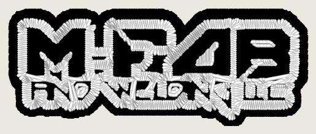
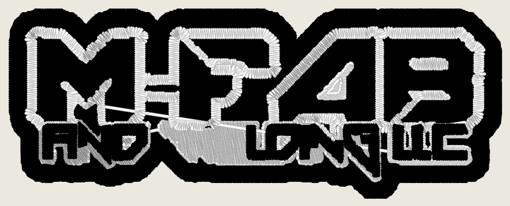
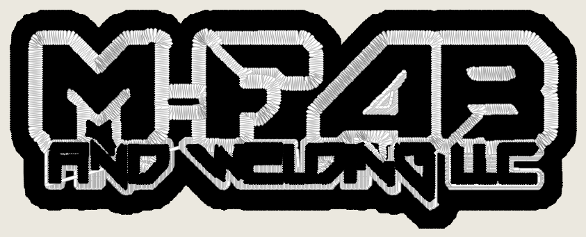
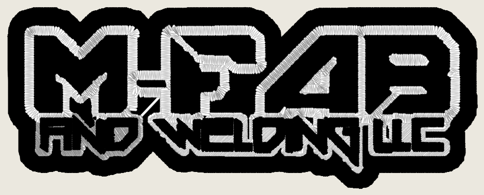
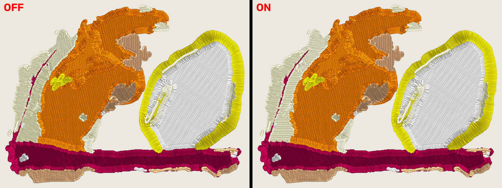
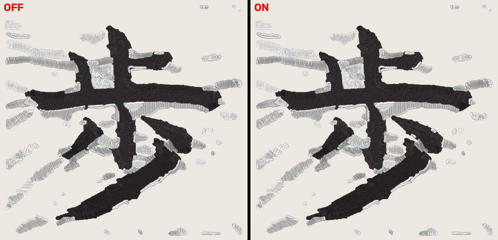
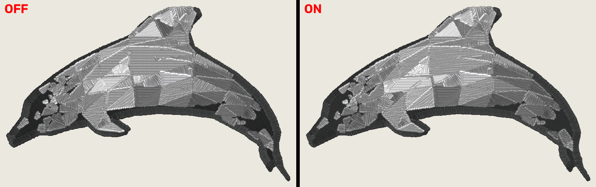

# MFab's keyline in the photo lane: the floor eats its rim, and `photo_enclosed_rim` (2026-11-06)

Kent's ruling, 2026-11-05, on the MFab photo-route defect: **"Keep OFF, fix
the superpixel merge"** (`photo_work_grid` stays OFF;
`docs/photo-work-grid-census-2026-11-05.md`). PR #1265 (`underfill_untagged_riders`,
OFF, `docs/photo-superpixel-merge-2026-11-05.md`) traced the letters to the
under-fill's rider rule and left one thing broken: W+E at 60 mm, because "the
white keyline round W+E is broken". This note finds where the keyline breaks.

Built here: `cfg.photo_enclosed_rim`, **default OFF**. Every number is an
instrument reading (ROADMAP gate 4): colour blocks, stitches, trims, grade,
renders, pixel counts. Stage 0 untouched (gate 2).

## Diagnosis: not the superpixel merge, the min-detail floor after it

Art `testdata/art/logo_mfab_hat.png` (418 x 159 px), the Studio's own request
on `hat_front`, no forced class: `photo_scene` at every width. At 60 and
100.8 mm the photo lane gets the SAME raster (418 px; 6.73 and 4.01 px/mm, no
resample). Traced step by step through `stage2_photo_segment.segment`:

| step | 60 mm vs 100.8 mm |
|---|---|
| SEEDS superpixels | 786 and 786, label arrays identical |
| RAG + hierarchical merge (CIEDE2000, area-ratio, boundary contrast) | 24 and 24 labels, arrays identical |
| phantom-blend dissolve, edge snap | nothing moved at either width, identical |
| **min-detail floor** (`resolve_small_regions`, 1.5 mm) | 303 pieces in; **32 kept at 60, 50 at 100.8** |
| stage-2 black after the floor | 935 px more black at 60 (a 1 px fattening along the keyline) |

So the superpixel merge never joins a letter to its keyline at any width. The
width dependence enters at the floor, which is in mm: `(1.5 mm x px/mm)^2` =
**102 px at 60 mm, 36 px at 100.8 and 113.5**.

What the floor eats: stage 1 marks the white keyline as an ENCLOSED ground
(bg-coloured, not border-connected; 13,162 px) and the lane quantises it as
its own population. The keyline's edge pixels miss that test and stay in the
main population, where the merge collects them into one white label: **275
pieces, 3,064 px, L\* 98.2 against the ground's 99.0 (dE 0.8)**. The floor
reads only the main population, so a sub-floor white piece's only neighbour is
the black: it is absorbed into the black, and a 1-2 px keyline loses a pixel.
At 60 mm (102 px floor) almost every piece goes; the keyline breaks into 3
white fields instead of 1, W+E sits only 50% in a field hole, and the rider
rule cannot reach the small line. At 100.8 (36 px) more pieces stand, and the
keyline holds except where the source's one-pixel W-E bridge already joins
the letters.

Merge criterion, letter vs ground, for the record: the black letters (L\* 1-4)
against the white keyline (L\* 99) are ~97 dE00 apart at every width, far over
the merge threshold; the merge never had a reason to join them.

## The fix (flag OFF): the rim joins its ground before the floor

`cfg.photo_enclosed_rim` (`stage2_photo_segment.enclosed_rim`, step 3.95 of
`segment`, after the merge and before the floor). ON, a main-population piece
(one 8-connected component of one merged label) moves to the enclosed ground's
population when all hold:

- it touches the enclosed ground (8-neighbour);
- its mean Lab is within `cfg.merge_delta_e` (6.0) of the mean Lab of the
  ground pixels it touches;
- it is under the floor (`(min_detail_mm x px/mm)^2` px): only a piece the
  floor would hand to the ink moves.

The floor bound was added after the first ON probe: unbounded,
`gradient_mascot` moved 388,284 px (whole regions of the ground's colour) into
the enclosed population. Bounded, it moves nothing there.

### Candidates rejected

- **A keyline / contrast guard in the merge criterion.** The merge keeps the
  letters and the keyline apart at every width (identical labels at 60 and
  100.8). Nothing to guard.
- **A detail floor in design mm, not pixels.** The floor already IS in mm;
  that is what makes it width-dependent. The fix is what the floor can see
  (the ground's population), not its size.
- **Routing white-keyline art off the photo lane (`white_keyline_art.detect`).**
  Stage-0-adjacent (gate 2), MFab-only, and the detector needs the text tags
  missing at 60 mm.
- **Taking every ground-coloured piece (unbounded).** Moves whole regions on
  `gradient_mascot` (above).

## MFab hat, OFF vs ON

Studio request on `hat_front`, the corpus tool's worker and renderer, serial;
wall clock on a shared, loaded laptop. Renders (ours only):
`docs/renders/photo-superpixel-merge-2026-11-06/`.

| width | arm | colour blocks | stitches | trims | grade (raw) | white fields / small-line riders | render |
|---|---|---|---|---|---|---|---|
| 60 | OFF | Black, White | 7,882 | 8 | C (64) | 3 / 0 | white over the whole small line |
| 60 | ON | Black, White, Black | 9,344 | 13 | C (64) | 1 / >= 12 | **AND WELDING LLC sews black on the keyline, readable** |
| 100.8 | OFF | Black, White, Black | 19,361 | 22 | B (88) | 1 / 11 | white blob over "WE" |
| 100.8 | ON | Black, White, Black | 19,387 | 18 | B (88) | 1 / >= 12 | **AND WELDING LLC legible, no blob** |
| 113.5 | OFF | Black, White, Black | 22,913 | 26 | B (88) | 1 / 12 | clean |
| 113.5 | ON | Black, White, Black | 22,775 | 23 | B (88) | 1 / >= 12 | clean; same read |

The OFF arm equals main (7,882 / 19,361 / 22,913, the numbers of #1262 and
#1265). With `underfill_untagged_riders` ALSO on, the first (unbounded) build
gave a design md5-identical to this flag alone at all three widths: once the
keyline holds, the tagger reads the small line and there is nothing left for
the untagged rule to add on MFab.

**What ON makes worse on MFab:** 60 mm stitches +1,462 (+19%) and trims
8 -> 13 (the small line sews as its own black block; that is the fix). The
grade does not move at any width (preflight does not see the blob either way).

## The corpus and the scorecard photo rows, stages 0-2

The flag is read only inside `stage2_photo_segment.segment` (the photo AND
gradient classes' segmenter), and only when stage 1 found an enclosed ground.
Probe: each row on the Studio's 80 mm left-chest request with the flag ON,
stopped after the floor, recording whether `enclosed_rim` moved any pixel. A
row where it moved none is byte-identical OFF vs ON by construction.

| inputs | rows | reach `segment` | have an enclosed ground | rim moves pixels |
|---|---|---|---|---|
| photo corpus, 18 photo genres | 18 | 15 | 2 | **2**: pencil_sketch 184 px, watercolor 763 px |
| photo corpus, 21 logo styles | 21 | 16 | 13 | **4**: distressed_grunge 8,484, kanji_brush 1,227, low_poly 116, vintage_engraved_badge 27,430 |
| scorecard photo rows (the 7 `photo_*` fixtures + `logo_bridge_bar.jpg`) | 8 | 8 | 0 | **0** |

(Rows that do not reach `segment` go through another segmenter and cannot
move: group_people, sports_action, vintage_sepia, comic_halftone,
kanji_seal, neon_outline_sign, pixel_art_sprite, qr_code.)

### The 6 rows that move, digitized in full (added 2026-11-06, after #1269 merged)

`tools.photo_corpus capture --procs 1`, labels `rim-off` and
`rim-on --set photo_enclosed_rim=true`, same tree (main 15cde8de), the
Studio's 80 mm left-chest request. Serial; the laptop was shared and loaded,
so wall times are not a cost reading.

| row | class | stitches OFF / ON | trims | colour blocks | grade (raw) OFF / ON | findings that appear ON | design |
|---|---|---|---|---|---|---|---|
| pencil_sketch | photo_scene | 19,277 / 19,277 | 3 / 3 | 2 / 2 | A (100) / A (100) | none | **md5 identical** (the 184 px leave no trace) |
| watercolor | photo_scene | 22,124 / 21,863 | 57 / 57 | 7 / 7 | C (64) / C (64) | **`ARTWORK_UNCOVERED`** | differs; renders read the same |
| kanji_brush | photo_scene | 12,803 / 12,851 | 93 / 94 | 4 / 5 | B (76) / B (76) | none | differs; renders read the same |
| low_poly | gradient | 13,789 / 13,383 | 63 / 67 | 6 / 6 | C (64) / C (64) | none | differs; facets shift, same read |
| distressed_grunge | gradient | 16,943 / 16,902 | 37 / 38 | 2 / 2 | **A (100) / B (88)** | **`LETTERING_TOO_SMALL`** | differs; letters slightly bolder ON, specks the same |
| vintage_engraved_badge | photo_scene | timeout (1,200 s) / 34,955 | - / 232 | - / 3 | - / C (64) | n/a: OFF did not finish | no comparison |

No `DENSITY_STACKED` appears or resolves on any row. Nothing resolves.

**Worse ON, by the instruments:** `distressed_grunge` (grade A -> B, a
`LETTERING_TOO_SMALL` finding appears) and `watercolor` (`ARTWORK_UNCOVERED`
appears; grade unchanged). The others read the same or are byte-identical.
`vintage_engraved_badge` is unmeasured (the OFF arm timed out on the loaded
laptop; ON finished in 815 s).

Side-by-side renders (OFF left, ON right; our output only), for Kent to mark
better / same / worse: `docs/renders/photo-superpixel-merge-2026-11-06/`
`watercolor_off_vs_on.png`, `kanji_brush_off_vs_on.png`,
`low_poly_off_vs_on.png`. Not committed: `distressed_grunge` (its source is
CC BY-SA 4.0, so a render of it is a derivative that carries the share-alike
and attribution terms; kept local with the corpus sxs, as the corpus spec
keeps every sxs page) and `pencil_sketch` (identical design).

## What the flip would change for a photograph upload

For almost every photograph, nothing: 16 of the 18 Commons photographs and
all 8 scorecard photo rows have no enclosed ground or no rim piece, and their
stage-2 output is identical ON. The rule moves pixels only where stage 1 found
an enclosed patch of the page colour inside the art AND a sub-floor piece of
that colour sits against it: keyline logos (MFab), and on photographs the odd
pale patch on a pale page (pencil_sketch, watercolor: under 0.1% of their
pixels). Digitized in full, pencil_sketch is md5-identical and watercolor gains an `ARTWORK_UNCOVERED` finding (grade unchanged). It also reaches gradient-class logos, which share this segmenter (distressed_grunge: A -> B).

## Tests

`digitizer/tests/test_photo_enclosed_rim.py`: synthetic rim (takes the
ground-coloured sliver, not a same-colour speck away from the ground, never
the ink; leaves a piece over the floor); flag defaults OFF; OFF never calls
`enclosed_rim` and pins the 60 mm OFF design md5 on the frozen engine; MFab at
60 / 100.8 / 113.5 ON: blocks Black, White, Black, one white field, at least
12 riders, never fewer than OFF; `owl_kent.jpg` stage 2 unchanged ON.

## Addendum 2026-11-13: every number above is the NO-cutout lane

MFab classes photo_scene, so a box with the rembg venv (a required deploy step)
runs the background cutout and prep; CI has no venv, so its cutout fails and
prep is skipped with it. Everything above was measured that second way. On the
cutout lane (fields / riders): 60 mm OFF 2 / 6, ON 2 / 10; 100.8 OFF 1 / 12,
ON 1 / 15; 113.5 OFF 1 / 12, ON 1 / 11. The default is better there (60 mm
already sews black, white, black), but ON does not hold the keyline whole at
60 mm and drops a rider at 113.5. The MFab tests now pin `photo_prep=False`;
the cutout lane's claims and these two gaps (strict xfails) are in
`digitizer/tests/test_mfab_cutout_lane.py`. Any flip of this flag should be
judged on the cutout lane.

### 60 mm on the cutout lane: the rim read a piece by its mean (fixed 2026-11-13)

Dumped `enclosed_rim`'s inputs on both lanes at 60 mm: the enclosed mask is
identical (13,162 px, 8 components), the white label nearly so (269 pieces,
3,057 px against 275, 3,064), and the rim takes 2,726 px against 2,798. One
piece makes the difference: an 89 px rim piece between A and N of AND that
holds 7 ink pixels, from a superpixel straddling the keyline's edge. Its MEAN
L\* is 92.3 against the ground's 100.0 (prep flattens the ground to pure
white), dE 7.7, over the 6.0 bound, so it stayed and the floor gave it to the
black. A and N joined (aspect 1.76, the pinch `textcluster`'s wide-letters
note records under rembg), AND lost its text tag, D was no longer a letter
holding its counter, and the counter read as a second white FIELD. The keyline
itself was whole (the main field 336 mm2 against 338). The no-cutout lane's
twin piece holds 4 ink pixels of 67, dE 5.9: it passed by a hair.

Fix: the piece's own colour is its MEDIAN Lab (`enclosed_rim`). Flag OFF the
function is never called, so OFF is byte-identical (the pinned md5 holds).

### 113.5 mm on the cutout lane: not the rim (left a strict xfail)

ON loses G of WELDING as a rider. G (11.2 mm, with its tail) is linked to its
line by the 2026-10-27 engine's letter door (`LETTER_HEIGHT_RATIO` 0.8) only
through the 9.1 mm letter beside it, 0.81 of its height. That letter is 9.1 mm
only because the OFF floor fattens it by a pixel of absorbed rim; ON the keyline
stays white, it reads 8.8 mm (0.786), and G goes untagged. With
`text_cluster_part_touching` ON (the live default since 2026-10-27; the frozen
test engine has it OFF) `_adopt_band` takes G: OFF 2 fields / 8 riders,
ON 1 / 14 at 113.5 mm.

### MFab hat, both lanes, after the fix (2026-11-13; fields / riders)

Frozen 2026-10-27 engine (`frozen_cfg`), the tests' config; OFF unchanged.

| width | arm | no cutout | cutout |
|---|---|---|---|
| 60 | OFF | 3 / 0 | 2 / 6 |
| 60 | ON | 1 / 13 (was 1 / 12) | **1 / 15** (was 2 / 10) |
| 100.8 | OFF | 1 / 10 | 1 / 12 |
| 100.8 | ON | 1 / 13 | 1 / 15 |
| 113.5 | OFF | 1 / 12 | 1 / 12 |
| 113.5 | ON | 1 / 12 | 1 / 11 (G: the letter door, above) |

Colour blocks are Black, White, Black in every ON cell. The no-cutout 100.8 ON
design changed (md5) with the same counts; 113.5 ON on both lanes and
cutout 100.8 ON are md5-identical to before.

## Addendum 2026-11-14: the flag on the LIVE engine, both lanes — stays OFF

Measured 2026-11-13 on tree `fd8a0359` (main `7ad9c124` plus PR #1461, tone
pass off), live `PipelineConfig` defaults, `photo_enclosed_rim` OFF vs ON.
Cutout lane = the isolated rembg venv present; no-cutout lane =
`photo_prep=False`. Renders were looked at for every changed pair.

### MFab hat, `hat_front` (fields / riders; colour blocks)

| width mm | lane | OFF | ON | what ON sews |
|---|---|---|---|---|
| 30 | cutout | 2 / 8, Black White | 2 / 11, Black White | faces and small line black, near legible |
| 30 | no cutout | 2 / 8, Black White | 2 / 11, Black White | same |
| 36.7 | cutout | 2 / 4, Black White | probe did not run, **White Black** | **one black patch** |
| 36.7 | no cutout | 2 / 4, Black White | probe did not run, **White Black** | **one black patch** |
| 60 | cutout | 2 / 7, Black White Black | 1 / 16, Black White Black | small line reads |
| 60 | no cutout | 3 / 0, Black White | 1 / 14, Black White Black | small line reads |
| 80 | cutout | 1 / 12 | 1 / 16 | white block over W-E gone |
| 80 | no cutout | 1 / 10 | 1 / 14 | same |
| 100.8 | cutout | 1 / 13 | 1 / 16 | `LETTERING_TOO_SMALL` clears |
| 100.8 | no cutout | 1 / 11 | 1 / 14 | small line clean |
| 113.5 | cutout | 2 / 8 | 1 / 14 | `LETTERING_TOO_SMALL` clears |
| 113.5 | no cutout | 1 / 12 | 1 / 14 | small line clean |

### Widths between those (cutout lane, ON arm)

| width mm | ON | reads as |
|---|---|---|
| 33 | 1 / 13, Black White | fine |
| 35, 36, 37, 40 | probe did not run, White Black | one black patch, as 36.7 |
| 38 | 1 / 13, Black White Black | fine |
| 45, 50 | 1 / 13 and 1 / 16, Black White Black | M-FAB faces sew WHITE, hyphen dropped; small line reads |

The 36.7 mm collapse is deterministic (same md5 on a repeat) and
`ARTWORK_UNCOVERED` appears with it.

### The 77-image set (80 mm, left_chest, 6 colours)

ON changes 4 designs on the cutout lane and 5 on the no-cutout lane; the other
rows are byte-identical to OFF, stained_glass included.

| image | lanes | ON against OFF |
|---|---|---|
| logo_mfab_hat | both | better: the white block over W-E goes |
| summit_badge | both (gradient class, lanes identical) | outer ground band more uniform, `THREAD_MATCH_POOR` clears, 1,453 fewer stitches |
| kanji_brush | no cutout | worse: a fifth block (dark grey) inside the black strokes |
| vintage_engraved_badge | both | cutout lane worse: 24% more stitches, silver speckle; no-cutout about the same |
| watercolor | both | worse: white specks (cutout); a block added and grade B to C (no cutout) |

**Ruling (Kent, 2026-11-14): "Keep off, fix the collapse".** The flag stays
OFF; the collapse at 35 to 37 and 40 mm and the white faces at 45 to 50 mm are to be
fixed behind the flag and the same widths and images re-measured before the
question comes back.

## Addendum 2026-11-14 (2): the 35 to 40 mm collapse is fixed; the white faces are a rule, not a bug

**The collapse was the border pass's line-art guard, not the rim.** The rim
gives the keyline back the band round the hyphen and round AND WELDING LLC.
Those holes are shorter than `machine.BORDER_MIN_LOOP_MM` at 30 to 50 mm, so
`art_outline.line_art_reading` counted their band as dropped: 0.0219, 0.0256
and 0.0224 of the keyline at 35, 36.7 and 40 mm against the 0.02 cut (38 mm
read 0.0197 and escaped). The outline was then dropped as line art, the
white-keyline recipe and the under-fill never ran, and black sewed over the
keyline. With the flag ON the guard now leaves out band within the loop width
of ANY hole of the outline (`round_any_hole`). No constant moved: every MFab
width then reads 0.000, and Bridge Bar's bowl still reads line art.

### MFab hat after the fix, flag ON (fields / riders, blocks; cutout lane ; no cutout)

| width mm | ON before | ON after |
|---|---|---|
| 35 | none, White Black ; none, White Black | 1 / 13, Black White ; 1 / 13, Black White |
| 36 | none, White Black (both) | 1 / 13, Black White (both) |
| 36.7 | none, White Black (both) | 1 / 13, Black White (both) |
| 37 | none, White Black (both) | 1 / 13, Black White (both) |
| 40 | none, White Black (both) | 1 / 13, Black White Black (both) |

The other nine widths (30, 33, 38, 45, 50, 60, 80, 100.8, 113.5) are
md5-identical to before with the flag ON. `ARTWORK_UNCOVERED` is gone from
every ON row. Renders looked at: 35 to 37 mm sew a thin white keyline, black
faces with the hyphen, and a readable small line.

### Flag OFF is untouched, and the 77-image set does not move

- Flag OFF, fix against main: all 28 MFab rows and all 154 corpus rows (77
  images, both lanes, 80 mm) are md5-identical.
- Flag ON, fix against main, 77 images: all 154 rows md5-identical. The flag
  still changes the same five images as in the first addendum.
- 31 of the cutout-lane baseline rows ran with the cutout unavailable; on the
  fix tree each of those is a refused cutout, which sews the no-cutout design,
  and their md5s agree.

### White faces at 38 to 50 mm: the keyline rule, reached at a smaller size

`keyline_bean.keyline_regions` sews the keyline as a thin bean only while the
field is at most 0.6 mm wide (2 × area / perimeter). Above that it gets the
looped border, widened to the `machine.OUTLINE_WIDTH_MM` floor of 1.5 mm. With
the flag OFF the floor erodes the keyline, so it reads under 0.6 mm up to
about 50 mm; with the flag ON it reads its true width and crosses 0.6 mm at
about 38 mm (0.604 at 38, 0.719 at 45, 0.815 at 50). The M-FAB strokes are
about 2 to 2.4 mm wide there, so 1.5 mm white loops swamp them, and at 45 mm
the hyphen is lost. In a close render the faces are still black. This is the
rule OFF already applies from 60 mm up. **Not changed: what a keyline should
be at these sizes is Kent's decision.**

### Why the flag touches three unrelated images (diagnosed, not fixed)

The rim accepts a whole piece by its median colour, so the piece brings its
non-ground pixels into the enclosed population, and that population's own
quantiser gives them new threads: kanji_brush 2,118 rim px (one spool becomes
three), vintage_engraved_badge 72,621 rim px of which 6,486 are over 25 dE
from the ground (a new spool takes 5,628 px), watercolor 871 rim px. Moving
only the rim pixels close to the ground, not whole pieces, is the candidate
fix.

*(measured 2026-11-14 — `tests/test_photo_enclosed_rim.py`; corpus and width
runs on a Windows desktop, both lanes)*

## Addendum 2026-11-14 (3): the three worse images, fixed behind the flag

**Verified first.** On the start point (PR #1527's tree), with the flag ON,
the rim moved 2,118 px on kanji_brush (no cutout; 336 of them 6 dE or more
from the ground), 72,621 on vintage_engraved_badge (cutout; 6,486 over 25
dE), and 871 on watercolor. That is the leak the second addendum names, and
it is half the story. Moving only the ground-coloured pixels (the candidate)
fixed kanji_brush but left vintage_engraved_badge 21% over OFF in stitches,
still speckled, and watercolor's white specks in place: of vintage's rim,
63,843 px sat beside enclosed components under the floor, specks of paper
the rim grew into sewn ones.

**The fix, two rules in `stage2_photo_segment.enclosed_rim`:**

1. Of an accepted piece only the pixels within `merge_delta_e` of the ground
   it touches move; the rest stay in the main population.
2. A piece no smaller than all the enclosed components it touches is not
   their rim and stays. Beside a speck the piece is the bigger thing
   (vintage: 59,587 px of such pieces, kanji_brush all 2,024, watercolor
   3,914 of 4,127); none of MFab's pieces (its keyline round the small line
   at 30 to 37 mm is enclosed pieces under the floor, each bigger than its
   rim) nor summit_badge's (68 px) are.

No constant was added. A first try that kept only grounds of at least the
floor (`max_px`) cost MFab a rider at 30 mm (11 to 10) and undid
summit_badge's gain, so it was dropped.

### The five images, 80 mm, left_chest, 6 colours (ON before ; ON after ; OFF)

| image, lane | stitches | blocks, grade |
|---|---|---|
| kanji_brush, no cutout | 13,072 ; 12,765 ; 12,803 | 5 blocks (Smoky added), B ; 4, B ; 4, B |
| vintage_engraved_badge, cutout | 27,929 ; 24,199 ; 22,508 | C with `ARTWORK_UNCOVERED` ; C without ; C |
| vintage_engraved_badge, no cutout | 33,402 ; 32,714 ; 32,465 | C ; C ; C |
| watercolor, cutout | 17,863 ; 17,580 ; 17,786 | B with `ARTWORK_UNCOVERED` ; B without ; B |
| watercolor, no cutout | 19,197 ; 19,020 ; 19,244 | 8 blocks (Tan twice), C ; 7, **D** ; 7, B |
| summit_badge, both | 26,996 ; 27,025 ; 28,449 | F 34 ; F 34 ; F 4 (`THREAD_MATCH_POOR`) |
| logo_mfab_hat, both | 13,710 / 13,756 ; 13,750 / 13,779 ; 13,611 / 13,664 | B ; B ; B |

Renders looked at: kanji_brush loses the dark-grey block inside the strokes
and matches OFF; vintage loses most of the silver speckle (a little more
paper shows in the branches than OFF); watercolor (cutout) loses the white
specks on the bar and gets the oval's inner ring back; summit_badge keeps its
even outer band.

**Still worse: watercolor, no cutout, D against OFF's B.** Its blocks now
match OFF, but two findings cross their line by a hair: 79 trims against 77
(4.15 per 1,000 stitches, limit 4.1), and a stack OFF already has (peak 9.97
units at the oval's left edge, under the 25 mm2 a patch must reach) grows to
exactly 25 mm2 (peak 10.66). The rim there is the oval's own edge, taken as
it is on MFab; not changed.

### MFab hat, flag ON after the fix (fields / riders, blocks; cutout ; no cutout)

| width mm | ON after |
|---|---|
| 30 | 2 / 11, Black White ; same |
| 33, 35, 36, 36.7, 37 | 1 / 13, Black White (both lanes, every width) |
| 45 | 1 / 13, Black White Black (both) |
| 60 | 1 / 15 ; 1 / 14, Black White Black |
| 80 | 1 / 16 ; 1 / 14, Black White Black |
| 100.8 | 1 / 16 ; 1 / 14, Black White Black |
| 113.5 | 1 / 14 (both), md5-identical to before |

Flag OFF: MFab at 30, 36.7, 45, 60, 80 and 113.5 mm, both lanes, is
md5-identical to the start point on the final tree, and the five images'
OFF rows were on the rule-1 tree (the change is inside `enclosed_rim`,
which runs only with the flag ON). The 77-image set was
not re-run (the machine was short of memory).

*(measured 2026-11-14 — `tests/test_photo_enclosed_rim.py`; corpus and width
runs on a Windows desktop, both lanes)*
