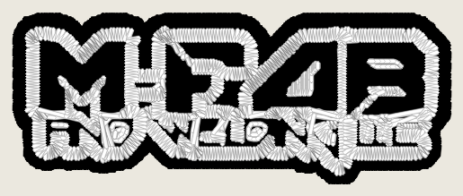
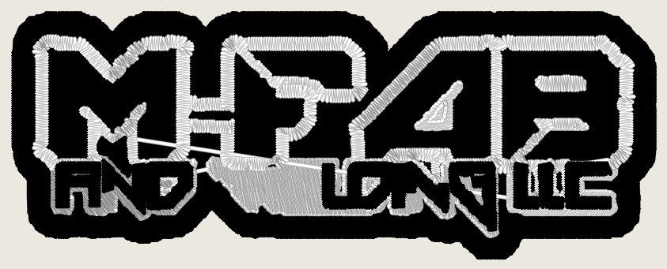
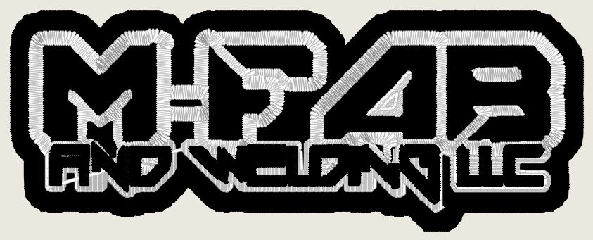
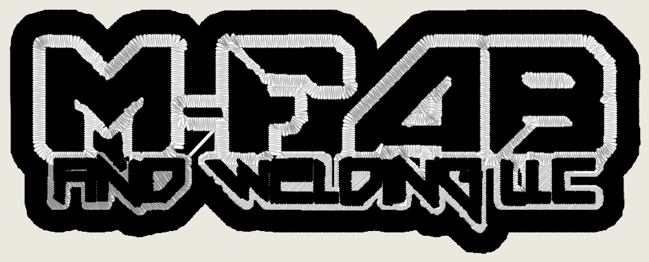

# MFab's keyline in the photo lane: the floor eats its rim, and `photo_enclosed_rim` (2026-11-06)

Kent's ruling, 2026-11-05, on the MFab photo-route defect: **"Keep OFF, fix
the superpixel merge"** (`photo_work_grid` stays OFF;
`docs/photo-work-grid-census-2026-11-05.md`). PR #1265 (`underfill_untagged_riders`,
OFF, `docs/photo-superpixel-merge-2026-11-05.md`) traced the letters to the
under-fill's rider rule and left one thing broken: W+E at 60 mm, because "the
white keyline round W+E is broken". This note finds where the keyline breaks.

Built here: `cfg.photo_enclosed_rim`, **default OFF**. Every number is an
instrument reading (ROADMAP gate 4): colour blocks, stitches, trims, grade,
renders, pixel counts. Stage 0 untouched (gate 2).

## Diagnosis: not the superpixel merge, the min-detail floor after it

Art `testdata/art/logo_mfab_hat.png` (418 x 159 px), the Studio's own request
on `hat_front`, no forced class: `photo_scene` at every width. At 60 and
100.8 mm the photo lane gets the SAME raster (418 px; 6.73 and 4.01 px/mm, no
resample). Traced step by step through `stage2_photo_segment.segment`:

| step | 60 mm vs 100.8 mm |
|---|---|
| SEEDS superpixels | 786 and 786, label arrays identical |
| RAG + hierarchical merge (CIEDE2000, area-ratio, boundary contrast) | 24 and 24 labels, arrays identical |
| phantom-blend dissolve, edge snap | nothing moved at either width, identical |
| **min-detail floor** (`resolve_small_regions`, 1.5 mm) | 303 pieces in; **32 kept at 60, 50 at 100.8** |
| stage-2 black after the floor | 935 px more black at 60 (a 1 px fattening along the keyline) |

So the superpixel merge never joins a letter to its keyline at any width. The
width dependence enters at the floor, which is in mm: `(1.5 mm x px/mm)^2` =
**102 px at 60 mm, 36 px at 100.8 and 113.5**.

What the floor eats: stage 1 marks the white keyline as an ENCLOSED ground
(bg-coloured, not border-connected; 13,162 px) and the lane quantises it as
its own population. The keyline's edge pixels miss that test and stay in the
main population, where the merge collects them into one white label: **275
pieces, 3,064 px, L\* 98.2 against the ground's 99.0 (dE 0.8)**. The floor
reads only the main population, so a sub-floor white piece's only neighbour is
the black: it is absorbed into the black, and a 1-2 px keyline loses a pixel.
At 60 mm (102 px floor) almost every piece goes; the keyline breaks into 3
white fields instead of 1, W+E sits only 50% in a field hole, and the rider
rule cannot reach the small line. At 100.8 (36 px) more pieces stand, and the
keyline holds except where the source's one-pixel W-E bridge already joins
the letters.

Merge criterion, letter vs ground, for the record: the black letters (L\* 1-4)
against the white keyline (L\* 99) are ~97 dE00 apart at every width, far over
the merge threshold; the merge never had a reason to join them.

## The fix (flag OFF): the rim joins its ground before the floor

`cfg.photo_enclosed_rim` (`stage2_photo_segment.enclosed_rim`, step 3.95 of
`segment`, after the merge and before the floor). ON, a main-population piece
(one 8-connected component of one merged label) moves to the enclosed ground's
population when all hold:

- it touches the enclosed ground (8-neighbour);
- its mean Lab is within `cfg.merge_delta_e` (6.0) of the mean Lab of the
  ground pixels it touches;
- it is under the floor (`(min_detail_mm x px/mm)^2` px): only a piece the
  floor would hand to the ink moves.

The floor bound was added after the first ON probe: unbounded,
`gradient_mascot` moved 388,284 px (whole regions of the ground's colour) into
the enclosed population. Bounded, it moves nothing there.

### Candidates rejected

- **A keyline / contrast guard in the merge criterion.** The merge keeps the
  letters and the keyline apart at every width (identical labels at 60 and
  100.8). Nothing to guard.
- **A detail floor in design mm, not pixels.** The floor already IS in mm;
  that is what makes it width-dependent. The fix is what the floor can see
  (the ground's population), not its size.
- **Routing white-keyline art off the photo lane (`white_keyline_art.detect`).**
  Stage-0-adjacent (gate 2), MFab-only, and the detector needs the text tags
  missing at 60 mm.
- **Taking every ground-coloured piece (unbounded).** Moves whole regions on
  `gradient_mascot` (above).

## MFab hat, OFF vs ON

Studio request on `hat_front`, the corpus tool's worker and renderer, serial;
wall clock on a shared, loaded laptop. Renders (ours only):
`docs/renders/photo-superpixel-merge-2026-11-06/`.

| width | arm | colour blocks | stitches | trims | grade (raw) | white fields / small-line riders | render |
|---|---|---|---|---|---|---|---|
| 60 | OFF | Black, White | 7,882 | 8 | C (64) | 3 / 0 | white over the whole small line |
| 60 | ON | Black, White, Black | 9,344 | 13 | C (64) | 1 / >= 12 | **AND WELDING LLC sews black on the keyline, readable** |
| 100.8 | OFF | Black, White, Black | 19,361 | 22 | B (88) | 1 / 11 | white blob over "WE" |
| 100.8 | ON | Black, White, Black | 19,387 | 18 | B (88) | 1 / >= 12 | **AND WELDING LLC legible, no blob** |
| 113.5 | OFF | Black, White, Black | 22,913 | 26 | B (88) | 1 / 12 | clean |
| 113.5 | ON | Black, White, Black | 22,775 | 23 | B (88) | 1 / >= 12 | clean; same read |

The OFF arm equals main (7,882 / 19,361 / 22,913, the numbers of #1262 and
#1265). With `underfill_untagged_riders` ALSO on, the first (unbounded) build
gave a design md5-identical to this flag alone at all three widths: once the
keyline holds, the tagger reads the small line and there is nothing left for
the untagged rule to add on MFab.

**What ON makes worse on MFab:** 60 mm stitches +1,462 (+19%) and trims
8 -> 13 (the small line sews as its own black block; that is the fix). The
grade does not move at any width (preflight does not see the blob either way).

## The corpus and the scorecard photo rows, stages 0-2

The flag is read only inside `stage2_photo_segment.segment` (the photo AND
gradient classes' segmenter), and only when stage 1 found an enclosed ground.
Probe: each row on the Studio's 80 mm left-chest request with the flag ON,
stopped after the floor, recording whether `enclosed_rim` moved any pixel. A
row where it moved none is byte-identical OFF vs ON by construction.

| inputs | rows | reach `segment` | have an enclosed ground | rim moves pixels |
|---|---|---|---|---|
| photo corpus, 18 photo genres | 18 | 15 | 2 | **2**: pencil_sketch 184 px, watercolor 763 px |
| photo corpus, 21 logo styles | 21 | 16 | 13 | **4**: distressed_grunge 8,484, kanji_brush 1,227, low_poly 116, vintage_engraved_badge 27,430 |
| scorecard photo rows (the 7 `photo_*` fixtures + `logo_bridge_bar.jpg`) | 8 | 8 | 0 | **0** |

(Rows that do not reach `segment` go through another segmenter and cannot
move: group_people, sports_action, vintage_sepia, comic_halftone,
kanji_seal, neon_outline_sign, pixel_art_sprite, qr_code.)

**Full digitize of the 6 rows that move: not run in this session** (2.5 h budget on a shared laptop, rows took 5-470 s at stage 2 alone). Their stage 0-1 is identical; stage 2 differs by the counts above. Before any flip, `tools.photo_corpus capture --set photo_enclosed_rim=true --only pencil_sketch watercolor distressed_grunge kanji_brush low_poly vintage_engraved_badge` against an OFF capture is the read.

## What the flip would change for a photograph upload

For almost every photograph, nothing: 16 of the 18 Commons photographs and
all 8 scorecard photo rows have no enclosed ground or no rim piece, and their
stage-2 output is identical ON. The rule moves pixels only where stage 1 found
an enclosed patch of the page colour inside the art AND a sub-floor piece of
that colour sits against it: keyline logos (MFab), and on photographs the odd
pale patch on a pale page (pencil_sketch, watercolor: under 0.1% of their
pixels). It also reaches gradient-class logos, which share this segmenter.

## Tests

`digitizer/tests/test_photo_enclosed_rim.py`: synthetic rim (takes the
ground-coloured sliver, not a same-colour speck away from the ground, never
the ink; leaves a piece over the floor); flag defaults OFF; OFF never calls
`enclosed_rim` and pins the 60 mm OFF design md5 on the frozen engine; MFab at
60 / 100.8 / 113.5 ON: blocks Black, White, Black, one white field, at least
12 riders, never fewer than OFF; `owl_kent.jpg` stage 2 unchanged ON.
