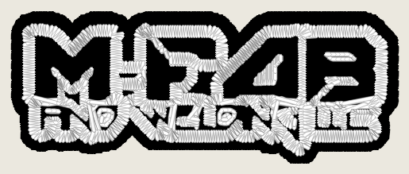
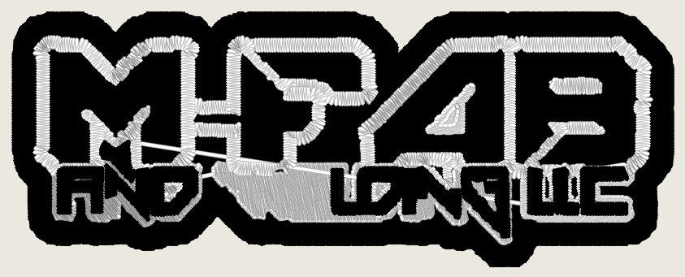
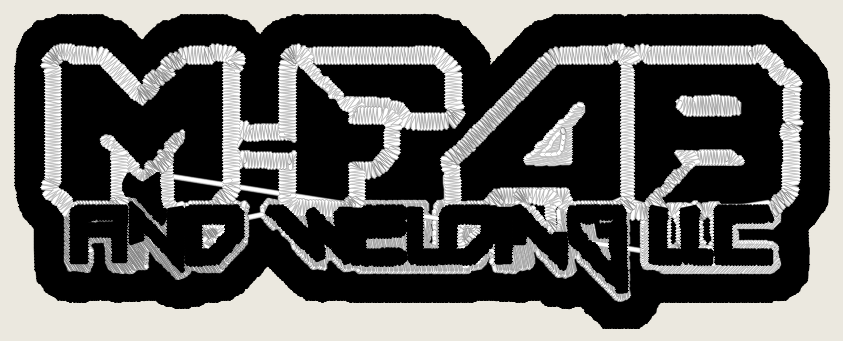
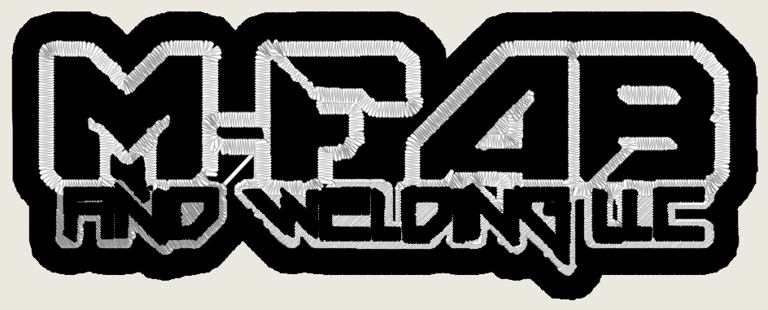

# MFab's small line: where the letters are lost, and `underfill_untagged_riders` (2026-11-05)

Kent's ruling, 2026-11-05, on the MFab photo-route defect: **"Keep OFF, fix
the superpixel merge"** (`photo_work_grid` stays OFF;
`docs/photo-work-grid-census-2026-11-05.md`).

Built here: `cfg.underfill_untagged_riders`, **default OFF**. Every number is
an instrument reading (ROADMAP gate 4): colour blocks, stitches, trims,
grade, renders. Tree: main `13c0eb85` plus this branch.

## Diagnosis: the letters are not lost in the superpixel merge

Traced per letter: each black letter of AND WELDING LLC in
`testdata/art/logo_mfab_hat.png` (418 x 159 px, letters ~26 px tall) was
followed to the regions that reach `silhouette_underfill.apply_cfg` in
`plan_stitches`, on the Studio's own request (`hat_front`, no forced class;
stage 0 calls it `photo_scene` at every width).

**Stage 2 (SEEDS superpixels plus the CIEDE2000 hierarchical merge) keeps
every small letter as its own black region at all three widths.** The only
join is W+E, which the SOURCE joins with a one-pixel black bridge (60 mm:
`Sb615d5b4`, 19.0 mm2; 100.8 mm: `S0d081325`, 53.6 mm2). No letter is merged
into the black band or the white keyline by the superpixel stage.

**They are lost at the under-fill's rider rule.** `silhouette_underfill`
merges every inner shape of the host's thread into the black under-fill,
except RIDERS. A rider must carry a text tag (`_is_letter`: the text
tagger's word / cluster keys). An untagged small letter is merged, the black
sews first, and the white field sews over it.

| width | source px/mm | riders (tagged) | small-line shapes merged untagged | the offending shapes: stroke (2A/P), area, tag, sits in a field hole |
|---|---|---|---|---|
| 60 mm | 6.73 | **0** | all of them (16 shapes merged) | every small letter: stroke 0.68-0.75 mm, 8.7-23.4 mm2, **no tag**, in a hole (cover 0.99-1.00); W+E 0.71 mm, 19.0 mm2, no tag, hole cover **0.50** |
| 100.8 mm | 4.01 | 11 | W+E only | `S0d081325`: stroke 1.20 mm, 53.6 mm2, **no tag**, hole cover 0.98 |
| 113.5 mm | 3.56 (enlarged to 4.0) | 12 | none | every small letter tagged and riding |

The big M-FAB letters' black bodies merge too, as they should (stroke
2.1-5.7 mm, the keyline loops sew round them on the black). So "thin and in
a hole of the white field" separates the small line from the big letters.
"Untagged" alone does not.

So the size sensitivity Kent saw comes from the text tagger's read of a
4-7 px/mm source, not from the segmenter. (The 2026-11-04 diagnosis note
blamed the segmenter. Its 2026-11-05 correction in memory
`mfab-photo-route-2026-11-04` already says so. This trace confirms it per
letter.)

## The fix (flag OFF): untagged riders

`cfg.underfill_untagged_riders` (`silhouette_underfill._untagged_rider`,
read only where riders are read: `silhouette_underfill_panels` +
`sew_enclosed_white` + `border_from_outline`). ON, an UNTAGGED shape rides
the white panel (never merged, sewn black after the white) when all hold:

- it is in the host's thread, tier `auto`, not the host;
- it sits `INSIDE_MIN` (0.9) in a hole of a sewn white field;
- its stroke (2 x area / perimeter) is at most 1.6 mm (the pro's
  small-letter satin cross on MFab, p50 1.55 / 1.46 mm) AND at most half the
  thickest same-thread shape inside the ring (so big-letter bodies never
  ride, at any width);
- its area is at least 2 mm2 (the 0.3-1.5 mm2 slivers between loops keep
  merging);
- it stands in a ROW: at least 2 other same-thread shapes (>= 2 mm2) inside
  the ring share its line (vertical overlap >= 0.6 of the shorter, heights
  within 1.67x).

The row condition was added after the first ON run. Without it, M-FAB's
hyphen (stroke 1.44 mm, alone on its line) rode at 100.8 mm, and its closed
panel sewed white over the whole F. That run is not committed. The rule
was re-run with the row condition and is what the table below shows.

### Candidates rejected

- **A keyline / contrast guard in the stage-2 merge criterion.** The stage-2
  merge never joins these letters to their ground, so there is nothing for
  it to guard. It would change every photograph's segmentation to fix a
  loss that happens later.
- **A minimum-detail floor in design mm.** The letters are not dropped by
  any floor. They reach the under-fill intact and are MERGED by colour.
- **Routing MFab-type art off the photo lane via `white_keyline_art`.** The
  gate needs a text-tagged body, the same tags that are missing at 60 mm.
  Changing the route is also stage-0-adjacent (gate 2). This fix runs on
  geometry the under-fill already has.
- **`photo_work_grid` ON.** Already measured: it fixes 60 mm and breaks the
  hat's default 113.5 mm, grade B to F (`docs/photo-work-grid-census-2026-11-05.md`).

## MFab hat, OFF vs ON

Studio request on `hat_front`, the corpus tool's worker and renderer, serial,
wall clock on a shared laptop. Renders (ours only):
`docs/renders/photo-superpixel-merge-2026-11-05/`.

| width | arm | colour blocks | stitches | trims | grade | wall s | render |
|---|---|---|---|---|---|---|---|
| 60 | OFF | Black, White | 7,882 | 8 | C | 12.4 | white over the whole small line |
| 60 | ON | Black, White, Black | 9,009 | 13 | **B** | 16.8 | AND and LDING LLC sew black on white; **W+E still lost** (white blob) |
| 100.8 | OFF | Black, White, Black | 19,361 | 22 | B | 49.9 | white blob over "WE" |
| 100.8 | ON | Black, White, Black | 19,772 | 22 | B | 45.8 | **AND WELDING LLC all legible**; no new blob |
| 113.5 | OFF | Black, White, Black | 22,913 | 26 | B | 68.3 | clean |
| 113.5 | ON | Black, White, Black | 22,913 | 26 | B | 63.7 | identical stitch count and trims (every letter already tagged) |

The OFF arm reproduces main's numbers exactly (7,882 / 19,361 / 22,913
stitches, the same as the `photo_work_grid` census's OFF arm on `9660b28b`).

**What ON leaves broken:** W+E at 60 mm. At that width the white keyline
round W+E is broken in the source raster, so the joined region sits only
50% in a hole of the field (the rule needs 90%). It still merges and white
still sews over it. Reaching it would mean relaxing hole containment, which
this change does not do.

**What ON makes worse:** stitches +1,127 (+14%) and trims 8 -> 13 at 60 mm,
+411 (+2%) at 100.8 mm. That is the cost of sewing the letters as a third
black block. Nothing else moved on MFab.

## The corpus and the scorecard photo rows

Stages 0-2 are untouched by the flag: it is read only in `plan_stitches`,
so the stage 0-2 output is identical OFF vs ON on every row by
construction. To find the rows the flag can move at all, each input was run
up to the under-fill call, and `find_riders` was read OFF and ON on the same
regions (`find_riders(untagged=True)`), at the Studio's 80 mm left-chest
request.

| inputs | rows | rider rule reached | rows with a sewn white field | rows whose riders change ON |
|---|---|---|---|---|
| photo corpus, 18 photo genres | 18 | 18 | 0 | **0** |
| photo corpus, 21 logo styles | 21 | 21 | 2 (kanji_seal 1 field, outline_lineart_logo 6) | **1**: outline_lineart_logo, 0 -> 18 riders |
| scorecard photo rows (the 7 `photo_*` fixtures + `logo_bridge_bar.jpg`, which stage 0 sends photo) | 8 | 8 | 0 | **0** |

Every one of the 18 photographs and all 8 scorecard photo rows has NO sewn
white field. The rule cannot reach them (it reads only shapes in a field's
holes), and their stitches are identical OFF vs ON by construction.

**The one row that moves, digitized in full** (`tools.photo_corpus
capture`, serial; render not committed: the corpus never commits a
Commons image or a render of one):

| row | arm | stitches | trims | colours | grade (raw) | wall s |
|---|---|---|---|---|---|---|
| outline_lineart_logo ("EYE FOR blind child") | OFF | 14,434 | 36 | 3 | B (76) | 283.9 |
| outline_lineart_logo | ON | 15,862 | 38 | 3 | B (76) | 294.6 |

ON, its black letters (strokes 0.35-1.23 mm, each in a hole of the white
field) sew as riders on a closed white panel after the white, instead of
merging into the black ring's under-fill. On the render the letters read
the same in both arms. ON costs +1,428 stitches (+9.9%) and +2 trims; the
grade did not move. Whether that row is better is Kent's eye.

## What the flip would change for a photograph upload

Nothing. The rule reads only shapes that sit in a hole of a SEWN WHITE FIELD
(enclosed white the design sews: keyline art). None of the 18 Commons
photographs and none of the 8 scorecard photo rows has one, so a
photograph's stitches are identical with the flag ON. It moves keyline
LOGOS whose small lettering the text tagger misses: MFab at 60 and 100.8 mm,
and the line-art logo above.

## Tests

`digitizer/tests/test_underfill_untagged_riders.py`:
- synthetic keyline art: OFF finds no untagged rider; ON rides exactly the
  row of thin letters, not the lone thin bar (the hyphen case) and not the
  thick body;
- the flag defaults OFF;
- MFab hat at 60 / 100.8 / 113.5 mm ON: blocks Black, White, Black; riders ON
  are a superset of OFF, strictly more at 60 and 100.8, identical (blocks and
  riders) at 113.5;
- `owl_kent.jpg` (a real photograph), stopped at the under-fill call: the
  rider read is the same OFF and ON.

The OFF arm runs none of the new code: `find_riders` takes the new branch
only with `untagged=True`, which only the flag passes. The OFF numbers above
equal main's.
