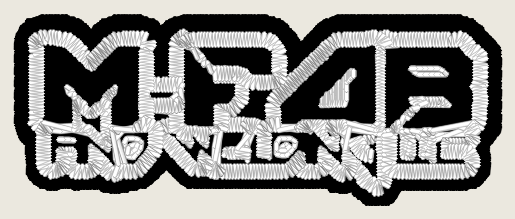
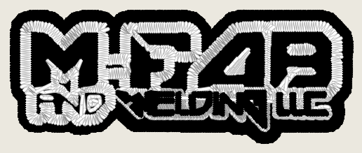
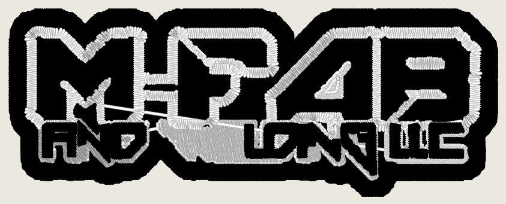
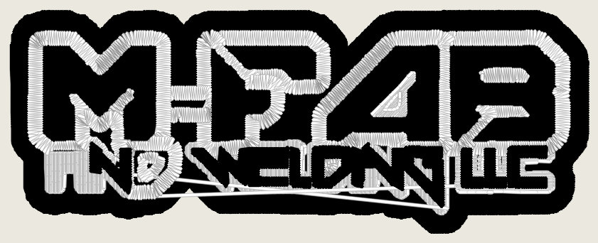
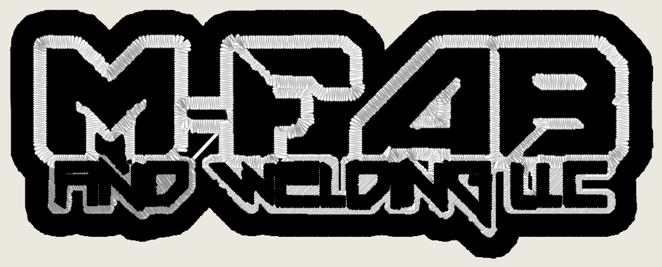
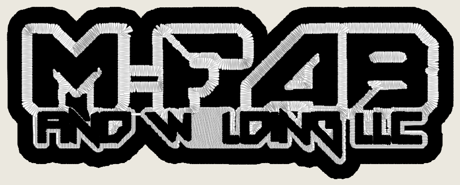

# `photo_work_grid` census, OFF vs ON (2026-11-05)

Measurement only. Nothing here flips `cfg.photo_work_grid` (built OFF in
PR #1247) or changes the engine. Tree: `9660b28b` (main). Every number is an
instrument reading (ROADMAP gate 4): stitches, trims, colour changes,
preflight grade and wall time, plus renders. Agreement and fidelity numbers
are not quoted as quality.

## What the flag does, in one line

`work_grid_px_per_mm` (`digitizer_core/config.py`) gives photo classes the
4 px/mm source line; ON gives them the 8 px/mm working grid. Stage 1
enlarges a source ONLY when it supplies fewer pixels per mm than that grid
(`stage1_prep.py`, `if px_per_mm < grid`). So the flag can change a design
only when (a) stage 0 calls it a photo class and (b) the artwork supplies
under 8 px/mm at the size asked for.

## Result

- **Photo corpus, all 39 rows at the Studio's 80 mm left-chest request: the
  flag changes nothing.** Stage 1's raster is byte-identical OFF vs ON on
  39 of 39 rows (probe below). 24 rows class `photo_scene`, all of them at
  11.4 px/mm or more, so neither grid enlarges them. The 15 non-photo rows
  get 8 px/mm either way. End to end, every row digitized in both arms
  produced an identical design (md5 of the design json), see the tally.
- **MFab hat, the one art that motivated the flag, at 60 / 100.8 / 113.5 mm:
  ON is better at 60, a trade at 100.8, and WORSE at 113.5.** At 113.5 mm ON
  sews a white panel over the "E" of WELDING and the preflight grade falls
  B (88) -> F (34) with a `DENSITY_STACKED` block plus `LETTERING_ILLEGIBLE`
  and `LETTERING_TOO_SMALL`. The bridge-merge defect moves to another width;
  it is not removed.

## Stage 1 probe: all 39 rows, OFF vs ON

Stage 0 + stage 1 only (`classify` then `stage1_prep.prep`), the Studio's
own request (`tools.photo_corpus.request_config`, 80 mm, left_chest), flag
toggled, md5 of the prepared RGB raster. Script: classify + prep twice per
row; no image is committed (public repo, the corpus tool fetches).

| row | kind | class | source px/mm at 80 mm | grid OFF -> ON | upscale OFF -> ON | stage-1 raster identical |
|---|---|---|---|---|---|---|
| bw_street | photo | photo_scene | 24.0 | 4 -> 8 | 1.0 -> 1.0 | yes |
| night_neon | photo | photo_scene | 24.0 | 4 -> 8 | 1.0 -> 1.0 | yes |
| architecture | photo | photo_scene | 24.0 | 4 -> 8 | 1.0 -> 1.0 | yes |
| landscape_lake | photo | photo_scene | 24.0 | 4 -> 8 | 1.0 -> 1.0 | yes |
| food_plate | photo | photo_scene | 24.0 | 4 -> 8 | 1.0 -> 1.0 | yes |
| vintage_sepia | photo | photo_scene | 14.51 | 4 -> 8 | 1.0 -> 1.0 | yes |
| fireworks | photo | photo_scene | 24.0 | 4 -> 8 | 1.0 -> 1.0 | yes |
| snow_highkey | photo | photo_scene | 24.0 | 4 -> 8 | 1.0 -> 1.0 | yes |
| flower_macro | photo | photo_scene | 24.0 | 4 -> 8 | 1.0 -> 1.0 | yes |
| dark_dog | photo | photo_scene | 24.0 | 4 -> 8 | 1.0 -> 1.0 | yes |
| underwater_reef | photo | photo_scene | 24.0 | 4 -> 8 | 1.0 -> 1.0 | yes |
| watercolor | photo | photo_scene | 19.77 | 4 -> 8 | 1.0 -> 1.0 | yes |
| pencil_sketch | photo | photo_scene | 23.79 | 4 -> 8 | 1.0 -> 1.0 | yes |
| stained_glass | photo | photo_scene | 23.4 | 4 -> 8 | 1.0 -> 1.0 | yes |
| group_people | photo | photo_scene | 13.34 | 4 -> 8 | 1.0 -> 1.0 | yes |
| sports_action | photo | photo_scene | 16.11 | 4 -> 8 | 1.0 -> 1.0 | yes |
| night_skyline | photo | photo_scene | 24.0 | 4 -> 8 | 1.0 -> 1.0 | yes |
| oil_painting | photo | photo_scene | 24.0 | 4 -> 8 | 1.0 -> 1.0 | yes |
| pixel_art_sprite | logo | flat | 22.1 | 8 -> 8 | 1.0 -> 1.0 | yes |
| low_poly | logo | gradient | 7.92 | 8 -> 8 | 1.009 -> 1.009 | yes |
| arabic_calligraphy | logo | gradient | 11.49 | 8 -> 8 | 1.0 -> 1.0 | yes |
| qr_code | logo | flat | 12.5 | 8 -> 8 | 1.0 -> 1.0 | yes |
| barcode | logo | gradient | 9.7 | 8 -> 8 | 1.0 -> 1.0 | yes |
| heraldic_crest | logo | gradient | 6.56 | 8 -> 8 | 1.219 -> 1.219 | yes |
| flat_emoji_icon | logo | gradient | 5.14 | 8 -> 8 | 1.557 -> 1.557 | yes |
| silhouette_logo | logo | gradient | 13.65 | 8 -> 8 | 1.0 -> 1.0 | yes |
| distressed_grunge | logo | gradient | 22.57 | 8 -> 8 | 1.0 -> 1.0 | yes |
| halftone_dots | logo | photo_scene | 24.0 | 4 -> 8 | 1.0 -> 1.0 | yes |
| neon_outline_sign | logo | flat | 7.42 | 8 -> 8 | 1.077 -> 1.077 | yes |
| duotone_poster | logo | photo_scene | 22.57 | 4 -> 8 | 1.0 -> 1.0 | yes |
| isometric_icon | logo | gradient | 20.49 | 8 -> 8 | 1.0 -> 1.0 | yes |
| comic_halftone | logo | photo_scene | 23.98 | 4 -> 8 | 1.0 -> 1.0 | yes |
| devanagari_logo | logo | gradient | 12.29 | 8 -> 8 | 1.0 -> 1.0 | yes |
| kanji_seal | logo | flat | 6.17 | 8 -> 8 | 1.296 -> 1.296 | yes |
| vintage_engraved_badge | logo | photo_scene | 19.14 | 4 -> 8 | 1.0 -> 1.0 | yes |
| gradient_mascot | logo | gradient | 13.21 | 8 -> 8 | 1.0 -> 1.0 | yes |
| outline_lineart_logo | logo | gradient | 21.98 | 8 -> 8 | 1.0 -> 1.0 | yes |
| kanji_brush | logo | photo_scene | 11.38 | 4 -> 8 | 1.0 -> 1.0 | yes |
| chalkboard_lettering | logo | photo_scene | 20.0 | 4 -> 8 | 1.0 -> 1.0 | yes |

Note: PR #1247 called `comic_halftone` flat class. On this tree it classes
`photo_scene` (23.98 px/mm, so the flag still cannot reach it).

## Full digitize tally, OFF vs ON

### The 20 rows PR #1247 measured (copied, pointer)

PR #1247's body ("Photo corpus" section) reports, for the 20 logo rows it
had on disk, tree vs main with the flag OFF vs ON: the 5 `photo_scene` rows
(chalkboard_lettering, duotone_poster, halftone_dots, kanji_brush,
vintage_engraved_badge) had identical stitches and grades OFF vs ON; it did
not publish per-row numbers for the other 15, which are not photo class and
which the flag cannot reach (probe above). Its capture folders were not kept
(none found on this machine), so those 20 rows are carried by pointer, not
re-quoted. The probe above re-confirms all 20 at stage 1 on this tree.

The 20: pixel_art_sprite, low_poly, arabic_calligraphy, qr_code, barcode,
heraldic_crest, flat_emoji_icon, silhouette_logo, distressed_grunge,
halftone_dots, neon_outline_sign, duotone_poster, isometric_icon,
devanagari_logo, kanji_seal, vintage_engraved_badge, gradient_mascot,
outline_lineart_logo, kanji_brush, chalkboard_lettering.

### The 19 rows it did not (this census)

The 18 photo genres (fetched from Commons with `tools.photo_corpus fetch`,
licences re-read live, all 18 fetched) plus `comic_halftone` (timed out in
#1247's ON arm). `tools.photo_corpus capture --procs 1` (serial; other
digitize jobs shared the laptop, so wall times are loaded-laptop times),
labels `pwg-off` and `pwg-on --set photo_work_grid=true`, same tree.
"colour changes" is the design's colour-change count (blocks = changes + 1).

| row | class | src px/mm | stitches OFF / ON | trims OFF / ON | colour changes OFF / ON | grade OFF / ON | wall s OFF / ON | design md5 same |
|---|---|---|---|---|---|---|---|---|
| bw_street | photo_scene | 24.0 | 30056 / 30056 | 150 / 150 | 5 / 5 | B / B | 276.3 / 285.7 | yes |
| night_neon | photo_scene | 24.0 | 28692 / 28692 | 163 / 163 | 6 / 6 | F / F | 213.2 / 449.4 | yes |
| architecture | photo_scene | 24.0 | 21109 / - | 47 / - | 6 / - | F / - | 98.1 / - | - |
| landscape_lake | photo_scene | 24.0 | 33419 / - | 75 / - | 5 / - | B / - | 266.5 / - | - |
| food_plate | photo_scene | 24.0 | 41039 / - | 141 / - | 5 / - | C / - | 359.3 / - | - |
| vintage_sepia | photo_scene | 14.51 | 49223 / - | 127 / - | 4 / - | F / - | 108.7 / - | - |
| fireworks | photo_scene | 24.0 | 21945 / - | 80 / - | 5 / - | D / - | 117.0 / - | - |
| snow_highkey | photo_scene | 24.0 | 26807 / - | 62 / - | 1 / - | D / - | 167.0 / - | - |
| flower_macro | photo_scene | 24.0 | 42576 / - | 180 / - | 5 / - | B / - | 284.5 / - | - |
| dark_dog | photo_scene | 24.0 | 39600 / - | 80 / - | 6 / - | D / - | 262.1 / - | - |
| underwater_reef | photo_scene | 24.0 | - / - | - / - | - / - | - / - | - / - | - |
| watercolor | photo_scene | 19.77 | - / - | - / - | - / - | - / - | - / - | - |
| pencil_sketch | photo_scene | 23.79 | - / - | - / - | - / - | - / - | - / - | - |
| stained_glass | photo_scene | 23.4 | - / - | - / - | - / - | - / - | - / - | - |
| group_people | photo_scene | 13.34 | - / - | - / - | - / - | - / - | - / - | - |
| sports_action | photo_scene | 16.11 | - / - | - / - | - / - | - / - | - / - | - |
| night_skyline | photo_scene | 24.0 | - / - | - / - | - / - | - / - | - / - | - |
| oil_painting | photo_scene | 24.0 | - / - | - / - | - / - | - / - | - / - | - |
| comic_halftone | photo_scene | 23.98 | - / 54819 | - / 236 | - / 7 | - / F | - / 1112.7 | - |

**Coverage, stated plainly.** The 2-hour budget on a shared laptop (rows ran
98 to 1,113 s each) covered: **both arms on 2 rows** (bw_street, night_neon:
designs md5-identical), **OFF only on 8** (architecture, landscape_lake,
food_plate, vintage_sepia, fireworks, snow_highkey, flower_macro, dark_dog),
**ON only on 1** (comic_halftone, 1,113 s, under the 1,200 s timeout this
time). **No full digitize on 8**: underwater_reef, watercolor, pencil_sketch,
stained_glass, group_people, sports_action, night_skyline, oil_painting.
Every one of the 19 has the stage-1 probe (identical raster OFF vs ON, no
enlargement in either arm), which is where the flag acts; a row whose stage-1
raster is identical cannot diverge downstream through this flag (its other two
readers, `alpha_edge.extension_applies` and preflight's resolution note, read
the same `px_per_mm < grid` test, false in both arms at 13 px/mm and over).
The side-by-side page was built over the 2 rows with both arms.

## MFab hat at 3 widths, OFF vs ON

Art: `digitizer/testdata/art/logo_mfab_hat.png` (committed; MFab's artwork
was already public in this repo before this census, nothing new added).
Request: the Studio's own (`tree_request`) with `target_width_mm` set and
`garment_id: hat_front`; no forced class. Stage 0 calls it `photo_scene` at
every width. Renders are OUR output only, under
`docs/renders/photo-work-grid-2026-11-05/`.

| width | arm | stitches | trims | colour changes | blocks | grade (raw score) | wall s | what the render shows |
|---|---|---|---|---|---|---|---|---|
| 60 | OFF | 7,882 | 8 | 1 | Black, White | C (64) | 14.1 | white sewn over the small line; "AND WELDING LLC" unreadable |
| 60 | ON | 8,581 | 14 | 2 | Black, White, Black | C (64) | 29.0 | small line black on white keyline, readable |
| 100.8 | OFF | 19,361 | 22 | 2 | Black, White, Black | B (88) | 49.6 | white blob over "WE" of WELDING (the #1247 defect) |
| 100.8 | ON | 19,011 | 21 | 2 | Black, White, Black | B (88) | 48.9 | WELDING legible; "AND" smudged by a white patch over N-D |
| 113.5 | OFF | 22,913 | 26 | 2 | Black, White, Black | B (88) | 62.6 | clean; every word legible |
| 113.5 | ON | 24,168 | 21 | 2 | Black, White, Black | **F (34)** | 66.1 | **white panel over the "E" of WELDING** ("W LDING"); `DENSITY_STACKED` block |

Renders: `mfab_hat_60_off.png`, `mfab_hat_60_on.png`,
`mfab_hat_100.8_off.png`, `mfab_hat_100.8_on.png`,
`mfab_hat_113.5_off.png`, `mfab_hat_113.5_on.png`.








113.5 mm is the pro's own hat box (memory `garment-size-like-pro-2026-10-26`;
`proSized` default ON), so ON breaks the hat's default size to repair two
smaller ones.

Reading: the source supplies 6.7 / 4.0 / 3.6 px/mm at 60 / 100.8 / 113.5 mm.
ON enlarges all three to 8 px/mm, and where the W-E bridge and the photo
lane's superpixel cut fall changes with the enlargement factor. At 100.8 the
enlargement opens the bridge (PR #1247's diagnosis); at 113.5 it closes a
different join and an untagged region again merges into the black host for
the white panel to cover. Same mechanism, different width. That points the
fix at the photo lane's merge (Kent's "fix the lane", 2026-11-05), not at the
grid.

## CPU cost, ON vs OFF

- Photo corpus: zero. The raster is identical, so the work is identical; the
  wall-time differences in the tally (e.g. night_neon 213 s vs 449 s) are the
  loaded laptop, not the flag (the designs are md5-identical).
- MFab: 60 mm 14.1 -> 29.0 s (2.1x; the enlargement 6.7 -> 8 px/mm is
  only 1.4x the pixels, and ON plans a third block); 100.8 mm 49.6 -> 48.9
  s; 113.5 mm 62.6 -> 66.1 s (+6%). Wall clock, one run each, laptop shared
  with other jobs.
- Bounded by `WORK_GRID_MAX_SIDE_PX` (2,800): the enlargement never makes a
  raster bigger than the service already accepts.

## What ON makes worse (gate 4 wording)

- MFab hat at 113.5 mm: preflight grade B -> F (raw 88 -> 34), one
  `DENSITY_STACKED` block finding added, stitches +1,255 (+5.5%); render shows
  a white panel over one letter. Trims 26 -> 21.
- MFab hat at 100.8 mm: grade unchanged (B 88); stitches -350; render trades
  a blob over "WE" for a smudge over "ND". Grade does not see either blob.
- MFab hat at 60 mm: stitches +699, trims 8 -> 14, colour changes 1 -> 2
  (that third block is the fix), wall time 2.1x.
- Photo corpus: nothing moved on any row measured in both arms.

## What the flip would change for a customer uploading a photograph today

Almost nothing. A photograph off a phone or camera is thousands of pixels
wide; the service decodes up to 2,800 px on the long side, which is 8 px/mm
up to 350 mm wide, far past any garment box. Every corpus photo (1,067 to
1,920 px wide) supplied 13 to 24 px/mm at 80 mm. Those uploads are
byte-identical with the flag ON.

The flag bites only on a photo-CLASSED upload that is SMALL for its size
(under 8 px/mm: e.g. under 905 px wide at the 113.5 mm hat box, under 640 px
at 80 mm). In practice that is a low-resolution logo stage 0 misreads as a
photograph (MFab), or a small web thumbnail of a photo. For MFab, the one
such art measured, it fixes 60 mm, trades at 100.8 mm and breaks the default
113.5 mm hat size.

## Reproduce

From `digitizer/` in a checkout of the tree:

```
python -m tools.photo_corpus fetch --only bw_street ...   # the 18 photo rows
python -m tools.photo_corpus capture --label pwg-off --procs 1 --only <slug> ...
python -m tools.photo_corpus capture --label pwg-on --procs 1 --set photo_work_grid=true --only <slug> ...
python -m tools.photo_corpus sxs --before corpus_runs/pwg-off --after corpus_runs/pwg-on --allow-same-sha
```

The side-by-side page (`corpus_runs/sxs-9660b28-9660b28.html`) is local
only: it embeds the Commons photos and `corpus_runs/` is gitignored.
