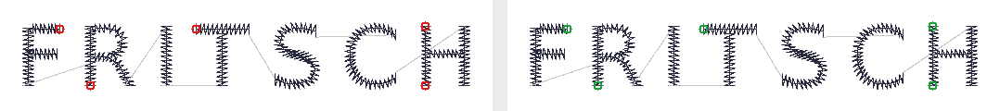
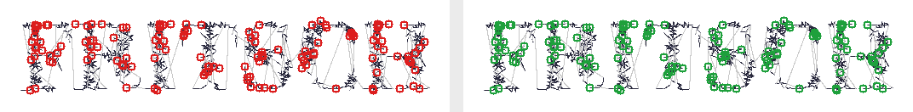
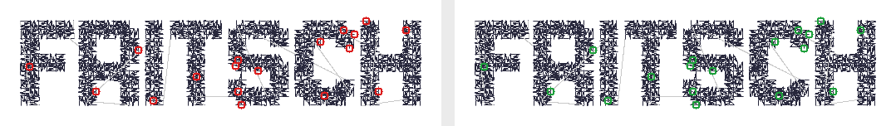
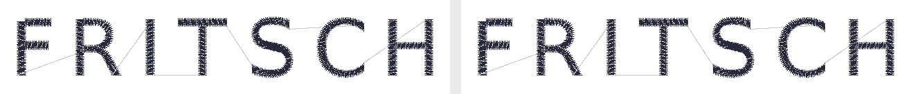
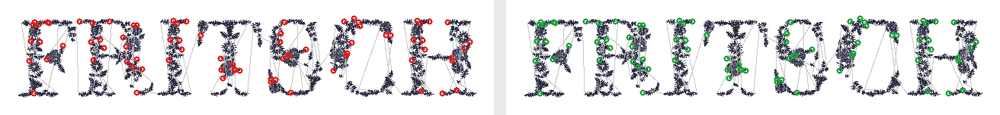
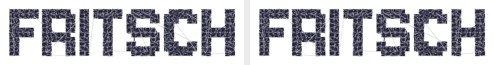
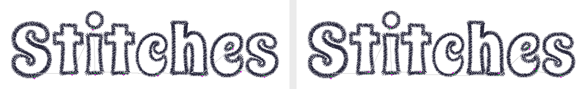

# The text lane's two flags, OFF beside ON (2026-10-20)

MASTER_SCOPE 25 (`dedupeHoles`) and 40 (`underlayDirection`) each ended with
"lettering has no flag yet". Both now reach `buildLetteringDesign` under the
shape lane's names and values, and BOTH default OFF in this lane (the shape
lane's `underlayDirection` has been ON since 2026-10-11; this one is a new
flag and ships OFF, gate 3). Drawn from the stream the builder hands the
writers by `node tools/text-lane-flags-sheet.mjs`; `counts.json` holds every
number below. Three library fonts — `medium_font` (the Studio's default),
`mai_en_fleur` (the most doubled holes of the 85 at this size), `pixel10` —
the word FRITSCH at 40 and 100 mm wide on a 5 x 2.25 in garment, the underlay
ladder deciding the underlay (centre-run at these caps). Not sewn.

## What is in what ships (OFF)

`T` rounds every point to the file's unit, 0.1 mm, so a run's first stitch
lands on the point the run before it ended on whenever the two are nearer
than that, and the writers keep both records: the needle goes down twice in
one hole. In lettering that is mostly the underlay's closed walk returning to
the satin's start (`underlay`), a needle-down connector's last step
(`travel`) and a bean run's turn (`run`); a satin column narrowed to nothing
adds a few (`satin`). A cross-stitch font (`noble`, not pictured) lays its
leg ends twice the same way: 17 on FRITSCH, in no span.

Across the 85 fonts, two words, two sizes: 4,811 such records on 223 of 340
designs (`node tools/text-lane-flags-sheet.mjs` over three fonts; the sweep
is the scratch script of the PR, 2026-10-20).

## `dedupeHoles` — OFF on the left, ON on the right

Red ring: a hole the needle goes down in twice (two `stitch` records on one
point, one straight after the other). Green ring: the same hole, laid once.

| font | width | cap | OFF md5 | records | stitches | doubled holes, by span kind | ON md5 | records | doubled |
|---|---|---|---|---|---|---|---|---|---|
| medium_font | 40 mm | 5.41 mm | `a4e9cff8e793cabe7382408bf66ac465` | 590 | 577 | 5 (underlay 5) | `689552b6cdb280197c21abfcd6c0273f` | 585 | 0 |
| medium_font | 100 mm | 13.53 mm | `a414327a26c87a9b0ae672ec6b7ff6a8` | 1291 | 1278 | 0 | same | 1291 | 0 |
| mai_en_fleur | 40 mm | 6.79 mm | `96e149414b624ad8f603e9fe8d3f4793` | 2039 | 1840 | 146 (travel 103, run 23, underlay 20) | `81dd80020e11f4eb0108850aabbb68a9` | 1893 | 0 |
| mai_en_fleur | 100 mm | 16.96 mm | `6a0322664f1aece2224f1b6a0517579f` | 6172 | 5914 | 78 (underlay 73, travel 4, satin 1) | `d2f93da65eaa6a90659bb1b08cd1d3f2` | 6094 | 0 |
| pixel10 | 40 mm | 8.39 mm | `fd08f0d56f282821dfa08bc76303eae7` | 3785 | 3754 | 18 (satin 10, underlay 7, travel 1) | `210ebcfe8205a4f200c9a6fe85f1fb8c` | 3767 | 0 |
| pixel10 | 100 mm | 20.98 mm | `9152f6f964eba544506510c004b8f993` | 6879 | 6843 | 0 | same | 6879 | 0 |

The OFF md5 is main's at `7220f3e` (byte-identical on all 340 library designs
with the flag absent or `false`). ON is OFF's stream less exactly those
records: jumps, trims, colour changes, the spans' kinds and order, width and
height are unchanged (`test/text-lane-flags.test.js`). The rule is the shape
lane's, word for word: only a stitch whose record comes straight after a
stitch on its point is left out; after a jump, a trim or a colour change the
stitch is laid, whatever point it is on (a cut is three jump records to a
DST reader, so a stitch is kept on either side of every jump).

## `underlayDirection` — the lane did not have the defect

The shape lane's rule (`satin.startNear`): a satin column starts at
whichever of its two ends is nearer where its underlay finished. Measured
first, with the flag absent: for every satin column entered needle-down from
its own underlay, where does the underlay end against the column's two
crosses?

| font | text | width | columns after an underlay | starting at the nearer cross, OFF | turned by ON | ON md5 == OFF md5 | travel OFF / ON | needle-down thread OFF / ON |
|---|---|---|---|---|---|---|---|---|
| medium_font | FRITSCH | 40 mm | 19 | 19 | 0 | yes | 21.8 / 21.8 mm | 616.1 / 616.1 mm |
| medium_font | FRITSCH | 100 mm | 20 | 20 | 0 | yes | 56.6 / 56.6 mm | 2627.4 / 2627.4 mm |
| mai_en_fleur | FRITSCH | 40 mm | 80 | 80 | 0 | yes | 232.7 / 232.7 mm | 852.8 / 852.8 mm |
| mai_en_fleur | FRITSCH | 100 mm | 379 | 379 | 0 | yes | 223.3 / 223.3 mm | 4601.2 / 4601.2 mm |
| pixel10 | FRITSCH | 40 mm | 152 | 152 | 0 | yes | 139.4 / 139.4 mm | 3010.8 / 3010.8 mm |
| pixel10 | FRITSCH | 100 mm | 465 | 465 | 0 | yes | 399.2 / 399.2 mm | 12726.7 / 12726.7 mm |
| colorful | Stitches | 100 mm | 10 | 4 | 6 | no | 0 / 0 mm | 5239.6 / 5240.2 mm |

Every column already starts where its underlay ends. That is by
construction: this lane's two underlay walks
(`satinplay.centerUnderlayFromGeom`, an even number of legs;
`edgeUnderlayFromGeom`, a closed outline) finish back at the fraction the
satin starts from, so real underlay costs no travel — which is the defect
the shape lane's flag cures there (a centre-run walked once, the column
starting at the far end, a needle-up move as long as the bar).

Two things the measurement turned up:

- **The shape lane's test would turn 300 of 11,516 library columns, every
  one wrongly.** `startNear` compares the thread's position with the
  column's first and last STITCHES. A zigzag's first stitch is on one rail
  and its last on the other, so on a column wider than it is long (pixel10's
  3.6 x 2.5 mm blocks) the first stitch is the farther one even when the
  thread sits at the column's own start. The lettering wiring passes the
  midpoints of the column's first and last crosses as its ends (a new,
  optional `ends` argument; left out, the shape lane's stream is unchanged).
  A wrong turn here would also cost what it saves: the next part of the
  glyph begins where the satin was going to end, so the connector would be
  laid back across the column.
- **What ON does turn: closed rings and dots.** Of 11,516 columns across the
  85 fonts, two words, two sizes, 24 turn, in 13 of 340 designs: 17 rings
  (an O's two crosses meet, so its two ends are 0 to 0.3 mm apart and either
  is "nearer") and 7 short columns of 6 to 28 stitches whose ends are 0.7 to
  1.9 mm apart. No travel is added (the connectors are the same length), the
  stitch count is the same, the needle-down thread moves by at most 5.8 mm on
  a design of 2.2 to 5.2 metres, and a trim moves with the ring's end.
  Pictured: colorful's
  Stitches at 100 mm, the one such case among the fonts here. Green dot: the
  underlay's last stitch; magenta dot: the satin's first, for every column
  that follows its underlay. The six turned rings have their magenta dot at
  the other end of the ring.

## What to do with it — two questions for Kent, not decided here

1. **`dedupeHoles` for text.** The flip is `dedupeHoles: true` at
   `app/src/lib/generate.js`'s one text call site and a re-pin of the six
   md5s above (ON's are in the table). It removes 4,811 records from 223 of
   340 library designs — up to 7% of a fine script's records at 40 mm
   (mai_en_fleur: 2039 to 1893) — and nothing else. It is the same choice as
   "Waiting on Kent" 25 for the shape lanes, on the same rule; it can be
   flipped with that one or alone. Not sewn: what a machine does with one
   zero-length record is machine-dependent
   (`docs/sub-unit-stitches-2026-10-03.md`).
2. **`underlayDirection` for text.** ON changes nothing a column can feel on
   these fonts and turns 24 rings and dots on the library. Flip it for one
   set of flags across both lanes (byte-identical on 327 of 340 library
   designs, the other 13 as above), or leave it OFF and read item 40's
   "lettering not covered" as "lettering never had it".

Regenerate: `node tools/text-lane-flags-sheet.mjs` (about 20 s). The pins:
`node --test test/text-lane-flags.test.js`.
