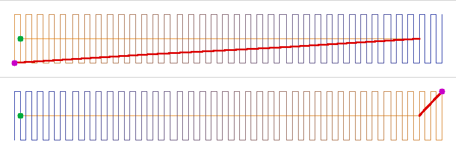

# The underlay's direction — one bar, off and on (2026-10-11)

Defect 57's underlay half, behind `underlayDirection` (default OFF). The shape
tool's 30 x 3 mm rectangle on left chest (pique: centre-run underlay), written
to `.dst` and drawn from the file by `node tools/underlay-direction-sheet.mjs`.

Top: off. Bottom: on. Stitches shade orange (first sewn, the underlay) to dark
blue (last). Red: a jump record after the first stitch. Green dot: the file's
first stitch. Magenta dot: the column's first record.

| | off | on |
|---|---|---|
| underlay end to column start | 28.45 mm | 2.33 mm |
| jump records in the file | 5 (7.3, 7.3, 9.5, 9.4, 9.5 mm) | 3 (7.3, 7.3, 2.3 mm) |
| stitches | 165 | 165 |

The two 7.3 mm jumps in both files carry the frame from the design's origin
to the shape and are not drawn. Off, the move inside the shape is laid as
three jump records, which a machine set to cut on three jumps reads as a
trim. On, it is one.

`off.dst` and `on.dst` are the two files the picture is drawn from.
