# Wave-3 flips: OFF | ON | pro (2026-10-26, PR #1112)

Kent flipped `small_text_bay_mouth` and `sew_enclosed_white` ON on 2026-10-26 ("No, ship
both"). These crops show the flip on three jobs.

**How the sheet was made.** `tools/flip_sheet_renders.py` rows `wave3_flips` and
`small_text_bay_mouth`, engine `024ea200`, Studio request at the pro's width (Fremont hat
at 92.5 mm).
- **OFF** pins both flips False.
- **ON** is the shipped defaults (white ticked, sewn white).
- rembg's timeout is pinned at 900 s and the route was checked on every cell (MFab removes
  its background in both arms).

**How to read the crops.**
- Each crop is 18 x 11 mm at 40 px/mm, placed on the window where the most needle points
  changed.
- The pro's crop is the same window taken as a fraction of his extents. It is not
  registered to ours.
- The "where" picture marks the window on our OFF design.
- Counts are the DST's own records: stitches / trims / stitches in white thread.

| job | OFF | ON | pro |
|---|---|---|---|
| Becker hat L 101.9 | 7,859 st / 19 tr / white 0 | 16,234 / 24 / 8,544 | 12,356 / 10 / 0 (he recoloured: black faces, grey outline) |
| MFab hat 104.9 | 10,902 / 51 / 1,267 | 19,871 / 53 / 6,189 | 17,568 / 19 / 6,680 |
| Fremont hat 92.5 (bay alone) | 17,381 / 28 | 17,378 / 28 | 17,067 / 21 |

On Fremont, white sews nothing new, so its `wave3_flips` row is byte-identical to the bay
row and is not repeated here.

## Becker hat L: the faces sew, under the outline loop

| OFF | ON | pro | where |
|---|---|---|---|
| 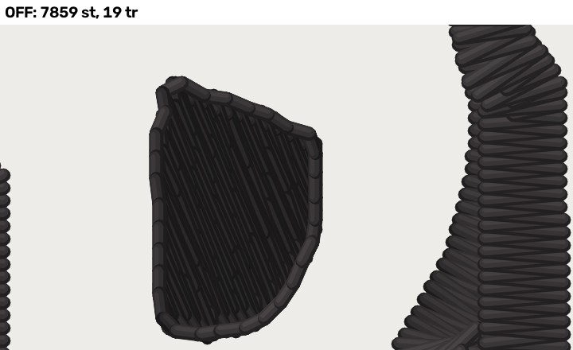 | 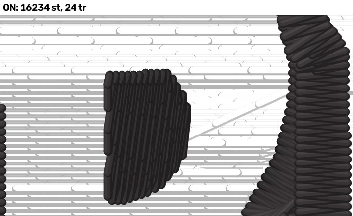 | 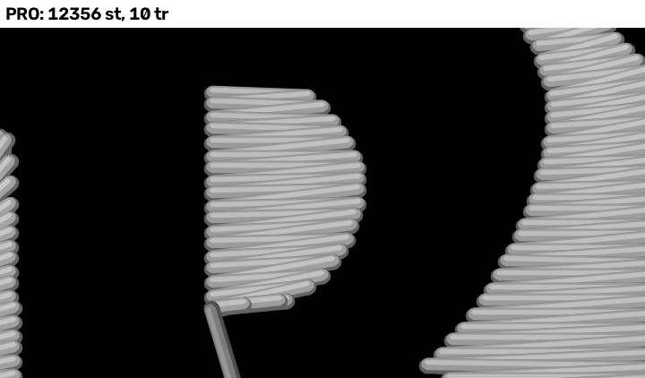 | 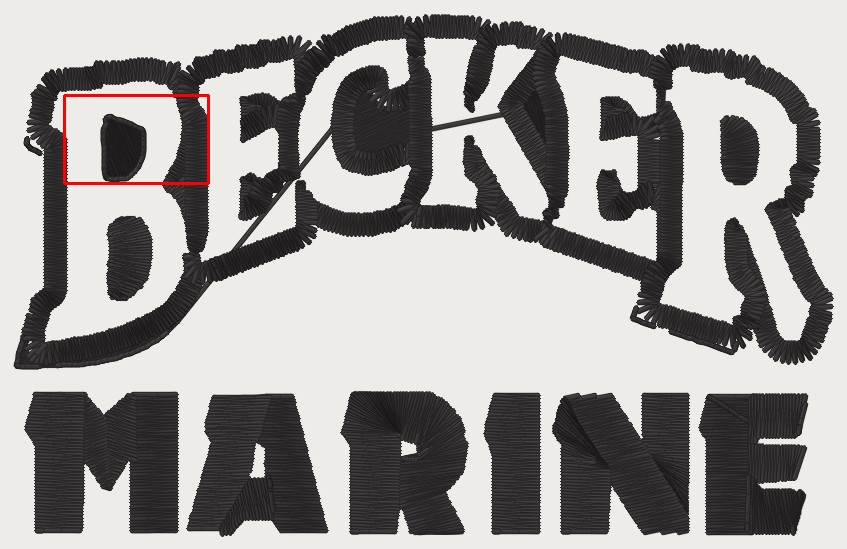 |

The white rows fill the face under the black loop. The pale diagonal lines are travel lying
on the white fill sewn before it. That is the "+27 mm exposed travel" in the PR's table: it
is on thread, not on fabric.

## MFab hat: the white band sews

| OFF | ON | pro | where |
|---|---|---|---|
| 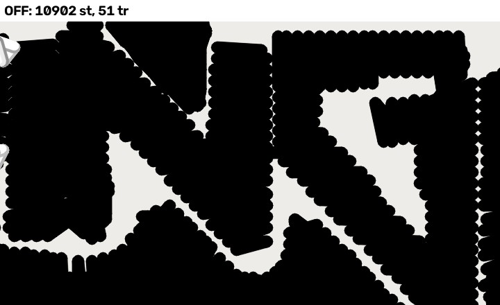 | 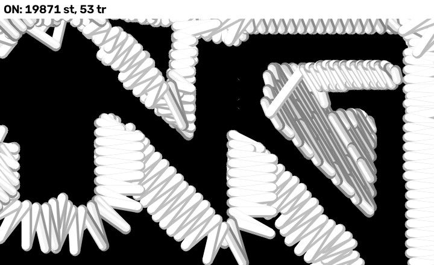 | 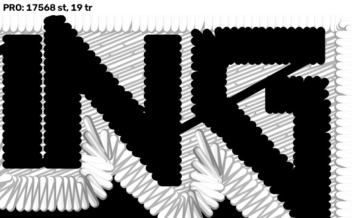 | 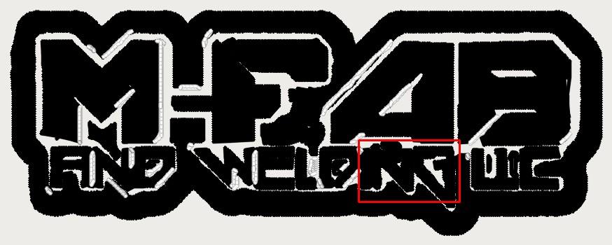 |

## Fremont hat: bay mouth, "BST" → "EST"

| OFF | ON | pro | where |
|---|---|---|---|
| 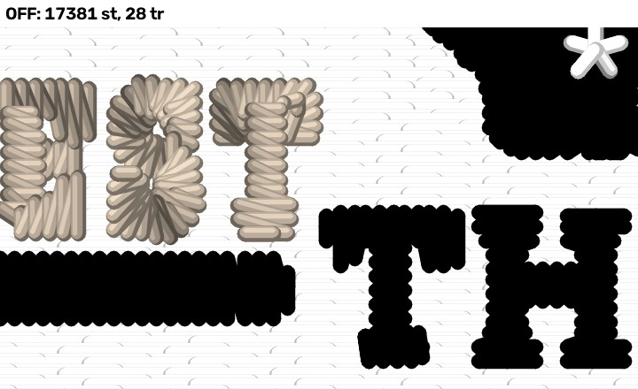 |  | 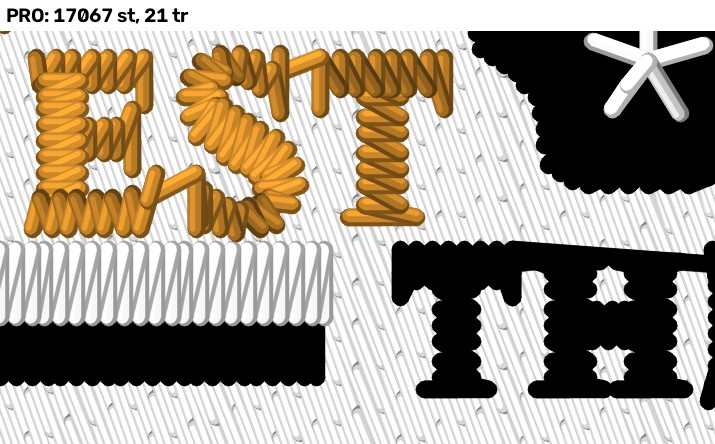 | 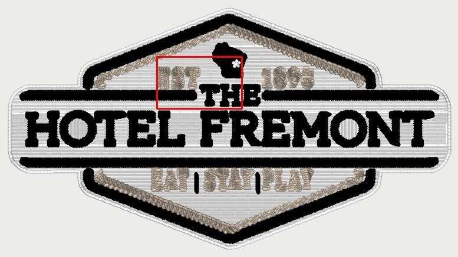 |

OFF sews E as B and S as 8: the re-set's widening shuts each bay. ON cuts the terminal back
so the bay keeps the pro's mouth (median 0.51 mm, #1085).
