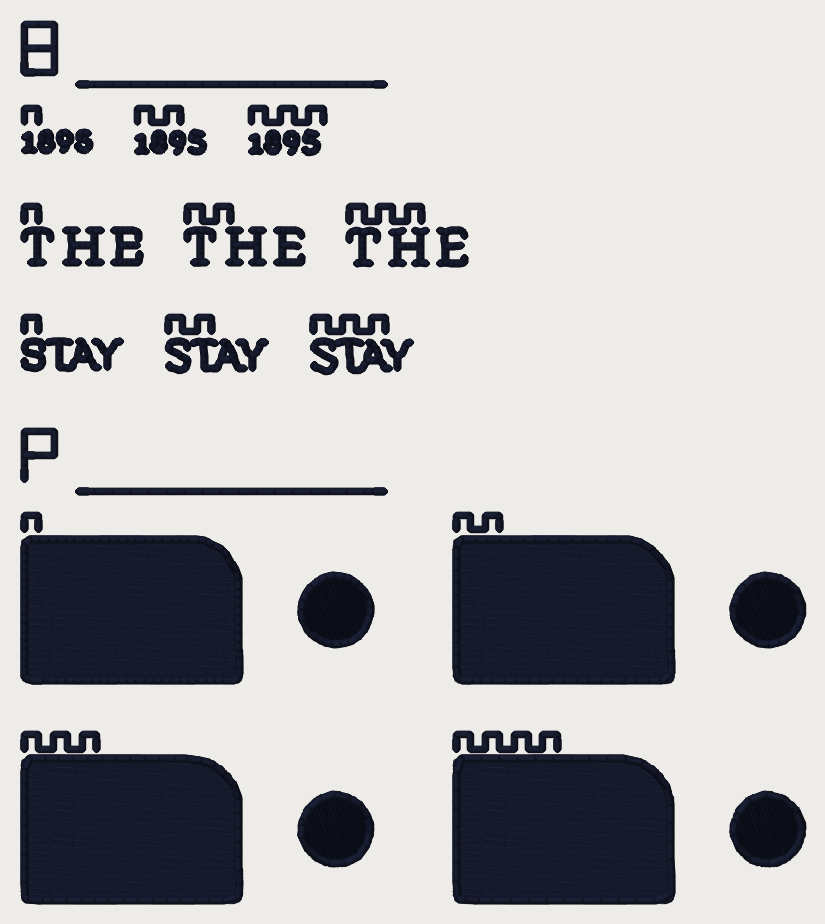

# Sew-out card: bay hold and edge-cap bean pitch (2026-10-15)

A **separate** small card for two switches that were built OFF and have never
met cloth. It is not card v3.3: Kent's card v3.2 (`../card-v3-2026-10-13/`) is
still unsewn and is not superseded, and the lettering-arms card
(`../card-lettering-arms-2026-10-14/`) is a different question. **Every number
on this card is a candidate until you sew it** (ROADMAP gate 1: this card is
the sew-out; no value is settled, the default config is untouched, and no
engine file is changed by the PR that adds this card).

**Source of Block P: PR #969's BRANCH.** `edge_cap_bean_pitch_mm` was not on
`main` when this card was cut (#969, branch `claude/edge-cap-bean-pitch`); the
P arms were generated from that branch, merged into this one (#969 has since
merged to `main`, and the arms are unchanged). Block B's flag
(`bean_letter_bay_hold`, #967) was on `main` already.

**What to sew:** `card_bayhold_edgecap_40wt.dst`, ONE colour (dark), **40 wt**,
a **4 x 4 in hoop** (the design is 64.8 x 73.0 mm, inside the 100 x 100 mm sewable
field), on a hat front like the Fremont job. 6,128 stitches, 34 trims:
allow roughly 14 minutes (an estimate: stitches / 600 spm plus 6 s a
trim; neither is measured, so treat it as an order of magnitude).

## What is in this folder

| File | What it is |
|---|---|
| `card_bayhold_edgecap_40wt.dst` | the card, 40 wt, written through the service's export path (pystitch), read back with pystitch. md5 `71f2d2ff9f477973b7035fbde9a56f31`. |
| `scoring-sheet.md` | the readout sheet: one row per arm. Print it. |
| `readback.json` | the file checks, quoted below, plus the per-arm md5. |
| `cuts/cut_*.json` | the pieces each arm sews: Fremont cut from the replay of the Studio request (`b81`, `b925`) and the synthetic plate (`p`), every arm generated by the real pipeline. |
| `../../renders/sewout-card-bayhold-edgecap/` | thread renders: the whole card, and each block's arms cropped at 60 px/mm, side by side. |

Reproduce with `python -m tools.sewout_card_bayhold_edgecap` from `digitizer/`
(the cuts are re-made with `--cut b81|b925|p`, one process at a time; a
Fremont cut digitizes ONCE and re-plans the three arms, because the flag is
read in stage 7 only). The test is
`digitizer/tests/test_sewout_card_bayhold_edgecap.py`.

## What you need

- **Fabric:** the cap (or a scrap of the same structured twill). Every piece is
  digitized on the **Hat profile** (0.4 mm pull), as your Fremont job was.
- **Stabilizer:** the backing you used for the Fremont hat; else tearaway
  (medium) under twill, no topping.
- **Thread:** one cone, a **dark** (black or navy), **40 wt**: Madeira
  Polyneon No. 40, or Isacord 40. The Fremont words are the logo's non-white
  thread only, so there is no white patch under them.
- **Needle:** 40 wt **75/11**. **Bobbin:** the same as the other cards.

## How to sew it

1. Load the DST. **Put the needle at the centre of the card** (the file's
   origin is the middle of the 64.8 x 73.0 mm box). Trace the outline.
2. Turn **trims on**.
3. **One colour.** No colour stop, no second cone.
4. Count **thread breaks** from the machine's counter, per block if you can.
5. Do not press or steam before scoring. Photograph each block close up (a
   macro) and once at arm's length. The words are 2-4 mm tall: read them under
   a loupe AND at arm's length, and score the two separately.

## How to read the arms

Each block has an **index strip** (its letter, B or P, sewn as a run, 4 mm tall,
with a rule under it). Within a row the arms are sewn side by side and labelled
with **teeth** (a square wave sewn above each), counted from the left in
block B and in reading order in block P (top row left to right, then the bottom
row): **1 tooth** is the first arm in the key below. The teeth are the card's
own arm number; nothing about a candidate changes them.

## Key and hoop layout

Top to bottom, in the hoop: block **B** (three rows: 1895, THE, STAY, each
with its three arms side by side), then block **P** (a 2 x 2 grid). Piece
boxes are in the file checks below.

| Block | Row / cell | 1 tooth | 2 teeth | 3 teeth | 4 teeth |
|---|---|---|---|---|---|
| **B** | **1895** at **81 mm** Hat | `bean_letter_bay_hold` OFF | **0.2** mm | **0.25** mm | |
| **B** | **THE** at **92.5 mm** Hat | OFF | 0.2 mm | 0.25 mm | |
| **B** | **STAY** (the tagline's S) at **92.5 mm** Hat | OFF | 0.2 mm | 0.25 mm | |
| **P** | tatami plate + R3 mm curve + 4 mm disc | `edge_cap_bean_pitch_mm` OFF (0.73 mm, today) | **1.0** mm | **1.2** mm | **1.5** mm |

Block B: `small_text_true_size` is **ON in every arm** (main's default since
#955, set here as an override too, so the card does not move if that ever
changes). Within a row the arms differ **only** in `bean_letter_bay_hold`;
everything else is today's default. Block P: every arm is the same artwork
and the same config but for `edge_cap_bean_pitch_mm`; nothing else differs.

**What to look for.**

- **Block B** (#967): does the **5** in 1895 read 5 (not A)? Does THE's **E**
  show its slit open between the tick and the middle arm? Does the tagline's
  **S** read S (not 8)? And the cost: a held letter sews up to ~0.1 mm
  **wider on the side away from a bay**. Does that outward widening read
  worse on cloth than a bay that is filled? Compare each hold arm with the
  OFF arm.
- **Block P** (#969): does the **edge stay closed** (no fabric visible between
  the fill and the cap) at each pitch? Does the **3 mm curve** and the **4 mm
  disc** read as round or as a polygon at arm's length, and under a loupe? Any
  **thread break or birdnest** in the cap? Does the line weight (the bean
  ridge) read as one line?

**Read the render with care.** `stitchviz` draws a three-pass bean as **one**
thread width: the thread renders under-draw the sewn weight of every bean
letter and of the edge cap, and they show where the thread lands, not tension
or pull. The arms of a row will look alike, and thinner than they sew. The
cloth is the only judge.

## What the files say about each arm (the FILE, not the cloth)

| block | piece | arm | stitches | vs arm 1 | trims | est. minutes |
|---|---|---|---|---|---|---|
| B | 1895 | off | 120 | - | 1 | 0.30 |
| B | 1895 | hold0.2 | 120 | +0 | 1 | 0.30 |
| B | 1895 | hold0.25 | 120 | +0 | 1 | 0.30 |
| B | THE | off | 222 | - | 1 | 0.47 |
| B | THE | hold0.2 | 222 | +0 | 1 | 0.47 |
| B | THE | hold0.25 | 222 | +0 | 1 | 0.47 |
| B | STAY | off | 184 | - | 1 | 0.41 |
| B | STAY | hold0.2 | 184 | +0 | 1 | 0.41 |
| B | STAY | hold0.25 | 184 | +0 | 1 | 0.41 |
| P | plate + disc | off | 1,175 | - | 3 | 2.26 |
| P | plate + disc | p1.0 | 1,091 | -84 | 3 | 2.12 |
| P | plate + disc | p1.2 | 1,055 | -120 | 3 | 2.06 |
| P | plate + disc | p1.5 | 1,016 | -159 | 3 | 1.99 |

## Arm to config, and the md5 of what each arm sews

The md5 of each arm is taken from the arm's own top-left (so where it sits on
the card does not count); the md5 of the machine file is in the table above.
`ov` is the override set on the replay; `small_text_true_size` is ON in every
block B arm.

| piece | arm | config (what differs) | arm md5 |
|---|---|---|---|
| B 1895 81 mm | off | `defaults (switch ON)` | `29f3bab5265abfe49981814e5f97709a` |
| B 1895 81 mm | hold0.2 | `bean_letter_bay_hold=0.2` | `8c07ef2a38a30fe877d755ae64120e54` |
| B 1895 81 mm | hold0.25 | `bean_letter_bay_hold=0.25` | `223946631697a1df4e7213a83840b99d` |
| B THE 92.5 mm | off | `defaults (switch ON)` | `81bc44c54faafdf487cf7e76be2d729c` |
| B THE 92.5 mm | hold0.2 | `bean_letter_bay_hold=0.2` | `0a34ea4fb18029862567993cde8e914d` |
| B THE 92.5 mm | hold0.25 | `bean_letter_bay_hold=0.25` | `ddb619dbd9f5d181a4ca2ae8bc5d86f2` |
| B STAY 92.5 mm | off | `defaults (switch ON)` | `7904d7a535eab79f9693793981381677` |
| B STAY 92.5 mm | hold0.2 | `bean_letter_bay_hold=0.2` | `42b403b866c0858e304c3472c201e6b4` |
| B STAY 92.5 mm | hold0.25 | `bean_letter_bay_hold=0.25` | `7843c070208467601565f0d26bd49776` |
| P plate + disc | off | `edge_cap_bean_pitch_mm=None (0.73 mm)` | `7d700d3471c37d306a161e7e51b3442c` |
| P plate + disc | p1.0 | `edge_cap_bean_pitch_mm=1.0` | `838ef1d3b82688238fd4d8ed08a23464` |
| P plate + disc | p1.2 | `edge_cap_bean_pitch_mm=1.2` | `ca7592620861487efc60d8737b8c547f` |
| P plate + disc | p1.5 | `edge_cap_bean_pitch_mm=1.5` | `0d17f681c9419c2b396e1d6f051cd281` |

The machine file: `card_bayhold_edgecap_40wt.dst`, md5 `71f2d2ff9f477973b7035fbde9a56f31`, 19,682 bytes.

## Where the pieces come from

Block B is not drawn: it is the **stitches the engine sews for Kent's job**.
`tools/fremont_triage.py` replays the Studio request (the committed
`testdata/photo/logo_hotel_fremont.webp`, Hat profile) through the service's
own steps ONCE per size, and the three arms are RE-PLANNED from that digitize
(`bean_bay_hold._plan`; #967 pinned that this equals a fresh digitize). A piece
is every non-white run lying wholly inside the word's box grown by 0.8 mm (the
tagline's STAY: the glyph outlines between its bars, grown 0.6 mm). Each arm
reproduces #967's corpus cells: the whole-design stream md5 of the OFF arm at
81 mm is `1541421f`, and at 92.5 mm the OFF / 0.2 / 0.25 arms are `e0d9323c` /
`3be34b6b` / `1f00488a` (the table below).

| cut | width | arm | overrides on the Studio request | whole design | stream md5 |
|---|---|---|---|---|---|
| `b81` | 81 mm | off | `{'small_text_true_size': True}` | 15,330 stitches, 41 trims | `1541421f` |
| `b81` | 81 mm | hold0.2 | `{'small_text_true_size': True, 'bean_letter_bay_hold': 0.2}` | 15,332 stitches, 41 trims | `fa685e6a` |
| `b81` | 81 mm | hold0.25 | `{'small_text_true_size': True, 'bean_letter_bay_hold': 0.25}` | 15,332 stitches, 41 trims | `3fc447bd` |
| `b925` | 92.5 mm | off | `{'small_text_true_size': True}` | 18,675 stitches, 54 trims | `e0d9323c` |
| `b925` | 92.5 mm | hold0.2 | `{'small_text_true_size': True, 'bean_letter_bay_hold': 0.2}` | 18,676 stitches, 54 trims | `3be34b6b` |
| `b925` | 92.5 mm | hold0.25 | `{'small_text_true_size': True, 'bean_letter_bay_hold': 0.25}` | 18,675 stitches, 54 trims | `1f00488a` |

| cut | arm | `edge_cap_bean_pitch_mm` | stitches | trims | cap stations | median cap step |
|---|---|---|---|---|---|---|
| `p` | off | None | 1,183 | 4 | 327 | 0.731 mm |
| `p` | p1.0 | 1.0 | 1,099 | 4 | 243 | 1.001 mm |
| `p` | p1.2 | 1.2 | 1,063 | 4 | 207 | 1.188 mm |
| `p` | p1.5 | 1.5 | 1,024 | 4 | 168 | 1.501 mm |

Block P is a synthetic plate (`p_image`): a 14 x 9 mm dark tatami plate with
straight edges, a square corner and an R3 mm corner, and a 4 mm disc beside
it, digitized through `digitize` (forced `flat` class, Hat, 40 wt) once per
pitch. No client artwork, no new image added to the repo apart from the
thread renders.

## The file checks (pystitch reading the DST back)

| | 40 wt |
|---|---|
| file | `card_bayhold_edgecap_40wt.dst` (19,682 bytes) |
| blocks on the card | 2 |
| stitches in the file / in the plan | 6,128 / 6,128 |
| colour changes in the file / planned | 0 / 0 |
| colours (stops) | 1 |
| extent (mm), x by y | 64.8 x 73.0 |
| x range / y range (mm) | [-32.4, 32.4] / [-36.5, 36.5] |
| inside 100 x 100 mm | yes |
| longest needle stitch (mm) | 3.01 |
| longest record, per axis (mm; the format's limit is 12.1) | 11.8 |
| trims | 34 |
| 0.8 mm lock-leg stitches | 223 |

Stitches per piece:

| piece | stitches |
|---|---|
| B:1895-hold0.2 | 120 |
| B:1895-hold0.25 | 120 |
| B:1895-off | 120 |
| B:STAY-hold0.2 | 184 |
| B:STAY-hold0.25 | 184 |
| B:STAY-off | 184 |
| B:THE-hold0.2 | 222 |
| B:THE-hold0.25 | 222 |
| B:THE-off | 222 |
| B:strips | 180 |
| P:off | 1175 |
| P:p1.0 | 1091 |
| P:p1.2 | 1055 |
| P:p1.5 | 1016 |
| P:strips | 115 |

Stitches per colour stop:

| stop | thread | stitches (thread m) |
|---|---|---|
| 1 | dark | 6,210 (8.86) |

Where each piece sits (mm, x0 y0 x1 y1, centre of the card at 0, 0):

| piece | box |
|---|---|
| B:1895-hold0.2 | [-23.0, -27.5, -17.5, -25.8] |
| B:1895-hold0.25 | [-13.5, -27.5, -8.0, -25.8] |
| B:1895-off | [-32.4, -27.5, -27.0, -26.0] |
| B:STAY-hold0.2 | [-20.4, -10.1, -12.3, -7.7] |
| B:STAY-hold0.25 | [-8.3, -10.1, -0.2, -7.6] |
| B:STAY-off | [-32.4, -10.1, -24.4, -7.8] |
| B:THE-hold0.2 | [-18.8, -19.3, -9.3, -16.7] |
| B:THE-hold0.25 | [-5.3, -19.3, 4.3, -16.6] |
| B:THE-off | [-32.4, -19.3, -22.8, -16.7] |
| P:off | [-32.4, 6.4, -3.6, 18.2] |
| P:p1.0 | [3.6, 6.4, 32.4, 18.2] |
| P:p1.2 | [-32.4, 24.7, -3.6, 36.5] |
| P:p1.5 | [3.6, 24.7, 32.4, 36.5] |

## What settles which default (flips are Kent's)

Every value below is a gate-1 candidate. Nothing is settled by this card
until the readout sheet is filled in, and a default is flipped only by Kent.

| Candidate | Value | Result that settles it |
|---|---|---|
| `bean_letter_bay_hold` | 0.2 or 0.25 mm (0.2 is the corpus arm; both open the same bays) | the 5 reads 5, THE's E shows its slit and the S reads S in a hold arm and not in OFF, **and** the ~0.1 mm outward widening does not read worse than a filled bay at arm's length. If the widening reads worse, OFF stays |
| `edge_cap_bean_pitch_mm` | 1.0, 1.2 or 1.5 mm (1.2 is the measured knee in #969; still a candidate) | the largest pitch whose edge stays closed with a curve and a 4 mm disc that do not read as a polygon, and no extra thread break. If 1.0 already reads polygonal, OFF stays |

## Things to know before you sew

- **The pieces are small** (2-4 mm tall words). "Looks the same at arm's
  length" is a finding, not a failure.
- **Some arms may be the same stitches on purpose.** The hold moves only
  stations near a bay; a word with no bay over the floor is identical in all
  three arms (the file table above says which rows differ).
- **The 1895 digits are TAN thread in the logo**, sewn here in the dark cone
  for contrast: read shape, not colour.
- **Short stitches.** Bean letters sew at a 0.45 mm station pitch; the cap at
  0.73 mm (1.0 / 1.2 / 1.5 in the P arms); the index strips and labels hold the
  1.0 mm floor.
- **Fremont is an UNREPRESENTATIVE fixture** (#967): it reproduces the defect and
  sizes nothing.
