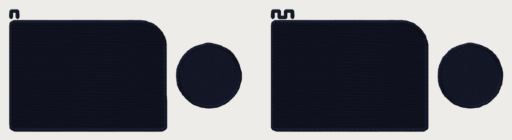
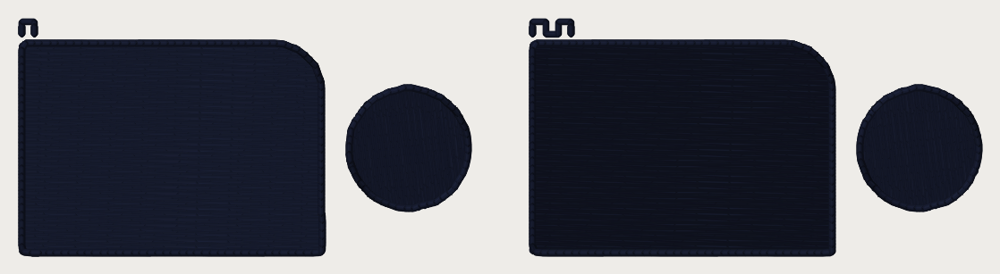

# Sew-out card: the pro's crossing underlay under a fill (2026-10-21)

**What it asks.** The pro sews one sparse crossing pass under every dense fill
on every job in his zip (~1.0 mm rows, ~4 mm stitches, ~90 degrees to the top
rows). Our hat preset sews an edge run plus a 2.0 mm zigzag; left chest and
beanie an edge run alone. `fill_underlay_cross` (built OFF) puts the pro's pass
in those three presets. Does it lie flatter, cover better, pucker less?
Every number is a candidate until you sew it (ROADMAP gate 1).

**What to sew:** two files, each **one dark cone, 40 wt**, 75/11, a **4 x 4 in
hoop**, trims on.

| File | Sew it on | Size | Stitches |
|---|---|---|---|
| `card_cross_underlay_hat_40wt.dst` | a cap front (or twill with your cap backing) | 89.6 x 21.8 mm | 5,301 |
| `card_cross_underlay_polo_40wt.dst` | a polo (pique) with cutaway; stands for the beanie too | 89.2 x 21.6 mm | 5,078 |

## How to read it

Each file is the same plate twice: a 26 x 18 mm field (one rounded corner) and a
10 mm disc. The **teeth** above a plate count its arm:

| Teeth | Arm |
|---|---|
| 1 | the preset as it ships (hat: edge run + 2.0 mm zigzag; polo: edge run) |
| 2 | `fill_underlay_cross` ON: the pro's crossing pass, no edge run |

Look for: fabric showing through the field; puckering or tunnelling round the
field and the disc; edges that wave or pull in; how flat the field lies when
the hoop comes off.

| File | Teeth | Arm | Stitches | Underlay thread | % of the fill's |
|---|---|---|---|---|---|
| hat | 1 | preset | 2,631 | 418.4 mm | 9.5% |
| hat | 2 | cross | 2,658 | 572.5 mm | 13.0% |
| polo | 1 | preset | 2,448 | 119.2 mm | 2.8% |
| polo | 2 | cross | 2,618 | 559.2 mm | 12.9% |

