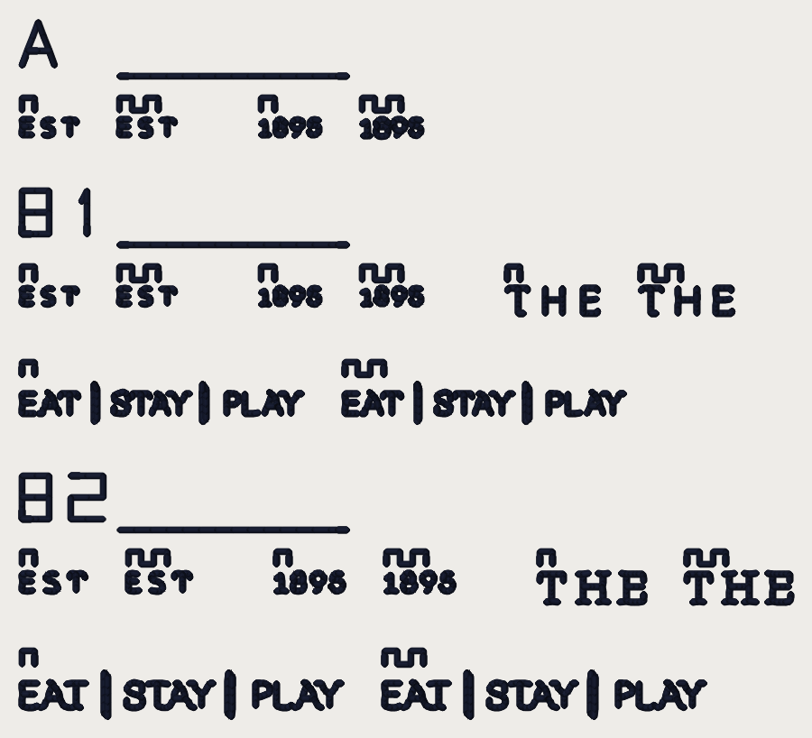

# Sew-out card: lettering arms (2026-10-14)

A **separate** small card for two switches that were built OFF and have never
met cloth. It is not card v3.3: Kent's card v3.2
(`../card-v3-2026-10-13/`) is still unsewn and is not superseded; this one
asks only about the lettering of Fremont's hat. **Every number on it is a
candidate until you sew it** (ROADMAP gate 1: this card is the sew-out; no
value is settled, the default config is untouched).

**What to sew:** `card_lettering_arms_40wt.dst`, ONE colour (dark), **40 wt**,
a **4 x 4 in hoop** (the design is 71.0 x 64.2 mm, inside the 100 x 100 mm
sewable field), on a hat front like the Fremont job. 4,476 stitches: allow
roughly 8 minutes (an estimate from the stitch count, not a measurement).

## What is in this folder

| File | What it is |
|---|---|
| `card_lettering_arms_40wt.dst` | the card, 40 wt, written through the service's export path (pystitch), read back with pystitch. |
| `card_lettering_arms_40wt.png` | the whole card as a thread render, 12 px/mm. A picture of the file, not of cloth. |
| `card_lettering_arms_40wt_blocks.png` | every arm cropped at 60 px/mm, the arms of a word side by side, the key printed on each row. |
| `scoring-sheet.md` | the readout sheet: one row per arm. Print it. |
| `readback.json` | the file checks, quoted below. |
| `cuts/cut_*.json` | the Fremont runs each arm sews: the replay of the Studio request, cut to each word box (see below). |

Reproduce with `python -m tools.sewout_card_lettering_arms` from
`digitizer/` (the cuts are re-made with `--cut s81|s81_hold|s81_ties|s925|s925_ties`,
one process at a time, a few minutes each). The test is
`digitizer/tests/test_sewout_card_lettering_arms.py`.

## What you need

- **Fabric:** the cap (or a scrap of the same structured twill). Every piece is
  digitized on the **Hat profile** (0.4 mm pull), as your Fremont job was.
- **Stabilizer:** the backing you used for the Fremont hat; else tearaway
  (medium) under twill, no topping.
- **Thread:** one cone, a **dark** (black or navy), **40 wt**: Madeira
  Polyneon No. 40, or Isacord 40. The card sews only the logo's non-white
  thread, so there is no white patch and no second cone.
- **Needle:** 40 wt **75/11**. **Bobbin:** the same as the other cards.

## How to sew it

1. Load the DST. **Put the needle at the centre of the card** (the file's
   origin is the middle of the 71.0 x 64.2 mm box). Trace the outline.
2. Turn **trims on**: the file cuts between letters and between pieces.
3. **One colour.** No colour stop, no second cone.
4. Count **thread breaks** from the machine's counter, per block if you can.
5. Do not press or steam before scoring. Photograph each block close up (a
   macro) and once at arm's length. The words are 2-4 mm tall: read them under
   a loupe AND at arm's length, and score the two separately.

## How to read the arms

Every block has an **index strip** (its letter sewn as a run, 4 mm tall, with
a rule under it; block B's two size rows add a **1** or **2** beside the B).
The arms of each word are sewn side by side and labelled with **teeth** (a
square wave sewn above each), counted from the left: **1 tooth** is the first
arm named in the key below, **2 teeth** the second. The same key is printed on
every row of `card_lettering_arms_40wt_blocks.png`.

## Key and block map

`small_text_true_size` is **ON in every arm** (set as an override on the
replay, not the default: its flip, #955, is not merged). Within a block the
two arms differ **only** in the flag named; every other setting is today's
default.

| Block | Where | 1 tooth | 2 teeth | What it asks |
|---|---|---|---|---|
| **A** | top | `bean_letter_counter_hold_mm` OFF | `bean_letter_counter_hold_mm` **0.25** (#952) | **EST** and **1895** at **81 mm** Hat. The 8 in 1895 sews both counters shut under bean letters (the stroke is 0.22 mm of ink under a 0.40 mm thread); held 0.25 mm off the counter, the thread lies on the stroke's outer side. Does the 8 show two open counters, and the 9 and 5? Is the letter visibly fatter outward (up to ~0.1 mm)? |
| **B1** | middle | `small_letter_ties` OFF | `small_letter_ties` **ON** (#956) | **EST, 1895, THE** and the **EAT / STAY / PLAY** tagline at **81 mm** Hat. OFF locks each trimmed letter with the ordinary four-leg bounce on one 0.45 mm station gap (a knot of thread on a 0.2 mm stroke); ON lays the lock along the letter. Is a knot visible at the letter ends in 1 and not in 2? Does the ON lock hold (no pulled-out ends after a gentle rub)? |
| **B2** | bottom | `small_letter_ties` OFF | `small_letter_ties` **ON** (#956) | The same four words at **92.5 mm** Hat, the size the pro sews. |
| **C** | not on this card | | | **Bean passes 1 / 2 / 3** (#950): already cut as a separate card, `../card-passes-2026-10-14/` (THE and 1895, `bean_letter_passes` 1, 2, 3). It is **not** re-cut here; sew it too if you want that question answered. |

**What to look for**, per arm: counters open or shut (the 8's two, the 9's,
the 5's top opening); knots visible or not at the ends of letters; the
letter's width against the 0.40 mm thread; any shredded or enlarged needle
holes, puckering or thread breaks; and **legibility at arm's length**: does the
word read, and which arm reads best?

**Read the render with care.** `stitchviz` draws a three-pass bean letter as
**one** thread width, so the thread render under-draws the sewn weight of every
bean letter here: the arms will look alike, and thinner than they sew. The
cloth is the only judge. The render shows layout and stitch placement, not
bulk.

## What the files say about each arm (the FILE, not the cloth)

| block | word | arm 1 | arm 2 | stitches arm 1 | stitches arm 2 | difference |
|---|---|---|---|---|---|---|
| A | EST | off | hold | 82 | 82 | +0 |
| A | 1895 | off | hold | 120 | 126 | +6 |
| B1 | EST | off | ties | 82 | 82 | +0 |
| B1 | 1895 | off | ties | 120 | 119 | -1 |
| B1 | THE | off | ties | 156 | 159 | +3 |
| B1 | TAG | off | ties | 520 | 521 | +1 |
| B2 | EST | off | ties | 103 | 106 | +3 |
| B2 | 1895 | off | ties | 139 | 142 | +3 |
| B2 | THE | off | ties | 222 | 225 | +3 |
| B2 | TAG | off | ties | 589 | 593 | +4 |

## Where the Fremont pieces come from

The pieces are not drawn: they are the **stitches the engine sews for Kent's
job**. `tools/fremont_triage.py` replays the Studio request (the committed
`testdata/photo/logo_hotel_fremont.webp`, Hat profile, 6 colours) through the
service's own steps, once per cut below, and a piece is every non-white run
lying wholly inside the word's artwork box grown by 0.8 mm (the same cut as
card v3's T and N, `sewout_card_v3.cut_arm`):

| cut | width | overrides on the Studio request | whole design |
|---|---|---|---|
| `s81` | 81 mm | `{'small_text_true_size': True}` | 15,330 stitches, 41 trims, 81.74 x 44.33 mm |
| `s81_hold` | 81 mm | `{'small_text_true_size': True, 'bean_letter_counter_hold_mm': 0.25}` | 15,338 stitches, 41 trims, 81.74 x 44.33 mm |
| `s81_ties` | 81 mm | `{'small_text_true_size': True, 'small_letter_ties': True}` | 15,297 stitches, 41 trims, 81.74 x 44.33 mm |
| `s925` | 92.5 mm | `{'small_text_true_size': True}` | 18,675 stitches, 54 trims, 93.23 x 50.53 mm |
| `s925_ties` | 92.5 mm | `{'small_text_true_size': True, 'small_letter_ties': True}` | 18,640 stitches, 54 trims, 93.23 x 50.53 mm |

Block A's OFF arm and block B1's OFF arm are the same cut (`s81`): the same
stitches, sewn twice.

## The file checks (pystitch reading the DST back)

| | 40 wt |
|---|---|
| file | `card_lettering_arms_40wt.dst` (15,185 bytes) |
| blocks on the card | 3 |
| stitches in the file / in the plan | 4,476 / 4,476 |
| colour changes in the file / planned | 0 / 0 |
| colours (stops) | 1 |
| extent (mm), x by y | 71.0 x 64.2 |
| x range / y range (mm) | [-35.5, 35.5] / [-32.1, 32.1] |
| inside 100 x 100 mm | yes |
| longest needle stitch (mm) | 2.0 |
| longest record, per axis (mm; the format's limit is 12.1) | 12.1 |
| trims | 51 |
| 0.8 mm lock-leg stitches | 172 |

Stitches per piece:

| piece | stitches |
|---|---|
| A:1895-hold | 126 |
| A:1895-off | 120 |
| A:EST-hold | 82 |
| A:EST-off | 82 |
| A:strips | 80 |
| B1:1895-off | 120 |
| B1:1895-ties | 119 |
| B1:EST-off | 82 |
| B1:EST-ties | 82 |
| B1:TAG-off | 520 |
| B1:TAG-ties | 521 |
| B1:THE-off | 156 |
| B1:THE-ties | 159 |
| B1:strips | 154 |
| B2:1895-off | 139 |
| B2:1895-ties | 142 |
| B2:EST-off | 103 |
| B2:EST-ties | 106 |
| B2:TAG-off | 589 |
| B2:TAG-ties | 593 |
| B2:THE-off | 222 |
| B2:THE-ties | 225 |
| B2:strips | 154 |

Stitches per colour stop:

| stop | thread | stitches (thread m) |
|---|---|---|
| 1 | dark | 4,676 (2.1) |

Where each piece sits (mm, x0 y0 x1 y1, centre of the card at 0, 0):

| piece | box |
|---|---|
| A:1895-hold | [-4.1, -23.1, 1.3, -21.5] |
| A:1895-off | [-13.4, -23.1, -8.1, -21.6] |
| A:EST-hold | [-26.5, -23.1, -21.4, -21.6] |
| A:EST-off | [-35.5, -23.1, -30.5, -21.6] |
| B1:1895-off | [-13.4, -7.5, -8.1, -6.0] |
| B1:1895-ties | [-4.1, -7.5, 1.3, -6.0] |
| B1:EST-off | [-35.5, -7.5, -30.5, -6.0] |
| B1:EST-ties | [-26.5, -7.5, -21.4, -6.0] |
| B1:TAG-off | [-35.5, 1.3, -9.7, 4.8] |
| B1:TAG-ties | [-5.7, 1.3, 20.1, 4.8] |
| B1:THE-off | [9.3, -7.5, 17.7, -5.2] |
| B1:THE-ties | [21.7, -7.5, 30.1, -5.2] |
| B2:1895-off | [-12.0, 18.8, -5.8, 20.5] |
| B2:1895-ties | [-1.8, 18.8, 4.3, 20.5] |
| B2:EST-off | [-35.5, 18.8, -29.7, 20.5] |
| B2:EST-ties | [-25.7, 18.8, -20.0, 20.5] |
| B2:TAG-off | [-35.5, 28.0, -6.0, 32.1] |
| B2:TAG-ties | [-2.0, 28.0, 27.5, 32.1] |
| B2:THE-off | [12.3, 18.8, 21.9, 21.5] |
| B2:THE-ties | [25.9, 18.8, 35.5, 21.5] |

## Things to know before you sew

- **The pieces are small** (2-4 mm tall). "Looks the same at arm's length" is a
  finding, not a failure.
- **Some arms are the same stitches on purpose.** EST has no counter, so
  block A's EST arms are identical (EST is the control: if EST differs on the
  cloth, it is the cloth), and the 81 mm EST arms of block B1 are identical
  too (the ties flag changed no stitch of EST at 81 mm; it does at 92.5 mm).
- **The 1895 digits are TAN thread in the logo** (a mid-tone), sewn here in
  the dark cone for contrast: read shape, not colour.
- **Short stitches.** Bean letters sew at a 0.45 mm station pitch; the index
  strips and labels hold the 1.0 mm floor, and the engine's own lock legs are
  0.8 mm (the `small_letter_ties` arms lay shorter spread legs on purpose).
