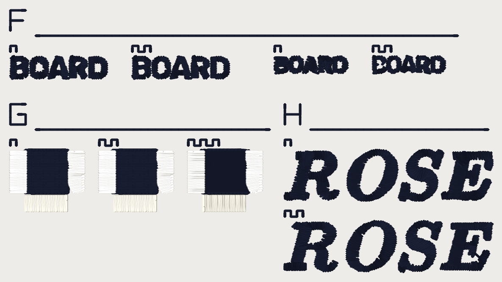

# Sew-out card v2, 2026-10-13

Two DST files, one per thread weight. Every candidate that has landed since
the hairline card, on **one** card, each as an **OFF vs ON pair sewn side by
side**. You sew each on cloth, score it on `scoring-sheet.md`, and that
settles several ROADMAP gate-1 questions at once. **Every number on this card
is a candidate until you sew it.** Nothing here is a setting.

This does not replace the hairline card (`../hairline-card-2026-10-12/`,
blocks A-E: single strands, combs, narrow columns, SKEIN, strands over a
ground). That card is untouched, and its questions (stitch length of a single
strand, strand spacing, the 60 wt column floor) are still its to settle. This
one is 95.2 x 51.6 mm of new questions, and the hoop is the same or smaller.

## What is in this folder

| File | What it is |
|---|---|
| `card_v2_40wt.dst` | the card for **40 wt** thread. |
| `card_v2_60wt.dst` | the card for **60 wt** thread. |
| `card_v2_40wt.png`, `card_v2_60wt.png` | what each file looks like, thread drawn at the weight's laid width. A picture of the file, not of cloth. |
| `card_v2_40wt_blocks.png`, `card_v2_60wt_blocks.png` | every OFF / ON piece cropped at 36 px/mm, side by side, for comparing the two before you sew. |
| `scoring-sheet.md` | one table per sew-out, one row per piece. Print it. |
| `readback.md`, `readback.json` | the file checks (stitch count, size, colours, longest stitch), also quoted below. |

Both files are written by `python -m tools.sewout_candidates_card` (in `digitizer/`)
through the service's export path (pystitch), not the browser's DST codec, and
read back with pystitch (table at the bottom). The test is
`digitizer/tests/test_sewout_candidates_card.py`: it regenerates the card and checks
the read-back against `readback.json`.

## What you need

- **Fabric, two kinds:** a pique polo and a twill, the same two as card v1.
  Use a **mid-tone** (grey or khaki): the card sews a dark and a light thread.
- **Hooping:**
  - **Pique:** cutaway stabilizer (medium) under it, and **water-soluble
    topping** on top. Do not skip the topping on pique: block F's 3 mm print
    is small enough to sink into the waffle without it.
  - **Twill:** **tearaway** stabilizer (medium). No topping.
  - The design is **95.2 x 51.6 mm**. Use a hoop with at least a 100 x 100 mm
    sewing field (a 4 x 4 in hoop is exactly that), as for card v1.
  - Hoop firm and flat. Do not change hoop, stabilizer or tension between
    the sew-outs without writing it on the sheet.
- **Thread, two cones per weight:** a **dark** (black or navy) and a **light**
  (white or cream). Same maker and same weight for both.
  - 40 wt file: **Madeira Polyneon No. 40**, or Isacord 40.
  - 60 wt file: **Madeira Polyneon No. 60**, or Isacord 60.
  - Pick the colours you have, as long as the two are clearly different from
    each other and from the cloth.
- **Needle:** 40 wt **75/11**. 60 wt: the needle that scored best on card v1
  (65/9 or 70/10). If v1 is not sewn yet, use **65/9**. Write it on the sheet.
- **Bobbin:** the same bobbin thread for every sew-out.

## The four sew-outs

A DST carries no thread weight and no needle, so you sew the files like this.

| Sew-out | File | Thread | Needle | Fabric |
|---|---|---|---|---|
| 1 | `card_v2_40wt.dst` | 40 wt | **75/11** | pique + cutaway + topping |
| 2 | `card_v2_60wt.dst` | 60 wt | v1's pick (else 65/9) | pique + cutaway + topping |
| 3 | `card_v2_40wt.dst` | 40 wt | **75/11** | twill + tearaway |
| 4 | `card_v2_60wt.dst` | 60 wt | v1's pick (else 65/9) | twill + tearaway |

Use **one** machine speed for all four and write it on the sheet (about 650
stitches a minute is a sensible start). Fresh needle for each sew-out. Each
hoop is about 5,318-5,789 stitches: allow roughly 12 minutes (an estimate from the
stitch count, not a measurement).

## How to sew one

1. Load the file. **Put the needle at the centre of the card**: the file's
   origin is the middle of the 95.2 x 51.6 mm box. Trace the outline to check it
   clears the hoop.
2. Turn **trims on**. The file cuts between pieces and wherever the
   digitizer cut inside one.
3. **Three colour stops**, in this order (two cones, dark and light; the
   machine asks for the dark one twice):
   1. **Stop 1, dark.** The three index strips (F, G, H), every label, the
      block F words, the block H words, and the **fill** of each block G arm.
   2. **Stop 2, light.** Block G's **bars** (all three arms).
   3. **Stop 3, dark.** Block G's two edge runs round each fill (short: about
      80 stitches in all). They are there because each G arm is the
      digitizer's own sew order, and the order is part of what is being tested.
4. Count **thread breaks** from the machine's counter, per block if you can.
5. Do not press or steam before scoring. Photograph each block close up
   (a macro) and once at arm's length.
6. Score on `scoring-sheet.md`.

## How to read the pairs

Every block has an **index strip**: its letter sewn as a run, 4 mm tall, with
a rule 1 mm under it. Each OFF / ON pair is labelled by **teeth** (a square
wave sewn above it), counted from the left: **1 tooth is OFF** (the engine as
shipped today), **2 teeth is ON** (the candidate). Block G has three arms:
**1 tooth OFF, 2 teeth `forbid_gap_mm` 0.4, 3 teeth `forbid_gap_mm` 0.8**.

## Block map

| Block | Where | What it is | Candidate it settles |
|---|---|---|---|
| **F** | top row | The word **BOARD** (counters in B, O, A, R, D). Left pair: **4 mm cap**, OFF then ON. Right pair: **3 mm cap**, OFF then ON. ON is `cfg.small_print_floor` (#873): counters at least one laid thread across are punched back open, and the column beside a counter holds half a laid width off it. | `SMALL_PRINT_COUNTER_MIN_WIDTHS` = **1.0** laid widths: counter kept open down to **0.40 mm at 40 wt, 0.32 mm at 60 wt**; and the **half-width hold-off** (0.20 / 0.16 mm). |
| **G** | middle row, left | Three **arms** of one two-colour piece: an 8 x 8 mm tatami **fill** with three 2.5 mm satin **bars** standing off it by **0.3 mm** (left), **0.6 mm** (right) and **1.0 mm** (bottom) of bare fabric drawn into the art. Arm 1 OFF; arm 2 `forbid_gap_mm` **0.4**; arm 3 `forbid_gap_mm` **0.8** (#874, WoK 44). With a value set, the colour sewn first spans a gap narrower than the value and tucks under the colour sewn on top. | `forbid_gap_mm`: **0.4** (closes the 0.3 gap only), **0.8** (closes 0.3 and 0.6), or neither. The 1.0 mm bar is the control: no value on the card closes it. |
| **H** | middle row, right | The word **ROSE** in a serif face (Roman AGS, OFL) at **9 mm cap**: top **Column lane OFF** (the skeleton satin tier), bottom **Column lane ON** (`cfg.lettering_columns`, the shipped default since 2026-10-12). | **Column reach** (#863's sew-out item): the Column lane's letters stand **0.06-0.07 mm** inside the skeleton tier's reach on the drawn edge. Is that visible, and which edge reads closer to the drawn letter? |

## What the files say about each pair (the FILE, not the cloth)

| piece | 40wt stitches OFF / ON | 60wt stitches OFF / ON |
|---|---|---|
| F, 4 mm BOARD | 381 / 389 | 428 / 427 |
| F, 3 mm BOARD | 262 / 259 | 294 / 289 |
| G, forbid_gap OFF / 0.4 | 605 / 607 | 636 / 638 |
| G, forbid_gap OFF / 0.8 | 605 / 667 | 636 / 692 |
| H, Column lane OFF / ON | 945 / 943 | 1,141 / 989 |

## The file checks (pystitch reading the DST back)

| | 40wt | 60wt |
|---|---|---|
| file | `card_v2_40wt.dst` (17,393 bytes) | `card_v2_60wt.dst` (18,794 bytes) |
| blocks on the card | 3 | 3 |
| stitches in the file / in the plan | 5,318 / 5,318 | 5,789 / 5,789 |
| colour changes in the file / planned | 2 / 2 | 2 / 2 |
| colours (stops) | 3 | 3 |
| extent (mm), x by y | 95.2 x 51.6 | 94.8 x 51.6 |
| x range / y range (mm) | [-47.6, 47.6] / [-25.8, 25.8] | [-47.4, 47.4] / [-25.8, 25.8] |
| inside 100 x 100 mm | yes | yes |
| longest needle stitch (mm) | 4.05 | 4.03 |
| longest record, per axis (mm; the format's limit is 12.1) | 12.0 | 12.0 |
| trims | 42 | 42 |
| 0.8 mm lock-leg stitches | 576 | 597 |

Stitches per piece (an OFF piece and its ON partner differ only by the flag):

| piece | 40wt | 60wt |
|---|---|---|
| F:3.0-off | 262 | 294 |
| F:3.0-on | 259 | 289 |
| F:4.0-off | 381 | 428 |
| F:4.0-on | 389 | 427 |
| F:strips | 137 | 137 |
| G:gap-0.4 | 607 | 638 |
| G:gap-0.8 | 667 | 692 |
| G:gap-off | 605 | 636 |
| G:strips | 106 | 106 |
| H:reach-off | 945 | 1141 |
| H:reach-on | 943 | 989 |
| H:strips | 71 | 71 |

Stitches per colour stop:

| stop | thread | 40wt stitches (thread m) | 60wt stitches (thread m) |
|---|---|---|---|
| 1 | dark | 4,458 (6.01) | 4,847 (6.5) |
| 2 | light | 677 (1.57) | 761 (1.81) |
| 3 | dark | 237 (0.17) | 240 (0.17) |

Where each piece sits (mm, x0 y0 x1 y1, centre of the card at 0, 0):

| piece | 40wt | 60wt |
|---|---|---|
| F:3.0-off | [4.4, -16.8, 18.7, -13.4] | [4.6, -16.8, 18.9, -13.4] |
| F:3.0-on | [23.7, -16.8, 37.9, -13.4] | [23.9, -16.8, 38.1, -13.4] |
| F:4.0-off | [-47.6, -16.8, -28.6, -12.5] | [-47.4, -16.8, -28.4, -12.3] |
| F:4.0-on | [-23.6, -16.8, -4.6, -12.5] | [-23.4, -16.8, -4.4, -12.3] |
| G:gap-0.4 | [-30.1, 1.5, -15.6, 13.6] | [-29.9, 1.7, -15.4, 13.8] |
| G:gap-0.8 | [-12.6, 1.5, 1.9, 13.6] | [-12.4, 1.7, 2.1, 13.8] |
| G:gap-off | [-47.6, 1.5, -33.1, 13.6] | [-47.4, 1.7, -32.9, 13.8] |
| H:reach-off | [6.4, 1.5, 47.2, 11.6] | [6.6, 1.7, 47.4, 11.7] |
| H:reach-on | [6.4, 15.6, 47.6, 25.8] | [6.6, 15.7, 47.4, 25.8] |

Reproduce with `python -m tools.sewout_candidates_card` from `digitizer/`.

## Things to know before you sew

- **Block F's ON and OFF words can look the same at arm's length.** That is a
  finding. Score the counters under a loupe and at arm's length separately.
- **Block G: which colour is on top.** The fill sews first (stop 1) and the
  bars sew on top of it (stop 2), so the **bars** own the seams and the fill
  spans the gap. With `forbid_gap_mm` set, the fill reaches across the gap
  and tucks under the bar's edge.
- **The cap heights are measured on the ink.** The words are sewn 1:1: the
  ink's bounding box is scaled to the size the label says, so the drawn cap is
  the label (the sewn height is a few tenths more: pull and the thread's own
  width). Card v1's block D scales its whole mask, 1 mm padding each side
  included, so its labels run small by about 14%: measured 2026-10-13, the
  letter regions of its "4.0 mm" SKEIN stand 4.6-4.8 mm tall and the "3.0"
  3.5-3.8 mm. Score v1's D by the sewn size, not the label.
- **Short stitches.** The digitizer sews some stitches under 1.0 mm in
  lettering and in tatami row turns, as it does today. The index strips and
  labels hold the 1.0 mm floor, and the lock legs are the engine's 0.8 mm.

Digitized pieces use the pipeline's default fabric profile (Pique knit (polo)).
