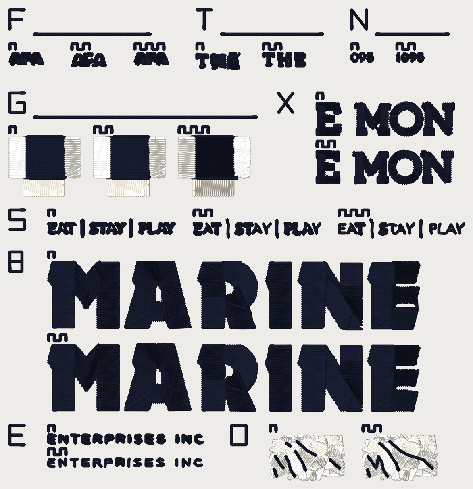

# Sew-out card v3.2, 2026-10-14

One DST file (**40 wt**): card v3.1's eight blocks **re-cut on today's main**,
**plus one new block, O: the line route's chaining** (`cfg.hairline_lines_chain`,
#917, default OFF; Kent 2026-10-14: it **stays OFF until this sew-out**). Each
question is a block of arms sewn **side by side** (or stacked, for the wide ones)
and labelled with teeth. You sew it once, read each block on
`scoring-sheet-v3.2.md`, and that settles several ROADMAP gate-1 questions
together. **Every number on this card is a candidate until you sew it.** Nothing
here is a setting; no flag is flipped by it.

93.8 x 97.0 mm, 13,355 stitches, 148 trims, 3 colour stops (two cones),
allow roughly 28.9 minutes (an estimate from the stitch count at 650 spm, not
a measurement). **Inside a 4 x 4 in hoop (100 x 100 mm).**

**This card replaces v3.1.** v3.1 (`card_v3_1_40wt.dst`, `README.md`,
`scoring-sheet.md`, `readback.*`, `cuts/cut31_*.json`) and v3 (`*-v3.*`) are
kept in this folder untouched, for history; do not sew two of them. v3.2 carries
every v3.1 block (F3, T, N, G, X, S, B, E2) arm for arm and flag for flag. It
does not replace card v1 (`../hairline-card-2026-10-12/`) or card v2
(`../card-v2-2026-10-13/`); neither has been sewn (MASTER_SCOPE "Waiting on Kent"
44, 45, 47).

## What changed from v3.1

1. **Block O is new: the line route's chaining.** See the block map and "The
   chaining block" below. Nothing was dropped to fit it: it sits right of E2.
2. **Layout.** v3.1 was 93.8 x 92.8 mm. To fit O inside the same 100 x 100 mm hoop, **E2's two arms are stacked instead of side by side** (they were 75 mm wide in one row, 31.8 mm wide stacked) and O sits to the right of them in the same row; the gap between the S, B and E2+O rows is 3.0 mm instead of 4.0. Nothing was dropped or moved to another block. The card is **93.8 x 97.0 mm** (v3.1: 93.8 x 92.8): inside the hoop with 1.5 mm to spare each side.
3. **F3 (small caps).** #923 (`small_print_floor`, the counters that still shut at 3 mm) was said to move v3.1's F3 arm 2 by one stitch and 0.1 mm or less; the VP accepted that. F3 is not a cut: the card digitizes APA when it is built, so **v3.2's F3 is regenerated on today's main**, not carried. Measured on this tree against v3.1's file (file stitches, file extent): today 94 to 88 stitches (-6), 6.9 x 2.3 to 6.8 x 2.3 mm; `small_print_floor` ON 114 to 119 stitches (+5), 6.8 x 2.6 to 7.0 x 2.5 mm; `small_glyph_keep` ON 94 to 88 stitches (-6), 6.9 x 2.3 to 6.9 x 2.3 mm. **That is not #923:** the same three arms digitized with `lettering_columns_square_ends` and `lettering_columns_inside_connectors` OFF give 94 / 114 / 94 stitches, v3.1's counts exactly, so #923 is 0 stitches here and the whole change is the two ends flags, which #922 turned ON by default after v3.1 was built. F3's arms do not pin them (v3's generator, unchanged), so F3 follows main's default and the arms still differ only by the flag each names. The readout is unchanged: does the counter open in arm 2 and arm 3 and not in arm 1.
4. **E2 (enthusiast, skeleton at floor 0.73).** v3.1's file sewed 11 of 14 offered glyphs as a skeleton run (2,102 stitches whole), as #913 measured. #936 (the small-glyph second try, flag still OFF) takes more of them: live on this tree the same flags sew **13 of 14** (2,023 stitches whole). **v3.2's E2 arm 2 is the re-cut, so it sews 13, not 11**: the card is for what main does today, and the flag the sew-out asks about is the one that would be flipped. Declined on this tree: 1 (reason: shape).
5. **Every cut was re-made on today's main** (`cuts/cut32_*.json`, and
   `cuts/tn/cut_*.json` for T and N), because `digitizer_core` moved after
   v3.1's cuts were taken. The flags are pinned exactly as in v3.1, so the
   differences below are the engine's, not the card's. Whole-design totals, the
   v3.1 cut against the v3.2 cut:

| cut | whole design, v3.1 cut | whole design, v3.2 cut |
|---|---|---|
| `today` | 15,306 stitches, 44 trims | 15,306 stitches, 44 trims |
| `skel` | 15,124 stitches, 44 trims | 14,995 stitches, 44 trims |
| `skel073` | 14,886 stitches, 44 trims | 14,790 stitches, 44 trims |
| `ends_on` | 15,320 stitches, 45 trims | 15,320 stitches, 45 trims |
| `ent_today` | 2,428 stitches, 8 trims | 2,428 stitches, 8 trims |
| `ent_skel073` | 2,102 stitches, 8 trims | 2,023 stitches, 7 trims |
| `becker_off` | 6,011 stitches, 22 trims | 6,011 stitches, 22 trims |
| `becker_on` | 6,150 stitches, 25 trims | 6,150 stitches, 25 trims |
| T / N cut `today` (v3's) | 15,306 stitches, 44 trims | 15,320 stitches, 45 trims |
| T / N cut `wordtier` (v3's) | 15,375 stitches, 48 trims | 15,393 stitches, 49 trims |
| T / N cut `keep` (v3's) | 15,611 stitches, 46 trims | 15,625 stitches, 47 trims |

   And the pieces as the two FILES hold them (stitches):

| piece | v3.1 file | v3.2 file | change |
|---|---|---|---|
| F3:today | 94 | 88 | -6 |
| F3:floor | 114 | 119 | +5 |
| F3:keep | 94 | 88 | -6 |
| T:today | 170 | 170 | +0 |
| T:wordtier | 203 | 203 | +0 |
| N:keep-off | 92 | 92 | +0 |
| N:keep-on | 133 | 133 | +0 |
| G:gap-off | 605 | 605 | +0 |
| G:gap-0.4 | 607 | 607 | +0 |
| G:gap-0.8 | 667 | 667 | +0 |
| S:today | 582 | 582 | +0 |
| S:floor-1.0 | 419 | 386 | -33 |
| S:floor-0.73 | 200 | 200 | +0 |
| E2:today | 531 | 531 | +0 |
| E2:floor-0.73 | 205 | 126 | -79 |
| X:ends-off | 657 | 657 | +0 |
| X:ends-on | 669 | 669 | +0 |
| B:ends-off | 2,087 | 2,087 | +0 |
| B:ends-on | 2,223 | 2,223 | +0 |

## What is in this folder

| File | What it is |
|---|---|
| `card_v3_2_40wt.dst` | the card, **40 wt** thread. |
| `card_v3_2_40wt.png` | what the file looks like, thread drawn at the laid width, 12 px/mm. A picture of the file, not of cloth. |
| `card_v3_2_40wt_blocks.png` | every arm cropped at 60 px/mm, the arms of a block side by side (stacked for S, E2, X and B), for comparing them before you sew. |
| `scoring-sheet-v3.2.md` | the readout sheet: one table per block. Print it. |
| `cuts/cut32_*.json`, `cuts/tn/cut_*.json` | the runs the pieces sew: Fremont tagline / E / M, O, N / THE and 1895, enthusiast's line, Becker's MARINE, and the owl's O pair (see below). |
| `readback-v3.2.md`, `readback-v3.2.json` | the file checks, also quoted below. |
| `README.md`, `scoring-sheet.md`, `readback.*`, `card_v3_1_40wt.*`, `cuts/cut31_*.json` | card v3.1, for history. |
| `README-v3.md`, `scoring-sheet-v3.md`, `readback-v3.*`, `card_v3_40wt.*`, `cuts/cut_*.json` | card v3, for history. |

The file is written by `python -m tools.sewout_card_v3_2` (in `digitizer/`)
through the service's export path (pystitch), not the browser's DST codec, and
read back with pystitch. The test is `digitizer/tests/test_sewout_card_v3_2.py`.

## What you need

- **Fabric:** the **cap** (or a scrap of the same structured twill) is the
  honest test. F3, T, N, S and X are digitized on the **Hat profile** (0.4 mm
  pull per side), as your Fremont job was. **E2 and B are digitized on the
  left-chest profile** (#913's and #912's own corpus runs), and **O on the
  pipeline's default profile** (#917's owl run), so a cap is a harder test of
  them than they were made for; read them as a flag check, not as a size for
  the hat. Block G is the default profile, as on card v2.
- **Stabilizer:** the backing you used for the Fremont hat; else tearaway
  (medium) under twill, no topping.
- **Thread, two cones:** a **dark** (black or navy) and a **light** (white or
  cream), the same maker and weight. 40 wt: **Madeira Polyneon No. 40**, or
  Isacord 40. Every v3.1 block sews in the **dark** cone; **O sews its fills in
  the light cone and its strands in the dark one.**
- **Needle:** 40 wt **75/11**. **Bobbin:** the same for every sew-out.
- The design is 93.8 x 97.0 mm, inside a 100 x 100 mm field (a 4 x 4 in hoop).
  It is tall: **hoop it with the whole card inside the field and trace the
  outline before sewing.**

## How to sew it

1. Load `card_v3_2_40wt.dst`. **Put the needle at the centre of the card**: the
   file's origin is the middle of the 93.8 x 97.0 mm box. Trace the outline.
2. Turn **trims on**. The file cuts between pieces and wherever the
   digitizer cut inside one. Block O's chain-ON arm has **fewer** cuts on
   purpose: its hops are stitched.
3. **Three colour stops** (two cones; the machine asks for the dark one twice):
   1. **Stop 1, dark.** Every index strip and label, blocks F3, T, N, S, E2, X
      and B, and the **fill** of each block G arm.
   2. **Stop 2, light.** Block G's **bars** and block O's **fills** (the owl's
      fill rows under the strands, both arms).
   3. **Stop 3, dark.** Block G's two edge runs round each fill (short) and
      block O's **strands and hops** (both arms), on top of the owl's fills.
4. Count **thread breaks** from the machine's counter, per block if you can.
   S's two skeleton arms put 0.73 mm and 1.0 mm stitches in a 0.4 mm line:
   note shredding, looping and needle heat on them.
5. Do not press or steam before scoring. Photograph each block close up (a
   macro) and once at arm's length; most pieces are 2-10 mm tall. For O,
   photograph the pair side by side in raking light: the hops are the thing.

## How to read the arms

Every block has an **index strip**: its letter sewn as a run, 4 mm tall (F for
F3, T, N, G, S, E for E2, X, B, and O for the owl block). Blocks F3, T, N and G
keep v3's layout (strip above the arms, rule under it); the new blocks S, E2, X,
B, O put the strip to the **left** of their arms. Arms are labelled by
**teeth** (a square wave sewn above each), counted from the left, or from the
top for the stacked blocks (X, B, E2): **1 tooth** is the first arm named in the
table below, **2 teeth** the second, **3 teeth** the third.

## Block map

| Block | Where | Arms (1 / 2 / 3 teeth) | What it settles |
|---|---|---|---|
| **F3** | top row, left | v3's, unchanged. The word **APA**, **2.2 mm cap**, stroke about 0.23 mm. **1** today, **2** `small_print_floor` ON, **3** `small_glyph_keep` ON. | #905's recommendation 1: does `small_print_floor` / `small_glyph_keep` keep an A's triangle open at the size of Fremont's tagline? |
| **T** | top row, middle | v3's, unchanged. Fremont's **THE** at 81 mm: **1** today, **2** `lettering_words` + `lettering_word_tiers`. **No skeleton arm: the skeleton tier leaves THE as it is (#913: the T is declined on width; the THE box cut from the skeleton arms at both floors is point for point today's, 18 runs, 170 points), so a skeleton arm would be a duplicate of arm 1 and is dropped.** | #905's recommendation 2: does the one-tier-per-word pair read as THE where today's is a blob? |
| **N** | top row, right | v3's, unchanged. Fremont's **1895** at 81 mm: **1** `small_glyph_keep` OFF, **2** ON. | Does ON read 1895 where OFF reads "098"? (#902) |
| **G** | second row, left | v3's (card v2's block G), unchanged. An 8 x 8 mm fill with three bars standing off it by 0.3 / 0.6 / 1.0 mm. **1** OFF, **2** `forbid_gap_mm` 0.4, **3** 0.8. | `forbid_gap_mm`: 0.4, 0.8, or neither. |
| **X** | second row, right (arms stacked) | **NEW, a verification arm, not a gate.** Fremont's **E** (HOTEL) and **M, O, N** (FREMONT) at 81 mm Hat: Kent's triage circles 5, 6, 7. **1** `lettering_columns_square_ends` + `lettering_columns_inside_connectors` OFF, **2** both ON (#907, #912). | Does the E's upper arm end square, does the M's vertex stand on its foot with no loop to the O, does the N's diagonal end on the baseline rather than in an ear? |
| **S** | third row | **NEW.** The tagline **EAT, bar, STAY, bar, PLAY** at 81 mm Hat (the Studio request replay, 13 glyphs, caps 2.17 mm, strokes 0.22-0.30 mm). **1** today (`small_lettering_skeleton` OFF), **2** skeleton at the default floor (`small_lettering_skeleton_floor_mm` None = `MIN_STITCH_MM`, **1.0 mm**), **3** skeleton at floor **0.73 mm**. | #913's question: does one run down the middle of each letter read better than the bean outline round it, and do 0.73 mm stitches hold (`MIN_STITCH_MM`)? #913 prices 6 glyphs sewn as skeleton runs at 1.0 and 13 offered / 11 sewn at 0.73 (its table: 4 of 13 and 11 of 13 as one run on the render). |
| **B** | fourth row (arms stacked) | **NEW, a verification arm, not a gate.** Becker's **MARINE** at 80 mm left chest (6 Column-lane letters, 13.4 mm tall): **1** both ends flags OFF, **2** both ON. | #912's N: the travel stitch across the notch at the top of the N is gone with ON. Does the N read cleaner on cloth? |
| **E2** | bottom row, left (arms stacked) | **NEW.** Enthusiast's **ENTERPRISES INC** at 80 mm left chest (14 letters, 31.8 mm wide). **1** today, **2** skeleton at floor **0.73 mm**. | #913 flags that the **R of PRISES** reads close to an **A** with the tier ON (the floor-limited route closes the bowl). Does it on cloth? |
| **O** | bottom row, right of E2 (arms side by side) | **NEW (v3.2): the line route's chaining.** The owl (`owl_kent.jpg`, 127 mm, 40 wt, the photo lane's hairline line route, #882 / #917): one run of consecutive strands with the fills under it clipped to the window. **1** `hairline_lines_chain` OFF (today: every hop between strands is a float or a trim), **2** ON (a hop of at most 8 mm that lies over laid thread is sewn needle-down). The fills sew in the **light** cone and the strands in the **dark** one, so a hop that shows is a dark line on a light field. | Does a hop sewn on top of the fill read worse than the cut it replaces? Exposed travel (thread on the fabric between hops), floating thread, cut ends, and whether the strands still read as one hair line. #917 leaves the flip, and the 8 mm cap, to the sew-out. |

### Pinned flags (every arm; the card does not move if a default flips)

`small_glyph_keep`, `small_lettering_skeleton`, `small_lettering_skeleton_floor_mm`,
`lettering_words`, `lettering_word_tiers`, `lettering_columns_square_ends`,
`lettering_columns_inside_connectors`, `bean_letter_max_stroke_mm`,
`bean_letter_stitch_mm`, and the two small-text options that compose with the
tier: **`small_text_cap_mm` (#909) and `small_text_restore_mm` (#911, "true
size")**, both OFF, alongside the skeleton tier in S, E2 and the cuts, as
#913's table composes #909. The ends flags are being turned ON by default
elsewhere (`claude/letter-ends-on`); the cuts pin them explicitly (`cuts/cut31_*.json`
record the flag set each came from).

F3, T and N come from v3's generator, unchanged: they do not pin `lettering_columns_square_ends` or `lettering_columns_inside_connectors`, so they follow main's default (ON since #922). Only F3's stitch counts move with them (see change 3); T's and N's counts equal v3.1's.

Block O's cuts pin `hairline`, `hairline_from_lines`, `hairline_lines_strand_test` OFF and `thread_wt` 40 on the photo lane (`forced_class` photo_subject, `photo_prep` off), differing only by `hairline_lines_chain`; `cuts/cut32_owl_*.json` record the flag set each came from.

## The chaining block (O)

`hairline_lines_chain` (#917) is OFF on `main`, and stays OFF until Kent has
sewn this block. It acts only when the hairline line route (`hairline_from_lines`,
#882) runs. Strands are sewn nearest end first, as before. A hop between two
strands of at most `HOP_MAX_MM` (**8.0 mm**, candidate, borrowed from the
streamline tier's no-topcoat reasoning) is sewn **needle-down**, as a travel run
at 2.5 mm, when every point of the hop (sampled every 0.1 mm) is within half a
thread width of a stitch the fills and detail layer already laid; every other
hop is a jump, **a trim past 3.0 mm** (`trim_at_mm`), exactly as today. A hop
under 3.0 mm that is not chained is an **untrimmed jump**: the thread is dragged
across, a float. So the two arms differ in what they leave between strands:
arm 1, floats (thread above the fabric, no needle) and cuts (two locks and a
trim each); arm 2, short stitched hops lying on the fills.

**What the piece is.** The owl at 127 mm, 40 wt, #917's route (photo lane,
`photo_prep` off, hairline line route, strand test OFF), digitized on this
tree twice (chain OFF, chain ON). The window is the 14.0 x 8.0 mm patch of the
chain-ON plan that holds the most hops sewn needle-down, a hop counting only
with 1.5 mm of both its strands round it (3 hops, 7
strand runs, window [-53.3, 45.6, -39.3, 53.6] mm in the design's frame; #917's whole owl has 9
hops, 4 with a travel run). The same window is cut from the chain-OFF plan: the
strands themselves do not move (#917's test; the cut asserts the same window and
the same fills). **Strands are clipped to the window** (no stitch is moved or
invented; where a strand leaves the window the piece simply ends, and the join
to the next fragment follows the card's rule: a hop under 3.0 mm is a float, a
longer one a trim; those 3 window joins are the same in both arms and
are not hops). Under the strands sit the fills of the design clipped to the
window grown by 0.6 mm (126 fragments), so a hop that is "covered" in the
design is covered on the card. The fills sew in the light cone, the strands in
the dark one. The fills are several layers of the owl's colours: they sew as a
dense light pile and carry their own cuts (the piece's trim count is mostly
those, equal in both arms).

**What the instrument says** (the FILE, never the cloth; ROADMAP gate 1).
`tools/hairline_travel.measure_plan` is #895's reader as #937 corrected it (a
trimmed jump is a flight, no thread; an untrimmed jump or a chained hop is
thread). It is quoted for both arms below, on the whole owl and on the card's
piece.

The card's O pieces, as the FILE's plan holds them (the instrument is `tools/hairline_travel.measure_plan`, #895's reader as #937 fixed it: a trimmed jump is a flight, not thread laid on the fabric; run on each piece alone, fills and strands):

| O piece | chain OFF | chain ON |
|---|---|---|
| strands | 7 | 7 |
| stitches | 1,333 | 1,327 |
| hops sewn needle-down (count; mm each, through the travel stitches) | 0 | 3; [3.14, 1.4, 2.53] |
| of which over bare fabric (mm each; the cover test says 0) | - | [0.0, 0.0, 0.0] |
| untrimmed jumps between strands (floats: thread dragged, no needle; count; mm each) | 2; [1.4, 2.53] | 0; [] |
| trimmed jumps between strands (cuts; count; mm each) | 1; [3.14] | 0; [] |
| thread over bare fabric, instrument (mm) | 1.82 | 1.82 |
| exposed travel legs, instrument | 4 | 4 |
| trimmed flights over bare, not thread (mm) | 1.32 | 1.32 |
| trims in the piece (the first strand's cut, fill joins and strand cuts together) | 28 | 27 |

The chained hops' gap to the source (mean L* difference between the dragged thread and the source under the hop; the tier's own contrast floor is 12): 3 of 3 hops differ by 12 or more, 7.07 of 7.07 mm, mean gap 34.9 L*, longest 3.14 mm (a reading of the photo, not of cloth).

The whole owl design (127 mm, 40 wt, photo lane, the line route; #917's table rows re-measured on this tree):

| owl_kent, whole design | chain OFF | chain ON |
|---|---|---|
| stitches | 35,446 | 35,427 |
| trims | 422 | 419 |
| trims between two strands | 44 | 41 |
| jumps between strands (trimmed or not) | 74 | 65 |
| hops sewn needle-down (count / mm) | 0 / 0.0 | 9 / 22.786 |
| strands sewn / dropped | 75 / 38 | 75 / 38 |
| thread over bare fabric, instrument (mm) | 751.46 | 751.46 |
| trimmed flights over bare (mm) | 69.32 | 69.32 |
| thread laid (m) | 56.81 | 56.79 |
| hops showing against the source (of count / mm) | - | 3 of 4 / 11.46 of 15.31 |
| plan md5 | `4f6a4e54...` | `a214bf48...` |

**How to read the sheet.** Score what is between the strands: thread you can
see on the fabric where nothing was sewn (floats, long hops), cut ends and
stray tails, thread lying on top of a fill, a ridge or pucker under a hop, and
whether the strands still read as one continuous hair line. #917's open
question is whether a short dark hop sewn on top of a lighter fill (3 of its 4
owl hops that get a travel run differ by 12 L* or more, mean 25.7) reads
worse than the cut it replaces. The 8 mm cap and the flip are Kent's after
this sew-out.

## What the files say about each arm (the FILE, not the cloth)

| piece | arm | stitches | vs arm 1 |
|---|---|---|---|
| F3 | today | 88 | - |
| F3 | floor | 119 | +31 |
| F3 | keep | 88 | +0 |
| T | today | 170 | - |
| T | wordtier | 203 | +33 |
| N | keep-off | 92 | - |
| N | keep-on | 133 | +41 |
| G | gap-off | 605 | - |
| G | gap-0.4 | 607 | +2 |
| G | gap-0.8 | 667 | +62 |
| S | today | 582 | - |
| S | floor-1.0 | 386 | -196 |
| S | floor-0.73 | 200 | -382 |
| E2 | today | 531 | - |
| E2 | floor-0.73 | 126 | -405 |
| X | ends-off | 657 | - |
| X | ends-on | 669 | +12 |
| B | ends-off | 2,087 | - |
| B | ends-on | 2,223 | +136 |
| O | chain-off | 1,333 | - |
| O | chain-on | 1,327 | -6 |

The skeleton arms in S: the shape counts, pieces and widths are in the
read-back below; #913's table (per glyph, sewn width 0.42-0.43 mm against
0.47-0.73 mm today) is the source for what each glyph does. **A counter 0.5 mm
wide under a 0.40 mm thread is mostly covered (#913: 20-40% stays bare at
0.73), so the A may read as a filled triangle in both arms: that is the trade,
and the cloth is the judge.**

## Where the pieces come from

None of the pieces but F3 and the labels are drawn; they are the **stitches the
engine sews** for a design that is already in the repo. The cut files hold the
runs exactly as the engine laid them (kind, points, the engine's jump and trim
calls). The card places each cut's top-left, one translation per piece, and the
card's plan keeps the engine's own jump/trim decisions for these runs (a hop
under `TRIM_AT_MM` is a float). Block O's strands keep them exactly (a chained
hop is NOT a jump); its fills are clipped to the window, so their joins follow
the card's rule.

| cut | flags on the request (beyond the pins) | whole design | what was cut |
|---|---|---|---|
| `today` | `none: every flag pinned OFF` | 15,306 stitches, 44 trims, 81.74 x 44.34 mm (hat_front) | tagline box (S arm 1), THE box (checked against the skeleton arms), E and M, O, N (X arm 1) |
| `skel` | `{'small_lettering_skeleton': True}` | 14,995 stitches, 44 trims, 81.74 x 44.34 mm (hat_front) | tagline box (S arm 2); THE box (check) |
| `skel073` | `{'small_lettering_skeleton': True, 'small_lettering_skeleton_floor_mm': 0.73}` | 14,790 stitches, 44 trims, 81.74 x 44.34 mm (hat_front) | tagline box (S arm 3); THE box (check) |
| `ends_on` | `{'lettering_columns_square_ends': True, 'lettering_columns_inside_connectors': True}` | 15,320 stitches, 45 trims, 81.74 x 44.34 mm (hat_front) | E and M, O, N (X arm 2) |
| `ent_today` | `none: every flag pinned OFF` | 2,428 stitches, 8 trims, 79.91 x 16.55 mm (left_chest) | ENTERPRISES INC (E2 arm 1) |
| `ent_skel073` | `{'small_lettering_skeleton': True, 'small_lettering_skeleton_floor_mm': 0.73}` | 2,023 stitches, 7 trims, 79.91 x 16.55 mm (left_chest) | ENTERPRISES INC (E2 arm 2) |
| `becker_off` | `none: every flag pinned OFF` | 6,011 stitches, 22 trims, 79.87 x 50.17 mm (left_chest) | MARINE (B arm 1) |
| `becker_on` | `{'lettering_columns_square_ends': True, 'lettering_columns_inside_connectors': True}` | 6,150 stitches, 25 trims, 79.87 x 50.08 mm (left_chest) | MARINE (B arm 2) |
| `owl_chain_off` | owl line route, strand test OFF, `{'hairline_lines_chain': False}` | 35,446 stitches, 422 trims, 127.41 x 127.58 mm (default) | the O window: strands and clipped fills (O arm 1) |
| `owl_chain_on` | owl line route, strand test OFF, `{'hairline_lines_chain': True}` | 35,427 stitches, 419 trims, 127.41 x 127.58 mm (default) | the O window (O arm 2); cut first, it names the window |
| T / N `today` (v3's cut) | `{'small_glyph_keep': False}` | 15,320 stitches, 45 trims (81.74 x 44.34 mm, Hat) | THE (T arm 1), 1895 with `small_glyph_keep` OFF (N arm 1) |
| T / N `wordtier` (v3's cut) | `{'small_glyph_keep': False, 'lettering_words': True, 'lettering_word_tiers': True}` | 15,393 stitches, 49 trims (81.74 x 44.34 mm, Hat) | THE with `lettering_words` + `lettering_word_tiers` (T arm 2) |
| T / N `keep` (v3's cut) | `{'small_glyph_keep': True}` | 15,625 stitches, 47 trims (81.74 x 44.33 mm, Hat) | 1895 with `small_glyph_keep` ON (N arm 2) |

## The file checks (pystitch reading the DST back)

| | 40 wt |
|---|---|
| file | `card_v3_2_40wt.dst` (43,532 bytes) |
| blocks on the card | 9 |
| stitches in the file / in the plan | 13,355 / 13,355 |
| colour changes in the file / planned | 2 / 2 |
| colours (stops) | 3 |
| extent (mm), x by y | 93.8 x 97.0 |
| x range / y range (mm) | [-46.9, 46.9] / [-48.5, 48.5] |
| inside 100 x 100 mm | yes |
| longest needle stitch (mm) | 4.91 |
| longest record, per axis (mm; the format's limit is 12.1) | 12.0 |
| trims | 148 |
| 0.8 mm lock-leg stitches | 1288 |

Stitches per piece:

| piece | stitches |
|---|---|
| B:ends-off | 2087 |
| B:ends-on | 2223 |
| B:strips | 50 |
| E2:floor-0.73 | 126 |
| E2:strips | 28 |
| E2:today | 531 |
| E:strips | 19 |
| F3:floor | 119 |
| F3:keep | 88 |
| F3:strips | 48 |
| F3:today | 88 |
| F:strips | 42 |
| G:gap-0.4 | 607 |
| G:gap-0.8 | 667 |
| G:gap-off | 605 |
| G:strips | 106 |
| N:keep-off | 92 |
| N:keep-on | 133 |
| N:strips | 61 |
| O:chain-off | 1333 |
| O:chain-on | 1327 |
| O:strips | 47 |
| S:floor-0.73 | 200 |
| S:floor-1.0 | 386 |
| S:strips | 65 |
| S:today | 582 |
| T:strips | 58 |
| T:today | 170 |
| T:wordtier | 203 |
| X:ends-off | 657 |
| X:ends-on | 669 |
| X:strips | 47 |

Stitches per colour stop:

| stop | thread | stitches (thread m) |
|---|---|---|
| 1 | dark | 9,890 (15.9) |
| 2 | light | 3,219 (5.16) |
| 3 | dark | 355 (0.27) |

Where each piece sits (mm, x0 y0 x1 y1, centre of the card at 0, 0):

| piece | box |
|---|---|
| B:ends-off | [-38.9, 3.5, 37.7, 17.4] |
| B:ends-on | [-38.9, 20.6, 37.7, 34.3] |
| E2:floor-0.73 | [-38.9, 44.2, -7.3, 45.8] |
| E2:today | [-38.9, 39.3, -7.1, 41.0] |
| F3:floor | [-34.1, -39.5, -27.1, -37.0] |
| F3:keep | [-21.1, -39.5, -14.2, -37.2] |
| F3:today | [-46.9, -39.5, -40.1, -37.2] |
| G:gap-0.4 | [-29.4, -22.3, -14.9, -10.2] |
| G:gap-0.8 | [-11.9, -22.3, 2.6, -10.2] |
| G:gap-off | [-46.9, -22.3, -32.4, -10.2] |
| N:keep-off | [23.8, -39.5, 28.1, -37.9] |
| N:keep-on | [33.1, -39.5, 38.5, -37.9] |
| O:chain-off | [6.9, 39.3, 22.1, 48.5] |
| O:chain-on | [26.1, 39.3, 41.3, 48.5] |
| S:floor-0.73 | [21.2, -5.2, 46.9, -1.5] |
| S:floor-1.0 | [-8.8, -5.2, 17.2, -1.5] |
| S:today | [-38.9, -5.2, -12.8, -1.6] |
| T:today | [-8.2, -39.5, 0.5, -36.3] |
| T:wordtier | [5.5, -39.5, 14.1, -36.9] |
| X:ends-off | [16.6, -29.3, 44.8, -22.6] |
| X:ends-on | [16.6, -19.4, 44.5, -12.7] |

Sew time, estimated (650 spm, 3 s per trim, 30 s per colour change): about 28.9 minutes.

Read back piece by piece (the DST decoded with pystitch: STITCH records inside each arm's box, against the in-memory pattern the file was written from; extent = width x height in mm):

| piece | stitches in the file | in the plan | extent in the file | extent in the plan |
|---|---|---|---|---|
| B:ends-off | 2,066 | 2,066 | 76.6 x 13.9 | 76.6 x 13.9 |
| B:ends-on | 2,205 | 2,205 | 76.6 x 13.7 | 76.6 x 13.7 |
| E2:floor-0.73 | 126 | 126 | 31.6 x 1.6 | 31.6 x 1.6 |
| E2:today | 531 | 531 | 31.8 x 1.7 | 31.8 x 1.7 |
| F3:floor | 115 | 115 | 7.0 x 2.5 | 7.0 x 2.5 |
| F3:keep | 84 | 84 | 6.9 x 2.3 | 6.9 x 2.3 |
| F3:today | 84 | 84 | 6.8 x 2.3 | 6.8 x 2.3 |
| G:gap-0.4 | 607 | 607 | 14.5 x 12.1 | 14.5 x 12.1 |
| G:gap-0.8 | 667 | 667 | 14.5 x 12.1 | 14.5 x 12.1 |
| G:gap-off | 605 | 605 | 14.5 x 12.1 | 14.5 x 12.1 |
| N:keep-off | 92 | 92 | 4.3 x 1.6 | 4.3 x 1.6 |
| N:keep-on | 133 | 133 | 5.4 x 1.6 | 5.4 x 1.6 |
| O:chain-off | 1,330 | 1,330 | 15.1 x 9.1 | 15.1 x 9.1 |
| O:chain-on | 1,324 | 1,324 | 15.1 x 9.1 | 15.1 x 9.1 |
| S:floor-0.73 | 200 | 200 | 25.7 x 3.7 | 25.7 x 3.7 |
| S:floor-1.0 | 386 | 386 | 26.0 x 3.7 | 26.0 x 3.7 |
| S:today | 582 | 582 | 26.1 x 3.6 | 26.1 x 3.6 |
| T:today | 164 | 164 | 8.7 x 3.2 | 8.7 x 3.2 |
| T:wordtier | 203 | 203 | 8.6 x 2.6 | 8.6 x 2.6 |
| X:ends-off | 634 | 634 | 28.2 x 6.7 | 28.2 x 6.7 |
| X:ends-on | 646 | 646 | 27.9 x 6.7 | 27.9 x 6.7 |

The card's O pieces, as the FILE's plan holds them (the instrument is `tools/hairline_travel.measure_plan`, #895's reader as #937 fixed it: a trimmed jump is a flight, not thread laid on the fabric; run on each piece alone, fills and strands):

| O piece | chain OFF | chain ON |
|---|---|---|
| strands | 7 | 7 |
| stitches | 1,333 | 1,327 |
| hops sewn needle-down (count; mm each, through the travel stitches) | 0 | 3; [3.14, 1.4, 2.53] |
| of which over bare fabric (mm each; the cover test says 0) | - | [0.0, 0.0, 0.0] |
| untrimmed jumps between strands (floats: thread dragged, no needle; count; mm each) | 2; [1.4, 2.53] | 0; [] |
| trimmed jumps between strands (cuts; count; mm each) | 1; [3.14] | 0; [] |
| thread over bare fabric, instrument (mm) | 1.82 | 1.82 |
| exposed travel legs, instrument | 4 | 4 |
| trimmed flights over bare, not thread (mm) | 1.32 | 1.32 |
| trims in the piece (the first strand's cut, fill joins and strand cuts together) | 28 | 27 |

The chained hops' gap to the source (mean L* difference between the dragged thread and the source under the hop; the tier's own contrast floor is 12): 3 of 3 hops differ by 12 or more, 7.07 of 7.07 mm, mean gap 34.9 L*, longest 3.14 mm (a reading of the photo, not of cloth).

The whole owl design (127 mm, 40 wt, photo lane, the line route; #917's table rows re-measured on this tree):

| owl_kent, whole design | chain OFF | chain ON |
|---|---|---|
| stitches | 35,446 | 35,427 |
| trims | 422 | 419 |
| trims between two strands | 44 | 41 |
| jumps between strands (trimmed or not) | 74 | 65 |
| hops sewn needle-down (count / mm) | 0 / 0.0 | 9 / 22.786 |
| strands sewn / dropped | 75 / 38 | 75 / 38 |
| thread over bare fabric, instrument (mm) | 751.46 | 751.46 |
| trimmed flights over bare (mm) | 69.32 | 69.32 |
| thread laid (m) | 56.81 | 56.79 |
| hops showing against the source (of count / mm) | - | 3 of 4 / 11.46 of 15.31 |
| plan md5 | `4f6a4e54...` | `a214bf48...` |

Reproduce with `python -m tools.sewout_card_v3_2` from `digitizer/` (the cuts
are re-made with `--cut today|skel|skel073|ends_on|ent_today|ent_skel073|becker_off|becker_on|tn_today|tn_wordtier|tn_keep|owl_chain_on|owl_chain_off`,
one process at a time, a minute to ten each; `owl_chain_on` first, it names the window).

## Things to know before you sew

- **The pieces are small.** Read them under a loupe AND at arm's length, and
  score the two separately. "Looks the same at arm's length" is a finding.
- **A fat line is still 0.40 mm.** The skeleton arms in S are one pass of one
  thread down the middle of a stroke narrower than the thread; the sewn width
  is the thread's, not the stroke's. The picture is a render, not cloth.
- **The Fremont tagline is TAN in the logo** (rgb 163,150,135) with two black
  bars; every colour sews in the dark cone here: read shape, not colour.
  Two small marks beside the tagline's letters in the artwork (the banner's
  rope edge) are not on the card.
- **The cloth is not the logo's ground.** The Fremont logo's white patch is not
  on the card, so the pieces sew straight onto the cap or twill.
- **Short stitches.** The skeleton arms deliberately sew stitches down to
  1.0 mm and 0.73 mm in lettering; the index strips and labels hold the
  1.0 mm floor, and the lock legs are the engine's 0.8 mm.
- **The ends arms are a verification, not a gate.** Nothing is flipped by
  this card; if X and B show no difference on cloth, say so on the sheet.

- **Block O is a window, not the owl.** It is a run of consecutive strands with
  the fills clipped under them, at 1:1 (127 mm design scale). The fills sew in
  the light cone so exposure is the worst case; in the photo the thread colours
  differ and #917 measured the same reading from the source, not from cloth.
- **The 8 mm cap is not tested above the longest hop in the window**
  (3.14 mm here; #917's longest on the whole owl is 5.8 mm). It is a
  candidate (gate 3), not a measurement.
