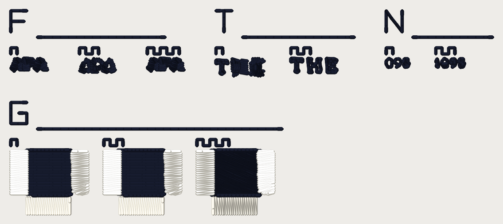

# Sew-out card v3, 2026-10-13

One DST file (**40 wt**) for the questions Kent's Hotel Fremont 81 mm Hat
report left open. Each question is a block of arms sewn **side by side** and
labelled with teeth. You sew it once, read each block on `scoring-sheet.md`,
and that settles several ROADMAP gate-1 questions together. **Every number on
this card is a candidate until you sew it.** Nothing here is a setting.

It does not replace card v1 (`../hairline-card-2026-10-12/`, hairline blocks
A-E) or card v2 (`../card-v2-2026-10-13/`, blocks F small print, G forbid gap,
H column reach). Both are untouched and **neither has been sewn** (MASTER_SCOPE
"Waiting on Kent" 44, 45, 47). Card v3 carries v2's block G unchanged, so the
forbid-gap question is settled by whichever you sew; v2's F and H, and v1, are
still theirs. 90.6 x 38.4 mm, 3,074 stitches: allow roughly 5 minutes (an estimate from the
stitch count, not a measurement).

## What is in this folder

| File | What it is |
|---|---|
| `card_v3_40wt.dst` | the card, **40 wt** thread. |
| `card_v3_40wt.png` | what the file looks like, thread drawn at the laid width, 12 px/mm. A picture of the file, not of cloth. |
| `card_v3_40wt_blocks.png` | every arm cropped at 60 px/mm, the arms of a block side by side, for comparing them before you sew. |
| `scoring-sheet.md` | the readout sheet: one table per block. Print it. |
| `cuts/cut_*.json` | the Fremont runs the T and N blocks sew: the replay of the Studio request, cut to each box (see below). |
| `readback.md`, `readback.json` | the file checks, also quoted below. |

The file is written by `python -m tools.sewout_card_v3` (in `digitizer/`)
through the service's export path (pystitch), not the browser's DST codec,
and read back with pystitch. The test is `digitizer/tests/test_sewout_card_v3.py`.

## What you need

- **Fabric:** the **cap** (or a scrap of the same structured twill) is the
  honest test: F3, T and N are digitized on the **Hat profile** (0.4 mm pull
  per side), as your Fremont job was. A pique polo would sew them with a pull
  the cloth does not want. Block G is the default profile, as on card v2.
- **Stabilizer:** the backing you used for the Fremont hat; else tearaway
  (medium) under twill, no topping.
- **Thread, two cones:** a **dark** (black or navy) and a **light** (white or
  cream), the same maker and weight. 40 wt: **Madeira Polyneon No. 40**, or
  Isacord 40. The Fremont blocks sew in the **dark** cone (the card sews only
  the logo's non-white thread: there is no white patch under THE or 1895).
- **Needle:** 40 wt **75/11**. **Bobbin:** the same for every sew-out.
- The design is 90.6 x 38.4 mm, well inside a 100 x 100 mm field (a 4 x 4 in hoop).

## How to sew it

1. Load `card_v3_40wt.dst`. **Put the needle at the centre of the card**: the
   file's origin is the middle of the 90.6 x 38.4 mm box. Trace the outline.
2. Turn **trims on**. The file cuts between pieces and wherever the
   digitizer cut inside one.
3. **Three colour stops** (two cones; the machine asks for the dark one twice):
   1. **Stop 1, dark.** The four index strips, every label, blocks F3, T and
      N, and the **fill** of each block G arm.
   2. **Stop 2, light.** Block G's **bars**.
   3. **Stop 3, dark.** Block G's two edge runs round each fill (short).
4. Count **thread breaks** from the machine's counter, per block if you can.
5. Do not press or steam before scoring. Photograph each block close up (a
   macro) and once at arm's length; the F3, T and N pieces are 2-10 mm.

## How to read the arms

Every block has an **index strip**: its letter sewn as a run, 4 mm tall (F for
F3, T, N, G), with a rule 1 mm under it. Arms are labelled by **teeth** (a
square wave sewn above each), counted from the left: **1 tooth** is the first
arm named in the table below, **2 teeth** the second, **3 teeth** the third.

## Block map

| Block | Where | Arms (1 / 2 / 3 teeth) | What it settles |
|---|---|---|---|
| **F3** | top row, left | The word **APA**, **2.2 mm cap**, stroke about 0.23 mm, counters as measured under "What the files say" (Fremont's tagline: 2.17 mm caps, 0.23 mm strokes, A counters about 0.50 mm across). **1** today (`small_print_floor` OFF, `small_glyph_keep` OFF), **2** `small_print_floor` ON, **3** `small_glyph_keep` ON. | #905's recommendation 1: does `small_print_floor` keep an A's triangle open at the size of Fremont's tagline, which the 81 mm replay said it shuts? And does `small_glyph_keep`? Success = the triangle is a visible bare hole under a loupe in an arm and not in 1. |
| **T** | top row, middle | Fremont's **THE** at 81 mm (box about 9.1 x 3.3 mm), cut from the replay. **1** today (T a run outline, H and E Column-lane satin, sewn 2.1-2.4 x their 0.40 mm drawn stroke: the blob); **2** `lettering_words` + `lettering_word_tiers` (three run outlines of one weight). The skeleton-run arm (`cfg.small_lettering_skeleton`) is **not on the card**: that branch has not merged. | #905's recommendation 2: does the one-tier-per-word pair read as THE where today's is a blob? The flip is not ripe until this is sewn (or a legibility score shows it). |
| **N** | top row, right | Fremont's **1895** box at 81 mm (about 4.3 x 1.7 mm), cut from the replay. **1** `small_glyph_keep` OFF (the 1 is not sewn at all, so the box reads "098"; the 8 and 9 sew as solid outlines), **2** ON (the 1 is sewn; the 8 and 9 keep counters). | Kent's flip-ruling follow-up from #902: does ON read 1895 where OFF reads "098"? |
| **G** | second row | Card v2's **block G**, unchanged: an 8 x 8 mm tatami **fill** with three 2.5 mm satin **bars** standing off it by **0.3 mm** (left), **0.6 mm** (right) and **1.0 mm** (bottom). **1** OFF, **2** `forbid_gap_mm` **0.4**, **3** **0.8** (#874, WoK 44). | `forbid_gap_mm`: 0.4 (closes the 0.3 gap only), 0.8 (closes 0.3 and 0.6), or neither. The 1.0 bar is the control. |

## What the files say about each arm (the FILE, not the cloth)

| piece | arm | stitches | vs arm 1 |
|---|---|---|---|
| F3 | today | 94 | - |
| F3 | floor | 114 | +20 |
| F3 | keep | 94 | +0 |
| T | today | 170 | - |
| T | wordtier | 203 | +33 |
| N | keep-off | 92 | - |
| N | keep-on | 133 | +41 |
| G | gap-off | 605 | - |
| G | gap-0.4 | 607 | +2 |
| G | gap-0.8 | 667 | +62 |

F3's counters as drawn (inscribed width, left to right: A 0.45 mm (0.297 mm^2), P 0.65 mm (0.434 mm^2), A 0.45 mm (0.297 mm^2)); the stroke is 0.236 mm on a 2.2 mm cap. A counter has to be at least one laid thread (0.4 mm at 40 wt) across for `small_print_floor` to keep it.

## Where the Fremont pieces come from

The T and N pieces are not drawn: they are the **stitches the engine sews for
Kent's job**. `tools/fremont_triage.py` replays the Studio request (81 mm, Hat,
6 colours, bean edge cap, the committed `testdata/photo/logo_hotel_fremont.webp`)
through the service's own steps. The arms differ only by the flags in the
table. Each box is the artwork rectangle `fremont_triage.ROIS` names, grown by
0.8 mm, and a piece is every non-white run lying wholly inside it:

| arm (cut) | flags on the Studio request | whole design | THE box mm | 1895 box mm |
|---|---|---|---|---|
| `today` | `{'small_glyph_keep': False}` | 15,306 stitches, 44 trims, 81.74 x 44.34 mm | [-4.86, -8.062, 5.022, -4.489] (18 runs) | [2.997, -13.509, 9.72, -10.633] (3 runs) |
| `wordtier` | `{'small_glyph_keep': False, 'lettering_words': True, 'lettering_word_tiers': True}` | 15,375 stitches, 48 trims, 81.74 x 44.34 mm | [-4.86, -8.062, 5.022, -4.489] (3 runs) | [2.997, -13.509, 9.72, -10.633] (3 runs) |
| `keep` | `{'small_glyph_keep': True}` | 15,611 stitches, 46 trims, 81.74 x 44.33 mm | [-4.86, -8.062, 5.022, -4.489] (18 runs) | [2.997, -13.509, 9.72, -10.633] (6 runs) |

`small_glyph_keep` is OFF on `origin/main` as of 2026-10-13 (a flip branch,
`claude/small-glyph-keep-on`, is not merged), and the card pins it explicitly in
every arm, so it does not move if that default flips.

## The file checks (pystitch reading the DST back)

| | 40 wt |
|---|---|
| file | `card_v3_40wt.dst` (10,400 bytes) |
| blocks on the card | 4 |
| stitches in the file / in the plan | 3,074 / 3,074 |
| colour changes in the file / planned | 2 / 2 |
| colours (stops) | 3 |
| extent (mm), x by y | 90.6 x 38.4 |
| x range / y range (mm) | [-45.3, 45.3] / [-19.2, 19.2] |
| inside 100 x 100 mm | yes |
| longest needle stitch (mm) | 3.14 |
| longest record, per axis (mm; the format's limit is 12.1) | 11.9 |
| trims | 38 |
| 0.8 mm lock-leg stitches | 288 |

Stitches per piece:

| piece | stitches |
|---|---|
| F3:floor | 114 |
| F3:keep | 94 |
| F3:strips | 48 |
| F3:today | 94 |
| F:strips | 42 |
| G:gap-0.4 | 607 |
| G:gap-0.8 | 667 |
| G:gap-off | 605 |
| G:strips | 106 |
| N:keep-off | 92 |
| N:keep-on | 133 |
| N:strips | 61 |
| T:strips | 58 |
| T:today | 170 |
| T:wordtier | 203 |

Stitches per colour stop:

| stop | thread | stitches (thread m) |
|---|---|---|
| 1 | dark | 2,180 (2.74) |
| 2 | light | 677 (1.57) |
| 3 | dark | 237 (0.17) |

Where each piece sits (mm, x0 y0 x1 y1, centre of the card at 0, 0):

| piece | box |
|---|---|
| F3:floor | [-32.4, -10.2, -25.6, -7.5] |
| F3:keep | [-19.6, -10.2, -12.7, -7.8] |
| F3:today | [-45.3, -10.2, -38.4, -7.8] |
| G:gap-0.4 | [-27.8, 7.1, -13.3, 19.2] |
| G:gap-0.8 | [-10.3, 7.1, 4.2, 19.2] |
| G:gap-off | [-45.3, 7.1, -30.8, 19.2] |
| N:keep-off | [25.3, -10.2, 29.6, -8.5] |
| N:keep-on | [34.6, -10.2, 40.0, -8.5] |
| T:today | [-6.7, -10.2, 2.4, -6.9] |
| T:wordtier | [7.4, -10.2, 16.0, -7.5] |

Reproduce with `python -m tools.sewout_card_v3` from `digitizer/` (the cuts
are re-made with `--cut today|wordtier|keep`, one process at a time, a few
minutes each).

## Things to know before you sew

- **F3, T and N are small.** The pieces are 2-10 mm; read them under a loupe
  AND at arm's length, and score the two separately. "Looks the same at arm's
  length" is a finding.
- **The 1895 digits are TAN thread in the logo** (rgb 163,150,135, a mid-tone), sewn here in the dark cone for contrast: read shape, not colour. THE is black in the logo.
- **The cloth is not the logo's ground.** The Fremont logo's white patch is not
  on the card, so THE and 1895 sew straight onto the cap or twill.
- **Short stitches.** The digitizer sews some stitches under 1.0 mm in lettering
  as it does today. The index strips and labels hold the 1.0 mm floor, and the
  lock legs are the engine's 0.8 mm.
