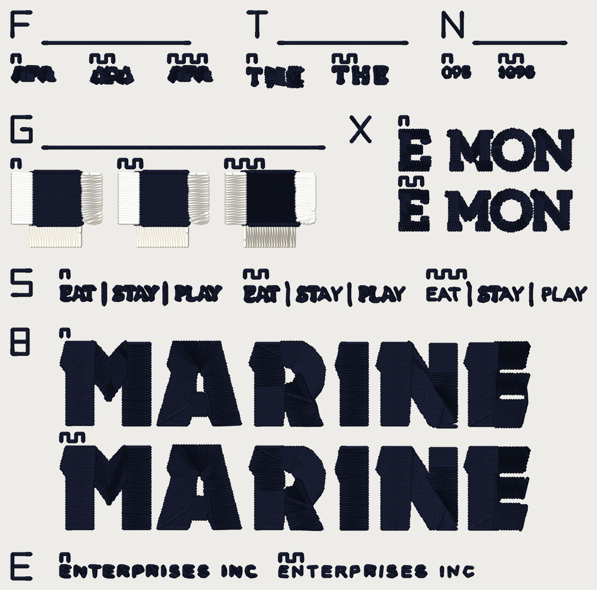

# Sew-out card v3.1, 2026-10-13

**Superseded by card v3.2 (see `README-v3.2.md` in this folder and `card_v3_2_40wt.dst`), which carries every block here, re-cut on today's main, and adds the line route's chaining block. Kept for history.**

One DST file (**40 wt**) for the questions Kent's Hotel Fremont 81 mm Hat
report left open, **plus the small-lettering skeleton arms** that card v3 was
waiting on (#913, merged, `cfg.small_lettering_skeleton`, default OFF), **plus a
lettering-ends check**. Each question is a block of arms sewn **side by side**
(or stacked, for the wide ones) and labelled with teeth. You sew it once, read
each block on `scoring-sheet.md`, and that settles several ROADMAP gate-1
questions together. **Every number on this card is a candidate until you sew
it.** Nothing here is a setting.

93.8 x 92.8 mm, 10,771 stitches, 91 trims, 3 colour stops (two cones),
allow roughly 22.1 minutes (an estimate from the stitch count at 650 spm, not
a measurement). **Inside a 4 x 4 in hoop (100 x 100 mm).**

**This card replaces v3.** Card v3 (`card_v3_40wt.dst`, its README, scoring
sheet and read-back, now `*-v3.*`) is kept in this folder for history; do not
sew both: v3.1 carries every v3 block unchanged (F3, T, N, G) and adds S, E2,
X and B. It also does not replace card v1 (`../hairline-card-2026-10-12/`) or
card v2 (`../card-v2-2026-10-13/`); neither has been sewn (MASTER_SCOPE
"Waiting on Kent" 44, 45, 47). v3.1 carries v2's block G as v3 did.

## What is in this folder

| File | What it is |
|---|---|
| `card_v3_1_40wt.dst` | the card, **40 wt** thread. |
| `card_v3_1_40wt.png` | what the file looks like, thread drawn at the laid width, 12 px/mm. A picture of the file, not of cloth. |
| `card_v3_1_40wt_blocks.png` | every arm cropped at 60 px/mm, the arms of a block side by side (stacked for S, E2 and B), for comparing them before you sew. |
| `scoring-sheet.md` | the readout sheet: one table per block. Print it. |
| `cuts/cut31_*.json` | the runs the new blocks sew: Fremont tagline / E / M, O, N, enthusiast's line, Becker's MARINE (see below). `cuts/cut_*.json` are v3's T and N. |
| `readback.md`, `readback.json` | the file checks, also quoted below. |
| `card_v3_40wt.*`, `README-v3.md`, `scoring-sheet-v3.md`, `readback-v3.*` | card v3, for history. |

The file is written by `python -m tools.sewout_card_v3_1` (in `digitizer/`)
through the service's export path (pystitch), not the browser's DST codec,
and read back with pystitch. The test is
`digitizer/tests/test_sewout_card_v3_1.py`.

## What you need

- **Fabric:** the **cap** (or a scrap of the same structured twill) is the
  honest test. F3, T, N, S and X are digitized on the **Hat profile** (0.4 mm
  pull per side), as your Fremont job was. **E2 and B are digitized on the
  left-chest profile** (#913's and #912's own corpus runs: enthusiast and
  Becker at 80 mm), so a cap is a harder test of them than they were made
  for; read them as a flag check, not as a size for the hat. Block G is the
  default profile, as on card v2.
- **Stabilizer:** the backing you used for the Fremont hat; else tearaway
  (medium) under twill, no topping.
- **Thread, two cones:** a **dark** (black or navy) and a **light** (white or
  cream), the same maker and weight. 40 wt: **Madeira Polyneon No. 40**, or
  Isacord 40. Every new block sews in the **dark** cone.
- **Needle:** 40 wt **75/11**. **Bobbin:** the same for every sew-out.
- The design is 93.8 x 92.8 mm, inside a 100 x 100 mm field (a 4 x 4 in hoop).
  It is tall: **hoop it with the whole card inside the field and trace the
  outline before sewing.**

## How to sew it

1. Load `card_v3_1_40wt.dst`. **Put the needle at the centre of the card**: the
   file's origin is the middle of the 93.8 x 92.8 mm box. Trace the outline.
2. Turn **trims on**. The file cuts between pieces and wherever the
   digitizer cut inside one.
3. **Three colour stops** (two cones; the machine asks for the dark one twice):
   1. **Stop 1, dark.** Every index strip and label, blocks F3, T, N, S, E2, X
      and B, and the **fill** of each block G arm.
   2. **Stop 2, light.** Block G's **bars**.
   3. **Stop 3, dark.** Block G's two edge runs round each fill (short).
4. Count **thread breaks** from the machine's counter, per block if you can.
   S's two skeleton arms put 0.73 mm and 1.0 mm stitches in a 0.4 mm line:
   note shredding, looping and needle heat on them.
5. Do not press or steam before scoring. Photograph each block close up (a
   macro) and once at arm's length; most pieces are 2-10 mm tall.

## How to read the arms

Every block has an **index strip**: its letter sewn as a run, 4 mm tall (F for
F3, T, N, G, S, E for E2, X, B). Blocks F3, T, N and G keep v3's layout (strip
above the arms, rule under it); the new blocks S, E2, X, B put the strip to the
**left** of their arms. Arms are labelled by **teeth** (a square wave sewn
above each), counted from the left, or from the top for the stacked blocks
(X, B; and S, E2 sew left to right): **1 tooth** is the first arm named in the table
below, **2 teeth** the second, **3 teeth** the third.

## Block map

| Block | Where | Arms (1 / 2 / 3 teeth) | What it settles |
|---|---|---|---|
| **F3** | top row, left | v3's, unchanged. The word **APA**, **2.2 mm cap**, stroke about 0.23 mm. **1** today, **2** `small_print_floor` ON, **3** `small_glyph_keep` ON. | #905's recommendation 1: does `small_print_floor` / `small_glyph_keep` keep an A's triangle open at the size of Fremont's tagline? |
| **T** | top row, middle | v3's, unchanged. Fremont's **THE** at 81 mm: **1** today, **2** `lettering_words` + `lettering_word_tiers`. **No skeleton arm: the skeleton tier leaves THE as it is (#913: the T is declined on width; here the THE box cut from the skeleton arms at both floors is point for point today's, 18 runs, 170 points), so a skeleton arm would be a duplicate of arm 1 and is dropped.** | #905's recommendation 2: does the one-tier-per-word pair read as THE where today's is a blob? |
| **N** | top row, right | v3's, unchanged. Fremont's **1895** at 81 mm: **1** `small_glyph_keep` OFF, **2** ON. | Does ON read 1895 where OFF reads "098"? (#902) |
| **G** | second row, left | v3's (card v2's block G), unchanged. An 8 x 8 mm fill with three bars standing off it by 0.3 / 0.6 / 1.0 mm. **1** OFF, **2** `forbid_gap_mm` 0.4, **3** 0.8. | `forbid_gap_mm`: 0.4, 0.8, or neither. |
| **X** | second row, right (arms stacked) | **NEW, a verification arm, not a gate.** Fremont's **E** (HOTEL) and **M, O, N** (FREMONT) at 81 mm Hat: Kent's triage circles 5, 6, 7. **1** `lettering_columns_square_ends` + `lettering_columns_inside_connectors` OFF, **2** both ON (#907, #912). | Does the E's upper arm end square, does the M's vertex stand on its foot with no loop to the O, does the N's diagonal end on the baseline rather than in an ear? |
| **S** | third row | **NEW.** The tagline **EAT, bar, STAY, bar, PLAY** at 81 mm Hat (the Studio request replay, 13 glyphs, caps 2.17 mm, strokes 0.22-0.30 mm). **1** today (`small_lettering_skeleton` OFF), **2** skeleton at the default floor (`small_lettering_skeleton_floor_mm` None = `MIN_STITCH_MM`, **1.0 mm**), **3** skeleton at floor **0.73 mm**. | #913's question: does one run down the middle of each letter read better than the bean outline round it, and do 0.73 mm stitches hold (`MIN_STITCH_MM`)? #913 prices 6 glyphs sewn as skeleton runs at 1.0 and 13 offered / 11 sewn at 0.73 (its table: 4 of 13 and 11 of 13 as one run on the render). |
| **B** | fourth row (arms stacked) | **NEW, a verification arm, not a gate.** Becker's **MARINE** at 80 mm left chest (6 Column-lane letters, 13.4 mm tall): **1** both ends flags OFF, **2** both ON. | #912's N: the travel stitch across the notch at the top of the N is gone with ON. Does the N read cleaner on cloth? |
| **E2** | bottom row | **NEW.** Enthusiast's **ENTERPRISES INC** at 80 mm left chest (14 letters, 31.8 mm wide). **1** today, **2** skeleton at floor **0.73 mm**. | #913 flags that the **R of PRISES** reads close to an **A** with the tier ON (the floor-limited route closes the bowl). Does it on cloth? |

### Pinned flags (every arm; the card does not move if a default flips)

`small_glyph_keep`, `small_lettering_skeleton`, `small_lettering_skeleton_floor_mm`,
`lettering_words`, `lettering_word_tiers`, `lettering_columns_square_ends`,
`lettering_columns_inside_connectors`, `bean_letter_max_stroke_mm`,
`bean_letter_stitch_mm`, and the two small-text options that compose with the
tier: **`small_text_cap_mm` (#909) and `small_text_restore_mm` (#911, "true
size")**, both OFF, alongside the skeleton tier in S, E2 and the cuts, as
#913's table composes #909. The ends flags are being turned ON by default
elsewhere (`claude/letter-ends-on`); the cuts pin them explicitly (`cuts/cut31_*.json`
record the flag set each came from).

## What the files say about each arm (the FILE, not the cloth)

| piece | arm | stitches | vs arm 1 |
|---|---|---|---|
| F3 | today | 94 | - |
| F3 | floor | 114 | +20 |
| F3 | keep | 94 | +0 |
| T | today | 170 | - |
| T | wordtier | 203 | +33 |
| N | keep-off | 92 | - |
| N | keep-on | 133 | +41 |
| G | gap-off | 605 | - |
| G | gap-0.4 | 607 | +2 |
| G | gap-0.8 | 667 | +62 |
| S | today | 582 | - |
| S | floor-1.0 | 419 | -163 |
| S | floor-0.73 | 200 | -382 |
| E2 | today | 531 | - |
| E2 | floor-0.73 | 205 | -326 |
| X | ends-off | 657 | - |
| X | ends-on | 669 | +12 |
| B | ends-off | 2,087 | - |
| B | ends-on | 2,223 | +136 |

The skeleton arms in S: the shape counts, pieces and widths are in the
read-back below; #913's table (per glyph, sewn width 0.42-0.43 mm against
0.47-0.73 mm today) is the source for what each glyph does. Declined glyphs
(E, S, T, P, L, the left A) stay the bean outline in the 1.0 mm arm. **A
counter 0.5 mm wide under a 0.40 mm thread is mostly covered (#913: 20-40%
stays bare at 0.73), so the A may read as a filled triangle in both arms: that
is the trade, and the cloth is the judge.**

## Where the new pieces come from

None of the new pieces are drawn; they are the **stitches the engine sews** for
a design that is already in the repo. The cut files hold the runs exactly as
the engine laid them (kind, points, the engine's jump and trim calls). The card
places each cut's top-left, one translation per piece, and the card's plan
keeps the engine's own jump/trim decisions for these runs (a hop under
`TRIM_AT_MM` is a float).

| cut | flags on the request (beyond the pins above) | whole design | what was cut |
|---|---|---|---|
| `today` | `none: every flag pinned OFF` | 15,306 stitches, 44 trims, 81.74 x 44.34 mm (hat_front) | tagline box (S arm 1), THE box (checked against the skeleton arms), E and M, O, N (X arm 1) |
| `skel` | `{'small_lettering_skeleton': True}` | 15,124 stitches, 44 trims, 81.74 x 44.34 mm (hat_front) | tagline box (S arm 2); THE box (check) |
| `skel073` | `{'small_lettering_skeleton': True, 'small_lettering_skeleton_floor_mm': 0.73}` | 14,886 stitches, 44 trims, 81.74 x 44.34 mm (hat_front) | tagline box (S arm 3); THE box (check) |
| `ends_on` | `{'lettering_columns_square_ends': True, 'lettering_columns_inside_connectors': True}` | 15,320 stitches, 45 trims, 81.74 x 44.34 mm (hat_front) | E and M, O, N (X arm 2) |
| `ent_today` | `none: every flag pinned OFF` | 2,428 stitches, 8 trims, 79.91 x 16.55 mm (left_chest) | ENTERPRISES INC (E2 arm 1) |
| `ent_skel073` | `{'small_lettering_skeleton': True, 'small_lettering_skeleton_floor_mm': 0.73}` | 2,102 stitches, 8 trims, 79.91 x 16.55 mm (left_chest) | ENTERPRISES INC (E2 arm 2) |
| `becker_off` | `none: every flag pinned OFF` | 6,011 stitches, 22 trims, 79.87 x 50.17 mm (left_chest) | MARINE (B arm 1) |
| `becker_on` | `{'lettering_columns_square_ends': True, 'lettering_columns_inside_connectors': True}` | 6,150 stitches, 25 trims, 79.87 x 50.08 mm (left_chest) | MARINE (B arm 2) |

## The file checks (pystitch reading the DST back)

| | 40 wt |
|---|---|
| file | `card_v3_1_40wt.dst` (34,646 bytes) |
| blocks on the card | 8 |
| stitches in the file / in the plan | 10,771 / 10,771 |
| colour changes in the file / planned | 2 / 2 |
| colours (stops) | 3 |
| extent (mm), x by y | 93.8 x 92.8 |
| x range / y range (mm) | [-46.9, 46.9] / [-46.4, 46.4] |
| inside 100 x 100 mm | yes |
| longest needle stitch (mm) | 4.91 |
| longest record, per axis (mm; the format's limit is 12.1) | 12.0 |
| trims | 91 |
| 0.8 mm lock-leg stitches | 855 |

Stitches per piece:

| piece | stitches |
|---|---|
| B:ends-off | 2087 |
| B:ends-on | 2223 |
| B:strips | 50 |
| E2:floor-0.73 | 205 |
| E2:strips | 28 |
| E2:today | 531 |
| E:strips | 19 |
| F3:floor | 114 |
| F3:keep | 94 |
| F3:strips | 48 |
| F3:today | 94 |
| F:strips | 42 |
| G:gap-0.4 | 607 |
| G:gap-0.8 | 667 |
| G:gap-off | 605 |
| G:strips | 106 |
| N:keep-off | 92 |
| N:keep-on | 133 |
| N:strips | 61 |
| S:floor-0.73 | 200 |
| S:floor-1.0 | 419 |
| S:strips | 65 |
| S:today | 582 |
| T:strips | 58 |
| T:today | 170 |
| T:wordtier | 203 |
| X:ends-off | 657 |
| X:ends-on | 669 |
| X:strips | 47 |

Stitches per colour stop:

| stop | thread | stitches (thread m) |
|---|---|---|
| 1 | dark | 9,962 (15.94) |
| 2 | light | 677 (1.57) |
| 3 | dark | 237 (0.17) |

Where each piece sits (mm, x0 y0 x1 y1, centre of the card at 0, 0):

| piece | box |
|---|---|
| B:ends-off | [-38.9, 7.6, 37.7, 21.5] |
| B:ends-on | [-38.9, 24.7, 37.7, 38.4] |
| E2:floor-0.73 | [-3.1, 44.4, 28.4, 46.1] |
| E2:today | [-38.9, 44.4, -7.1, 46.1] |
| F3:floor | [-34.0, -37.4, -27.2, -34.8] |
| F3:keep | [-21.2, -37.4, -14.3, -35.1] |
| F3:today | [-46.9, -37.4, -40.0, -35.1] |
| G:gap-0.4 | [-29.4, -20.2, -14.9, -8.1] |
| G:gap-0.8 | [-11.9, -20.2, 2.6, -8.1] |
| G:gap-off | [-46.9, -20.2, -32.4, -8.1] |
| N:keep-off | [23.7, -37.4, 27.9, -35.8] |
| N:keep-on | [32.9, -37.4, 38.4, -35.8] |
| S:floor-0.73 | [21.2, -2.1, 46.9, 1.6] |
| S:floor-1.0 | [-8.8, -2.1, 17.2, 1.6] |
| S:today | [-38.9, -2.1, -12.8, 1.5] |
| T:today | [-8.3, -37.4, 0.7, -34.2] |
| T:wordtier | [5.7, -37.4, 14.4, -34.8] |
| X:ends-off | [16.6, -27.2, 44.8, -20.5] |
| X:ends-on | [16.6, -17.3, 44.5, -10.6] |

Sew time, estimated (650 spm, 3 s per trim, 30 s per colour change): about 22.1 minutes.

Read back piece by piece (the DST decoded with pystitch: STITCH records inside each arm's box, against the in-memory pattern the file was written from; extent = width x height in mm):

| piece | stitches in the file | in the plan | extent in the file | extent in the plan |
|---|---|---|---|---|
| B:ends-off | 2,066 | 2,066 | 76.6 x 13.9 | 76.6 x 13.9 |
| B:ends-on | 2,205 | 2,205 | 76.6 x 13.7 | 76.6 x 13.7 |
| E2:floor-0.73 | 205 | 205 | 31.5 x 1.7 | 31.5 x 1.7 |
| E2:today | 531 | 531 | 31.8 x 1.7 | 31.8 x 1.7 |
| F3:floor | 109 | 109 | 6.8 x 2.6 | 6.8 x 2.6 |
| F3:keep | 90 | 90 | 6.9 x 2.3 | 6.9 x 2.3 |
| F3:today | 90 | 90 | 6.9 x 2.3 | 6.9 x 2.3 |
| G:gap-0.4 | 607 | 607 | 14.5 x 12.1 | 14.5 x 12.1 |
| G:gap-0.8 | 667 | 667 | 14.5 x 12.1 | 14.5 x 12.1 |
| G:gap-off | 605 | 605 | 14.5 x 12.1 | 14.5 x 12.1 |
| N:keep-off | 92 | 92 | 4.2 x 1.6 | 4.2 x 1.6 |
| N:keep-on | 133 | 133 | 5.5 x 1.6 | 5.5 x 1.6 |
| S:floor-0.73 | 200 | 200 | 25.7 x 3.7 | 25.7 x 3.7 |
| S:floor-1.0 | 419 | 419 | 26.0 x 3.7 | 26.0 x 3.7 |
| S:today | 582 | 582 | 26.1 x 3.6 | 26.1 x 3.6 |
| T:today | 163 | 163 | 9.0 x 3.2 | 9.0 x 3.2 |
| T:wordtier | 203 | 203 | 8.7 x 2.6 | 8.7 x 2.6 |
| X:ends-off | 634 | 634 | 28.2 x 6.7 | 28.2 x 6.7 |
| X:ends-on | 646 | 646 | 27.9 x 6.7 | 27.9 x 6.7 |

Reproduce with `python -m tools.sewout_card_v3_1` from `digitizer/` (the cuts
are re-made with `--cut today|skel|skel073|ends_on|ent_today|ent_skel073|becker_off|becker_on`,
one process at a time, a minute to five each).

## Things to know before you sew

- **The pieces are small.** Read them under a loupe AND at arm's length, and
  score the two separately. "Looks the same at arm's length" is a finding.
- **A fat line is still 0.40 mm.** The skeleton arms in S are one pass of one
  thread down the middle of a stroke narrower than the thread; the sewn width
  is the thread's, not the stroke's. The picture is a render, not cloth.
- **The Fremont tagline is TAN in the logo** (rgb 163,150,135) with two black
  bars; every colour sews in the dark cone here: read shape, not colour.
  Two small marks beside the tagline's letters in the artwork (the banner's
  rope edge) are not on the card.
- **The cloth is not the logo's ground.** The Fremont logo's white patch is not
  on the card, so the pieces sew straight onto the cap or twill.
- **Short stitches.** The skeleton arms deliberately sew stitches down to
  1.0 mm and 0.73 mm in lettering; the index strips and labels hold the
  1.0 mm floor, and the lock legs are the engine's 0.8 mm.
- **The ends arms are a verification, not a gate.** Nothing is flipped by
  this card; if X and B show no difference on cloth, say so on the sheet.
