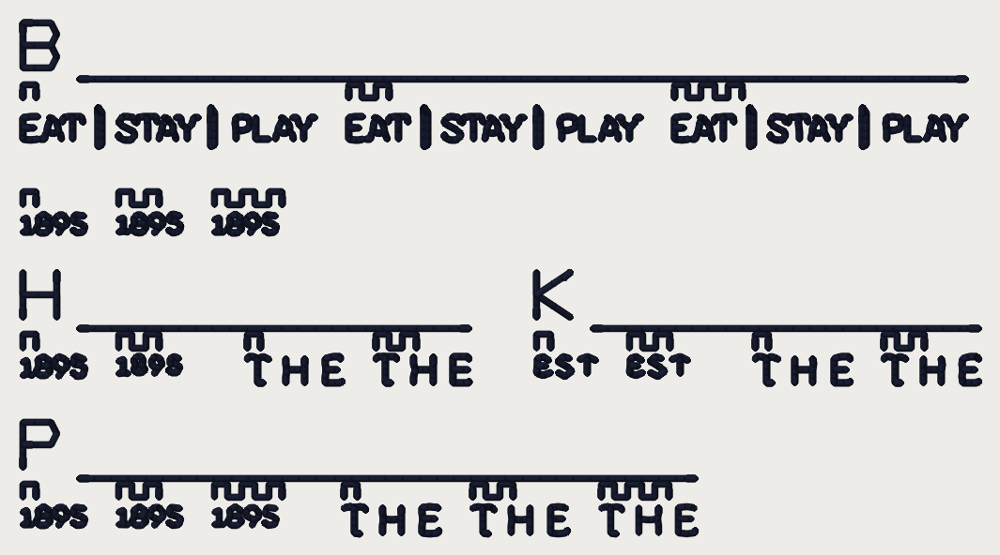

# Sew-out card v4 (2026-10-20)

**Sew this one. It replaces card v3.2, the lettering-arms card and the bay-hold /
edge-cap card**, which were cut before about ten flips landed (10-15 to 10-20);
their baseline arms are no longer what ships. Those folders stay for history.
Don't sew them.

Every arm here is **today's default engine** except the one flag its block
names, so the **1-tooth arm of every block is what a customer gets tonight**.
Every number is a candidate until you sew it (ROADMAP gate 1).

**What to sew:** `card_v4_40wt.dst`, **one colour (dark)**, **40 wt**, a **4 x 4 in
hoop** (the design is 84.8 x 45.4 mm), on a **cap front or the same structured
twill**, with your Fremont backing. 3,609 stitches, ? trims: allow about
6 minutes (from the stitch count at 650 spm, not a measurement).

## How to sew it

1. Load the DST. Needle at the centre (the file's origin is the middle of the
   box). Trace the outline.
2. **Trims on.** One colour, no stop.
3. Count thread breaks, per block if you can.
4. Don't press. Photograph each block close up and the whole card at arm's
   length, and send the photos.

## How to read it

Each block has an **index letter** (B, H, K, P, sewn as a run with a rule
beside it). The arms of each word sit side by side, labelled by **teeth** above
them, counted from the left.

| Block | Words | 1 tooth | 2 teeth | 3 teeth | The question |
|---|---|---|---|---|---|
| **B** | 1895, EAT STAY PLAY | straight stretches **0.7 mm** (today) | OFF (all 0.45 beads) | **0.9 mm** | Your "1 is wiggly / tagline wiggly": does the longer straight stitch read straighter? Does a 3-pass stitch that long lie flat and hold? |
| **H** | 1895, THE | bean holds **ON** (today: counter 0.25, bay 0.2) | holds OFF | | Do the 8's two counters and the 9's stay open in 1 and shut in 2? Are the held letters visibly fatter? |
| **K** | EST, THE | ties OFF (today) | `small_letter_ties` **ON** | | A knot at the letter ends in 1 and not in 2? Does 2's lock hold after a rub? |
| **P** | 1895, THE | **3 passes** (today) | 2 passes | 1 pass | Thread laid on itself: does each extra pass make the line wider, or only higher? Holes torn by three hits 0.45 mm apart? Which reads best? |

**Arms that are the same stitches** (the flag changes nothing on that word; if they differ on cloth, it is the cloth): K EST: arms off, ties identical.

## Not on this card, on purpose

- **Small-lettering skeleton, fold cuts:** cut, then dropped. On today's engine
  both arms came out the **same stitches** on the tagline (skeleton) and on
  FREMONT's M->O and final T (fold cuts) at 81 mm, so the cloth could not tell
  them apart.

- **Detail spokes / the star:** the star is white on a black host; one cone
  can't show it.
- **Forbid gap, overlap by angle:** seams between two colours; one cone can't
  show them.
- **Edge-cap bean pitch, line chaining:** other fixtures, and chaining needs two
  cones.

## What the file says (pystitch reading the DST back)

| | 40 wt |
|---|---|
| file | `card_v4_40wt.dst` (12,560 bytes) |
| blocks on the card | 4 |
| stitches in the file / in the plan | 3,609 / 3,609 |
| colour changes in the file / planned | 0 / 0 |
| colours (stops) | 1 |
| extent (mm), x by y | 84.8 x 45.4 |
| x range / y range (mm) | [-42.4, 42.4] / [-22.7, 22.7] |
| inside 100 x 100 mm | yes |
| longest needle stitch (mm) | 2.0 |
| longest record, per axis (mm; the format's limit is 12.1) | 11.9 |
| trims | 52 |
| 0.8 mm lock-leg stitches | 208 |

Stitches per piece:

| piece | stitches |
|---|---|
| B:1895-0.7 | 114 |
| B:1895-0.9 | 111 |
| B:1895-off | 126 |
| B:TAG-0.7 | 481 |
| B:TAG-0.9 | 448 |
| B:TAG-off | 523 |
| B:strips | 169 |
| H:1895-off | 108 |
| H:1895-on | 114 |
| H:THE-off | 132 |
| H:THE-on | 132 |
| H:strips | 99 |
| K:EST-off | 82 |
| K:EST-ties | 82 |
| K:THE-off | 132 |
| K:THE-ties | 135 |
| K:strips | 99 |
| P:1895-1 | 48 |
| P:1895-2 | 81 |
| P:1895-3 | 114 |
| P:THE-1 | 64 |
| P:THE-2 | 90 |
| P:THE-3 | 132 |
| P:strips | 147 |

Stitches per colour stop:

| stop | thread | stitches (thread m) |
|---|---|---|
| 1 | dark | 3,763 (1.99) |

Where each piece sits (mm, x0 y0 x1 y1, centre of the card at 0, 0):

| piece | box |
|---|---|
| B:1895-0.7 | [-42.4, -5.7, -36.9, -4.0] |
| B:1895-0.9 | [-25.4, -5.7, -19.9, -4.0] |
| B:1895-off | [-33.9, -5.7, -28.4, -4.0] |
| B:TAG-0.7 | [-42.4, -15.2, -16.5, -11.7] |
| B:TAG-0.9 | [15.4, -15.2, 41.3, -11.7] |
| B:TAG-off | [-13.5, -15.2, 12.4, -11.7] |
| H:1895-off | [-33.9, 7.0, -28.5, 8.5] |
| H:1895-on | [-42.4, 7.0, -36.9, 8.7] |
| H:THE-off | [-11.1, 7.0, -2.8, 9.3] |
| H:THE-on | [-22.5, 7.0, -14.1, 9.3] |
| K:EST-off | [3.2, 7.0, 8.4, 8.7] |
| K:EST-ties | [11.4, 7.0, 16.6, 8.7] |
| K:THE-off | [22.6, 7.0, 31.0, 9.3] |
| K:THE-ties | [34.0, 7.0, 42.4, 9.3] |
| P:1895-1 | [-25.4, 20.3, -19.9, 22.0] |
| P:1895-2 | [-33.9, 20.3, -28.4, 22.0] |
| P:1895-3 | [-42.4, 20.3, -36.9, 22.0] |
| P:THE-1 | [8.9, 20.3, 17.3, 22.7] |
| P:THE-2 | [-2.5, 20.3, 5.9, 22.7] |
| P:THE-3 | [-13.9, 20.3, -5.5, 22.7] |

## Where the pieces come from

`tools/fremont_triage.py` replays the Studio request for your Fremont job
(`testdata/photo/logo_hotel_fremont.webp`, **81 mm, Hat**, 6 colours) through
the service's own steps once per cut. A piece is every non-white run lying
wholly inside the word's box grown by 0.8 mm (`sewout_card_v3.cut_arm`).

| cut | overrides on today's request | whole design |
|---|---|---|
| `today` | `none: today` | 15,281 stitches, 42 trims, 81.74 x 44.33 mm |
| `straight_off` | `{'bean_letter_straight_mm': None}` | 15,359 stitches, 42 trims, 81.74 x 44.33 mm |
| `straight_09` | `{'bean_letter_straight_mm': 0.9}` | 15,221 stitches, 42 trims, 81.74 x 44.33 mm |
| `holds_off` | `{'bean_letter_counter_hold_mm': None, 'bean_letter_bay_hold': None}` | 15,265 stitches, 42 trims, 81.74 x 44.33 mm |
| `ties_on` | `{'small_letter_ties': True}` | 15,248 stitches, 42 trims, 81.74 x 44.33 mm |
| `passes_2` | `{'bean_letter_passes': 2}` | 15,145 stitches, 44 trims, 81.74 x 44.33 mm |
| `passes_1` | `{'bean_letter_passes': 1}` | 14,879 stitches, 42 trims, 81.74 x 44.33 mm |

Reproduce: `python -m tools.sewout_card_v4 --cut <name>` per cut, then
`python -m tools.sewout_card_v4`, from `digitizer/`. Test:
`digitizer/tests/test_sewout_card_v4.py`.
