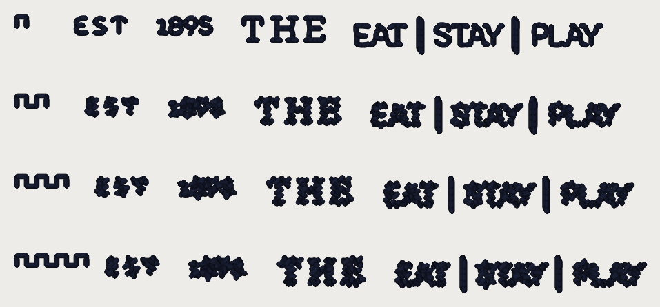

# Sew-out card v5 (2026-10-20): small letters as satin, at the pro's size

**Sew this beside the pro's Fremont patch.** Card v4's sew-out showed our small
letters reading far smaller than the pro's. Rendered at the same size they sit
in the art's own footprint, but as a thin bean line; the pro fills each stroke
with ~0.85 mm satin (`../card-v4-2026-10-20/pro_vs_ours_92mm.png`). This card
asks how wide the satin should be. Every number is a candidate until you sew it.

**What to sew:** `card_v5_40wt.dst`, **one dark cone**, **40 wt**, 75/11, a
**4 x 4 in hoop** (the design is 75.8 x 33.2 mm), cap front or twill with your
Fremont backing. 4,124 stitches, 35 trims, about 6 minutes. Trims on.

## How to read it

Four **rows**, each Fremont's EST, 1895, THE and EAT | STAY | PLAY at
**92.5 mm, the pro's size** (hold each row up to his patch). The **teeth** at
the left of a row count it:

| Teeth | Row |
|---|---|
| 1 | today: 3-pass bean line |
| 2 | satin column **0.5 mm** wide |
| 3 | satin column **0.65 mm** |
| 4 | satin column **0.85 mm** (the pro's median) |

Look for: which row reads most like the pro's; do the 8's two holes, the 9's, the
E's and the A's stay open; do the letters stay crisp or turn to blobs; thread
breaks; puckering.

## The file (pystitch reading the DST back)

| | 40 wt |
|---|---|
| file | `card_v5_40wt.dst` (14,045 bytes) |
| blocks on the card | 4 |
| stitches in the file / in the plan | 4,124 / 4,124 |
| colour changes in the file / planned | 0 / 0 |
| colours (stops) | 1 |
| extent (mm), x by y | 75.8 x 33.2 |
| x range / y range (mm) | [-37.9, 37.9] / [-16.6, 16.6] |
| inside 100 x 100 mm | yes |
| longest needle stitch (mm) | 1.2 |
| longest record, per axis (mm; the format's limit is 12.1) | 11.9 |
| trims | 35 |
| 0.8 mm lock-leg stitches | 178 |

Stitches per piece:

| piece | stitches |
|---|---|
| R:1895-sat050 | 142 |
| R:1895-sat065 | 142 |
| R:1895-sat085 | 142 |
| R:1895-today | 136 |
| R:EST-sat050 | 103 |
| R:EST-sat065 | 103 |
| R:EST-sat085 | 103 |
| R:EST-today | 101 |
| R:TAG-sat050 | 649 |
| R:TAG-sat065 | 649 |
| R:TAG-sat085 | 649 |
| R:TAG-today | 551 |
| R:THE-sat050 | 249 |
| R:THE-sat065 | 249 |
| R:THE-sat085 | 249 |
| R:THE-today | 189 |
| R:strips | 72 |

Stitches per colour stop:

| stop | thread | stitches (thread m) |
|---|---|---|
| 1 | dark | 4,478 (1.8) |

Where each piece sits (mm, x0 y0 x1 y1, centre of the card at 0, 0):

| piece | box |
|---|---|
| R:1895-sat050 | [-19.4, -6.8, -13.0, -4.4] |
| R:1895-sat065 | [-18.2, 2.8, -11.6, 5.4] |
| R:1895-sat085 | [-16.9, 12.5, -10.3, 15.2] |
| R:1895-today | [-20.8, -16.4, -14.5, -14.5] |
| R:EST-sat050 | [-29.5, -6.8, -23.4, -4.7] |
| R:EST-sat065 | [-28.3, 2.9, -22.2, 5.1] |
| R:EST-sat085 | [-27.1, 12.5, -20.9, 14.9] |
| R:EST-today | [-30.7, -16.4, -24.8, -14.6] |
| R:TAG-sat050 | [5.1, -6.8, 34.8, -2.6] |
| R:TAG-sat065 | [6.6, 2.9, 36.4, 7.0] |
| R:TAG-sat085 | [8.0, 12.5, 37.9, 16.6] |
| R:TAG-today | [3.1, -16.4, 32.7, -12.3] |
| R:THE-sat050 | [-9.0, -6.8, 1.1, -3.7] |
| R:THE-sat065 | [-7.6, 2.8, 2.6, 6.1] |
| R:THE-sat085 | [-6.3, 12.5, 4.0, 16.0] |
| R:THE-today | [-10.5, -16.4, -0.9, -13.8] |

