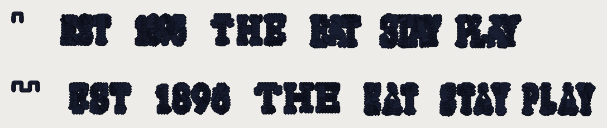

# Sew-out card v6 (2026-10-21): small letters re-set like the pro

**Sew this beside the pro's Fremont patch.** The pro raises Fremont's small
words to ~4 mm and re-sets them as bold block letters with the gaps between
letters closed to 0.15-0.35 mm (`docs/pro-digitizer-rules-2026-10-21.md`,
R4). Card v5 asked how wide the satin should be; this card asks whether the
**spacing** is right. Every number is a candidate until you sew it.

**What to sew:** `card_v6_40wt.dst`, **one dark cone**, **40 wt**, 75/11, a
**4 x 4 in hoop** (the design is 86.6 x 15.2 mm), cap front or twill with your
Fremont backing. 2,791 stitches, 19 trims, about 4 minutes. Trims on.

## How to read it

Two **rows**, each Fremont's EST, 1895, THE and EAT STAY PLAY at **92.5 mm,
the pro's size** (hold each row up to his patch). The tagline's `|` bars are
left out of both rows (another colour on the patch). The **teeth** at the
left of a row count it:

| Teeth | Row |
|---|---|
| 1 | #1024 + #1025 as built: grown condensed to 4 mm, bold satin |
| 2 | **re-set (PR #1029)**: same size and stroke, letters spaced ~0.25 mm apart |

Measured off the files (not the cloth): row 2's letter gaps read 0.27-0.47 mm
against the pro's 0.15-0.6; its columns 0.80-0.90 mm against his 0.90. Row 1's
letters within a word touch.

**Known before you sew:** on row 2 the 5 of 1895 and the S close their
openings (1895 can read "1898"); the pro draws those digits wider.

Look for: does row 2 read like the pro's letters, letter by letter; are the
gaps open on the cloth, or too wide; do the A's and the 8's counters stay open;
thread breaks; puckering.

## The file (pystitch reading the DST back)

| | 40 wt |
|---|---|
| file | `card_v6_40wt.dst` (9,287 bytes) |
| blocks on the card | 2 |
| stitches in the file / in the plan | 2,791 / 2,791 |
| colour changes in the file / planned | 0 / 0 |
| colours (stops) | 1 |
| extent (mm), x by y | 86.6 x 15.2 |
| x range / y range (mm) | [-43.3, 43.3] / [-7.6, 7.6] |
| inside 100 x 100 mm | yes |
| longest needle stitch (mm) | 1.99 |
| longest record, per axis (mm; the format's limit is 12.1) | 11.3 |
| trims | 19 |
| 0.8 mm lock-leg stitches | 578 |

Stitches per piece:

| piece | stitches |
|---|---|
| R:1895-condensed | 240 |
| R:1895-reset | 274 |
| R:EST-condensed | 202 |
| R:EST-reset | 200 |
| R:TAG-condensed | 738 |
| R:TAG-reset | 680 |
| R:THE-condensed | 273 |
| R:THE-reset | 290 |
| R:strips | 28 |

Stitches per colour stop:

| stop | thread | stitches (thread m) |
|---|---|---|
| 1 | dark | 2,925 (2.2) |

Where each piece sits (mm, x0 y0 x1 y1, centre of the card at 0, 0):

| piece | box |
|---|---|
| R:1895-condensed | [-25.0, -7.4, -17.7, -2.9] |
| R:1895-reset | [-22.0, 2.9, -11.2, 7.3] |
| R:EST-condensed | [-36.1, -7.4, -29.0, -3.0] |
| R:EST-reset | [-34.9, 2.9, -26.0, 7.3] |
| R:TAG-condensed | [1.1, -7.4, 32.2, -2.6] |
| R:TAG-reset | [9.1, 2.9, 43.3, 7.6] |
| R:THE-condensed | [-13.7, -7.4, -2.9, -2.9] |
| R:THE-reset | [-7.2, 2.9, 5.1, 7.2] |

