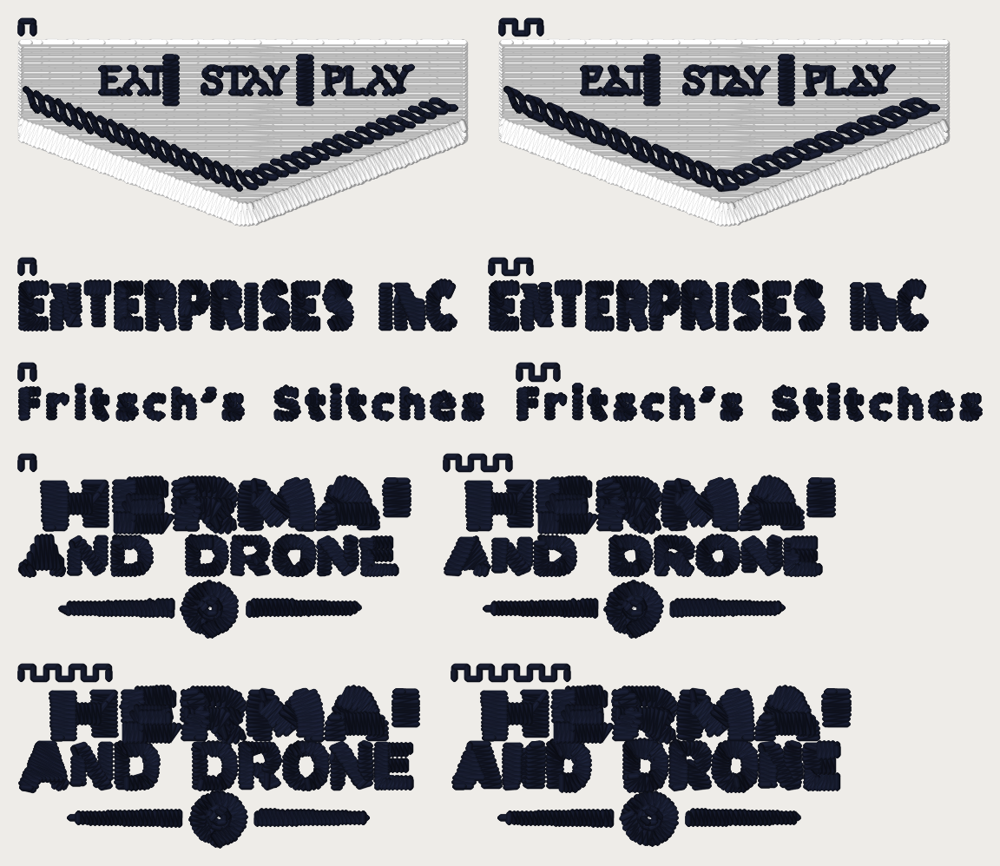

# Sew-out card v8 (2026-11-01): cut every jump, the bold factor and the halo

**Sew this one in the same sitting as card v7, beside the pro's Fremont
patch.** It carries the arms the K3 handoff queued after v7, less the ones a
merged flip has closed (the table at the end). Every number is a candidate
until you sew it (ROADMAP gate 1).

**Rebuilt 2026-11-08 on main 2ce938eb (2026-11-08)** (first cut 2026-11-01 on main 3896a7ae)
so arm (a) ships today's defaults. Six flags flipped ON in between and the
11-01 cut did not pin them: `lettering_stray_word_thread`,
`dark_ink_floor_rescue`, `flat_light_text_runs`,
`text_cluster_nest_door_aspect`, `thread_match_grade_traced_letter`,
`dropped_element_v2`; all six are pinned ON below now. What moved, old ->
new: whole file 15,891 -> 15,893 stitches, 130 -> 130 trims, 2 -> 2 colour
stops (white, then dark), 92.0 x 79.2 mm unchanged, DST 50,375 -> 50,387
bytes; F (a) 3,077 -> 3,080 and (b) 3,080 -> 3,083 (one more satin run in
the lower crest); E and J byte-identical in their cuts; D (a) 1,559 -> 1,556,
(c) 1,540 -> 1,542, (d) 1,631 -> 1,631, (e) 1,627 -> 1,624. In D the
stray-word-thread flip folded the one grey-blue stray letter thread (RGB 90 94
97) into the line's grey (140 137 132): the design has one thread less in
that window, but this card sews every non-white piece in one dark cone, so
the file's colour map did not change. The scale of AND DRONE per arm is
unchanged (table below).

**What to sew:** `card_v8_40wt.dst`, **two cones, 40 wt**, 75/11, a **flat
4 x 4 in hoop** (the design is 92.0 x 79.2 mm), the structured twill you sewed
card v4 on, with your Fremont backing. **Stop 1 is white** (the Fremont
field under block F, 4,132 stitches, nothing else), **stop 2 is dark**
(everything else). 15,893 stitches, 130 trims, about 24 minutes
(stitch count at 650 spm, not a measurement). Trims on. Print
`card_v8_40wt_worksheet.pdf` (or `.png`) beside it: the card's map, the teeth
legend and a tick box per piece.

## The arms

Teeth above each piece count its arm. Every arm pins every flag an arm
touches and the halo explicitly (an unpinned value would follow a later
default flip): `cut_every_jump` False, `small_text_cap_mm` 4.0, `small_text_cap_max_width_scale` 1.05, `small_text_cap_min_stroke_mm` 0.85, `small_text_cap_letter_gap_mm` 0.25, `small_text_cap_bold_scale` 1.45, `small_text_cap_reach_edges` True, `small_text_bay_mouth` True, `small_text_reset_grow_away` True, `lettering_columns_small_bold` True, `bean_only_lines` True, `dark_ink_bean` True, `trim_bury_under_later` True, `tie_in_off` True, `lettering_stray_word_thread` True, `dark_ink_floor_rescue` True, `flat_light_text_runs` True, `text_cluster_nest_door_aspect` True, `thread_match_grade_traced_letter` True, `dropped_element_v2` True; halo (`small_text.CLEAR_MM`) 0.8.

| Teeth | Arm | What differs from (a) |
|---|---|---|
| 1 | (a) ships | nothing: main 2ce938eb (2026-11-08)'s defaults, pinned |
| 2 | (b) cut every jump | `cut_every_jump` ON (Python, blocks F and E) / `cutEveryJump` ON (browser, block J): no needle-up move left uncut -- buried under later thread, else walked needle-down on the work, else cut and locked both sides |
| 3 | (c) bold 2.0 | `small_text_cap_bold_scale` 2.0 (1.45): a re-set letter's stroke, 2.0x its traced stroke at its height |
| 4 | (d) halo 0.3 | `small_text.CLEAR_MM` 0.3 (0.8): the fabric the re-set keeps between the line's artwork and its neighbours |
| 5 | (e) bold 2.0 + halo 0.3 | both |

## The four blocks

- **F**: Hotel Fremont at **92.5 mm, the pro's size**, Hat: the lower crest
  (EAT | STAY | PLAY, the rope's lower arcs, the white field under them with
  its own white satin edge along the point, clipped to the window; the black
  hexagon border crosses the window and is left out), (a) beside (b). On today's engine every float of
  the whole design (148, between the rope strands and between the
  tan bean letters, 0.8-3 mm) lies on the white field, and **(b) walks all
  of them and cuts none**: each float becomes one needle-down stitch (or a
  2 mm run) on top of the white. The piece holds 58 of them. The pro
  sews straight through on his field (his shortest Fremont cut is 3.4 mm).
  **Look for:** the float threads on (a) against the walk stitches on (b):
  does a dark stitch across the white field show, and would you rather
  snip the float?
- **E**: ENTHUSIAST at 93 mm Hat, the tagline ENTERPRISES INC., re-set x2.0
  by `small_text_reset_grow_away` (ON 10-26), (a) beside (b). Its floats
  are between letters on bare cloth, so **(b) cuts them**: 12 cuts in the
  piece (the whole design 19 floats -> 29 trims from 11). **Look for:** the
  floats on (a) against the lock knots on (b); the P and R counters open or
  filled; the 0.25 mm letter gaps open on the cloth.
- **J**: "Fritsch's Stitches" typed in medium_font (the Studio's default) at
  44 mm, flat, through the browser builder: (a) beside (b). OFF leaves
  15 floats (3 trims); ON cuts every one (18 trims, 838 stitches
  against 718). The 0.01 mm oracle finds none of its new stitches on bare
  cloth. **Look for:** the same as E, on a cap-sized name.
- **D**: Precision Drone at **62.6 mm, the pro's size**, Hat: THERMAL (the
  letters that stand over AND DRONE; its T and L reach past the window and
  are left out), AND DRONE, the dome and the short dashes under it, in two
  rows: (a) | (c) above, (d) | (e) below. The pro re-sets AND DRONE x1.57
  with 1.26 mm columns and keeps 0.15-0.30 mm thread to thread; ours stops
  at x1.40 against the 0.8 mm halo. **Look for:** the gap between AND DRONE
  and THERMAL / the dome (crowded? touching?), the column width against the
  pro's 1.26, and the letters' legibility at each height.

Cuts the crop itself made (a shape whose neighbour in the sew order fell
outside the window, and the white field's long edge hops) are the same in
every arm of a block; the table below counts them with the design's own.

| Piece | Teeth | Arm | Stitches | Floats / cuts / sewn hops in the piece | Planned satin: cross / stitch (mm) | Whole design: stitches / trims / floats |
|---|---|---|---|---|---|---|
| F | 1 | (a) ships | 3,080 | 58 / 8 / 25 | 1.12 / 1.12 | 15,866 / 29 / 148 |
| F | 2 | (b) cut every jump | 3,083 | 0 / 8 / 86 | 1.12 / 1.12 | 15,872 / 29 / 0 |
| E | 1 | (a) ships | 835 | 12 / 2 / 25 | 0.95 / 0.95 | 2,874 / 11 / 19 |
| E | 2 | (b) cut every jump | 931 | 0 / 14 / 25 | 0.94 / 0.94 | 2,946 / 29 / 0 |
| J | 1 | (a) ships | 718 | 15 / 3 / 0 | 0.54 / 0.54 | 718 / 3 / 15 |
| J | 2 | (b) cut every jump | 838 | 0 / 18 / 0 | 0.54 / 0.54 | 838 / 18 / 0 |
| D | 1 | (a) ships | 1,556 | 7 / 15 / 48 | 1.15 / 1.15 | 14,769 / 95 / 28 |
| D | 3 | (c) bold 2.0 | 1,542 | 9 / 15 / 51 | 1.2 / 1.2 | 14,757 / 95 / 30 |
| D | 4 | (d) halo 0.3 | 1,631 | 8 / 14 / 49 | 1.2 / 1.2 | 14,837 / 94 / 29 |
| D | 5 | (e) bold 2.0 + halo 0.3 | 1,624 | 9 / 15 / 48 | 1.39 / 1.38 | 14,816 / 98 / 30 |

Drone's AND DRONE per arm, from the re-set's own report (scale over the art,
stroke tag / traced, the room above and below) and the plan's columns:

| Arm | bold | halo (mm) | scale over the art | stroke tag / traced (mm) | room up / down (mm) | AND DRONE columns: cross / stitch (mm) |
|---|---|---|---|---|---|---|
| (a) ships | 1.45 | 0.8 | x1.401 | 0.537 / 0.361 | 2.035 / 1.284 | 0.92 / 0.92 |
| (c) bold 2.0 | 2.0 | 0.8 | x1.317 | 0.537 / 0.361 | 2.035 / 1.284 | 1.02 / 1.02 |
| (d) halo 0.3 | 1.45 | 0.3 | x1.736 | 0.537 / 0.361 | 2.035 / 1.284 | 1.04 / 1.04 |
| (e) bold 2.0 + halo 0.3 | 2.0 | 0.3 | x1.652 | 0.537 / 0.361 | 2.035 / 1.284 | 1.35 / 1.35 |
| the pro's file (`PRECISION DRON HAT 2.DST`, memory `reset-grow-away-2026-10-26`) | - | - | x1.57 | - | 0.15 / 0.30 thread to thread | 1.26 |

## The `cut_every_jump` walk against a 0.01 mm oracle (the handoff's nitpick)

The Python walk samples a hop every 0.1 mm (`stage7_sequence._BURY_STEP_MM`)
at its centre and both thread edges; the browser twin samples every 0.01 mm
because its test's oracle found 17 segments up to 0.015 mm off the thread at
0.1 mm. `tools/jump_walk_oracle.py` is that oracle ported (a thread raster of
the OFF file's DST at 0.01 mm, no code shared with the walk), run on each
job's whole-design OFF and ON files as the service writes them:

| Job | Floats OFF -> ON | New needle-down segments ON (locks) | Walked segments, mm | On bare cloth | Worst off the thread (mm) |
|---|---|---|---|---|---|
| fremont | 148 -> 0 | 154 (0) | 154, 170.7 | 0 | 0.0 |
| enthusiast | 19 -> 0 | 73 (72) | 1, 1.06 | 0 | 0.0 |
| drone (ON measured for the oracle only, not sewn here) | 28 -> 0 | 57 (36) | 21, 25.46 | 1 | 0.0292 |
| lettering (browser, its own oracle) | 15 -> 0 | 120 (114) | - | 0 | - |

**Verdict: the Python walk is off the thread by more than the browser's was.** Of 176 walked segments on the three jobs, 1 lies partly on bare cloth at 0.01 mm -- worst 0.0292 mm past the thread's edge, against the 0.015 mm the browser's 0.1 mm step showed before it went to 0.01 (drone: 0.54 mm at (0.0, -30.8), 0.0292 mm past the edge). A tenth of a thread width, not a stitch across cloth, and not in any piece on this card; arm (b) ships marked with it. The cure is the browser's (`_BURY_STEP_MM` 0.1 -> 0.01, a sampling step, not a physical constant), a build of its own.

## Arms the queue named that are not on this card

| Queued arm | Not on this card because |
|---|---|
| the 0.51 mm bay mouth (`small_text_bay_mouth`) | flipped ON 2026-10-26 (#1112, "ship both") from renders, proven on 16 jobs against the pro; 0.51 is the pro's own file median, so there is no candidate value left to sew against. It sews in every re-set line here (E, D). Today's Fremont hat also sews EST and 1895 as 2 mm bean lines (`bean_only_lines`, 10-27), so card v6's E / S / 5 mouths are not on this engine's hat at all. |
| the 5's bar slot | the same 5: a 2 mm bean line today, no slot to fill. Read the re-set letters' counters on E and D instead. |
| the 0.25 mm letter gap (#1084) | #1084 was a census with a harness prototype (numbers only); the clamp on `columns.sewn_rails` it priced was never built, so there is no flag to arm. The re-set's own 0.25 mm gap (default since 10-23) sews on every E and D piece: look at the gaps. |
| the typed-text fabric preset | no question or candidate value is written anywhere on main (the handoff's queue line and its "older next-wave candidates" only); nothing to arm. |
| ENTHUSIAST's tagline under `small_text_reset_grow_away` | not an arm: the flag flipped ON 10-26 from renders. The tagline sews on E (a) as it ships; its counters are the thing to look at there. |
| `pull_comp_by_stroke`, `pro_measured_values` | card v7's two arms, unchanged since; not repeated. |

## The file (pystitch reading the DST back)

| | 40 wt |
|---|---|
| file | `card_v8_40wt.dst` (50,387 bytes) |
| blocks on the card | 4 |
| stitches in the file / in the plan | 15,893 / 15,893 |
| colour changes in the file / planned | 1 / 1 |
| colours (stops) | 2 |
| extent (mm), x by y | 92.0 x 79.2 |
| x range / y range (mm) | [-46.0, 46.0] / [-39.6, 39.6] |
| inside 100 x 100 mm | yes |
| longest needle stitch (mm) | 4.59 |
| longest record, per axis (mm; the format's limit is 12.1) | 12.0 |
| trims | 130 |
| 0.8 mm lock-leg stitches | 1466 |

Stitches per piece:

| piece | stitches |
|---|---|
| D:a | 1556 |
| D:c | 1542 |
| D:d | 1631 |
| D:e | 1624 |
| D:strips | 84 |
| E:a | 835 |
| E:b | 931 |
| E:strips | 28 |
| F:a | 3080 |
| F:b | 3083 |
| F:strips | 28 |
| J:a | 718 |
| J:b | 838 |
| J:strips | 28 |

Stitches per colour stop:

| stop | thread | stitches (thread m) |
|---|---|---|
| 1 | white | 4,132 (9.83) |
| 2 | dark | 11,874 (11.81) |

Where each piece sits (mm, x0 y0 x1 y1, centre of the card at 0, 0):

| piece | box |
|---|---|
| D:a | [-46.0, 4.2, -8.8, 19.4] |
| D:c | [-5.2, 4.2, 31.9, 19.4] |
| D:d | [-46.0, 24.4, -8.0, 39.6] |
| D:e | [-4.4, 24.4, 33.4, 39.4] |
| E:a | [-46.0, -14.6, -4.4, -10.1] |
| E:b | [-0.8, -14.6, 40.8, -10.1] |
| F:a | [-46.0, -37.6, -3.4, -20.2] |
| F:b | [0.2, -37.6, 42.8, -20.2] |
| J:a | [-46.0, -4.5, -1.8, -1.4] |
| J:b | [1.8, -4.5, 46.0, -1.4] |

