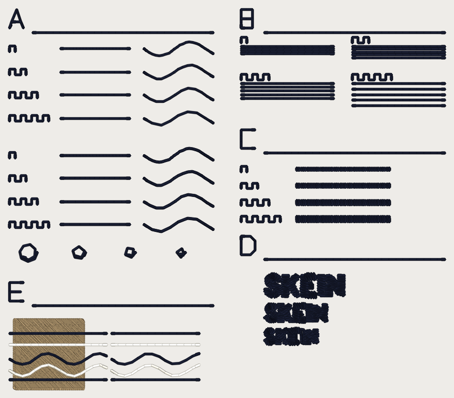

# Hairline sew-out card, 2026-10-12

Two DST files, one per thread weight. You sew each on cloth, score it on
`scoring-sheet.md`, and that settles the numbers the hairline work has been
guessing at. **Every number on this card is a candidate until you sew it**
(ROADMAP gate 1): the 60 wt laid width and spacing, the 0.73 / 1.0 / 1.5 /
2.0 mm stitch lengths, how close two strands can sit, the 1.0 mm column floor
at 60 wt, the cap-height note. Nothing here is a setting.

## What is in this folder

| File | What it is |
|---|---|
| `hairline_card_40wt.dst` | the card for **40 wt** thread. Sew once per fabric. |
| `hairline_card_60wt.dst` | the card for **60 wt** thread. Sew **twice** per fabric (two needles, below). |
| `hairline_card_40wt.png`, `hairline_card_60wt.png` | what each file looks like, thread drawn at the weight's laid width. A picture of the file, not of cloth. |
| `scoring-sheet.md` | one table per sew-out, one row per block. Print it. |
| `readback.md`, `readback.json` | the file checks (stitch count, size, short stitches), also quoted below. |

Both files are written by `python -m tools.hairline_card` (in `digitizer/`)
through the service's export path (pystitch), not the browser's DST codec,
and read back with pystitch (table at the bottom).

## What you need

- **Fabric, two kinds:** a pique polo and a twill. Use a **mid-tone** (grey or
  khaki). The card sews a dark thread and a light thread; on white cloth the
  light strands in block E will not show.
- **Hooping:**
  - **Pique:** cutaway stabilizer (medium) under it, and **water-soluble
    topping** on top. Do not skip the topping on pique: it keeps the single
    strands from sinking into the waffle.
  - **Twill:** **tearaway** stabilizer (medium). No topping.
  - The design is **94 x 82 mm**. Use a hoop with at least a 100 x 100 mm
    sewing field. A 4 x 4 in hoop is exactly that and leaves 3 mm each side;
    take a bigger hoop if you have one.
  - Hoop firm and flat. Do not change hoop, stabilizer or tension between
    the sew-outs without writing it on the sheet.
- **Thread, three cones per weight:** a dark (black or navy), a light (white
  or cream) and a mid-tone (tan or grey, between the two). Same maker and
  same weight for all three.
  - 40 wt hoop: **Madeira Polyneon No. 40**, or Isacord 40.
  - 60 wt hoop: **Madeira Polyneon No. 60**, or Isacord 60.
  - Pick the colours you have. The card does not care which, as long as dark,
    light and mid-tone are clearly different.
- **Bobbin:** the same bobbin thread for every sew-out.

## The six sew-outs

A DST carries no thread weight and no needle, so you sew the files like this.
The two needles on the 60 wt hoop are on purpose: the sources disagree (Madeira
says 60/8 to 65/9, Wilcom says 70/10 to 75/11) and only cloth can settle it.

| Sew-out | File | Thread | Needle | Fabric |
|---|---|---|---|---|
| 1 | `hairline_card_40wt.dst` | 40 wt | **75/11** | pique + cutaway + topping |
| 2 | `hairline_card_60wt.dst` | 60 wt | **65/9** | pique + cutaway + topping |
| 3 | `hairline_card_60wt.dst` | 60 wt | **70/10** | pique + cutaway + topping |
| 4 | `hairline_card_40wt.dst` | 40 wt | **75/11** | twill + tearaway |
| 5 | `hairline_card_60wt.dst` | 60 wt | **65/9** | twill + tearaway |
| 6 | `hairline_card_60wt.dst` | 60 wt | **70/10** | twill + tearaway |

Use **one** machine speed for all six and write it on the sheet (about 650
stitches a minute is a sensible start). Fresh needle for each sew-out. Each
hoop is about 4,000 stitches and a hundred or so trims: allow roughly 15
minutes (an estimate from the stitch count, not a measurement).

## How to sew one

1. Load the file. **Put the needle at the centre of the card**: the file's
   origin is the middle of the 94 x 82 mm box. Trace the outline to check it
   clears the hoop.
2. Turn **trims on**. The file cuts after every line in blocks A, B, C and E,
   and wherever the digitizer cut in block D.
3. **Three colour stops**, in this order:
   1. **Stop 1, mid-tone.** Block E's 15 x 15 mm ground (the tan square at the
      bottom left). Nothing else sews in this colour.
   2. **Stop 2, dark.** Everything else: the five index strips, blocks A, B,
      C and D, and block E's dark strands. This is the long one.
   3. **Stop 3, light.** Block E's light strands, over the ground and over
      bare cloth.
4. Count **thread breaks** from the machine's counter, per block if you can
   (stop the machine at the end of each block and read it). Write them on
   the sheet.
5. Do not press or steam before scoring. Photograph each block close up
   (a macro) and once at arm's length.
6. Score on `scoring-sheet.md`.

## Where things are, and what each block answers

Each block has an **index strip**: its letter sewn as a run, 4 mm tall, with
a rule 1 mm under it, so you can read which block you are looking at.

| Block | Where | What it is | What it answers |
|---|---|---|---|
| **A** | top left | Two columns of 8 lines, each 15 mm: **straight** (left) and an **S-curve** with a 3 mm bend radius (right). Rows 1-4 are **one pass** at stitch lengths **0.73 / 1.0 / 1.5 / 2.0 mm**, rows 5-8 the same four as a **3-pass bean** (every stitch sewn forward, back, forward). A row of **square teeth** to the left of each line counts the stitch length: 1 tooth = 0.73, 2 = 1.0, 3 = 1.5, 4 = 2.0. Under the lines, **four spirals** of radius **2.0 / 1.5 / 1.2 / 1.0 mm** at 1.5 mm stitches. | Which stitch length a single strand wants, and does one pass hold up against a bean? Does a tight curl read as a curl or as a polygon? |
| **B** | top right | Four **combs** of five parallel 20 mm single runs at 1.5 mm stitches, spaced **0.4 / 0.6 / 0.8 / 1.2 mm** (1 / 2 / 3 / 4 teeth above each). | At what spacing do neighbouring strands stop reading as separate? |
| **C** | right, middle | Four **satin columns**, 20 mm long, **0.6 / 0.8 / 1.0 / 1.2 mm** wide (1 to 4 teeth), at the weight's own stitch spacing: **0.40 mm in the 40 wt file, 0.32 mm in the 60 wt file**. | Does 60 wt move Melco's 1.0 mm column floor? Does the 0.32 spacing cover? |
| **D** | right, lower | The word **SKEIN** in Barstitch Bold at **4.0, 3.0 and 2.5 mm cap height** (top to bottom), digitized by this pipeline at the file's thread weight. | The cap-height note: the smallest caps that stay legible at each weight. |
| **E** | bottom left | A **15 x 15 mm mid-tone tatami** (the tan square), then five single strands over it, top to bottom: dark straight, light straight, dark S-curve, light S-curve, dark straight. The **same five strands** are repeated on **bare fabric** to the right. | Does a strand read over a ground that runs under it? Does it read worse, better or the same as on bare cloth? Does the double layer under it pucker? |

## Short stitches you will see in the file, and why

The file keeps every stitch at or over 1.0 mm (Melco's floor, set by the
needle and not the thread) except in four places, and the 0.8 mm lock legs the
engine always adds at a start or a cut. The four places are the things being
tested:

- **A, the 0.73 mm lines** (rows 1 and 5): today's bean stride.
- **C, the 0.6 and 0.8 mm columns:** a column that narrow crosses in under
  1.0 mm.
- **D, the lettering:** as the digitizer sews it today.
- **E, the tatami:** its row turns, at the engine's 0.15 mm row pitch.

## The file checks (pystitch reading the DST back)

| | 40wt | 60wt |
|---|---|---|
| file | `hairline_card_40wt.dst` (13,553 bytes) | `hairline_card_60wt.dst` (14,375 bytes) |
| stitches in the file / in the plan | 3,883 / 3,883 | 4,158 / 4,158 |
| colour changes in the file / planned | 2 / 2 | 2 / 2 |
| extent (mm), x by y | 94.0 x 82.0 | 94.0 x 82.0 |
| x range / y range (mm) | [-47.0, 47.0] / [-41.0, 41.0] | [-47.0, 47.0] / [-41.0, 41.0] |
| inside 100 x 100 mm | yes | yes |
| longest move (mm; the writer splits above 12.1) | 13.6 | 13.6 |
| stitches under 1.0 mm that are not 0.8 mm lock legs | 611 | 696 |
|   of those, outside the expected places | 0 | 0 |
| 0.8 mm lock-leg stitches | 753 | 838 |

Stitches under 1.0 mm, by where they are:

| where | 40wt | 60wt | why |
|---|---|---|---|
| A:0.73 lines | 208 | 208 | block A's 0.73 mm lines (today's bean stride, under Melco's 1.0 floor: the test) |
| C:0.6 col | 109 | 133 | block C's 0.6 mm column (its cross is under 1.0: the test) |
| C:0.8 col | 50 | 62 | block C's 0.8 mm column (its cross is under 1.0: the test) |
| D:2.5 cap | 52 | 76 | block D lettering, as the digitizer sews it today |
| D:3.0 cap | 23 | 50 | block D lettering, as the digitizer sews it today |
| D:4.0 cap | 33 | 76 | block D lettering, as the digitizer sews it today |
| E:ground | 150 | 150 | block E's tatami: row turns at the engine's 0.15 mm pitch |

Stitches per colour stop:

| stop | thread | 40wt stitches (thread m) | 60wt stitches (thread m) |
|---|---|---|---|
| 1 | ground (mid-tone) | 776 (1.53) | 776 (1.53) |
| 2 | dark | 3,018 (3.31) | 3,293 (3.54) |
| 3 | light | 89 (0.11) | 89 (0.11) |

Block boxes in the hoop (mm, x0 y0 x1 y1, centre of the card at 0, 0):

| block | 40wt | 60wt |
|---|---|---|
| A | [-47.0, -41.0, -3.0, 14.5] | [-47.0, -41.0, -3.0, 14.5] |
| B | [3.0, -41.0, 47.0, -19.2] | [3.0, -41.0, 47.0, -19.2] |
| C | [3.0, -15.0, 47.0, 5.8] | [3.0, -15.0, 47.0, 5.8] |
| D | [3.0, 8.0, 47.0, 32.7] | [3.0, 8.0, 47.0, 32.7] |
| E | [-47.0, 18.0, -3.0, 41.0] | [-47.0, 18.0, -3.0, 41.0] |

Reproduce with `python -m tools.hairline_card` from `digitizer/`; the
tests are `digitizer/tests/test_hairline_card.py`.

## Small print: two more candidates this card should settle (not in the DST yet)

Added 2026-10-12 by the small-print lane (`cfg.small_print_floor`, built OFF;
measurements in `digitizer/tools/small_print.py`, renders in
`docs/renders/claude-small-print-floor/`). Block D's word, SKEIN, has no
counters, so it cannot answer these. A future revision of this card should
add a word WITH counters (the lane's synthetic word is `BOARD 80`) at 3 and
4 mm cap, sewn OFF and ON, on both weights.

| Candidate | Value | Where it lives | What settles it |
|---|---|---|---|
| Narrowest counter kept open | **1 laid thread width** across: 0.40 mm at 40 wt, ~0.32 mm at 60 wt | `machine.SMALL_PRINT_COUNTER_MIN_WIDTHS` x `thread_profile(wt).width_mm` (`counter_min_width_mm`) | Is a 0.4 mm (40 wt) / 0.32 mm (60 wt) counter still open at arm's length, or does it close up? |
| Thread held off a counter | **half a laid width** from each penetration to the counter's edge: 0.20 mm at 40 wt, 0.16 mm at 60 wt | `thread_profile(wt).width_mm / 2`, in `columns._clear_counters` | Does the column next to a counter still cover its own ink (no bare line along the counter), and does the counter stay its drawn size? |

Score each on the sheet's "Cap height legible" column, plus a free note:
"counters open Y/N" per letter with a counter. Both numbers are derived from
the laid width, which is itself a candidate (60 wt's 0.32 mm is a square-root-
of-dtex estimate, never measured).
