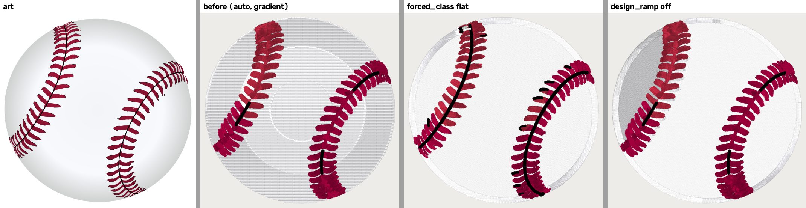
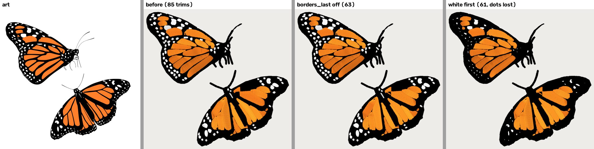

# Starter pack weak spots: baseball, turtle, monarch (2026-11-12)

[`starter-pack-2026-11-10.md`](starter-pack-2026-11-10.md) names three weak designs: the baseball's grey rings, the
turtle's shell, and the monarch's 86 trims. This doc reproduces each one, names the stage that causes it, and measures
the cheapest remedy. **No new flag was needed, and no pack file is changed here.** Every remedy is an existing
per-request setting. Whether to re-digitize the shipped DSTs with these settings is Kent's call (sent to the foreman
2026-11-12, with these renders).

## Method

- **Art.** The 1920 px Commons render each DST was made from (`digitized_from` in the manifest). The sha256 matches
  the manifest for all three.
- **Run.** One process mirrors the service: `_decode_bounded` → `build_generation` → `finish_generation` →
  `plan_stitches` → `run_preflight`, then `design_to_pattern` + `formats.write(…, "dst")`. The config is
  `target_width_mm` (the pack's width) plus the arm's settings, validated by the service's own `_validate_config_dict`.
  Code: main `bdae1860`. Runs went one at a time on a laptop shared with another digitizer worker, so the seconds are
  not a benchmark.
- **Drift.** Main has moved since the pack's `ac3d77fa`, so a "before" here is not the shipped DST byte for byte. Baseball
  went from 20,812 to 20,601 stitches and from 49 to 51 trims; the monarch's trims are still 86. Each fault is the same
  one the pack ships.
- **Trims.** Trims are the plan's count. Hop classes come from `tools/trim_classes.py` on the DST.
- **Renders.** `stitchviz.render_png_bytes` at 10 px/mm. Strips are in `docs/renders/starter-weak-spots-2026-11-12/`
  (art | before | arms). Rendered, not sewn: gate 1 applies.

## Numbers

| design | arm | stitches | cones | trims | regions | preflight | findings |
|---|---|---:|---:|---:|---:|---|---|
| baseball | before (auto → gradient) | 20,601 | 5 | 51 | 36 | B 88 | LETTERING_TOO_SMALL, SATIN_GAPS_TIGHT |
| baseball | `forced_class: "flat"` | 24,378 | 5 | 57 | 121 | B 76 | LETTERING_TOO_SMALL, STITCHES_TOO_SHORT |
| baseball | `design_ramp: false` | 24,129 | 5 | 39 | 36 | B 76 | DENSITY_STACKED, LETTERING_TOO_SMALL, SATIN_GAPS_TIGHT |
| turtle | before (auto → gradient) | 17,201 | 10 | 29 | 26 | B 76 | DENSITY_STACKED, LETTERING_TOO_SMALL, SATIN_GAPS_TIGHT |
| turtle | `forced_class: "flat"` | 29,232 | 12 | 43 | 66 | **F 0** | THREAD_MATCH_POOR (block) + 6 more |
| turtle | flat + `max_colors: 15` | 30,461 | 15 | 51 | 71 | **F 0** | THREAD_MATCH_POOR (block) + 6 more |
| monarch | before (auto → flat) | 16,129 | 3 | 86 | 127 | B 76 | LETTERING_TOO_SMALL, SATIN_GAPS_TIGHT, TRIM_HEAVY |
| monarch | `borders_last: false` | 16,035 | 3 | 64 | 127 | B 88 | LETTERING_TOO_SMALL, SATIN_GAPS_TIGHT |
| monarch | white shapes `layer: -1` | 20,496 | 3 | 62 | 127 | B 88 | LETTERING_TOO_SMALL, SATIN_GAPS_TIGHT |

The LETTERING_* findings are the false positive the pack doc already records: there is no text in these designs.

## Baseball: grey rings

**What the picture shows.** The white ball sews as three stepped concentric zones, Skylight grey (214) and Glacier
white (245) alternating, with a visible seam between them. The black centre line of the seams also survives only as
three short pieces (9.6 mm² of black).

**Cause: stage 2's design ramp, sewn by stage 6's blend.** Stage 0 reads the art as `gradient`. That is correct: the
ball is a radial vignette, with L* 96–98 at the centre falling to 84 at the rim. The radial fit in
`design_ramp.fit_design_ramp` then passes its gate (`source_pixels.design_ramp` is set, and its profile is that L*
curve). `stage6_blend` sews the ball region `Saacb6c7d` as `-blend` shade bands, giving 7 colour stops for 5 cones. This
is the 2026-09-04 gradient ruling working as built. DOCTRINE notes that its radial branch was "calibrated on ONE
synthetic fixture — a real radial logo is the missing evidence". This baseball is that evidence, and on it the bands
read as rings, not shading.

**Remedy: an existing setting, `forced_class: "flat"`** (the Studio's reading-row "Sew as flat art"). The ball becomes
one Glacier field with a satin rim. The black centre line comes back whole (37.5 mm²). Colour stops drop from 7 to 5.
The costs are +3.8k stitches (+18%), +6 trims, and preflight 88 → 76 (STITCHES_TOO_SHORT, warn). The grey shading is
lost entirely; a hand-digitized ball usually drops it too, but that is a craft call, not a measurement.
`design_ramp: false` was also tried and is worse. The rings go, but a single grey crescent stays on the left, the seam
line is still broken, and it costs the same +3.5k stitches.

Not done: no change to the radial gate. Widening or narrowing it needs more than one design. DOCTRINE says not to move
its numbers without re-measuring the `design_ramp.py` fixture table.

## Turtle: lost shell

**What the picture shows.** The doc said "loses its shell shading", but the fault is bigger. Shell, legs, neck and head
sew as ONE olive region (Caper, 3,062 mm², about 79% of the stitched area). One scute (Kiwi) and the shadow survive,
and the scute boundaries are left as dark run lines.

**Cause: stage 2's gradient-lane RAG merge** (`stage2_photo_segment`, hierarchical merge at `MERGE_DELTAE00_THRESH`
26). Sampled from the art, every pair among the six scutes, the shell rim, the belly and the leg/neck green sits 3–23
ΔE00 apart, all under 26. So the merge chains them into one region, exactly as tuned. DOCTRINE: "Leave
`MERGE_DELTAE00_THRESH` at 26.0" (2026-08-12). Stage 0 calls the art `gradient` (it does have soft highlights), so this
is the lane the turtle is on. Recalibrating stage 0 is gate 2.

**Remedy: an existing setting, with a cost that is Kent's to weigh.** `forced_class: "flat"` recovers every scute, the
green legs, the head, the mouth and the eye outlines. But it fills the 12-cone cap and folds the eye whites into
Serenity blue, so preflight goes **F** (THREAD_MATCH_POOR block). Adding `max_colors: 15` brings the eye whites back
(Oxford) and reads closest to the art. The cost: 15 cones (was 10), 30,461 stitches (+77%), 51 trims, and still **F**,
because the red tongue folds into Cranberry (a 33 mm² block). Pack preflight grades are not shown to the customer (Kent's
ruling in `starterPack.js`), but an F is still an F.

**Verdict:** an existing setting fixes the picture at a real cone and stitch cost. Otherwise this is a documented cap: on
the automatic lane, the merge threshold DOCTRINE pins is what merges the turtle.

## Monarch: 86 trims

**What the picture shows.** The render is right: black wings, orange cells and 87 white dots. The cost is the trims.
`trim_classes` reads 68 of the 86 hops as `on_work`: travel between white dots that would lie on finished black thread,
so it has to be cut. Only 1 is `under_later`.

**Cause: stage 7's `borders_last_layers`** (`cfg.borders_last`, ON since 2026-08-31 from the Instagram sew-out). The
white dots are small and classify satin, so their layer is satin-dominated. The pass moves it after the black fill, as
it would a border, and a dot layer is not a border. Every hop between dots then crosses finished black, and
`trim_bury_under_later` has nothing later to bury it under. The white block alone carries 50 of the 86 trims.

**Remedy: an existing setting, `borders_last: false`.** The order becomes black, orange, white. The white block's trims
fall from 50 to 30, the total from 86 to 64 (−26%), and TRIM_HEAVY clears (preflight 76 → 88). Stitches and the render
are unchanged. White still sews last, so 46 hops stay `on_work` and get cut.

**What would bury the rest, and why it is not a setting.** Sewing the white dots FIRST would put every hop under the
later black. A per-shape `layer: -1` override on all 87 white shapes does reorder them: the white block's trims go from
50 to 4. But the black block then splits into 532 runs (from 59) with 36 trims, stitches rise 27%, and in the render the
black sews over most of the dots. Doing this properly means sewing the islands first and keeping the black knocked out
around them. That is a stage-5/7 build, not a setting. It is a candidate for its own task, gated like any trim change by
`trim_classes` and a render, and not started here.

## Per-design verdict

| design | verdict | setting | waiting on Kent |
|---|---|---|---|
| baseball | existing setting | `forced_class: "flat"` | re-digitize the shipped DST? |
| turtle | existing setting, at a cost; documented cap on the automatic lane | `forced_class: "flat"`, `max_colors: 15` | 15 cones and an F: worth it, or keep as shipped? |
| monarch | existing setting (partial) + documented remainder | `borders_last: false` | re-digitize the shipped DST? Build the knock-out pass? |

Re-digitizing a design means its DST, the manifest's sha and counts, and `scripts/derive-starter-threads.mjs`'s output.
The manifest has no field for the settings a design was made with; a re-digitize should add one, so the next
regeneration reproduces it.
