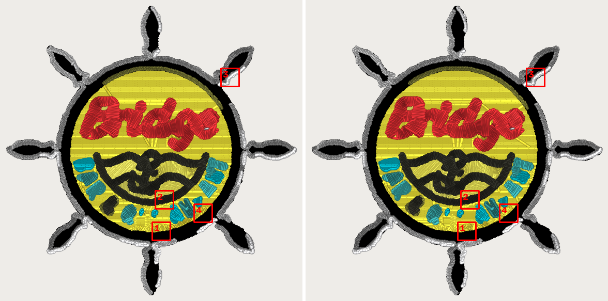
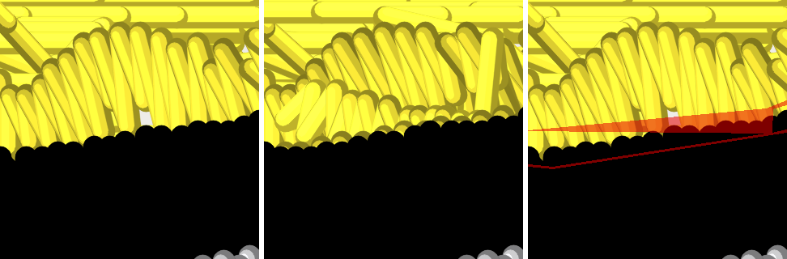
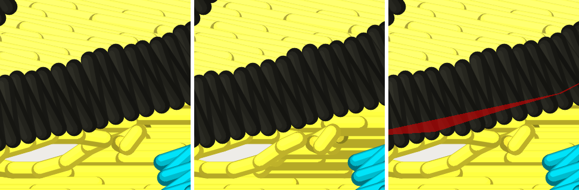
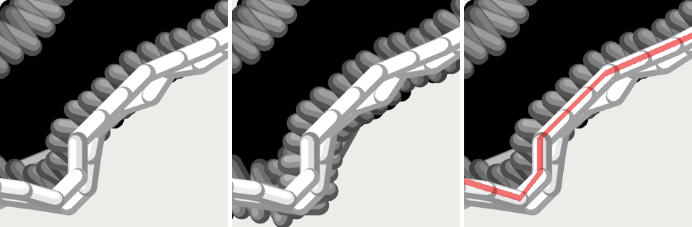
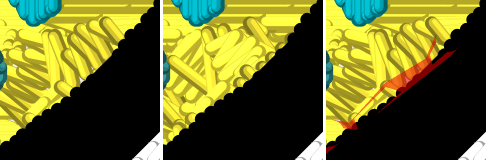

# WoK 44 prep: the `forbid_gap_mm` bill, measured and rendered (2026-10-12)

Measure and render only. Nothing here flips a default or changes the engine.
`cfg.forbid_gap_mm` stays `None`. The 0.8 mm value is ROADMAP gate 1's
candidate (card block 6), not a measured constant, and nothing below settles it.

Instrument: `digitizer/tools/forbid_gap_bill.py` (new; pinned by
`digitizer/tests/test_forbid_gap_bill.py`). One generation per fixture, then
stages 5-7 twice, OFF (`None`) and ON (0.8), each through `run_preflight`.
Welds are counted by spying `stage5_overlap.gap_bridges` and `_weld_part`
(nothing is altered; the test checks stage 5 is restored). Measured on the
tree at merge `44abbff3` (main as of 2026-10-12, which includes #857's weld
fix and #863's Column lane ON), 80 mm, `left_chest`, `corpus_scorecard.FIXTURES`
(26 fixtures). `hat_front` was not re-run; #857's census covers it for strips and
ARTWORK_UNCOVERED.

## Decision-ready summary

Corpus-wide, ON at 0.8 mm: 12 of 26 fixtures have a strip to bridge (128 pairs
across 56 welded shapes, **0 weld failures**). On those twelve:

| | OFF | ON at 0.8 | change |
|---|---|---|---|
| bare fabric under 0.8 mm between two colours, on the cloth | 126.57 mm² | 6.20 mm² | -95% |
| stitches (all 26 fixtures) | 344,421 | 345,845 | +1,424 (+0.41%) |
| trims | 1,045 | 1,031 | -14 |
| colour changes | 167 | 167 | 0 |
| ARTWORK_UNCOVERED findings | 8 | 7 | scene_stub 2 -> 1 (20.2 -> 17.5 mm²); no fixture gains one |
| CLIP_DROPPED_SLIVER | 0 | 0 | none |

The 14 fixtures with no strip are byte-for-byte the OFF counts (stitches, trims,
colour changes, findings all equal), and the OFF arm reads 0 / 0 / 0 on the weld
spy for all 26, so the OFF path never reaches the rule.

Three things the table does not show, all from the bridge detail below:

1. **The gaps are mostly not gaps.** Of 128 bridged pairs, 116 have the two
   artworks within 0.1 mm of each other (many exactly abutting), 6 are
   0.1 to 0.4 mm and 6 are 0.4 mm or more. On bridge, 13 of 17 pairs are under
   0.1 mm and only two are at 0.4 mm or over. Few of them look like a deliberate
   knockout line; they are seams where the artworks touch, which is what a
   knit's pull opens into bare cloth.
2. **A third of the strips go to satin shapes** (the decision WoK 44 asked for).
   37 of the 128 pairs, 52 of 376 mm² of strip, are handed to a satin-tier shape
   that sews first. On bridge that is 12 of 17 pairs, and every one of the 17
   pairs has a satin shape on the later side.
3. **The stitch cost lands on a few small satin shapes.** Bridge goes
   17,578 -> 18,227 stitches (+649, +3.7%) and 88 -> 96 trims. Needle points
   per shape: the rail-comp satin `S0c90443f` 3,383 -> 3,605 (+222, +6.6%);
   three small satin bars more than double (`S87a02ba8` 46 -> 201,
   `Sb7247667` 151 -> 290, `S354f0f99` 30 -> 124). The sum of the changed
   shapes is +649. WoK 44's "3,868 -> 2,914 once strips are handed to it" is
   **not reproduced** on this tree; `S0c90443f` goes up here, not down.

Also: #857's finding that the flag adds a 1.1 mm² ARTWORK_UNCOVERED on bridge
is **gone on current main** (bridge reads 0 -> 0 here). It was not chased.

## Pictures

Bridge, OFF (left) vs ON at 0.8 mm (right), thread drawn by `stitchviz`, one frame and one
scale (7 px/mm) for both. Thread picture, not cloth (gate 1). Boxes 1-4 mark
the four largest strips.

Zooms are 5 mm square at 64 px/mm, so the sub-millimetre strip is 20 to 60 px
wide. Panels left to right: OFF, ON, OFF with every strip in the window filled red.

1. Yellow fill meets the black ring (strip owner `Sb7247667`, 1.55 mm²). OFF shows a
   pale speck of cloth at the join; in ON the fill rows reach the ring.
   
2. Black anchor arc over yellow (`S5d53f83f`, 1.37 mm²). The strip is a long wedge
   under the arc; ON closes the pale gap.
   
3. The grey and white satin border on a wheel spoke (`S0c90443f`, 1.09 mm²), the
   rail-comp satin of WoK 44. The strip runs along the border's inner edge; in ON
   dark stitches show along that edge (the tuck, as read from the picture). This is the panel to judge the
   satin question on.
   
4. Yellow fill against the black ring, lower right (`S354f0f99`, 1.08 mm²). Fill
   rows re-lay across the wedge.
   

Anything in the ON picture outside the red strips (the re-laid yellow rows) is
looks like the fill's rows re-laid after its entry points moved; that was not separately measured.

## Options for Kent

**A. Flip `forbid_gap_mm` to 0.8.**
Delivers: the -95% bare cloth above, -14 trims corpus-wide, one ARTWORK_UNCOVERED
cleared, 0 failed welds in 56. Costs: +1,424 stitches corpus-wide, +3.7% on bridge.
Catch: 0.8 mm is a physical constant, so ROADMAP gate 1 says it is a candidate
until a sew-out; flipping the default settles it by the back door. It also hands
satin shapes strips (a third of them), which the picture in crop 3 is the only
evidence on, and nobody has sewn it. Mechanically it is safe now (#857).

**B. Flip at a different value (a candidate only).**
Bridge, golden_tee and scene_stub at 0.4 and 1.2 (the rule's strip floor is
gap_mm², so the value is not a dial that scales the effect):

0.4 mm (left_chest):

| photo/logo_bridge_bar.jpg | left_chest | 17578 -> 17484 | 88 -> 86 | 12 | 63 | 22 / 0 | 30.75 | 23.78 -> 2.98 | 0 (0.0) | 0 (0.00) | 295 / 242 |
| photo/logo_golden_tee.jpg | left_chest | 8315 -> 8158 | 46 -> 47 | 13 | 30 | 14 / 0 | 13.27 | 12.50 -> 0.17 | 0 (0.0) | 0 (0.00) | 73 / 44 |
| photo/photo_scene_stub.png | left_chest | 24752 -> 23081 | 117 -> 113 | 7 | 26 | 10 / 0 | 66.64 | 28.75 -> 0.00 | 2 -> 1 (20.2 -> 17.7) | 0 (0.00) | 161 / 171 |

1.2 mm (left_chest):

| photo/logo_bridge_bar.jpg | left_chest | 17578 -> 17711 | 88 -> 85 | 12 | 1 | 1 / 0 | 1.60 | 1.33 -> 1.23 | 0 (0.0) | 0 (0.00) | 284 / 188 |
| photo/logo_golden_tee.jpg | left_chest | 8315 | 46 | 13 | 0 | 0 / 0 | 0.00 | 0.00 | 0 (0.0) | 0 (0.00) | 68 / 55 |
| photo/photo_scene_stub.png | left_chest | 24752 -> 25109 | 117 -> 123 | 7 | 8 | 3 / 0 | 27.97 | 12.85 -> 0.00 | 2 -> 1 (20.2 -> 19.2) | 0 (0.00) | 164 / 190 |

At 0.4 mm the rule bridges many small pairs (63 on bridge), cuts stitches on all
three (scene_stub -6.7%) and takes open cloth to 2.98 / 0.17 / 0.00 mm²; at 1.2 mm the floor
drops almost every bridge strip (1 pair, open cloth 1.33 -> 1.23 mm²). 0.4 mm
sits where most pairs already are (116 of 128 are under 0.1 mm). Catch: three fixtures at
two values is a sensitivity probe, not a sweep, and the value still needs a
sew-out card before anyone calls it a constant. `open mm²` is read at the
same gap as the rule, so the OFF column differs between blocks.

**C. Hold.** Costs nothing now: OFF is byte-identical and the flag stays a
documented candidate. Catch: 126.6 mm² of bare cloth under 0.8 mm stays across 12
of 26 fixtures (photo-class and logo-class alike), and the satin question stays
unanswered. If the picture above reads as acceptable, the remaining gate is the
sew-out, not engineering.

## Caveats

- `seconds` in the table is stage 5-7 wall time (OFF / ON) on a laptop at 100% CPU
  shared with other lanes. It is noise: OFF ran first and sometimes slower (sunset_backlit
  1743 / 820). No runtime cost of the rule can be read from it.
- CLIP_DROPPED_SLIVER is 0 in both arms on every fixture (the count sums every such
  warning in `plan.warnings`).
- `open mm²` is `seam_underlap.narrow_gaps` on the cloth (pull taken back); `strip mm²`
  is the fabric the settled strips hand to the colour sewn first. They are different
  readings and are not expected to match.
- `pairs bridged` counts (earlier, later) pairs; `shapes welded` counts shapes handed a
  strip. A shape that sews first can take several pairs.
- Pictures are one fixture (bridge, left_chest 80 mm) drawn as thread.

## Full table (0.8 mm, left_chest, 80 mm)

Cells show `OFF -> ON` where they differ, one value where equal. `s` is OFF / ON
seconds (noise, see caveats). Reproduce with
`python -m tools.forbid_gap_bill --jobs 4 --md out.md`.

| fixture | garment | stitches | trims | colour chg | pairs bridged | shapes welded ok / failed | strip mm² | open mm² | UNCOVERED n (mm²) | SLIVER n (mm²) | s |
|---|---|---|---|---|---|---|---|---|---|---|---|
| bg_uncertain.png | left_chest | 10349 | 2 | 1 | 0 | 0 / 0 | 0.00 | 0.00 | 0 (0.0) | 0 (0.00) | 7 / 6 |
| logo_alpha.png | left_chest | 5854 | 15 | 9 | 0 | 0 / 0 | 0.00 | 0.00 | 0 (0.0) | 0 (0.00) | 8 / 6 |
| logo_whitebg.png | left_chest | 5824 | 15 | 9 | 0 | 0 / 0 | 0.00 | 0.00 | 0 (0.0) | 0 (0.00) | 8 / 6 |
| ribbon_curve.png | left_chest | 1009 | 1 | 0 | 0 | 0 / 0 | 0.00 | 0.00 | 0 (0.0) | 0 (0.00) | 1 / 1 |
| photo/drone_render.png | left_chest | 18954 -> 18777 | 147 -> 136 | 16 | 35 | 8 / 0 | 53.80 | 19.63 -> 0.00 | 0 (0.0) | 0 (0.00) | 453 / 403 |
| photo/enthusiast_logo.png | left_chest | 2269 | 8 | 1 | 0 | 0 / 0 | 0.00 | 0.00 | 0 (0.0) | 0 (0.00) | 10 / 10 |
| photo/fur_ramp.png | left_chest | 4059 | 24 | 9 | 0 | 0 / 0 | 0.00 | 0.00 | 0 (0.0) | 0 (0.00) | 19 / 16 |
| photo/gradient_ramp_linear.png | left_chest | 10772 | 6 | 5 | 0 | 0 / 0 | 0.00 | 0.00 | 0 (0.0) | 0 (0.00) | 1 / 1 |
| photo/gradient_ramp_radial.png | left_chest | 18092 | 12 | 6 | 0 | 0 / 0 | 0.00 | 0.00 | 0 (0.0) | 0 (0.00) | 4 / 2 |
| photo/photo_chrome_specular.png | left_chest | 35872 -> 36410 | 111 -> 102 | 9 | 22 | 13 / 0 | 126.72 | 27.22 -> 1.06 | 0 (0.0) | 0 (0.00) | 504 / 582 |
| photo/photo_dof_meadow.png | left_chest | 21006 -> 21557 | 78 -> 81 | 7 | 10 | 5 / 0 | 30.09 | 4.38 -> 0.58 | 1 (18.4) | 0 (0.00) | 372 / 446 |
| photo/photo_grass_macro.png | left_chest | 4094 | 18 | 2 | 1 | 1 / 0 | 1.71 | 0.07 -> 0.00 | 1 (798.7) | 0 (0.00) | 32 / 34 |
| photo/photo_owl_pale.png | left_chest | 25384 | 14 | 3 | 0 | 0 / 0 | 0.00 | 0.00 | 0 (0.0) | 0 (0.00) | 68 / 31 |
| photo/photo_scene_stub.png | left_chest | 24752 -> 24566 | 117 | 7 | 12 | 3 / 0 | 49.89 | 22.28 -> 0.00 | 2 -> 1 (20.2 -> 17.5) | 0 (0.00) | 244 / 246 |
| photo/photo_subject_stub.png | left_chest | 3180 | 3 | 1 | 0 | 0 / 0 | 0.00 | 0.00 | 0 (0.0) | 0 (0.00) | 28 / 32 |
| photo/photo_sunset_backlit.png | left_chest | 26016 -> 26095 | 88 -> 93 | 9 | 6 | 4 / 0 | 26.48 | 0.40 -> 0.00 | 1 (25.0) | 0 (0.00) | 1743 / 820 |
| photo/region_blobs.png | left_chest | 16319 -> 16272 | 26 -> 18 | 11 | 2 | 1 / 0 | 17.22 | 0.16 -> 0.00 | 0 (0.0) | 0 (0.00) | 65 / 86 |
| photo/repro_gradient_white_icon.png | left_chest | 22869 | 23 | 5 | 0 | 0 / 0 | 0.00 | 0.00 | 0 (0.0) | 0 (0.00) | 36 / 33 |
| photo/summit_badge.png | left_chest | 25878 -> 26038 | 52 -> 49 | 13 | 5 | 2 / 0 | 7.56 | 3.39 -> 0.00 | 0 (0.0) | 0 (0.00) | 244 / 251 |
| becker_marine_logo.png | left_chest | 6011 | 22 | 1 | 0 | 0 / 0 | 0.00 | 0.00 | 2 (12.4) | 0 (0.00) | 64 / 74 |
| logo_script_tires.png | left_chest | 2732 | 8 | 0 | 0 | 0 / 0 | 0.00 | 0.00 | 1 (1.1) | 0 (0.00) | 13 / 13 |
| photo/logo_bridge_bar.jpg | left_chest | 17578 -> 18227 | 88 -> 96 | 12 | 17 | 10 / 0 | 13.64 | 13.73 -> 4.43 | 0 (0.0) | 0 (0.00) | 534 / 372 |
| photo/logo_gaulke_roofing.png | left_chest | 4827 -> 4821 | 23 -> 24 | 2 | 1 | 1 / 0 | 2.94 | 2.94 -> 0.00 | 0 (0.0) | 0 (0.00) | 57 / 44 |
| photo/logo_golden_tee.jpg | left_chest | 8315 -> 8167 | 46 -> 47 | 13 | 6 | 4 / 0 | 4.61 | 4.92 -> 0.00 | 0 (0.0) | 0 (0.00) | 70 / 53 |
| photo/logo_hotel_fremont.webp | left_chest | 14214 | 41 | 3 | 0 | 0 / 0 | 0.00 | 0.00 | 0 (0.0) | 0 (0.00) | 89 / 83 |
| photo/screenshot_phone_ui_golke.jpg | left_chest | 8192 -> 8203 | 57 -> 56 | 13 | 11 | 4 / 0 | 28.00 | 27.45 -> 0.13 | 0 (0.0) | 0 (0.00) | 83 / 77 |
